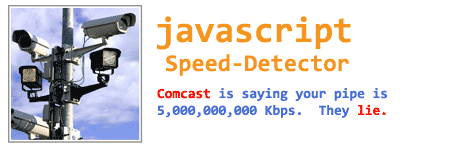

## [Connection Speed Detection with Javascript](http://alexle.net/archives/257 "Permanent Link to Connection Speed Detection with Javascript")

April  
22  
2008

[Ajax & Web 2.0](http://alexle.net/archives/category/web-technolgy/ajax-web-20 "View all posts in Ajax &amp; Web 2.0")  
[Server](http://alexle.net/archives/category/web-technolgy/server "View all posts in Server")  
[Tutorials](http://alexle.net/archives/category/tutorials "View all posts in Tutorials")  
[Web Scripting](http://alexle.net/archives/category/web-technolgy/web-scripting "View all posts in Web Scripting")  
[Web Technolgy](http://alexle.net/archives/category/web-technolgy "View all posts in Web Technolgy")

[view comments](http://alexle.net/archives/257#comments)  
[permalink](http://alexle.net/archives/257 "Permalink to Connection Speed Detection with Javascript")



Based on an [article on detection connection speed](http://www.thefutureoftheweb.com/blog/javascript-speed-detection) using JavaScript, I implemented a more completed speed detection solution which you can drop into your project with minimal fuss. An example would be to detect the user’s connection speed to show either high or low bandwidth version of the website. All the ingredients you need are an image, a small JavaScript snippet, and some imagination. There is no dependency and no other 3rd party library needed.

The main idea is that we load an image programmatically and measure the time it takes the browser to load such an file. Once an image is done loading, the browser will fire the onLoad event and we can capture the end time. I included two different versions of the code. The first one is quite simple with the image being loaded only once. The second one is more sophisticated, loading the image multiple times and taking the average loading time to arrive at a more accurate answer.

The key technique being used here are closure and passing functions as arguments. These two techniques are very commonly used in modern JavaScript frameworks such as Prototype, Scriptaculous, jQuery, Ext, YUI, etc.

In order for this technique to work, we need to have an image with an average size. Too small of an image won’t give us a very good result while too big of an image will cause more lags and affect the user’s experience. For your convenience, I included the a JPG image around 58.5KB in size as our testing image. We will need the exact size of the image in Bytes in order to calculate the bitrates or byte-rates.

**Simple Javascript Speed Detection**  
Insert this code snippet into the page where you want to conduct the speed test

[view plain](http://alexle.net/archives/257#)[copy to clipboard](http://alexle.net/archives/257#)[print](http://alexle.net/archives/257#)[?](http://alexle.net/archives/257#)

1. var SpeedTest = function() {
2. /\*
3. From:  http://techallica.com/kilo-bytes-per-second-vs-kilo-bits-per-second-kbps-vs-kbps/
4. 256 kbps            31.3 KBps
5. 384 kbps            46.9 KBps
6. 512 kbps            62.5 KBps
7. 768 kbps            93.8 KBps
8. 1 mbps ~ 1000kbps   122.1 KBps
9. \*/
10. };
11. SpeedTest.prototype = {
12. imgUrl: "speedtest.jpg"    // Where the image is located at
13. ,size: 59917                // bytes
14. ,run: function( options ) {
16. if( options && options.onStart )
17. options.onStart();
19. var imgUrl = this.imgUrl + "?r=" + Math.random();
20. this.startTime = (new Date()).getTime() ;
22. var testImage = new Image();
23. var me = this;
24. testImage.onload = function() {
25. me.endTime = (new Date()).getTime();
26. me.runTime = me.endTime - me.startTime;
28. if( options && options.onEnd )
29. options.onEnd( me.getResults() );
30. };
31. testImage.src = imgUrl;
32. }
34. ,getResults: function() {
35. if( !this.runTime )
36. return null;
38. return {
39. runTime: this.runTime
40. ,Kbps: ( this.size \* 8 / 1024 / ( this.runTime / 1000 ) )
41. ,KBps: ( this.size / 1024 / ( this.runTime / 1000 ) )
42. };
43. }
44. }

```
var SpeedTest = function() {
  /*
  From:  http://techallica.com/kilo-bytes-per-second-vs-kilo-bits-per-second-kbps-vs-kbps/
  256 kbps            31.3 KBps
  384 kbps            46.9 KBps
  512 kbps            62.5 KBps
  768 kbps            93.8 KBps
  1 mbps ~ 1000kbps   122.1 KBps
  */
};
SpeedTest.prototype = {
  imgUrl: "speedtest.jpg"    // Where the image is located at
  ,size: 59917                // bytes
  ,run: function( options ) {

    if( options && options.onStart )
      options.onStart();

    var imgUrl = this.imgUrl + "?r=" + Math.random();
    this.startTime = (new Date()).getTime() ;

    var testImage = new Image();
    var me = this;
    testImage.onload = function() {
      me.endTime = (new Date()).getTime();
      me.runTime = me.endTime - me.startTime;

      if( options && options.onEnd )
        options.onEnd( me.getResults() );
    };
    testImage.src = imgUrl;
  }

  ,getResults: function() {
    if( !this.runTime )
      return null;

    return {
      runTime: this.runTime
      ,Kbps: ( this.size * 8 / 1024 / ( this.runTime / 1000 ) )
      ,KBps: ( this.size / 1024 / ( this.runTime / 1000 ) )
    };
  }
}
```

First, we need to specify where we would load the image from (in this case, the relative path to the page) and the exact size of that image in Kilobytes. Since we don’t want the browser to cache the image, which short-circuits our test, we append a random number to the original image’s url (line 19). Before we run the test, we check to see if we need to run the onStart() functions being passed in. The idea is that you can show on the page with some messages or pop-up to notify about the test is about to run, simply by passing in an inline function.

The crux of the detection is from **line 23** to **line 30**. If you are new to JavaScript or you are not comfortable with Closure, you should [investigate a bit more](http://www.jibbering.com/faq/faq_notes/closures.html) since Closure is a critical and extremely powerful part of Object-Oriented JavaScript. In its simplest form of explanation, Closure means an anonymous function from a different execution context can gain access to another function’s internal properties.

In this case, after downloading the image, the browser fires the image’s onLoad event at a later time in a different execution context (the context of the current browser) other than context of our SpeedTest object. Without a closure reference via the variable “me” (line 23), which holds the reference to the SpeedTest object, we can no longer access to the startTime and endTime properties of the current SpeedTest object.

Now to run the test and obtain the results, all you have to do is to initialize a new SpeedTest object, execute the run() method, and pass in your custom actions. Currently 2 custom events onStart() and onEnd() are supported:

[view plain](http://alexle.net/archives/257#)[copy to clipboard](http://alexle.net/archives/257#)[print](http://alexle.net/archives/257#)[?](http://alexle.net/archives/257#)

1. var st = new SpeedTest();
2. st.run({
3. onStart: function() {
4. alert('Before Running Speed Test');
5. }
7. ,onEnd: function(speed) {
8. alert( 'Speed test complete:  ' + speed.Kbps + ' Kbps');
9. // put your logic here
10. if( speed.Kbps < 200 )
11. {
12. alert('Your connection is too slow');
13. }
14. }
15. });

```
var st = new SpeedTest();
st.run({
  onStart: function() {
    alert('Before Running Speed Test');
  }

  ,onEnd: function(speed) {
    alert( 'Speed test complete:  ' + speed.Kbps + ' Kbps');
    // put your logic here
    if( speed.Kbps < 200 )
    {
      alert('Your connection is too slow');
    }
  }
});
```

**The Multi-trial speed test**

As with any kind of measurements, one single measure is subjected to certain errors and inaccuracy. In our case, the degree of inaccuracy is much higher since connection speed fluctuates constantly. Other factors would affect the single-pass test is the initial DNS look-up speed and overhead, temporal network latency, slow browser, etc. Hence we can further improve our answers by taking multiple tests and average the results to get a more accurate number.

Below is a more sophisticated speed-detection code, which we can specify how many times the test is run. Typically 3 runs is good enough and it will not impact on the user’s experience.

[view plain](http://alexle.net/archives/257#)[copy to clipboard](http://alexle.net/archives/257#)[print](http://alexle.net/archives/257#)[?](http://alexle.net/archives/257#)

1. var SpeedTest = function() {
2. /\*
3. From:  http://techallica.com/kilo-bytes-per-second-vs-kilo-bits-per-second-kbps-vs-kbps/
4. 256 kbps            31.3 KBps
5. 384 kbps            46.9 KBps
6. 512 kbps            62.5 KBps
7. 768 kbps            93.8 KBps
8. 1 mbps ~ 1000kbps   122.1 KBps
9. \*/
10. };
11. SpeedTest.prototype = {
12. runCount: 3                 // how many times we want to run the test for
13. ,imgUrl: "speedtest.jpg"    // Where the image is located at
14. ,size: 59917                // bytes
15. ,run: function( options ) {
16. this.results = []; // reset the results
17. this.callback = ( options && options.onEnd ) ? options.onEnd : null;
18. this.runTrial(0, options);
19. }
21. ,runTrial: function(i, options ) {
22. var imgUrl = this.imgUrl + "?r=" + Math.random();
23. var me = this;
24. var testImage = new Image();
25. testImage.onload = function() {
26. me.results[i].endTime = ( new Date() ).getTime();
27. me.results[i].runTime = me.results[i].endTime - me.results[i].startTime;
29. if ( i < me.runCount - 1 )
30. me.runTrial( i + 1 ); // run the next trial
31. else
32. {
33. // Execute the callback
34. if( me.callback )
35. me.callback( me.getResults() );
36. }
37. };
38. this.results[i] = { startTime: ( new Date() ).getTime() };
39. testImage.src = imgUrl;
40. }
42. ,getResults: function() {
43. var totalRunTime = 0;
44. for( var i = 0; i < this.runCount; i++ )
45. {
46. if( !this.results || !this.results[i].endTime )
47. return null; // exit if we found no endTime.  --> test’s not done yet
48. else
49. totalRunTime += this.results[i].runTime;
50. }
52. var avgRunTime = totalRunTime / this.runCount;
54. return {
55. avgRunTime: avgRunTime
56. ,Kbps: ( this.size \* 8 / 1024 / ( avgRunTime / 1000 ) )
57. ,KBps: ( this.size / 1024 / ( avgRunTime / 1000 ) )
58. };
59. }
60. }

```
var SpeedTest = function() {
  /*
  From:  http://techallica.com/kilo-bytes-per-second-vs-kilo-bits-per-second-kbps-vs-kbps/
  256 kbps            31.3 KBps
  384 kbps            46.9 KBps
  512 kbps            62.5 KBps
  768 kbps            93.8 KBps
  1 mbps ~ 1000kbps   122.1 KBps
  */
};
SpeedTest.prototype = {
  runCount: 3                 // how many times we want to run the test for
  ,imgUrl: "speedtest.jpg"    // Where the image is located at
  ,size: 59917                // bytes
  ,run: function( options ) {
    this.results = []; // reset the results
    this.callback = ( options && options.onEnd ) ? options.onEnd : null;
    this.runTrial(0, options);
  }

  ,runTrial: function(i, options ) {
    var imgUrl = this.imgUrl + "?r=" + Math.random();
    var me = this;
    var testImage = new Image();
    testImage.onload = function() {
      me.results[i].endTime = ( new Date() ).getTime();
      me.results[i].runTime = me.results[i].endTime - me.results[i].startTime;

      if ( i < me.runCount - 1 )
        me.runTrial( i + 1 ); // run the next trial
      else
      {
        // Execute the callback
        if( me.callback )
          me.callback( me.getResults() );
      }
    };
    this.results[i] = { startTime: ( new Date() ).getTime() };
    testImage.src = imgUrl;
  }

  ,getResults: function() {
    var totalRunTime = 0;
    for( var i = 0; i < this.runCount; i++ )
    {
      if( !this.results || !this.results[i].endTime )
        return null; // exit if we found no endTime.  --> test’s not done yet
      else
        totalRunTime += this.results[i].runTime;
    }

    var avgRunTime = totalRunTime / this.runCount;

    return {
      avgRunTime: avgRunTime
      ,Kbps: ( this.size * 8 / 1024 / ( avgRunTime / 1000 ) )
      ,KBps: ( this.size / 1024 / ( avgRunTime / 1000 ) )
    };
  }
}
```

Even though our test method has changed, you can still use the same exact code as above to run the speed-test. The answer will be much more accurate this time. Basically we run multiple trials back-to-back, each time measuring the runtime and store it into an array, then average and get the final result.

Another small difference is that we have to store the reference to the user’s custom onEnd() method as a property of the SpeedTest object so that at the end of the test, we can execute it and return the answer to the user.

**Final words**

I hope you enjoy this article and make good use of the code. I packaged the 2 versions and the image into a zip file so just go ahead and have some fun. Go speed-racer!

**Download**

- [SpeedTest Package](http://alexle.net/wp-content/uploads/2008/04/speedtest.zip)
