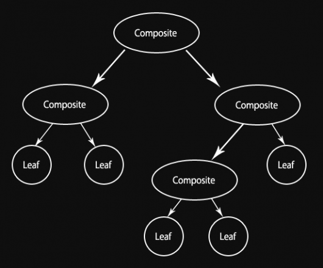
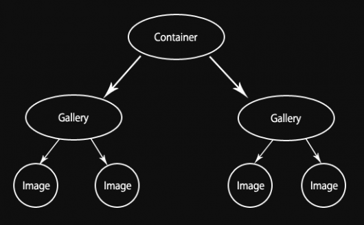

## [Javascript](http://imasters.com.br/secao/javascript)

# Padrão de projeto de software - JavaScript: Composite

Sexta-feira, 23/03/2012 às 11h00, por [Joe Zim](http://imasters.com.br/perfil/joezim)

Meu [último artigo](http://imasters.com.br/artigo/23855/javascript/padrao-de-projeto-de-software-javascript-bridge)  foi sobre o Design Pattern Bridge, dando continuidade à série “Padrões de projetos de JavaScript”, que começou com o [Singleton](http://imasters.com.br/artigo/23744/javascript/padrao-de-projeto-de-software-javascript-singleton) . Hoje mudamos para o padrão Composite. Composites são bastante úteis. Por definição da palavra "composite", Composites são compostos de várias peças para criar uma entidade inteira.

Estes são os dois principais benefícios que o padrão Composite oferece:

- Você pode tratar toda a coleção de objetos da mesma maneira que trataria qualquer um dos objetos individuais na coleção. Funções executadas no Composite são transmitidas a cada um dos filhos a serem executados. Em grandes coleções, isso se torna muito benéfico (embora também possa ser enganoso, pois você pode não perceber o quão grande é a coleta e, então, não entender o quanto o desempenho pode sofrer).
- Ele organiza os objetos em uma estrutura de árvore e, uma vez que cada objeto composite contém um método para obter seus filhos, você pode ocultar a implementação e organizar os filhos em qualquer forma que desejar.

#### Estrutura do padrão Composite

Na hierarquia dos padrões Composite, existem dois tipos de objetos: folha e composite. A imagem abaixo mostra um da estrutura do Composite. Ela é recursiva, que é o que dá força a esse padrão. A diferença entre os objetos composite e as folhas é que as folhas não possuem filhos, enquanto que a essência de um composite é que ele os tenha.



#### Exemplos do padrão Composite

Há vários exemplos de certa forma comuns do padrão Composite. Se já usou um PC, você mais que provavelmente já viu uma implementação frequentemente usada desse padrão: a estrutura do arquivo. Considere cada disco/drive e pasta como um objeto composite e que cada arquivo seja uma folha. Ao tentar excluir uma pasta, ele não só vai apagar essa pasta, mas também todas as outras e os arquivos contidos nelas. Você realmente não obterá um exemplo muito melhor do que esse.

Outro exemplo que é um tipo especial de composite é a árvore binária. Se você não souber o que é isso, deveria ver [este artigo da Wikipedia sobre a árvore binária](http://en.wikipedia.org/wiki/Binary_search_tree) . Ela é especial porque cada nó pode conter no máximo dois filhos. Além disso, os pedaços de folhas e composites são exatamente os mesmos. Composites representam um valor final, assim como as folhas, e elas podem se tornar composite a qualquer momento, dando-lhes filhos. Ela também é otimizada para ser usada principalmente para pesquisar através de dados classificáveis.

Se você olhar em volta, tenho certeza de que encontrará mais alguns exemplos. Você pode até mesmo ver alguns implementados usando JavaScript.

#### Nosso exemplo JavaScript do padrão Composite

Para demonstrar o padrão Composite utilizando JavaScript, não usarei nenhum dos exemplos acima. Ao invés disso, farei uma galeria de imagens. É realmente muito parecido com o exemplo do sistema de arquivos, exceto que isso não precisa refletir o lugar em que as imagens são armazenadas ou organizadas no disco, e a intenção é ter apenas um certo número de níveis. Veja a imagem abaixo:



Repare que, na minha imagem, todas as imagens estão contidas dentro de composites no nível "Galeria". Isso não é necessário, nem será aplicado no código, mas é como elas deveriam ser idealmente organizadas.

Cada um dos objetos na hierarquia precisa implementar uma determinada interface. Uma vez que o JavaScript não tem interfaces, só precisamos ter a certeza de implementar certos métodos. Abaixo está a lista deles e que fazem:

**Métodos específicos do composite**

- add: adiciona um nó filho para esse composite
- remove: remove um nó filho desse composite (ou um em um nível mais profundo)
- getChild: retorna um objeto filho

**Métodos específicos de galeria**

- hide: esconde o composite e todos os seus filhos
- show: mostra o composite e todos os seus filhos

**Métodos auxiliares**

- getElement: obtém o elemento HTML do nó

Primeiro, mostrarei o JavaScript para implementar o GalleryComposite usando esta interface. Pode ser interessante notar que usarei a [biblioteca JavaScript jQuery](http://jquery.com/)  para me ajudar com alguns dos trabalhos DOM.

```
    var GalleryComposite = function (heading, id) {
     this.children = [];
     
     this.element = $('<div id="' + id + '" class="composite-gallery"></div>')
      .append('<h2>' + heading + '</h2>');
    }
     
    GalleryComposite.prototype = {
     add: function (child) {
      this.children.push(child);
      this.element.append(child.getElement());
     },
     
     remove: function (child) {
      for (var node, i = 0; node = this.getChild(i); i++) {
       if (node == child) {
        this.children.splice(i, 1);
        this.element.detach(child.getElement());
        return true;
       }
       
       if (node.remove(child)) {
        return true;
       }
      }
     
      return false;
     },
     
     getChild: function (i) {
      return this.children[i];
     },
     
     hide: function () {
      for (var node, i = 0; node = this.getChild(i); i++) {
       node.hide();
      }
     
      this.element.hide(0);
     },
     
     show: function () {
      for (var node, i = 0; node = this.getChild(i); i++) {
       node.show();
      }
     
      this.element.show(0);
     },
     
     getElement: function () {
      return this.element;
     }
    }
```

Em seguida, vamos implementar as imagens usando GalleryImage:

```
    var GalleryImage = function (src, id) {
     this.children = [];
     
     this.element = $('')
      .attr('id', id)
      .attr('src', src);
    }
     
    GalleryImage.prototype = {
     // Due to this being a leaf, it doesn't use these methods,
     // but must implement them to count as implementing the
     // Composite interface
     add: function () { },
     
     remove: function () { },
     
     getChild: function () { },
     
     hide: function () {
      this.element.hide(0);
     },
     
     show: function () {
      this.element.show(0);
     },
     
     getElement: function () {
      return this.element;
     }
    }
```

Observe que a classe GalleryImage não faz nada nas funções *add*, *remove* e *getChild*. Como ela é a classe folha, não contém filhos, de modo que não faz nada para esses métodos. No entanto, é preciso incluir essas funções, a fim de cumprir com a interface que montamos. Afinal, os objetos composite não sabem o que é uma folha e podem tentar chamar esses métodos.

Agora que as classes foram criadas, vamos escrever um pouco de código JavaScript que as utiliza para criar e mostrar uma galeria real. Embora este exemplo só mostre o uso de três dos métodos exemplificados acima, é possível estender este código para criar uma galeria dinâmica, na qual os usuários podem adicionar e remover imagens e pastas facilmente.

```
    var container = new GalleryComposite('', 'allgalleries');
    var gallery1 = new GalleryComposite('Gallery 1', 'gallery1');
    var gallery2 = new GalleryComposite('Gallery 2', 'gallery2');
    var image1 = new GalleryImage('image1.jpg', 'img1');
    var image2 = new GalleryImage('image2.jpg', 'img2');
    var image3 = new GalleryImage('image3.jpg', 'img3');
    var image4 = new GalleryImage('image4.jpg', 'img4');
     
    gallery1.add(image1);
    gallery1.add(image2);
     
    gallery2.add(image3);
    gallery2.add(image4);
     
    container.add(gallery1);
    container.add(gallery2);
     
    // Make sure to add the top container to the body,
    // otherwise it'll never show up.
    container.getElement().appendTo('body');
    container.show();
```

Você pode ver a demo do código na [página Composite Pattern Demo](http://www.joezimjs.com/composite-pattern-demo-page/) . Você pode também ver o código fonte dessa página para observar que nenhum dos álbuns ou das imagens foi criado anteriormente para usar HTML, mas foram adicionados ao DOM por meio do nosso código JavaScript.

#### Vantagens e desvantagens do padrão Composite

Você pode ver os surpreendentes benefícios de sempre serem capazes de acionar simplesmente uma função em um objeto de nível superior e ter os resultados acontecendo em qualquer um ou todos os nós da estrutura composite. O código torna-se muito mais fácil de usar. Além disso, os objetos no composite são fracamente acoplados, porque todos eles seguem simplesmente a mesma interface. Finalmente, o composite dá uma boa estrutura para os objetos, ao invés de manter todos eles em variáveis separadas ou em um array.

No entanto, como mencionado anteriormente, o padrão Composite pode ser enganoso. Efetuar uma chamada a uma única função pode ser tão fácil que você pode não perceber o efeito adverso que terá no desempenho se o composite aumentar muito.

O padrão Composite é uma ferramenta poderosa, mas, como muitos sabem, "com grande poder vem grande responsabilidade." Use o padrão Composite sabiamente e você estará a um passo de se tornar um guru em JavaScript.

*⁂*  
*Texto original disponível em [http://www.joezimjs.com/JavaScript/JavaScript-design-patterns-Composite/](http://www.joezimjs.com/javascript/javascript-design-patterns-composite/)*
