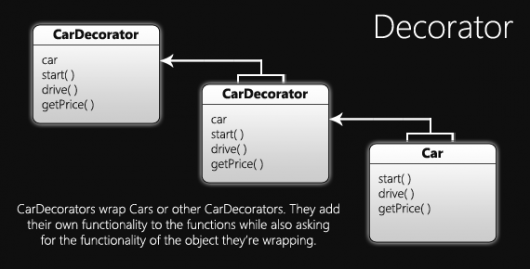

## [Javascript](http://imasters.com.br/secao/javascript)

# Padrão de projeto de software - JavaScript: Decorator

Quarta-feira, 28/03/2012 às 10h30, por [Joe Zim](http://imasters.com.br/perfil/joezim)

Hoje gostaria de mostrar um outro Padrão de projeto de software JavaScript: o Decorator, que é uma maneira de adicionar recursos a objetos sem subclassificar ou adicionar atributos extras. Este artigo continua a série “Padrão de projeto de software JavaScript. O artigo anterior pode ser lido [aqui](http://imasters.com.br/artigo/23898/javascript/padrao-de-projeto-de-software-javascript-composite) .

#### Começando com o padrão Decorator

Como eu disse, esse padrão nos permite adicionar funcionalidades a um objeto sem a necessidade de subclasse. Em vez disso, o "decorate" (wrap) com outro objeto com a mesma interface que tem o recurso que estamos adicionando. Para ter uma ideia melhor do que estou falando, vamos primeiro demonstrar como alguém sem conhecimento desse padrão tentaria isso, especialmente se eles estão vindo de um background de herança clássica.

```
    // Superclass
    var Car = function() {…};
     
    // Subclasses with different features
    var CarWithPowerLocks = function() {…};
    var CarWithPowerWindows = function() {…};
    var CarWithPowerLocksAndPowerWindows = function() {…};
    var CarWithAC = function() {…};
    var CarWithACAndPowerLocks = function() {…};
    var CarWithACAndPowerWindows = function() {…};
    var CarWithACAndPowerLocksAndPowerWindows = function() {…};
    …
```

Como você pode ver, cada combinação de características precisa ser representada por uma nova "classe". Isso pode ser bom se você tiver apenas algumas características, mas, uma vez que você começa a aumentar o número de recursos, isso se torna cada vez mais um pesadelo. Claro, se quer ser um idiota, você pode fazer isso em um aplicativo e deixar para alguém manter, mas eu não sei por quanto tempo você duraria antes de ser socado no rosto se o programador precisar incluir outro recurso (ou 5 mais!).

#### Como o padrão Decorator pode ajudar

Felizmente, o padrão Decorator pode tornar as coisas consideravelmente mais simples para nós e para mantenedores futuros de nosso código. Primeiro, vamos criar o objeto de base que será um *Car* sem recursos interessantes. Isso também configura a interface que os decorators vão usar.

```
    var Car = function() {
        console.log('Assemble: build frame, add core parts');
    }
     
    // The decorators will also need to implement these functions
    // to comply with Car's interface.
    Car.prototype = {
        start: function() {
            console.log('The engine starts with roar!');
        },
        drive: function() {
            console.log('Away we go!');
        },
        getPrice: function() {
            return 11000.00;
        }
    }
```

Agora, vamos criar a "classe" decorator que cada decorator vai herdar. Você notará que cada uma das funções simplesmente passa o cursor no *Car* que estão selecionando. Nesse caso, as únicas funções que serão substituídas são *assemble* e *getPrice*.

```
    // You need to pass in the Car (or CarDecorator) in order to
    // be able to add features to it.
    var CarDecorator = function(car) {
        this.car = car;
    }
     
    // CarDecorator is implementing the same interface
    CarDecorator.prototype = {
        start: function() {
            this.car.start();
        },
        drive: function() {
            this.car.drive();
        },
        getPrice: function() {
            return this.car.getPrice();
        }
    }
```

Em seguida, criamos um objeto decorator para cada recurso e substituímos as funções dos pais sempre que quisermos adicionar mais ou diferentes funcionalidades lá.

```
    var PowerLocksDecorator = function(car) {
        // JavaScript's way of calling a parent class' constructor
        CarDecorator.call(this, car);
        console.log('Assemble: add power locks');
    }
    PowerLocksDecorator.prototype = new CarDecorator();
    PowerLocksDecorator.prototype.drive = function() {
        // You can either do this
        this.car.drive();
        // or you can call the parent's drive function:
        // CarDecorator.prototype.drive.call(this);
        console.log('The doors automatically lock');
    }
     
    var PowerWindowsDecorator = function(car) {
        CarDecorator.call(this, car);
        console.log('Assemble: add power windows');
    }
    PowerWindowsDecorator.prototype = new CarDecorator();
     
    var ACDecorator = function(car) {
        CarDecorator.call(this, car);
        console.log('Assemble: add A/C unit');
    }
    ACDecorator.prototype = new CarDecorator();
    ACDecorator.prototype.start = function() {
        this.car.start();
        console.log('The cool air starts blowing.');
    }
```

Observe que sempre chamamos a mesma função sobre o objeto wrapped. Isso é um pouco semelhante à maneira como funciona um composite, embora as semelhanças entre os dois padrões terminem por aí. Neste exemplo, nós sempre usamos a função do objeto wrapped primeiro, antes de adicionar as novas informações do decorator (se existir alguma para essa função). Isso cria o efeito desejado de ter as funções principais sendo executadas em primeiro lugar, mas outros aplicativos podem requerer ordem diferente, ou, eventualmente, podem até não chamar a função do objeto wrapped, se a intenção é mudar completamente a funcionalidade em vez de adicionar a ela.



#### Vendo nosso JavaScript em ação

Então, como usaremos o código que acabamos de passar todo esse tempo fazendo? Bem, o código atual está abaixo, mas talvez eu deva dar uma explicação primeiro. Claro, você é livre para pulá-la e ir direto para o código, se achar que já consegue resolver isso.

Primeiro, vamos criar um objeto *Car*. Então, criamos o decorator para a função que queremos adicionar nele e passamos o *Car* para seu construtor. O objeto retornado do construtor do decorator é atribuído de volta para a variável que anteriormente detinha o objeto *Car*, porque desde que os decoradores usem a mesma interface, eles também podem ser considerados *Cars*. Continuamos adicionando mais recursos até que estejamos satisfeitos e, em seguida, temos o nosso *Car* desejado, e podemos fazer o que quisermos com ele.

```
    var car = new Car();                    // log "Assemble: build frame, add core parts"
     
    // give the car some power windows
    car = new PowerWindowDecorator(car);    // log "Assemble: add power windows"
     
    // now some power locks and A/C
    car = new PowerLocksDecorator(car);     // log "Assemble: add power locks"
    car = new ACDecorator(car);             // log "Assemble: add A/C unit"
     
    // let's start this bad boy up and take a drive!
    car.start(); // log 'The engine starts with roar!' and 'The cool air starts blowing.'
    car.drive(); // log 'Away we go!' and 'The doors automatically lock'
```

#### Concluindo este fiasco

O Decorator prova ser uma boa maneira de manter funcionalidades diferenciadas para um objeto e, definitivamente, ajuda a melhorar a manutenção a longo prazo. Você pode ter notado, no entanto, que não incluí nenhum código para me certificar de que nós não adicionaríamos, acidentalmente, o mesmo recurso mais de uma vez.

Se você tem algo a dizer sobre o padrão Decorator, este artigo, ou apenas JavasScript em geral, faça sua voz ser ouvida na seção de comentários abaixo. Feliz codificação!

*⁂*

*Texto original disponível em <http://www.joezimjs.com/javascript/javascript-design-patterns-decorator/>*
