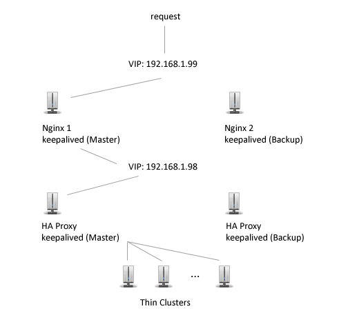

# [Setting up a High Availability Ruby on Rails environment with keepalived, nginx, HA Proxy and Thin on Debian Lenny](http://sleekd.com/general/keepalived_nginx_haproxy_thin_ruby_on_rails/ "Setting up a High Availability Ruby on Rails environment with keepalived, nginx, HA Proxy and Thin on Debian Lenny")

Posted on May 15 in **[General](http://sleekd.com/category/general/ "View all posts in General") , [Ruby on Rails](http://sleekd.com/category/rails/ "View all posts in Ruby on Rails") , [Scalability](http://sleekd.com/category/scalability/ "View all posts in Scalability") , [Tutorials](http://sleekd.com/category/tutorials/ "View all posts in Tutorials")**  | *[(10) Comments](http://sleekd.com/general/keepalived_nginx_haproxy_thin_ruby_on_rails/#comments "Comment on Setting up a High Availability Ruby on Rails environment with keepalived, nginx, HA Proxy and Thin on Debian Lenny")*

## Contents

- Configure Keepalived and Nginx
- Configure HA Proxy
- Configure Thin

## Overview

Nginx and HA Proxy have similar functions: they can both be used as reverse proxies and load balancers. In our case Nginx will be the reverse proxy and HA Proxy will be the load balancer. Nginx is great for dealing with SSL encryption, gzip compression or talking to a cache server (Varnish, memcached).

HA Proxy can control the maximum connections sent to a Thin server which is great because we can queue the users at the load balancer level (HA Proxy) instead of the backend level (Thin servers). HA proxy will health check the Thin servers and only send requests if they are ready to receive connections.

## 



Because all our requests are coming in through Nginx we have a single point of failure: if the server would go down our website will be unavailable. To fix this we’ll configure two servers running Nginx and keepalived. The servers will health check each other and if one of them goes down the other one will take over the Virtual IP (VIP) that points to our website.

*Edit: As Christian Winkler pointed out, this setup is not entirely fail-over. If something were to happen to the HA Proxy server the web server would be unavailable to take requests. This can be solved by adding another HA Proxy machine to the mix and configuring keepalived, similar to the Nginx boxes.*

## Configure Keepalived and Nginx

First let’s install Debian Lenny on our fist reverse proxy (Nginx 1). You can download a Vmware image of Debian Lenny from [thoughpolice.co.uk](http://www.thoughtpolice.co.uk/vmware/)  and run it with the free Vmware Player. The image has 256mb of RAM by default. You can find a very useful article on securing Debian Lenny at [slicehost.com](http://articles.slicehost.com/2009/3/31/debian-lenny-setup-page-1) . If you are using the image. edit /etc/apt/sources.list and add the following two lines to be able to use apt-get to install all the required programs:

```
deb http://ftp.debian.org/debian lenny main
deb-src http://ftp.debian.org/debian lenny main
```

### Installing Keepalived

We install keepalived using apt-get:

```
apt-get install keepalived
```

Next we are going to allow processes to bind non-local IP addresses. Edit /etc/sysctl.conf

```
 nano /etc/sysctl.conf
```

Set net.ipv4.ip\_nonlocal\_bind

```
net.ipv4.ip_nonlocal_bind=1
```

```
sysctl -p
```

To configure keepalived we need to edit the keepalived.conf at /etc/keepalived/keepalive.conf

```
vrrp_instance VI_1 {
 interface eth0
 state MASTER
 lvs_sync_daemon_interface eth0
 priority 150
 advert_int 1

 authentication {
   auth_type PASS
   auth_pass yourpassword
 }
virtual_router_id 51

virtual_ipaddress {
   192.168.1.99
 }
}
```

We set the state to MASTER because this is the main reverse proxy. Only one of the two Nginx proxies will listen to the 192.168.1.99 address at any one time. When the MASTER goes down the BACKUP will take over the VIP address. The lvs\_sync\_daemon\_interface eth0 option enables the MASTER to save the connection state and sync it with the BACKUP.

Repeat the same steps to configure keepalived for the BACKUP (Nginx2). Here’s is the keepalived.conf on the BACKUP server:

```
vrrp_instance VI_1 {
 interface eth0
 state BACKUP
 lvs_sync_daemon_interface eth0
 priority 100
 advert_int 1

 authentication {
   auth_type PASS
   auth_pass yourpassword
 }
 virtual_router_id 51

 virtual_ipaddress {
   192.168.1.99
 }
```

The BACKUP configuration is not much different to the MASTER except the state BACKUP and priority which is set to a lower value than the MASTER.

Check if the MASTER is listening to 192.168.1.99 by typing:

```
ip addr sh
```

This is a sample output:

```
inet 192.168.1.145/24 brd 192.168.52.255 scope glocal eth0
inet 192.168.1.99/32 scope global eth0
```

Test if the BACKUP listens to the IP by restarting the MASTER and typing ip addr sh on the BACKUP machine.

### Installing Nginx

Repeat the following steps for both the MASTER and BACKUP machines.

```
apt-get install nginx
```

Edit the /etc/nginx/nginx.conf file. We will keep all the default settings and add a server and upstream directive to the http section.

```
http {
  # ... Leave the default config options here

upstream haproxy_server {
  server 192.168.1.98:3100;
}

server {
  listen 80;
  server_name nginxserver;

  location / {
  proxy_pass http://haproxy_server;
  proxy_set_header X-Real-IP $remote_addr;
  proxy_set_header Host $host;
  proxy_set_header X-Forwarded-For $proxy_add_x_forwarded_for;
  }

 } #end server

} #end http
```

We configured Nginx to proxy all requests to an upstream HA Proxy server located at 192.168.1.101 and listening to the port 3100. We could have added more upstream servers and have Nginx load balance them on top of HA Proxy but according to my http\_load benchmarks there is no increase in performance.

## Configure HA Proxy and Keepalived

HA Proxy and keepalived will be installed on two machines similar to the Nginx boxes. The VIP of the HA Proxy will be 192.168.1.98. HA Proxy will load balance the requests to a cluster of 5 Thin servers listening on ports 3000-3004 installed on a separate box with the IP of 192.168.1.101.

Let’s install it using apt-get:

```
apt-get install haproxy
```

Now we have to edit the configuration file:

```
nano /etc/haproxy/haproxy.cfg
```

Add the following lines:

```
global
     log 127.0.0.1   local0
     log 127.0.0.1   local1 notice
     maxconn 10000
     user haproxy
     group haproxy
     daemon
     nbproc  1

defaults
     log     global
     mode    http
     contimeout      5000
     clitimeout      50000
     srvtimeout      50000
     balance roundrobin

listen webfarm *:3100
mode    http
option  forwardfor
cookie  SERVERID insert indirect nocache
option  httpclose
option redispatch
server  web1 192.168.1.101:3000 cookie A check inter 6000 maxconn 1
server  web2 192.168.1.101:3001 cookie A check inter 6000 maxconn 1
server  web3 192.168.1.101:3002 cookie A check inter 6000 maxconn 1
server  web4 192.168.1.101:3003 cookie A check inter 6000 maxconn 1
server  web5 192.168.1.101:3004 cookie A check inter 6000 maxconn 1

listen admin_stats *:8080
       mode http
       stats uri /my_stats
       stats realm Global\ statistics
       stats auth username:password
```

Notice the maxconn option that is set to 10000 connections. The load balancing will be done using roundrobin. HA Proxy will listen to port 3100. The cookie option is important if you have a Ruby on Rails app that requires authentication based on cookies. Also, the configuration option that sends only one request to each Thin cluster: maxconn 1.

HA Proxy has a neat admin interface where we can visually see all the connections to the backend Thin clusters. You can access it by browsing to http://192.168.1.98:8080/my\_stats. Enter the username and password you used in the HA Proxy config file and you’re good to go. If you check it now all the connections will be red because there are no Thin servers listening to those ports.

### Keepalived and HA Proxy

Follow the previous steps to install keepalived on both HA Proxy machines. The configuration options are identical except the **virtual\_ipaddress** directive which in this case will be set to **192.168.1.98**.

## Configure Thin

I will assume you have a working Ruby on Rails environment. We’ll install Thin server first.

```
gem install thin
```

Next let’s install an open source RoR app to test our setup. I have seen Eldorado (full-stack community web application) in many benchmark tests so I decided to use it. These are the installation steps taken from the project’s [github](http://github.com/trevorturk/eldorado/) :

```
git clone git://github.com/trevorturk/eldorado.git
cd eldorado
cp config/database.example.yml config/database.yml
cp config/config.example.yml config/config.yml
rake gems:install
rake db:create
rake db:schema:load
```

Configure your database and make sure the app starts by typing **script/server** in the eldorado folder.

Now to configure Thin to start this app:

```
thin config -C /etc/thin/eldorado.yml -c /var/rails/eldorado
--servers 5 -e production
```

The -C option sets the location where all our thin config files are located : /etc/thin. The -c option sets the location of the Rails app: /var/rails/eldorado.

Edit the file we just created:

```
nano /etc/thin/eldorado.yml
```

Check that the starting port is 3000. I also set the address to 192.168.1.101 to match the HA Proxy configuration.

```
pid: tmp/pids/thin.pid
log: log/thin.log
timeout: 30
max_conns: 1024
port: 3000
max_persistent_conns: 512
chdir: /var/rails/eldorado
environment: production
servers: 4
address: 192.168.1.101
daemonize: true
```

Now we start the thin server:

```
thin -C /etc/thin/eldorado.yml start
```

Check the HA Proxy status page (**http://192.168.1.98:8080/my\_stats**) to see the Thin clusters going online (you have to refresh a few times). Now you can check the Rails app using the VIP address we configured in the first steps: **http://192.168.1.99**.

This setup is flexible because we can easily add an HTTP caching server like Varnish to sit between Nginx and HA Proxy to decrease the load on our backend Thin clusters. Nginx call also accomodate for a memory cache server like memcached with a few modifications to the nginx.conf file. We’ll leave that and the benchmarks of this setup for a future article.

### Related Posts

- [Configuring Nginx and Unicorn](http://sleekd.com/general/configuring-nginx-and-unicorn/ "Configuring Nginx and Unicorn")


#### Author: [Razvan](http://razvandraghici.com/)

Razvan is a Toronto based scalability consultant, UI designer and Ruby on Rails developer. He is the co-founder of Wisecat Media Inc.

### Comments

1. Christian Winkler |
   [May 19th, 2010](#comment-133)

   Interesting article, but I don’t understand the setup. Why create two nginx in a failover setup when you only have a single HA proxy (as a single point of failure)?

   An alternative setup could be to use mod\_passenger directly in the frontend nginx servers (which spawns processes as needed) and omit the whole HA proxy part. Probably even faster and really HA.
2. You have a good point about the single point of failure. I can fix that by either setting up two HA proxy boxes and have nginx load balance the requests or install keepalived and have fail over at the load balancer level as well.

   I used HA Proxy because it gives me a nice web interface to check the backend servers and to limit the connections to each Thin cluster (this way I can queue the requests at the load balancer level and only use Thin clusters that are ready to receive connections).

   I will look into mod\_passenger for speed comparisons but from what I’ve read nginx can’t limit the connections to upstream servers (<http://nginx.2469901.n2.nabble.com/Limiting-number-of-connections-to-upstream-servers-td4969422.html>)
3. Christian Winkler |
   [May 19th, 2010](#comment-136)

   You don’t have upstream servers in this setup, as everything is handled by mod\_passenger and it has some options for limiting the number of ruby processes (which can even share some data IIRC).

   But definitely nginx does not have a nice status page (yet).
4. Christian you are right about mod\_passenger, I saw the screencast on the Passenger’s website. Compiling nginx with mod\_passenger should give better performance.

   I will write a separate article and compare the two setups. Thanks for your input!
5. Your post has been linked at the Drink Rails blog as one of the top ruby on rails blogs of the day.
6. [...] Continue reading here: Sleekd » Setting up a High Availability Ruby on Rails environment … [...]
7. [...] Sleekd Setting up a High Availability Ruby on Rails environment with keepalived, nginx, HA Proxy and… [...]
8. [...] Continue reading here: Sleekd » Setting up a High Availability Ruby on Rails environment … [...]
9. [...] Sleekd » Setting up a High Availability Ruby on Rails environment with keepalived, nginx, HA P… – August 20th ( tags: nginx rails haproxy thin performance ruby scalability deployment guide example tutorial ) [...]
10. Matt |
    [Dec 21st, 2011](#comment-278)

    It appears that the way you have keepalived setup, it won’t fail over if just the nginx and/or haproxy service fails. You need a vrrp\_script to check for the running process and give it a weight.

    The way you have it setup, it will only fail over when the other server looses network connection to the other. You can test by shutting down nginx or haproxy and watching to see if it fails over.

    Also, you can run haproxy and nginx on the same box and have the vrrp\_script check both processes and failover to your other server if either of those processes are not running.
