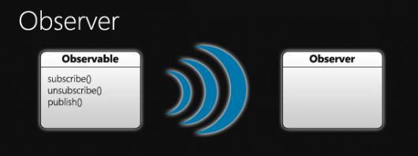

É hora de apresentar a vocês o padrão Observer, que dá seguimento à série de Padrão de projeto de software - JavaScript.

  



  

#### O que é o padrão Observer

  

O padrão Observer é um conceito bastante simples. Um observer (conhecido como assinante) assina um objeto observable (conhecido como editora), à espera de algo de seu interesse acontecer. Observers também são capazes de cancelar a assinatura do observador. Nesse ponto, o comportamento é dependente da forma como você implementou o padrão. Existem dois métodos básicos para observers obterem informações sobre o que está acontecendo: push e pull. No método push, sempre que algo acontece, o observable notifica imediatamente os observers do evento. No método pull, o observer irá verificar com o observable para ver se alguma coisa mudou quando o observer sentir a necessidade de verificar.

  

Aposto que você quer ver um exemplo. Claro que sim! Você é um programador e para você o seu código faz mais sentido do que falatório, certo? Vamos começar com um exemplo do método push:

  

```
  var Observable = function() {  
   
  this.subscribers = [];  
   
  }  
   
   
  Observable.prototype = {  
   
  subscribe: function(callback) {  
   
  // In most situations, you would check to see if the  
   
  // callback already exists within the subscribers array,  
   
  // but for the sake of keeping us on track and because  
   
  // this isn't necessarily included, we'll leave it out.  
   
  // Just add the callback to the subscribers list  
   
  this.subscribers.push(callback);  
   
  },  
   
  unsubscribe: function(callback) {  
   
  var i = 0,  
   
  len = this.subscribers.length;  
   
   
  // Iterate through the array and if the callback is  
   
  // found, remove it.  
   
  for (; i < len; i++) {  
   
  if (this.subscribers[i] === callback) {  
   
  this.subscribers.splice(i, 1);  
   
  // Once we've found it, we don't need to  
   
  // continue, so just return.  
   
  return;  
   
  }  
   
  }  
   
  },  
   
  publish: function(data) {  
   
  var i = 0,  
   
  len = this.subscribers.length;  
   
   
  // Iterate over the subscribers array and call each of  
   
  // the callback functions.  
   
  for (; i < len; i++) {  
   
  this.subscribers[i](data);  
   
  }   
   
  }  
   
  };  
   
   
  var Observer = function (data) {  
   
  console.log(data);  
   
  }  
   
   
  // Here's where it gets used.  
   
  observable = new Observable();  
   
  observable.subscribe(Observer);  
   
  observable.publish('We published!');
```

  

Existem algumas coisas para falar aqui. Primeiro, todas as funções relacionadas com o padrão Observer são executadas dentro de *Observable*. Com a flexibilidade do JavaScript, você também pode tornar o observer capaz de fazer a inscrição e o cancelamento, mas acredito que seja mais sensível e compreensível implementar tudo isso dentro do objeto observable. Outro ponto digno de atenção é que o observador é simplesmente uma função que pode ser usada como uma callback.

  

Em linguagens como Java, um observador seria um objeto que implementa uma interface especificada. Então todo o objeto seria inscrito, e o observable simplesmente chamaria o método especificado pela interface observer. Finalmente, no presente exemplo, Observable é a classe que pode ser usada sozinha, embora seja muito mais útil ser herdada por outros objetos de modo que eles possam se tornar observáveis.

  

Agora vamos implementar o método pull do padrão Observer. Quando você estiver usando o método pull, faz mais sentido trocar as coisas um pouco:

  

```
  Observable = function() {  
   
  this.status = "constructed";  
   
  }  
   
  Observable.prototype.getStatus = function() {  
   
  return this.status;  
   
  }  
   
   
  Observer = function() {  
   
  this.subscriptions = [];  
   
  }  
   
  Observer.prototype = {  
   
  subscribeTo: function(observable) {  
   
  this.subscriptions.push(observable);  
   
  },  
   
  unsubscribeFrom: function(observable) {  
   
  var i = 0,  
   
  len = this.subscriptions.length;  
   
   
  // Iterate through the array and if the observable is  
   
  // found, remove it.  
   
  for (; i < len; i++) {  
   
  if (this.subscriptions[i] === observable) {  
   
  this.subscriptions.splice(i, 1);  
   
  // Once we've found it and removed it, we  
   
  // don't need to continue, so just return.  
   
  return;  
   
  }  
   
  }   
   
  }  
   
  doSomethingIfOk: function() {  
   
  var i = 0;  
   
  len = this.subscriptions.length;  
   
   
  // Iterate through the subscriptions and determine  
   
  // whether the status has changed to ok on each of them,  
   
  // and do something for each subscription that has  
   
  for (; i < len; i++) {  
   
  if (this.subscriptions[i].getStatus() === "ok") {  
   
  // Do something because the status of the  
   
  // observable is what we want it to be  
   
  }  
   
  }  
   
  }  
   
  }  
   
   
  var observer = new Observer(),  
   
  observable = new Observable();  
   
  observer.subscribeTo(observable);  
   
   
  // Nothing will happen because the status hasn't changed  
   
  observer.doSomethingIfOk();  
   
   
  // Change the status to "ok" so now something will happen  
   
  observable.status = "ok";  
   
  observer.doSomethingIfOk();
```

  

Isso é bastante diferente da forma como push faz as coisas, não é? Agora, sempre que o observer ficar como deveria ser - ou, neste caso, sempre que eu disser a ele - ele vai verificar o estado do observable no qual ele está inscrito. Normalmente, isso seria em um temporizador ou algo assim, mas eu decidi mantê-lo simples e basta chamá-lo manualmente. Mais uma vez *Observable* nesse código não deve, tecnicamente, ser usado sozinho. Em vez disso, deve ser subclassificado de modo que não sejam construídos em mecanismos que alteram o estado, em vez de mudá-lo manualmente, como eu fiz no exemplo.

  

#### Os padrões Observer que você já viu

  

Os exemplos que eu dei são muito simples e, geralmente, um objeto observable pode possuir mais de um tipo de evento a ser observado. Falando em eventos, você pode ou não ter percebido que a manipulação de eventos em elementos DOM é uma implementação do padrão Observer. Ele está em toda parte, é muito poderoso e útil. Além disso, muitos plugins jQuery que usam animações incluirão o padrão Observer para que você possa injetar sua própria funcionalidade em diferentes pontos de uma animação.

  

#### Eu “observe” que o fim está próximo

  

O padrão Observer é uma ferramenta maravilhosa para a manutenção e a organização de grandes ações baseadas em aplicações ou mesmo apenas para fazer o seu plugin jQuery mais acessível e flexível. Ele adiciona um bom nível de abstração para ajudar a separar o seu código e mantê-lo simples e sustentável. Obviamente, o padrão Observer não deve ser usado para tudo, mas ele pode ser bastante útil em inúmeras situações.

  

Se não viu ainda, você deveria conferir [JZ Publish/Subscribe](http://www.joezimjs.com/projects/publish-subscribe-jquery-plugin/) para ver de que outra maneira o padrão Observer pode ser implementado. Você pode até mesmo ver [como e por que você deve usá-lo](http://www.joezimjs.com/javascript/how-and-why-jz-publish-subscribe-should-be-used/).

  

*⁂*

  

*Texto original disponível em  <http://www.joezimjs.com/javascript/javascript-design-patterns-observer/>*

  
[anexo ausente]  
  

[](http://share.feedsportal.com/viral/sendEmail.cfm?lang=pt&amp;title=Padr%C3%A3o+de+projeto+de+software+-+JavaScript%3A+Observer&amp;link=http%3A%2F%2Fimasters.com.br%2Fartigo%2F24164%2Fjavascript%2Fpadrao-de-projeto-de-software-javascript-observer)

  

[](http://res.feedsportal.com/viral/bookmark_pt.cfm?title=Padr%C3%A3o+de+projeto+de+software+-+JavaScript%3A+Observer&amp;link=http%3A%2F%2Fimasters.com.br%2Fartigo%2F24164%2Fjavascript%2Fpadrao-de-projeto-de-software-javascript-observer)

  
  
  
[](http://da.feedsportal.com/r/132918353956/u/49/f/546640/c/33212/s/1ec4331c/a2.htm) [anexo ausente]  
  
[anexo ausente]  
  
  
  
  
from iMasters - <http://feedproxy.google.com/~r/imasters/~3/dGrsdVMKNFY/story01.htm>
