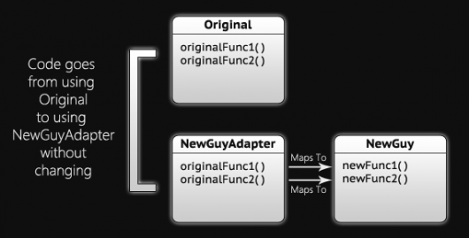

### Sent to you by Thiago Silva via Google Reader:

## 

[Padrão de projeto de software - JavaScript: Adapter](http://feedproxy.google.com/~r/imasters/~3/6gVVwP28qkU/story01.htm)

via [iMasters -](http://imasters.com.br/) by Joe Zim () on 4/10/12

  

Outro artigo, um outro padrão de projeto de software JavaScript. Desta vez, vamos mostrar o padrão Adapter. Essa máquina malvada e lutadora pode transformar interfaces. Ok, ela não exatamente transforma uma interface, apenas cria um novo objeto/função que adapta a interface de um objeto/função existente para corresponder ao que o código sabe usar.

Isso pode não fazer muito sentido até haver um contexto um pouco melhor; pelo menos isso é o que eu normalmente sinto quando me mostram a maneira como algo funciona pela primeira vez. Então, que tal dar mais algumas informações e mais algum contexto? Primeiro, esse padrão é projetado para ser usado dentro de um código existente. Nosso código existente utiliza um objeto ou uma função, mas queremos substituí-lo por outro diferente. O problema é que o novo objeto/função usa uma interface diferente daquele (a) que usamos atualmente. Em vez de mudarmos o código em todos os lugares que estao usando o objeto atual, trazemos o Adapter para o jogo.

O Adapter assume o novo objeto que vamos usar e o envolve ou o apenas faz sua mediação, dependendo de como o objeto é usado, para combiná-lo com a interface estabelecida pelo antigo objeto. No caso de um objeto que sempre é instanciado com o operador *new*, o Adapter irá envolvê-lo por conter uma instância do objeto em si e passando as chamadas de função para ele. Se o objeto é "estático", no sentido de que há apenas uma instância dele, então ele não será envolvido.



#### Exemplos de abstração

Há vários exemplos que eu poderia dar para mostrar como e quando usar o Adapter. Acredito que os mais comuns aparecem quando um projeto está utilizando um framework ou uma biblioteca: jQuery, por exemplo. O problema vem depois, quando, por qualquer motivo, há uma decisão de usar uma biblioteca diferente (por exemplo, YUI). Em uma grande aplicação, não há absolutamente nenhuma maneira de passar por todo o código e alterar todas as chamadas que têm a ver com jQuery em chamadas YUI. Você teria que criar um Adapter, o que nesse caso seria muito difícil, mas seria melhor do que a ideia anterior.

Outra biblioteca usada em muitas aplicações corporativas é um logger. Existem muitas bibliotecas logger diferentes, e alternar de uma para outra poderia ser algo fácil de fazer. Isso pode não aparecer muito em aplicações JavaScript, porque há um logger construído em todos os navegadores, mas é possível.

#### Exemplo de codificação JavaScript

Quando eu disse que era possível, o que realmente quis dizer foi que acontecerá agora. Primeiro, vamos mostrar o pequeno *LoggerFactory*, o que nos permitirá mudar mais facilmente o logger que estamos usando.

```
 var LoggerFactory = {  
 getLogger: function() {  
 return window.console;  
 },  
 …  
 };  
   
 /* Example Usage */  
 var logger = LoggerFactory.getLogger();  
 logger.log("something to log");
```

Observe como tudo o que ele faz é nos enviar o objeto console quando chamamos o *getLogger*. Vamos fazer de conta, por conta desse exercício, que o console tem apenas um método - *log* - e que ele só aceita um único argumento, que é uma string ou conversível para uma string; pelo menos, essa é a única forma de nossa aplicação JavaScript usar o console.

Em seguida, temos outro logger. Esse é muito mais complicado, porque 1) ele é implementado em JavaScript, ao contrário do console, e 2) ele envia o seu log para o servidor via AJAX, o que também significa que ele deve codificar os dados da URL (que não serão mostradas aqui por ele não terem nada a ver com o padrão Adapter). É claro, ele utiliza uma interface diferente da do console também.

```
 var AjaxLogger = {  
 sendLog: function() {  
 var data = this.urlEncode(arguments);  
   
 jQuery.ajax({  
 url: "http://example.com/log",  
 data: data  
 });  
 },  
   
 urlEncode: function(arg) {  
 …  
 return encodedData;  
 },  
 …  
 };
```

Observe que estamos usando jQuery para realizar o pedido AJAX, a fim de economizar tempo e esconder a desordem que envolve o cross-browser AJAX, que não tem nada a ver com o padrão Adapter.

Agora tudo o que precisamos fazer é criar um Adapter e mudar o factory para retornar o Adapter em vez de console.

```
 var AjaxLoggerAdapter = {  
 log: function(arg) {  
 AjaxLogger.sendLog(arg);  
 }  
 };  
   
 /* Adjust the LoggerFactory */  
   
 var LoggerFactory = {  
 getLogger: function() {  
 // just gotta change what's returned here  
 return AjaxLoggerAdapter;  
 },  
 …  
 };
```

A única mudança que fizemos no código existente foi uma linha no factory e de repente o nosso aplicativo inteiro está usando um logger completamente diferente.

#### Adapters complicados

Este logger é um exemplo muito simples, no qual há apenas uma função e que seus mapas praticamente o levam direto à antiga função, sem qualquer dificuldade. Há muitos exemplos em que esse não é o caso. Você pode se deparar com um problema no qual as funções mapeiam junto de forma bem diferente, usando argumentos totalmente distintos, que você poderá precisar criar, se a interface antiga não incluí-los.

Em alguns casos, você pode apenas deixar pra lá alguns dos argumentos que são enviados, porque o novo objeto simplesmente não os usa. Nunca se sabe. Se é muito difícil mapear as interfaces dos dois objetos, então tente outra coisa, que espero que não inclua passar por milhares de linhas de código para alterar cada uso do objeto original.

#### Concluindo

Adapters podem ser muito úteis e são extremamente fáceis de implementar no código se você estiver usando um factory para criar o objeto que está sendo substituído. A mudança é inevitável, especialmente em projetos maiores, por isso certifique-se de guardar este artigo.

Abaixo, você vai encontrar a lista dos artigos já publicados da série Padrão de projetos de software - JavaScript.

- [Padrão de projeto de software - JavaScript: Singleton](http://imasters.com.br/artigo/23744/javascript/padrao-de-projeto-de-software-javascript-singleton)
- [Padrão de projeto de software - JavaScript: Bridge](http://imasters.com.br/artigo/23855/javascript/padrao-de-projeto-de-software-javascript-bridge)
- [Padrão de projeto de software - JavaScript: Composite](http://imasters.com.br/artigo/23898/javascript/padrao-de-projeto-de-software-javascript-composite)
- [Padrão de projeto de software - JavaScript: Decorator](http://imasters.com.br/artigo/23934/javascript/padrao-de-projeto-de-software-javascript-decorator)
- [Padrão de projeto de software - JavaScript: Facade](http://imasters.com.br/artigo/24004/javascript/padrao-de-projeto-de-software-javascript-facade)

*⁂*

*Texto original disponível* [em http://www.joezimjs.com/JavaScript/JavaScript-design-patterns-Adapter/](http://www.joezimjs.com/javascript/javascript-design-patterns-adapter/)

[anexo ausente]

|  |  |
| --- | --- |
| [9bcafcd24ef5e7a319a7e300c0d5b221.gif](http://share.feedsportal.com/viral/sendEmail.cfm?lang=pt&title=Padr%C3%A3o+de+projeto+de+software+-+JavaScript%3A+Adapter&link=http%3A%2F%2Fimasters.com.br%2Fartigo%2F24070%2Fjavascript%2Fpadrao-de-projeto-de-software-javascript-adapter) | [75b9131ce15803402621ad7d693d4dd1.gif](http://res.feedsportal.com/viral/bookmark_pt.cfm?title=Padr%C3%A3o+de+projeto+de+software+-+JavaScript%3A+Adapter&link=http%3A%2F%2Fimasters.com.br%2Fartigo%2F24070%2Fjavascript%2Fpadrao-de-projeto-de-software-javascript-adapter) |

  
  
[[anexo ausente]](http://da.feedsportal.com/r/130577743377/u/49/f/546640/c/33212/s/1e410b51/a2.htm)[anexo ausente][anexo ausente]

  

### Things you can do from here:

- [Subscribe to iMasters -](http://www.google.com/reader/view/feed%2Fhttp%3A%2F%2Fimasters.uol.com.br%2Ffeed%2F?source=email) using **Google Reader**
- [Get started using Google Reader](http://www.google.com/reader/?source=email) to easily keep up with **all your favorite sites**
