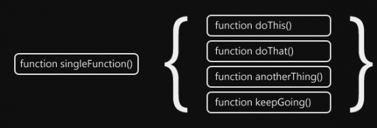

### Sent to you by Thiago Silva via Google Reader:

## 

[Padrão de projeto de software - JavaScript: Facade](http://feedproxy.google.com/~r/imasters/~3/IJA0R5PZ10g/story01.htm)

via [iMasters -](http://imasters.com.br/) by Joe Zim () on 4/3/12

  

Em nossa quarta parte da série Padrão de projeto de software - JavaScript, vamos dar uma olhada no padrão Facade. Se você o conhece ou não, posso quase garantir que você já o usou se tiver programado em qualquer linguagem por mais de um segundo (isso pode ter sido um pouco exagerado, mas você vai me perdoar, certo?). Você pode definir o padrão Facade como um pedaço de código que simplifica uma interface mais complexa. Você pode muito bem chamar qualquer forma de abstração de um Facade. Já fez uma função nomeada que tinha mais de uma linha de código dentro dela? Sim, isso é tecnicamente um exemplo do padrão Facade.

  
Antes que fiquemos muito avançados, porém, quero lembrá-los dos outros membros dentro desta série padrões de projeto de software - JavaScript. Tudo começou com o [Singleton](http://imasters.com.br/artigo/23744/javascript/padrao-de-projeto-de-software-javascript-singleton) e depois passou para o padrão [Bridge](http://imasters.com.br/artigo/23855/javascript/padrao-de-projeto-de-software-javascript-bridge). O precursor final para este padrão foi o [Composite](http://imasters.com.br/artigo/23898/javascript/padrao-de-projeto-de-software-javascript-composite).

#### De volta aos trabalhos com alguns exemplos

Voltando ao Facade, darei alguns exemplos que demonstram a intenção do padrão. Vamos começar com [jQuery](http://jquery.com/). Se não sabe o que é jQuery, então, você tem vivido em uma caixa e ainda não leu nenhum dos meus artigos anteriores (você provavelmente deveria fazer isso alguma hora). jQuery e outras bibliotecas JavaScript, tais como [Prototype](http://prototypejs.org/) e [YUI](http://developer.yahoo.com/yui/), servem essencialmente como um grupo de Facades para tornar nossa vida mais fácil como programadores. Eles transformam um código complexo (geralmente contendo algum bocado de detecção de recursos para garantir que usam o código correto para o navegador que está sendo executado) e o entrega a você como uma única chamada de função.

Outro grande exemplo que não tem nada a ver com programação JavaScript são os atalhos para aplicativos, tais como os que estão no desktop do seu computador. Tudo que você faz é dar um duplo clique nele que ele saltará através de vários níveis de estrutura de pastas para abrir/executar um arquivo.

#### Exemplo de codificação JavaScript

Eu sei que o conceito do Facade é bastante simples de entender e que não precisa, necessariamente, de um exemplo de código JavaScript, mas existem pessoas por aí que se preocupam mais com o código e entendem muito mais facilmente dessa maneira. Sem mencionar que qualquer artigo de JavaScript sem algum código é completamente idiota e deve ser arrancado do seu lugar na internet.

Vamos começar com um simples exemplo de listener do evento. A maioria das pessoas sabe que a adição de um listener de evento não é uma tarefa simples, a menos que elas estejam pensando em ter seu código de trabalho em um pequeno subconjunto de navegadores. Você precisa testar vários métodos, a fim de se certificar de que estão usando o caminho certo para o navegador em que o código está sendo executado. Neste exemplo de código, nós adicionaremos apenas esse recurso de detecção para uma função que pedimos para executar esse código irritante para nós:

```
 function addEvent(element, type, func) {  
 if (window.addEventListener) {  
 element.addEventListener(type, func, false);  
 }  
 else if (window.attachEvent) {  
 element.attachEvent('on'+type, func);  
 }  
 else {  
 element['on'+type] = func;  
 }  
 }
```

É muito simples! Eu meio que gostaria de que todas as amostras de código que tenho que escrever fossem assim tão fáceis, mas se isso fosse verdade não seria nada divertido e você não teria lido este artigo, teria? Eu acho que não. Por causa disso, achei que deveria te mostrar uma coisa com um pouquinho mais de complexidade. Vamos apenas dizer que, originalmente, seu código se parecia um pouco como isto:

```
 var foo = document.getElementById('foo');  
 foo.style.color = 'red';  
 foo.style.width = '150px';  
   
 var bar = document.getElementById('bar');  
 bar.style.color = 'red';  
 bar.style.width = '150px';  
   
 var baz = document.getElementById('baz');  
 baz.style.color = 'red';  
 baz.style.width = '150px';
```

Péssimo! Você está fazendo exatamente a mesma coisa para cada um desses elementos! Acho que há algo que possamos fazer para tornar isso um pouco mais fácil. Talvez algo um pouco parecido com isto:

```
 function setStyle(elements, property, value) {  
 for (var i=0, length = elements.length; i < length; i++) {  
 document.getElementById(elements[i]).style[property] = value;  
 }  
 }  
   
 // Now you can write this:  
 setStyle(['foo', 'bar', 'baz'], 'color', 'red');  
 setStyle(['foo', 'bar', 'baz'], 'width', '150px');
```

Você acha que somos de ouro? Vamos lá! Nós somos programadores de JavaScript! Vamos utilizar nossos cérebros para algum uso real e chegar a algo que realmente brilhe. Talvez possamos definir todos os estilos em uma chamada também. Confira:

```
 function setStyles(elements, styles) {  
 for (var i=0, length = elements.length; i < length; i++) {  
 var element = document.getElementById(elements[i]);  
   
 for (var property in styles) {  
 element.style[property] = styles[property];  
 }  
 }  
 }  
   
 //Now you can just write this:  
 setStyles(['foo', 'bar', 'baz'], {  
 color: 'red',  
 width: '150px'  
 });
```

Esse código poderia realmente nos economizar muito tempo se tivermos um monte de elementos que queremos estilizar da mesma forma.

#### Concluindo

Bem, isso é tudo que tenho para este episódio de padrão de projeto de software - JavaScript. Espero que tenham gostado.

*⁂*

*Texto original disponível em <http://www.joezimjs.com/javascript/javascript-design-patterns-facade/>*

[anexo ausente]

|  |  |
| --- | --- |
| [9bcafcd24ef5e7a319a7e300c0d5b221.gif](http://share.feedsportal.com/viral/sendEmail.cfm?lang=pt&title=Padr%C3%A3o+de+projeto+de+software+-+JavaScript%3A+Facade&link=http%3A%2F%2Fimasters.com.br%2Fartigo%2F24004%2Fjavascript%2Fpadrao-de-projeto-de-software-javascript-facade) | [75b9131ce15803402621ad7d693d4dd1.gif](http://res.feedsportal.com/viral/bookmark_pt.cfm?title=Padr%C3%A3o+de+projeto+de+software+-+JavaScript%3A+Facade&link=http%3A%2F%2Fimasters.com.br%2Fartigo%2F24004%2Fjavascript%2Fpadrao-de-projeto-de-software-javascript-facade) |

  
  
[[anexo ausente]](http://da.feedsportal.com/r/130577577104/u/49/f/546640/c/33212/s/1e0e05b4/a2.htm)[anexo ausente][anexo ausente]

  

### Things you can do from here:

- [Subscribe to iMasters -](http://www.google.com/reader/view/feed%2Fhttp%3A%2F%2Fimasters.uol.com.br%2Ffeed%2F?source=email) using **Google Reader**
- [Get started using Google Reader](http://www.google.com/reader/?source=email) to easily keep up with **all your favorite sites**
