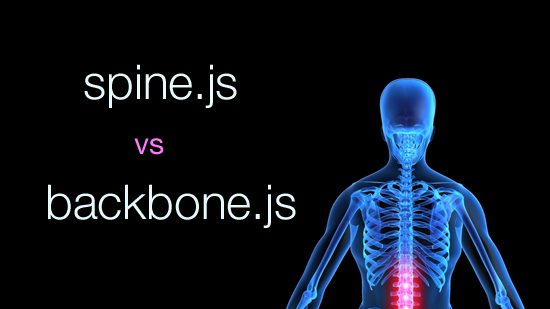

# Constant Improvement

## [Spine.js vs Backbone.js](http://hjortureh.tumblr.com/post/22117245794/spine-js-vs-backbone-js)



[Spine](http://spinejs.com/)  and [Backbone](http://documentcloud.github.com/backbone/)  are two Javascript MVC frameworks that look very similar on the surface but under the hood there are key differences. The purpose of this article is to highlight these differences and hopefully make it easier to choose which framework fits your needs.

### The basics

Backbone is written in Javascript and was created by [Jeremy Ashkenas](https://github.com/jashkenas)  in the year 2010. Spine came later and was highly inspired by Backbone, it is created by [Alex MacCaw](https://github.com/maccman)  and is written in [CoffeeScript](http://coffeescript.org/) .

Backbone was very successful right from the start and has been used by many established companies such as [37signals](http://37signals.com/) , [Fog Creek Software](http://www.fogcreek.com/) , [LinkedIn](http://www.linkedin.com/)  and [many others](http://documentcloud.github.com/backbone/#examples). Spine has gained some attraction, specially by CoffeeScript developers, but not nearly as much as Backbone.

Spine size is 7k, it aims to simplify MVC and integrates well with CoffeeScript. Backbone size is 5.6k and it depends on the utility library [Underscore.js](http://documentcloud.github.com/underscore/)  ( 4k ) that makes up for some of Javascript missing features.

### Positive by default

In the beginning Spine implemented a concept called asynchronous user interfaces. The way it works is that the user interface is updated when models are saved without waiting for the server response, expecting the result to be positive. This made Spine apps snappier and is explained well by the creator of Spine in his [article about async uis](http://alexmaccaw.com/posts/async_ui) .

Backbone introduced the same concept in version 0.9 and the models are now also positive by default. It’s still possible to turn this behavior off in Backbone by setting the wait option to true in the methods *save*, *create* and *destroy*.

Example:

```
contact.save({ wait: true });
```

### Models vs. Collections

Backbone has Models and Collections but in Spine there are only Models.

Spine is similar to Active Record in Rails where static methods operate on the list of records while instance methods work on single record instances. This makes Spine simple for doing basic things such as adding a contact to a contact list.

Example:

```
var Contact = Spine.Model.sub();
Contact.configure("Contact", "name", "email");
Contact.extend( Spine.Model.Ajax );

// Usage

var contact = new Contact({  
	name: "Sven Svensson", 
	email: "sven@svensson.se" 
});

contact.save();
```

The save operation in this example syncs the model to the server and adds the record to the list of contacts. Let’s next accomplish the same thing using Backbone.

Example:

```
var Contact = Backbone.Model.extend({});

var Contacts = Backbone.Collection.extend({
	model: Contact,
	url: "contacts"
});

// Usage

var contacts = new Contacts();
var contact = new Contact({  
	name: "Sven Svensson", 
	email: "sven@svensson.se" 
});

contacts.create( contact );
```

As you can see there are differences between the two so let’s dive a bit deeper.

### Attributes

Notice this line in the Spine model example.

```
Contact.configure("Contact", "name", "email");
```

Spine attributes that are synced to the server need to be configured so they are not mixed with other properties on the model that are only stored in memory.

Example:

```
Contact.configure("Contact", "name", "email");
contact.name = “John Johnson”;
contact.email = “john@johnson.com”;
contact.onlyInMemory = true;
```

In Backbone attributes are not stored directly on the model and are accessible through get and set methods.

Example:

```
contact.set({
	name: “John Johnson”,
	email: “john@johnson.com”
});

contact.onlyInMemory = true;
```

This means that Spine models are more static because they need to be defined beforehand but Backbone models are dynamic and can be changed on the fly. If you need models that have dynamic attributes Backbone is a better friend.

Another advantage of the setter method in Backbone is that it fires both *change* and *change:attribute* events when setting attributes. This is helpful in use cases where the user interface should be updated at the same time as attributes are changed.

### Unique identifiers

Spine makes it impossible to change the name of the unique identifier to something else than *id*.

This is a problem for example with databases such as CouchDB and MongoDB where the name is usually *\_id* but not *id*. To make this work with Spine there needs to some sort of conversion between the two names which is dirty.

Backbone has a property called *idAttribute* that makes it easy to switch the unique identifier name to something else than *id*.

Example:

```
var Contact = Backbone.Model.extend({
  idAttribute: "_id"
});
```

The models of Backbone also include an identifier called *cid* that is generated on the client before models are saved to the server and are specially useful for asynchronous user interfaces.

Strangely enough Spine models generate a client identifier that is set on the *id* before saving to the server and is overwritten as the model is synced for the first time. This is in my opinion very confusing and only increases the likelihood of introducing bugs.

### Storing records

Spine stores records in a hash internally but Backbone uses both an array and a hash.

The Spine hash uses *id* as the hash key and are therefore super fast for retrieving records by id. The problem with this approach is that for most other cases the hash is slower, for example the methods *count*, *toJSON*, *first*, *last* need to convert the hash to an array before returning the result, this is slower than just using an array.

Backbone collections keeps the records array always sorted by default but that behavior is hard to reproduce using only a hash. To sort records in Spine the hash has to be converted to an array and sorted using the sort method of javascript arrays.

That brings us to the next part about helper methods.

### Helpful Helpers

Backbone depends on the Underscore library as stated above. Underscore is mostly used by Backbone collections to provide many useful methods such as *map*, *filter*, *pluck* and [many more](http://documentcloud.github.com/underscore/)  can be quite useful.

Spine has few helper methods like *select* and *findByAttribute* but nothing as extensive as in Underscore . This is less of a problem in Spine for CoffeeScript developers as Coffee makes it easier to implement these kinds of operations.

### Views vs. Controllers

Spine controllers and Backbone views serve the same purpose and bridge the gap between the HTML markup and the model layer. In a conventional server-side MVC framework this layer is most often referred to as *controllers* and in my mind that name makes more sense than calling it *views* because the markup represents the view.

Lets not get carried away and rather take a look at a simple Backbone view example.

Example:

```
var ContactView = Backbone.View.extend({

	events: { 
		"click li": "openContact" 
	},

	initialize: function() {
		contacts.bind( "reset", reset, this );
		contacts.fetch();
	},
	
	reset: function() {  
 	    this.contactList = this.$("#contact-list");

 	    // Do stuff
    }

});

// Usage
new ContactView({ el: $("#view").get(0) });
```

Spine controllers are almost identical.

```
var ContactView = Spine.Controller.create({

	events: { 
		"click li": "openContact" 
	},

	elements: { 
		"#contact-list": "contactList" 
	},

	init: function() {
		ContactModel.bind( "refresh", refresh );
		ContactModel.fetch();
	},

	refresh: function() {
		// Do stuff
	},
	
});

// Usage
new ContactView({ el: $("#view") });
```

In both implementation we have list of events, a constructor and methods. Spine additionally provides a way to define the elements used by the controller with the *elements list*, its a very much used shorthand and a nice-to-have.

### Architecture

Another good thing about the Spine is that the library is broken into separate files. Spine core, ajax, local storage and routes are separate files so it’s possible to pick which one to include in our apps and avoid loading unnecessary code.

I think this is something that could be done with Backbone as its mainly one file that could be broken up to make things lean and cleaner.

### Conclusion

Spine and Backbone are frameworks that provide structure to our javascript code and features that help us to focus on writing better web applications. I have used both these frameworks and been happy with the results in both cases.

As a conclusion I recommend when the key thing is simplicity or CoffeeScript integration choose Spine. In most other cases I recommend using Backbone with Underscore as the tool for the job.

Posted 2 days ago
