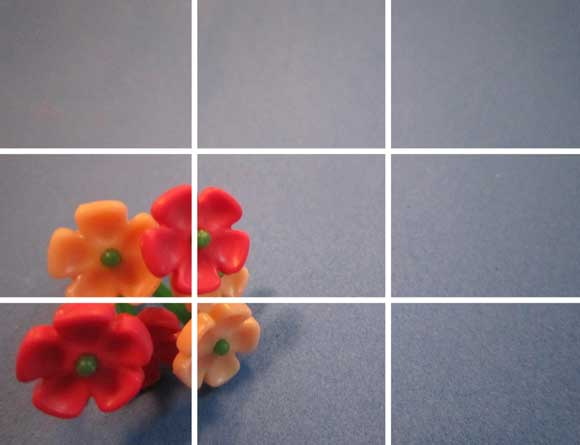
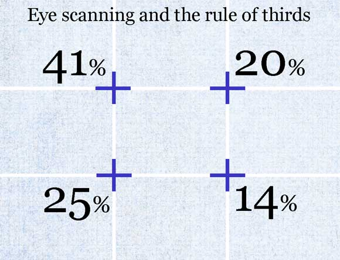
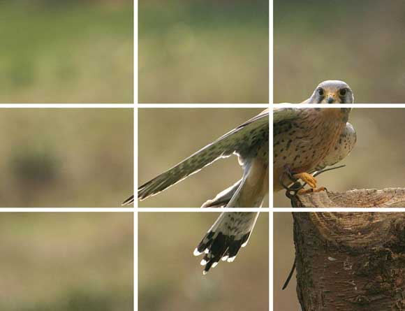
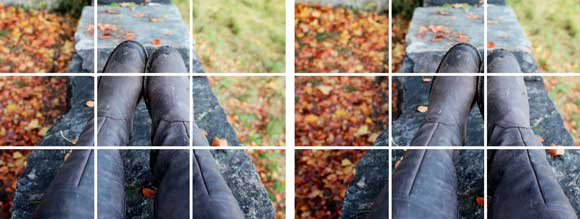
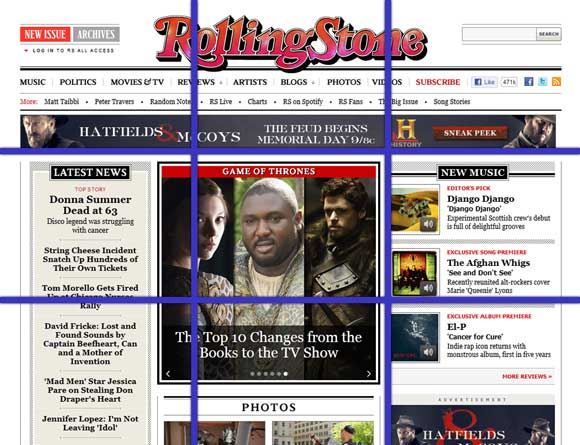
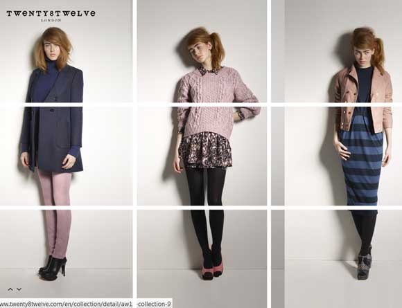
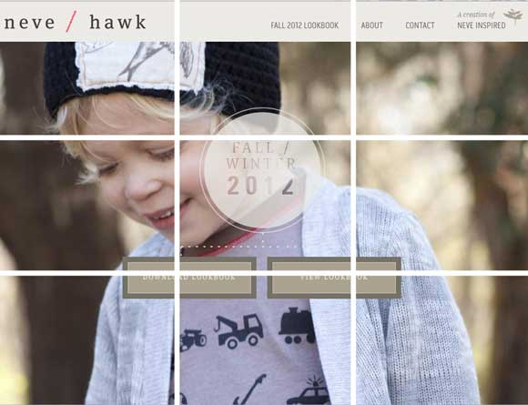

# Understanding the Rule of Thirds in Web Design

Intentional or not, the rule of thirds comes into play with most visuals, including images and in almost any web design.

Advertisement

In its most simple form the rule of thirds refers to a 3 by 3 grid that fits on top of any image. There are no specific sizes to the blocks – only that they are equally shaped. The grid works horizontally or vertically and helps you determine how the eye follows an image or group of images (such as a website).

The rule of thirds has been around for several hundred years, with the first written reference by John Thomas Smith in “Remarks on Rural Scenery” (1797). He wrote about the philosophy and how it pertained to painting and art, giving it the name “rule of thirds,” a phrase that is now used commonly among artists, photographers and designers.

While the rule of thirds can be used intentionally in art, photography or design, it is also an ever-present concept. Even when you don’t plan or accommodate for it, the rule of thirds exists. Your job is to use it to your design advantage.

### How it Works

The grid-shaped rule of thirds concept helps you understand the places on an image where a person is naturally drawn when viewing an image or even your webpage. In theory, the most eye-catching points are where the grid lines intersect.

Understanding where these key points fall can help you better compose a piece of artwork or photo, determine a more appealing crop and even determine placement of elements on your website’s landing page. Generally, the area that will first attract attention is the top left grid intersection, followed by the intersection below it and then the top right and bottom right cross-sections.

The biggest lesson to come from the rule of thirds is that perfect 2-part symmetry may not be the most appealing configuration. You will get more impact with images and design without it. (And remember, even if your design is created with perfect symmetry from the center out, the rule of thirds will still apply.)

You can work with or against the rule of thirds, but you can’t eliminate it.

### Photography and Images

Following the rule of thirds philosophy, images that fall into “thirds” regions are the most pleasing and are associated with balance and harmony. Where the focus of an image falls in the imaginary grid can create associations as well. For example, the placement of an object in one third of the photo can imply motion, such as with the bird above. (You can almost sense that he has just flown in from the left and landed on the branch.)

There are a few rule of thirds guidelines to keep in mind when working with and cropping images.

**Watch the horizon:** In photos with a horizon line (especially landscapes), try to place that line in the top third of the image. It will help better focus the rest of the image and add the proper feeling of where the sky is located.

**Watch the eyes:** This can be rather difficult at times, but in portraits think about lining up the subject’s eyes on two of the interesting gridlines. These are areas that first draw attention and your viewer will immediately connect with the person in the photo because you have created a feeling of looking into their eyes.

**Watch dead space:** Be aware of pieces of objects in the corners of images and crop. Pull the part of the image you really want to be showcased forward and near one of the primary gridlines.

### Overall Design

Think about placement of elements on your website in relation to the rule of thirds. At a common screen resolution of 1,024 pixels wide by 786 pixels deep, each third would be about 341 pixels wide by 262 deep.

Think about the composition of your site. It is likely the banner falls side the left-most top third. Much of your content probably begins around the location of the top third gridline, with navigation above it.

Consider where banner ads are placed on many news websites. They strip across the top third gridline, such as the ad and content on the Rolling Stone website.

On homepages, apply the rule of thirds when determining placement of key elements – banners, social media or interactivity icons, advertising and even key parts of your content. On subsequent or content pages, use the rule of thirds to help you determine where to place images or help readers focus when visiting your site. Think about how many sites are structured as well; sites with sidebars on both sides often allow for main content to fall within the center “third” of the site.

### Design Considerations

While the rule of thirds can be a very useful tool, it is not necessary to plan your website design around it. Use the philosophy as a guideline or a tool to tweak your design during the finalizing process. Toss an imaginary grid on a new site design and consider making placement changes to items that are close to key spaces on the rule of thirds grid.

More importantly, the rule of thirds can be applied to working with images on your site. Use it to help you better crop and scale images. Remember to keep in mind where the object of each photo falls and what kind of movement or feel it creates.

Successful use of the rule of thirds can create a feel of natural balance, which is often asymmetrical. It can help designers who tend to design with perfect symmetry break out of their comfort zone and try something new, while still maintaining a sense of design order.

Play with using the rule of thirds in different way to bring focus to your site. Consider only vertical (such as Twenty8Twelve) or horizontal thirds. Pick a “third” and use at as a focus throughout your site. Design your homepage by grouping thirds such as Google Ventures, which grouped the first two horizontal thirds for the main image and has a grouping of three images in each third below.

*Images courtesy of [Alan Cleaver](http://www.flickr.com/photos/alancleaver/2540352695/), [katerha](http://www.flickr.com/photos/katerha/5307001887/), [photojenni](http://www.flickr.com/photos/jenni40947/5133100985/) and [Illusive Photography](http://www.flickr.com/photos/alanant/3097475740/).*
