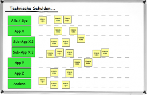
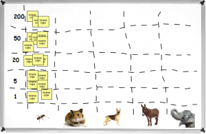
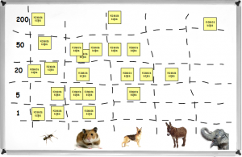
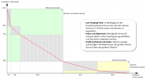
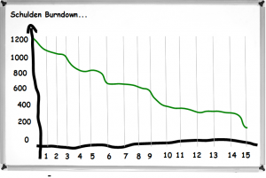

# [Effective Steps to reduce technical debt: An agile approach](http://www.codovation.com/2012/06/effective-steps-to-reduce-technical-debt-an-agile-approach/ "Effective Steps to reduce technical debt: An agile approach")

Posted on June 21, 2012 by Bastian

Technical debt as a topic didn’t change or got any better through agile development methods and principles. It gained visibility at best. I would even say that due to faulty setups and implementations of agile methodologies which only focus on opportunistic short term growth the situation became even worst. Though preventive measures such as TDD, pair programming and continuous refactoring are widely accepted (especially in the agile world), there are no systematic approaches for sustainable implementations of bigger software systems but generic appeals and striking calls. For example the craftsmen manifesto claims to build software that not only functions but is also well-crafted – but it doesn’t go any deeper and concrete approaches remain rare.  Software without a heavy amount of technical debt is unusual – maybe just utopian.

Working with agile teams over some years I noticed different factors influencing the way teams tackle technical debt:

- Developers know about technical debt and are aware that it is important to face this problem.
- It’s not clear who is responsible for the reduction of technical debt: the team, IT leads, product owner, or the scum master?
- It’s difficult to plan the work and define a strategy to reduce technical debt because it is not not a part of the regular development process which mainly focuses on implementing features.
- Product Owner often doesn’t understand the need and benefits of reducing technical debt and don’t consider or allow technical projects / stories in their backlog and release plan.
- Problems and goals regarding technical debt are neither structured nor documented. At best the things to do are quite clear among team members and partly exist in fragmented documentations. But it could also be worst case that topic owners already left the team or company and took all their knowledge and expertise with them out of the door.

Without considering every of those points, my current team and I tried to find a pragmatic approach that allows us to understand and reduce the existing debt in an agile way (iterative, prioritized, focused). The approach should be integrated seamlessly in the development process (which is Kanban).

At the end of the day the team itself is doing tasks of a Product Owner – but for a technical backlog.

## **1st Step: Involve the Product Owner and “promote” him to be the sponsor of technical debt reduction.**

The first important step in such a process is often to raise the technical awareness of the person who is responsible for the product. This guy should be the person who is talking about technical sustainability and quality on the front lines. Teams are lucky when already working with a product owner or manager who understands the life cycle of software systems – how software evolves – and thereby the impact of technical debt. In this situation it’s all about bringing the topics and to-do’s on the table and helping to prioritize them. For teams without this kind of a product owner this could really be a show stopper. Discussing the responsibility for the overall product including the quality and stability of underlying software systems like a mantra does not help much. The team should remember the product owner that he is part of the team: his pain is the pain of the team and other way round. He is not the customer, payer or employer of the team but more a SME (subject matter expert) and manager / analyst of product requirements from different stakeholders.

As a team give your product owner the guarantee that growth of the product will stay the most important part – but not just in a short team (Performance) but also in a long term (Health) manner. Depending on how active the product owner is integrated into the development process it can be helpful to present different options of how to reduce technical debt to him and involve him in discussion to find the best approaches.

For most product owners this situation will be quite common since they do the same all the time with their stakeholders: promote and inspire, explain and legitimate about agile, strengthen the WE… This shared challenge could be something like the carrier energy also for the establishment of technical debt reduction.

## **2nd Step: Inventory and structure known technical debt**

Having convinced the product owner it is time to collect and inventory known technical problems and map them on a structure that visualizes the system and project landscape.

Attention: It is not about completely understanding all topics. It is about finding a proper structure, identifying the most important issues and mapping those onto the structure. It’s about extracting knowledge about the systems from the heads to develop a common picture of existing technical problems.

Therefore we wrote the names / identifiers of all applications and modules we own on cards. These cards we pinned on a whiteboard. In the next step we extracted to-do’s (to solve existing problems) from all documentation media we use (wiki, jira, confluence, code documentation, paper), wrote them on post-its and stuck them  next to the application name it belongs to.

This board was accessible to all team members over a period of some days. Every team member was responsible to complete, restructure, and correct the board during this period so that we could go on with a round portfolio of the existing debt in our systems.

## **3rd Step: Agile prioritization and estimation of the work**

Having collected and understood the work to reduce the technical debt within our systems we now needed a baseline for defining a good strategy – a repayment plan. Therefore we need numbers: Costs and benefits. However, we know that it is almost impossible to come up with good numbers regarding these metrics in IT projects. Also quality metrics such as cycloramic complexity, code coverage or dependency depths are not really useful because those are used for preventive quality assurance regarding the code and not the whole system.

We moved one step back and asked ourselves what we actually want to achieve: It is not our goal to generate numbers for external use or to legitimate our work on technical debt but to find good hints for defining a strategy to reduce or even remove the existing debt in an effective way. All team members should understand what they are talking about, the reasons why A comes first and B second … Therefore it’s not important to find concrete numbers but a feeling about the relative sizes of all work items.

We established two abstract units that are somehow semantically based on concrete dimensions:

- On Y axis: TechDollar for the size of repayment for each item, which is in sum the gross amount of debt we have (1, 5, 20, 50, 200). This number doesn’t relate to the real costs or benefits, it is just an abstract number that allows us to compare items with each other and to generate a feeling about how big the technical debt is.
- On the X axis: Animal Sizes (later mapped to story points) for the size / effort of each item. (ant = 1, hamster = 3, dog = 8, donkey = 13, elefant = 20). Again this number does not relate to any real number but allows us to compare items with each other without handling all the complexity behind each item.

For not mixing up discussion about effort and benefit we first ordered the items based on the y axis using tech dollar. Therefore we compared items with each other and asked questions like “Compared to item X how much of your pain would be gone after finishing item Y? This was also good for clarifying questions to understand the context of each item.

In the second step we distributed the items of each row (benefit) among the animal sizes. “How big is item X compared to Y? How long does it take? How complex is it? How uncertain is the field?…”

At the end of this exercise we had a matrix with ToDos, i.e. technical stories, that are understood by each team member. The positioning in the matrix gives us good hints to develop a strategy for the reduction of technical debt in the next step.

## **4th Step: Analysis of the data and development of the right strategy.**

First we created stories marked as “TechnicalDebtItems” in JIRA for each task we defined. For bringing those items into a prioritized order and for drawing the right conclusions, we created a chart to visualize how the efforts relate to the payment and vise versa. This is the result:

The Y-axis shows the gross debt. The red line visualizes the amount of repayment distributed over the effort. The distribution of efforts on the X-axis on the other hand results from the sum of effort / story points per point category. However, this is only one option for a valid and effective repayment plan. But it makes one thing quite clear: The major amount of the perceived debt can be terminated by only a small effort. This knowledge leads to more focus and also motivation because before, without any insights, the team only saw the big blockers and the high amount of different tasks without any order or prioritization. Now we found a way, to focus on each next step without losing the whole thing out of focus.

The visualization of the debt and the finding of a possible repayment plan – even if this was created based on abstract numbers describing just the gut feeling of the team – the team now can focus on the most important steps. An important side effect: This overview is also a great tool for working with the product owner and other stakeholders because it gives him a good transparency regarding technical debt.

## **5th Step: Integration into the existing development process.**

The inventory and interpretation of the existing technical debt are only small steps within the whole process. The longest run the team must go is to actually work on the items, reduce the debt and transform a buggy system into a sustainable, solid platform. This requires a lot of discipline and the ability to achieve consensus among the team and the product owner.

In addition to the visualizations on the team boards regarding the feature development process we now have a debt burndown which show the payment over time (calendar weeks). The team and the product also agreed on including bigger technical stories (> 3 points) into the feature planning and development process.

Smaller stories (1-3 points) will be done spontaneously by the developers using their 20% tech and innovation time.

The defined portfolio of technical stories is not static. Developing new stuff always means new debt. Working with legacy code often results in finding code that is far from being structured well… The team agreed on collecting such things on a wiki page when it’s not a bug or critical blocker. Collected items will be reviewed in a quarterly review and if necessary added to the gross debt.  Finding and discussing improvements to the process will be part of regular retrospectives the team holds every other week. Latest in the quarterly review the process and results will be inspected in detail by the team.

## **Conclusion**

Technical debt is normal and part of every software project – even if preventive measurements became quite common lately through agile. It’s worth to work on the debt in a structured way. Understand where the problems are, understand the benefits and costs and analyze the data you have. Like the product owner for features the team is responsible to make the debt transparent and legitimize the work to reduce this debt. Who if not the developers themselves can do this?
