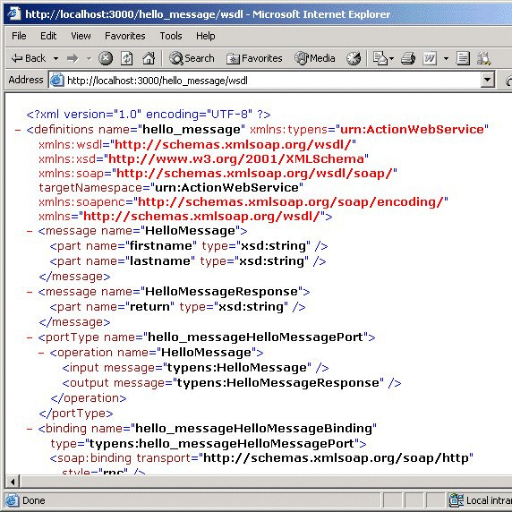
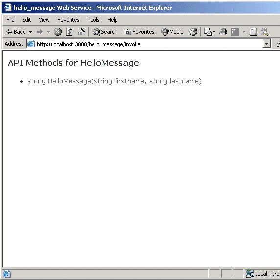
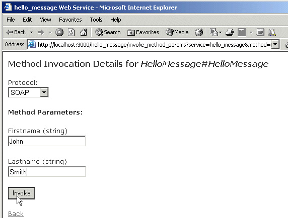
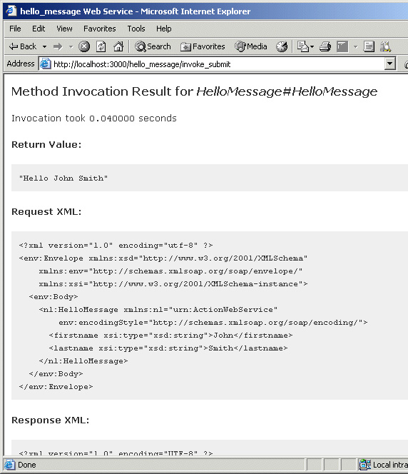
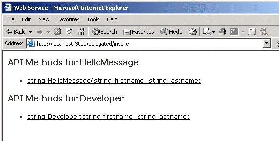
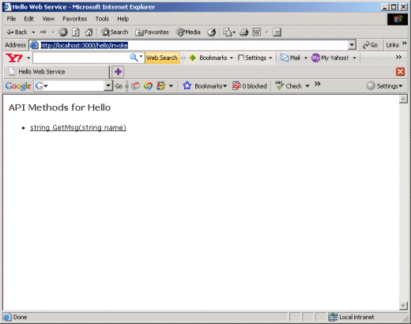

[Skip to main content](http://www.ibm.com/developerworks/opensource/library/os-ws-rubyrails/index.html#ibm-content)

- [Sign in (or register)](http://www.ibm.com/developerworks/dwwi/DWAuthRouter?m=loginpage&amp;lang=en&amp;d=http%3A%2F%2Fwww.ibm.com%2Fdeveloperworks%2Fopensource%2Flibrary%2Fos-ws-rubyrails%2Findex.html)
- [English](http://www.ibm.com/developerworks/opensource/library/os-ws-rubyrails/index.html#SELECTLANG)
- [](http://www.ibm.com/developerworks/opensource/library/os-ws-rubyrails/index.html#)

- [](http://www.ibm.com/developerworks/)

- [Technical topics](http://www.ibm.com/developerworks/topics/)
- [Evaluation software](http://www.ibm.com/developerworks/downloads/)
- [Community](http://www.ibm.com/developerworks/community/)
- [Events](http://www.ibm.com/developerworks/events/)

- [developerWorks](http://www.ibm.com/developerworks/)
- [Open source](http://www.ibm.com/developerworks/opensource/)
- [Technical library](http://www.ibm.com/developerworks/views/opensource/library.jsp)

# Create Web services with Ruby on Rails and Action Web Service

*Get started with SOAP and XML-RPC programming with the Rails Action Web Service gem*

[Deepak Vohra](http://www.ibm.com/developerworks/opensource/library/os-ws-rubyrails/index.html#author1) ([dvohra09@yahoo.com](mailto:dvohra09@yahoo.com%3Fsubject=Create%20Web%20services%20with%20Ruby%20on%20Rails%20and%20Action%20Web%20Service)), Web Developer, Independent

**Summary:**  The Action Web Service module implements Web services functionality in Ruby on Rails. Action Web Service creates server-side support for SOAP and XML-RPC Web service protocols. You can declare and publish APIs using Action Web Service.

[Tag this!](http://www.ibm.com/developerworks/opensource/library/os-ws-rubyrails/index.html#)

[Update My dW interests](http://www.ibm.com/developerworks/opensource/library/os-ws-rubyrails/index.html) ([Log in](https://www.ibm.com/developerworks/dwwi/DWAuthRouter?m=loginpage&amp;d=http%3A%2F%2Fwww.ibm.com%2Fdeveloperworks%2Fopensource%2Flibrary%2Fos-ws-rubyrails%2Findex.html) | [What's this?](http://www.ibm.com/developerworks/opensource/library/os-ws-rubyrails/index.html#overlay)) [Skip to help for Update My dW interests](http://www.ibm.com/developerworks/opensource/library/os-ws-rubyrails/index.html#dwmyinterestaddhelp)

**Date:**  04 Nov 2008  
**Level:**  Intermediate  
  
**Activity:**  47081 views  
**Comments:**   2 ([View](http://www.ibm.com/developerworks/opensource/library/os-ws-rubyrails/index.html#icomments) | [Add comment](http://www.ibm.com/developerworks/opensource/library/os-ws-rubyrails/index.html#) - Sign in)

[anexo ausente] Average rating (35 votes)  
[Rate this article](http://www.ibm.com/developerworks/opensource/library/os-ws-rubyrails/index.html#iratings)

Rails is a Web-application framework that includes everything you need to create database-backed Web applications using the Model-View-Control (MVC) pattern. The most succinct definition of Action Web Service is found in its README file: "Action Web Service provides a way to publish interoperable Web service APIs with Rails without spending a lot of time delving into protocol details." In this article, you will learn how to install Rails and the Action Web Service module and get started with XML-RPC programming.

Hardware and software requirements

Any computer connected to a network capable of running Ruby should have sufficient processing power for the code presented here. Ruby V1.86 or later is required, as is RubyGems and Rails. We discuss how to install these on a machine running Microsoft® Windows®.

How Web services work

## Frequently used acronyms

- **API** — Application program interface
- **HTML** — Hypertext Markup Language
- **HTTP** — Hypertext Transfer Protocol
- **REST** — Representational State Transfer
- **RHTML** — Ruby code mixed with HTML templates
- **SOAP** — Simple Object Access Protocol
- **UI** — User interface
- **WSDL** — Web Services Description Language
- **XML** — Extensible Markup Language
- **XML-RPC** — Remote Procedure Calling using HTTP and XML

A *Web service* is a software system designed for interoperable interaction over a network. A Web service is defined with a WSDL document. Other systems interact with the Web service using SOAP messages, transferred using HTTP with an XML serialization. A Web service is an abstract resource that provides a set of functions, implemented by an agent, which sends and receives messages. A *provider entity* provides the functionality of a Web service with a provider agent. A *requester entity* uses the Web services functionality with a requester agent.

Web services implement various technologies, including XML, SOAP, and WSDL. XML is a standard format for data exchange. Web services requests and responses are sent as XML messages. The elements and attributes that may be specified in an XML document are specified in an XML schema. SOAP provides a standard framework for packaging and exchanging XML messages. WSDL is an XML document found at http://schemas.xmlsoap.org/wsdl/, which defines a namespace for describing a Web service as a set of endpoints operating on messages. A WSDL document specifies the operations (methods) provided by a Web service and the format of the XML messages.

[Back to top](http://www.ibm.com/developerworks/opensource/library/os-ws-rubyrails/index.html#ibm-pcon)

Creating a Web service

Before discussing the Web services support in Ruby on Rails in detail, we will create a simple Web service using the Action Web Service module. First, we install Ruby on a Windows computer. The steps outlined are brief and simple (see [Resources](http://www.ibm.com/developerworks/opensource/library/os-ws-rubyrails/index.html#resources) to download Ruby and Ruby on Rails, and for additional developerWorks articles describing how to use Ruby on Rails):

1. For Windows users, download the Ruby Windows installer for the latest final release (currently Ruby V1.8.6-25), and double-click on the executable. Install Ruby in the C:/ruby directory. RubyGems, the standard Ruby package manager, which is used to install other gems, also gets installed. Next, install Rails. From the C:/ruby directory, the directory in which Ruby is installed, run the following command to install Rails and dependencies: `c:/ruby>gem install rails --include-dependencies`.
2. With the Rails 2.0 version, the Action Web Service gem is not included in the default package. Install the `actionwebservice` gem with the following command: `c:/ruby>gem install actionwebservice`. As of this writing, `actionwebservice` V1.2.6 is the latest version. If an earlier version of Rails (pre-Rails V2.0) is used, the `actionwebservice` gem is included in the default package.
3. Create a Rails application for the Web service by entering `C:/ruby>rails webservice`.
4. Create an apis directory in the app directory, then create a Web services API class, `HelloMessageApi`, which extends the `ActionWebService::API::Base` class. Store the following Ruby script to `hello_message_api.rb` in the app/apis directory.  
     
   **Listing 1. Web services API class `HelloMessageApi`**  

   |  |
   | --- |
   | ``` class HelloMessageApi < ActionWebService::API::Base   api_method :hello_message, :expects => [{:firstname=>:string},  {:lastname=>:string}], :returns => [:string]   end ``` |
5. Create a controller script, which defines a controller class: `HelloMessageController`. Copy the following Ruby code to the controller script and save the controller script, `hello_message_controller.rb`, in the `app/controllers` directory.  
     
   **Listing 2. Controller class `HelloMessageController`**  

   |  |
   | --- |
   | ``` class HelloMessageController < ApplicationController   web_service_api HelloMessageApi  web_service_dispatching_mode :direct   wsdl_service_name 'hello_message'   web_service_scaffold :invoke    def hello_message(firstname, lastname)     return "Hello "+ firstname +" "+lastname   end end ``` |
6. Start the WEBrick Web server by entering `C:/ruby/webservice>ruby script/server`.
7. Display the WSDL file for the Web service with the URL `http://localhost:3000/hello_message/wsdl`.  
     
   **Figure 1. Web services WSDL**  
   
8. Invoke the Web service with `http://localhost:3000/hello_message/invoke`. The API methods for the Web service will be displayed. Select the `HelloMessage` method.  
     
   **Figure 2. Invoking the Web service**  
   
9. To test the Web service, specify a first name and a last name, then click **Invoke**.  
     
   **Figure 3. Invoking a Web services method**  
   
10. The return value is output, as well as the request XML and response XML.

  
**Figure 4. Output from the Web service**  
  
  

Let's discuss the Web service in detail. The Web services API class defines the methods the Web service provides. The example API class defines the `hello_message` method, which takes two parameters of type `string` and returns a string value. An API method is defined with the `api_method` method of the `ActionWebService::API::Base` class. The WSDL for the Web service is created from the API class. The Web services API class extends the `ActionWebService::API::Base` class. The controller class contains the code the Web service makes available to a client. The `web_service_api` option specifies the API definition class. The `web_service_dispatching_mode` option specifies the dispatching method where remote callers send their invocation methods, the endpoint URLs, and how the method invocation is routed to the object that implements the method.

With the *direct* dispatching mode, method invocations are made directly to the controller. The API method implementations are defined in the controller class as public instance methods. The direct mode is the default mode. The `wsdl_service_name` option specifies the Web service name. The `web_service_scaffold` option generates a Web services scaffolding for method invocations. The Web services scaffolding is similar to the Active Record's scaffolding. The *invoke* method specified in the example Web service lists all the methods in all the APIs attached to the controller. The `hello_message` action in the controller class is available to clients for method invocation.

[Back to top](http://www.ibm.com/developerworks/opensource/library/os-ws-rubyrails/index.html#ibm-pcon)

Web services API class

In the previous example, the Web services API class is `HelloMessageApi`. The Web service API class extends the `ActionWebService::API::Base` class and specifies the methods to be made available for an API in a Web service. Some of the methods of the class are discussed below.

  
**Table 1. ActionWebService::API::Base Methods**  

| Method | Description |
| --- | --- |
| api\_method(name, options={}) | Specifies an API method; the options are :expects-Signature for method input parameters, :returns-Signature for return value, :expects\_and\_returns-Signature for input parameters and return values |
| api\_method\_name(public\_name) | Specifies a service method name for a public method name |
| api\_methods() | Specifies a hash of service methods on this API |
| has\_public\_api\_method?(public\_name) | Specifies whether a public method has a corresponding service method on this API |
| soap\_client(endpoint\_uri, options={}) | Specifies a SOAP client |
| xmlrpc\_client(endpoint\_uri, options={}) | Specifies an XML RPC client |

  

The procedure to define a API class is as follows:

1. Determine which methods are to be made available on the API.
2. Create a class that extends the `ActionWebService::API::Base` class.
3. Define the methods using the `api_method` option, including the method signature.

[Back to top](http://www.ibm.com/developerworks/opensource/library/os-ws-rubyrails/index.html#ibm-pcon)

Dispatching

*Dispatching* is the distribution of method invocations on a Web service. A dispatching approach refers to where remote callers send their invocation messages and how the method invocations are routed to the method implementation object. An API is implemented based on the dispatching approach. Three dispatching approaches are available:

1. Direct
2. Delegated
3. Layered

Direct dispatching

With the *direct dispatching* approach, the API definition class is attached to the controller class, and the API methods are implemented in the controller class as public instance methods. As in the example application discussed earlier, the direct dispatching is specified as `web_service_dispatching_mode :direct`.

The direct dispatching approach is the default approach. With the direct dispatching approach, a controller class may implement only one API. The endpoint URL for a Web service with direct dispatching is of the `http://SERVER/CONTROLLER_NAME/api` format.

The endpoint URL for the example Web service discussed earlier is `http://localhost:3000/hello_message/api`, as specified in the service element of the WSDL document.

  
**Listing 3. Endpoint URL**  

|  |
| --- |
| ``` <service name="hello_messageService">  <port name="hello_messageHelloMessagePort"    binding="typens:hello_messageHelloMessageBinding">   <soap:address location=    "http://localhost:3000/hello_message/api" />   </port>   </service> ``` |

  

In the direct dispatching mode, the `web_service_api` option may be omitted if the API definition class is of the same name as the controller class and is stored in the `app/apis` directory in a Ruby file of the format `apiclass_api.rb`. In the example application discussed earlier, the `web_service_api` option is not required in the controller class as the API class is stored in the `hello_message_api.rb`. The procedure to develop an Action Web Service Web service using the direct dispatching approach is as follows:

1. Define an API class, a class that extends the `ActionWebService::Base` class, and define the API methods.
2. Attach the API Web service class to a controller class using the `web_service_api` option.
3. Set the dispatching mode to "direct" with `web_service_dispatching_mode :direct`.
4. Implement the API methods in the controller class as public instance methods.
5. Test the Web service by adding scaffolding to the controller class.

Delegated dispatching

A limitation of the `direct` dispatching approach is that a controller class may implement only one API. In the *delegated dispatching* approach, a controller class may implement more than one API. We shall discuss `delegated` dispatching with an example.

Define two API classes: `HelloMessageApi` and `DeveloperApi`. Store the `HelloMessageApi` class in `hello_message_api.rb` Ruby script in the `app/apis` directory. The `HelloMessageApi` class defines a `hello_message` API method that takes two string parameters, firstname and lastname, and returns a string value. The `hello_message_api.rb` script is shown below.

  
**Listing 4. hello\_message\_api.rb**  

|  |
| --- |
| ``` class HelloMessageApi < ActionWebService::API::Base   api_method :hello_message, :expects =>    [{:firstname=>:string},    {:lastname=>:string}], :returns => [:string]  end ``` |

  

Store the `DeveloperApi` class in the `developer_api.rb` Ruby script in the app/apis directory. The `DeveloperApi` class defines a `developer` method that takes two string parameters and returns a string value. The `developer_api.rb` script is shown below.

  
**Listing 5. developer\_api.rb**  

|  |
| --- |
| ``` class DeveloperApi < ActionWebService::API::Base   api_method :developer, :expects =>    [{:firstname=>:string},  {:lastname=>:string}], :returns => [:string]  end ``` |

  

Create a service class for each API class. A service class extends the `ActionWebService::Base` class. The service class implements the methods defined in the API class. The API class is attached with the service class using the `web_service_api` option. The `HelloMessageService` class implements the `HelloMessageApi` API class. Store the `HelloMessageService` service class in the `app/models` directory as Ruby script `hello_message_service.rb`. The `hello_message_service.rb` script is shown below.

  
**Listing 6. hello\_message\_service.rb**  

|  |
| --- |
| ``` class HelloMessageService < ActionWebService::Base  web_service_api HelloMessageApi  def hello_message(firstname, lastname)     return "Hello "+ firstname +" "+lastname   end end ``` |

  

Similarly, create a service class, `DeveloperService`, for the `DeveloperApi` API class. The Ruby script for the `DeveloperService` class is stored in the `app/models` directory as `developer_service.rb`. The `developer_service.rb` script is shown below.

  
**Listing 7. developer\_service.rb**  

|  |
| --- |
| ``` class DeveloperService < ActionWebService::Base  web_service_api DeveloperApi  def developer(firstname, lastname)     return "This Web service is developed by "+ firstname +"      "+lastname   end end ``` |

  

Create a controller class for the service classes. Set the dispatching mode to "delegated" with the following option setting: `web_service_dispatching_mode :delegated`. Attach the service classes to the controller class using the `web_service` option. For example, the `HelloMessageService` class is attached to the controller class with the following declaration: `web_service :hello_message, HelloMessageService.new`.

`Hello_message` is a Web service that represents the `HelloMessageService` class. To test the Web service, add scaffolding to the controller class with the `web_service_scaffold` option. `web_service_scaffold :invoke`. Store the controller class in the `app/controllers` directory. The controller script, `delegated_controller.rb`, is shown below.

  
**Listing 8. delegated\_controller.rb**  

|  |
| --- |
| ``` class DelegatedController < ApplicationController  web_service_dispatching_mode :delegated   web_service :hello_message, HelloMessageService.new  web_service :developer, DeveloperService.new  web_service_scaffold :invoke end ``` |

  

The controller class does not have to be named `DelegatedController`. Next, we will test the Web service. Start the WEBrick Web server if it is not already started: `C:/ruby/helloservice>ruby script/server`. Invoke the Web service listing of methods with the URL `http://localhost:3000/delegated/invoke`. API methods for all the API service classes specified in the controller class get listed.

  
**Figure 5. Invoking a delegated Web service**  
  
  

Compared to the direct dispatching approach, more than one API class may be attached to the controller class using the service classes. The procedure to develop a Action Web Service Web service using the delegated approach is as follows:

1. Define API classes to be implemented by the Web service.
2. Create a service class, a class that extends the `ActionWebService::Base` class, for each of the API classes. Attach the API class to the service class with the `web_service_api` option.
3. Implement the API methods in the service class as public instance methods.
4. Create a controller class and set the dispatching mode to "delegated."
5. Attach the service classes to the controller class with the `web_service option`.
6. Test the Web service by generating a scaffolding for the Web service using the `web_service_scaffold` option.

Layered dispatching

The *layered dispatching* approach procedure is similar to the delegated dispatching approach, except for the following declaration: `web_service_dispatching_mode :layered`. Each method invocation is prefixed with the service name in the `servicename.methodname` format. A layered dispatching approach Web service may also be tested using scaffolding, generated with the `web_service_scaffold` option.

[Back to top](http://www.ibm.com/developerworks/opensource/library/os-ws-rubyrails/index.html#ibm-pcon)

Protocol clients

Action Web Service provides some client classes for accessing remote Web services. A remote Web service may be accessed from inside a controller using the `web_client_api` helper function or directly using an instance of the `ActionWebService::Client::Soap` or `ActionWebService::Client::XmlRpc` class. In this section, we create a Action Web Service Web service, and access the Web service using the `web_client_api` function and the direct instance method invocation. We need to create two separate Rails applications — one for the Web service and the other for the client. Create a Rails application for the Web service by entering `C:/ruby>rails helloservice`.

Create a `Hello` Web service with a `HelloApi` API class and a `getMsg` API method using the `web_service` script generator:

|  |
| --- |
| ``` C:/ruby/helloservice>ruby script/generate web_service Hello getMsg ``` |

  

A `HelloApi` API class gets created in the apis directory as Ruby script `hello_api.rb`. A `hello_controller.rb` controller script gets created in the controllers directory. The `HelloController` controller class includes a `getMsg` controller action. The controller class also specifies the `wsdl_service_name`, the Web service name. The WSDL for a Web service is available when the Web service is run. Modify the controller script to specify the `web_service_api` option and specify the scaffolding with the `web_service_scaffold` option. The `web_service_api` option maps the controller to the API class. Modify the `getMsg` controller action to take a string parameter and return a string value. The `getMsg` method implements the `getMsg` method in the API class. The modified controller script is shown below.

  
**Listing 9. hello\_controller.rb**  

|  |
| --- |
| ``` class HelloController < ApplicationController   wsdl_service_name 'Hello'  web_service_api HelloApi web_service_scaffold :invoke     def getMsg(name) "Hello "+ name  end end ``` |

  

Modify the `HelloApi` API class to add a parameter and a return value to the `getMsg` method signature. The `HelloApi` class is shown below.

  
**Listing 10. HelloApi**  

|  |
| --- |
| ``` class HelloApi < ActionWebService::API::Base   api_method :getMsg, :expects => [:name=>:string],  :returns => [:string] end ``` |

  

Next, we will test the Web service. Start the Web service with the following command from the Web service directory: `C:/ruby>webservice>ruby script/server`. Invoke the Web service using the URL `http://localhost:3000/hello/invoke`. The API methods for the Web service get listed. Click on the **GetMsg** method.

  
**Figure 6. Invoking a Web service scaffolding**  
  
  

An input field for name gets displayed. You may also select the protocol: SOAP or XML RPC. Specify a value in the Name field and click **Invoke**.

  
**Figure 7. Invoking a Web service method**  
  
  

The `getMsg` Web services method gets invoked with the name parameter value as "Steve," and the return value gets output. Also, the request XML and response XML messages display.

  
**Figure 8. Return value from the Web service**  
  
  

Next, we create a Rails application for the client using `C:/ruby>rails helloadmin`. Create an apis directory in the app directory of the `helloadmin` Rails application and copy the `hello_api.rb` script from the `helloservice` Rails application to the apis directory. Create a controller script for the Web service client:

|  |
| --- |
| ``` C:/ruby/helloadmin>ruby script/generate controller helloadmin getMsg ``` |

  

A `HelloadminController` controller class consisting of a `getMsg` controller action gets created. Access the Web service API from the controller class using the `web_client_api` function:

|  |
| --- |
| ``` web_client_api :hello, :xmlrpc, "http://localhost:3001/hello/api" ``` |

  

The `web_client_api(name, protocol, endpoint_uri, options={})` method creates a protected method specified with name parameter using the specified protocol to communicate with the specified endpoint URI. We have created a `hello` method using the `xmlrpc` protocol to connect with the endpoint URI `http://localhost:3001/hello/api`. We run the `Hello` Web service on port 3001 and access the Web service with a client on port 3000. Modify the `getMsg` controller action to create a variable for the output of the Web services method invocation. Using the `hello` method created with `web_client_api`, invoke the `getMsg` method of the `Hello` Web service with a `name` parameter as input to the method. We define the `name` parameter value in an `index.rhtml` view template. The controller script `helloadmin_controller.rb` is shown below.

  
**Listing 11. helloadmin\_controller.rb**  

|  |
| --- |
| ``` class HelloadminController < ApplicationController  web_client_api :hello, :xmlrpc, "http://localhost:3001/hello/api"      def getMsg         @service_output= hello.getMsg(params[:name])              end  end ``` |

  

The `Hello` Web service may also be accessed directly using an instance of the `ActionWebService::Client::Soap` or `ActionWebService::Client::XmlRpc` class. The `helloadmin_controller.rb` script may also be represented using an instance of the `ActionWebService::Client::Soap` class, as shown below.

  
**Listing 12. helloadmin\_controller.rb**  

|  |
| --- |
| ``` class HelloadminController < ApplicationController      def getMsg  hello_client = ActionWebService::Client::Soap.new(HelloApi,  "http://localhost:3001/hello/api")         @service_output= hello_client.getMsg(params[:name])              end  end ``` |

  

Create an `index.rhtml` view template in the `views/helloadmin` directory and add a form with an input field, "name," in the RHTML template. When the form is submitted, the `getMsg` method of the `Helloadmin` controller is invoked. View template `index.rhtml` is shown below.

  
**Listing 13. index.rhtml**  

|  |
| --- |
| ``` <html>    <head>       <title>Hello Web Service</title>    </head>    <body>       <h1>Hello Web Service</h1>       <p>       This Rails application tests a Web service.       </p>       <%= start_form_tag :action=> 'getMsg' %>       <p><label>Name</label><br/>       <%= text_field 'name', '' %></p>       <%= submit_tag "Get Message" %>       <%= end_form_tag %>    </body> </html> ``` |

  

Modify the `getMsg.rhtml` view template to output the value of the variable `@service_output`, which is defined in the `Helloadmin` controller class's `getMsg` method. The `getMsg.rhtml` view template is shown below.

  
**Listing 14. getMsg.rhtml**  

|  |
| --- |
| ``` <html>    <head>       <title>Hello Web Service</title>    </head>    <body>       <h1>Hello Web Service </h1>       <p>              </p>       <p>       <%= @service_output %>       </p>    </body> </html> ``` |

  

Next, we will test the Web service, `Hello`, using the client Rails application. Start the Web service on port 3001 with the following command from the `helloservice` directory:

|  |
| --- |
| ``` C:/ruby/helloservice>ruby script/server --port=3001 ``` |

  

Start the client Rails application on the default port 3000 from the `helloadmin` directory:

|  |
| --- |
| ``` C:/ruby/helloadmin>ruby script/server ``` |

  

The example application demonstrates accessing a Web service from a protocol client. Invoke the index controller action of the `Helloadmin` controller with the URL `http://localhost:3000/helloadmin/index`. The `index.rhtml` view template gets displayed. Specify a name value and click **Get Message**.

  
**Figure 9. Testing a Web service with a protocol client**  
  
  

The `getMsg` method of the `Helloadmin` controller gets invoked. Using the `hello` method, which is defined using the `web_client_api` option, the `Hello` Web service is accessed, and the `getMsg` method of the Web service is invoked. The output from the Web service is displayed in the `getMsg.rhtml` view template.

  
**Figure 10. Output from the Web service**  
  
  

The procedure to access a Web service using a protocol client is as follows:

1. Create a Rails application for a Web service.
2. Create a Web service.
3. Define the API method or methods and implement the method in the controller class.
4. Create a Rails application for the protocol client.
5. Define the API class and the API method or methods.
6. Access the Web service from the client application controller using the `web_client_api` option, an instance of the `ActionWebService::Client::Soap`, or `ActionWebService::Client::XmlRpc`.
7. Implement the API methods in the client controller class.
8. Start the Web service on port 3001.
9. Start the client application on port 3000.
10. Invoke the API methods from an RHTML view template and output the Web service output to another RHTML view template.

[Back to top](http://www.ibm.com/developerworks/opensource/library/os-ws-rubyrails/index.html#ibm-pcon)

Conclusion

Although Rails V2.x includes the REST-based ActiveResource gem in the default bundle instead of the SOAP-based Action Web Service gem, the SOAP-based Web services have their advantages, too (see [Resources](http://www.ibm.com/developerworks/opensource/library/os-ws-rubyrails/index.html#resources)). In this article, we discussed how to use the Action Web Service gem to create SOAP and XML-RPC-based Web services, and presented several examples to help you get started with this technology.

  

Resources

**Learn**

- Learn more about [Action Web Service — Serving APIs on Rails](http://rails.rubyonrails.com/files/vendor/rails/actionwebservice/README.html) in the [Rails Framework Documentation](http://rails.rubyonrails.com/).
- Learn about [Web Services Architecture](http://www.w3.org/TR/ws-arch/) in this W3C Working Group note.
- Learn about [WSDL](http://www.w3.org/TR/wsdl) in this W3C Working Group note.
- "[Make Ruby on Rails easy with RadRails and Eclipse](http://www.ibm.com/developerworks/opensource/library/os-ecl-radrails/)" is a tutorial showing how to use Ruby on Rails in Eclipse.
- "[An introduction to Ruby on Rails for DB2 developers](http://www.ibm.com/developerworks/db2/library/techarticle/dm-0606dumbill/)" is an introduction to Ruby on Rails for DB2 developers.
- "[Create a Web service with Ruby on Rails for integration with WebSphere Process Server](http://www.ibm.com/developerworks/webservices/library/ws-soa-rubyscacomponents/)" shows how to use a Web service to facilitate the communication between a Ruby on Rails client and an SCA component running on WebSphere® Process Server.
- "[Create a Web Service that receives SOAP attachments with Rational Application Developer](http://www.ibm.com/developerworks/websphere/library/techarticles/0606_dinardo/0606_dinardo.html)" describes how to use IBM® Rational® Application Developer to create a Web service that can receive a SOAP message containing attachments, in addition to the normal content contained in the body of the message.
- "[Fast-track your Web apps with Ruby on Rails](http://www.ibm.com/developerworks/linux/library/l-rubyrails/)" is an introduction to Ruby on Rails.
- "[Web Services, Part 1: SOAP vs. REST](http://ajaxonomy.com/2008/xml/web-services-part-1-soap-vs-rest)" compares and contrasts these two approaches to developing Web services.
- To listen to interesting interviews and discussions for software developers, check out [developerWorks podcasts](http://www.ibm.com/developerworks/podcast/).
- Stay current with developerWorks' [Technical events and webcasts](http://www.ibm.com/developerworks/offers/techbriefings/).
- Check out upcoming conferences, trade shows, webcasts, and other [Events](http://www.ibm.com/developerworks/views/opensource/events.jsp) around the world that are of interest to IBM open source developers.
- Visit the developerWorks [Open source zone](http://www.ibm.com/developerworks/opensource) for extensive how-to information, tools, and project updates to help you develop with open source technologies and use them with IBM's products.
- Watch and learn about IBM and open source technologies and product functions with the no-cost [developerWorks On demand demos](http://www.ibm.com/developerworks/offers/lp/demos/).

**Get products and technologies**

- [Download Ruby and Ruby on Rails](http://www.rubyonrails.org/down) from [Ruby on Rails.org](http://www.rubyonrails.org/).
- Innovate your next open source development project with [IBM trial software](http://www.ibm.com/developerworks/downloads/), available for download or on DVD.
- Download [IBM product evaluation versions](http://www.ibm.com/developerworks/downloads/), and get your hands on application development tools and middleware products from DB2®, Lotus®, Rational®, Tivoli®, and WebSphere®.

**Discuss**

- Participate in [developerWorks blogs](http://www.ibm.com/developerworks/blogs) and get involved in the developerWorks community.

About the author

Deepak Vohra (dvohra09@yahoo.com) is a Web Developer, a NuBean Consultant, and a Sun Certified Java 1.4 Programmer. You can reach him at [dvohra09@yahoo.com](mailto:dvohra09@yahoo.com).

Rate this article

[anexo ausente] Average rating (35 votes)

[anexo ausente]1 star  
[anexo ausente]2 stars  
[anexo ausente]3 stars  
[anexo ausente]4 stars  
[anexo ausente]5 stars

Comments

[Sign in](http://www.ibm.com/developerworks/opensource/library/os-ws-rubyrails/index.html#) or [register](http://www.ibm.com/developerworks/dwwi/DWAuthRouter?m=register&amp;lang=en&amp;d=http%3A%2F%2Fwww.ibm.com%2Fdeveloperworks%2Fopensource%2Flibrary%2Fos-ws-rubyrails%2Findex.html%23icomments) to leave a comment.

Note: HTML elements are not supported within comments.

1000 characters left

**Total comments (2)**[anexo ausente]

good starting for web services with ruby on rails, thanks a lot.

Posted by **[alaramanaiah](http://www.ibm.com/developerworks/forums/profile.jspa?userID=482963)** on 04 January 2012

[Report abuse](https://www.ibm.com/developerworks/community/report?lang=en&amp;referingURL=http://www.ibm.com/developerworks/opensource/library/os-ws-rubyrails/index.html&amp;mymessage=Comment:%20good%20starting%20%20for%20web%20services%20with%20ruby%20on%20rails%2C%20thanks%20a%20lot.%0DPosted%20by%20alaramanaiah%20on%2004%20January%202012%0D%0D---%20Add%20any%20comments%20below%20this%20line%20---)

Excellent tutorial. Just this piece of information that actionwebservice gem has been removed from rails 2.0 and above. To run this tutorial sucessfully see the following link. You have to install datanoise-actionwebservice.  
  
http://groups.google.ca/group/rubyonrails-talk/browse\_thread/thread/0251c2db59abdb10

Posted by **[akella\_karthik](http://www.ibm.com/developerworks/forums/profile.jspa?userID=188617)** on 29 December 2009

[Report abuse](https://www.ibm.com/developerworks/community/report?lang=en&amp;referingURL=http://www.ibm.com/developerworks/opensource/library/os-ws-rubyrails/index.html&amp;mymessage=Comment:%20Excellent%20tutorial.%20Just%20this%20piece%20of%20information%20that%20actionwebservice%20gem%20has%20been%20removed%20from%20rails%202.0%20and%20above.%20To%20run%20this%20tutorial%20sucessfully%20see%20the%20following%20link.%20You%20have%20to%20install%20datanoise-actionwebservice.http%3A%2F%2Fgroups.google.ca%2Fgroup%2Frubyonrails-talk%2Fbrowse_thread%2Fthread%2F0251c2db59abdb10%0DPosted%20by%20akella_karthik%20on%2029%20December%202009%0D%0D---%20Add%20any%20comments%20below%20this%20line%20---)

[Back to top](http://www.ibm.com/developerworks/opensource/library/os-ws-rubyrails/index.html#ibm-pcon)

## Table of contents


- [Hardware and software requirements](http://www.ibm.com/developerworks/opensource/library/os-ws-rubyrails/index.html#N10056)
- [How Web services work](http://www.ibm.com/developerworks/opensource/library/os-ws-rubyrails/index.html#N10064)
- [Creating a Web service](http://www.ibm.com/developerworks/opensource/library/os-ws-rubyrails/index.html#N100CA)
- [Web services API class](http://www.ibm.com/developerworks/opensource/library/os-ws-rubyrails/index.html#N101C4)
- [Dispatching](http://www.ibm.com/developerworks/opensource/library/os-ws-rubyrails/index.html#N10241)
- [Protocol clients](http://www.ibm.com/developerworks/opensource/library/os-ws-rubyrails/index.html#N10405)
- [Conclusion](http://www.ibm.com/developerworks/opensource/library/os-ws-rubyrails/index.html#N10654)
- [Resources](http://www.ibm.com/developerworks/opensource/library/os-ws-rubyrails/index.html#resources)
- [About the author](http://www.ibm.com/developerworks/opensource/library/os-ws-rubyrails/index.html#author)
- [Comments](http://www.ibm.com/developerworks/opensource/library/os-ws-rubyrails/index.html#icomments)

## Next steps from IBM


Rational Tester for SOA Quality is an automated web services testing and SOA testing tool that supports Web services SOAP, HTTP(S), JMS, WS-Security, UDDI, and RESTful standards.

- [Try: The no-charge Rational Service Tester for SOA Quality helps quality assurance professionals validate web service based SOA application..](http://www.ibm.com/developerworks/downloads/r/tsq/index.html)
- [Article: See the whats new with Rational Service Tester for SOA Quality, and its Generic Service Client, which provides a single client to interact with any SOA service type.](http://www.ibm.com/developerworks/rational/library/08/1028_bryson2/?open)
- [Tutorial: Get hands-on experience with this Transport for SOAP feature tutorial using Rational Tester for SOA Quality.](http://www.ibm.com/developerworks/edu/r-dw-rt-tsqws.html)
- [Buy: Rational Service Tester for SOA Quality](http://www.ibm.com/software/dre/h2b/buildh2bpage.wss?synkey=M444763D19437G49)

## Tags

[anexo ausente]

Use the search field to find all types of content in My developerWorks with that tag. *Popular tags* shows the top tags for this particular content zone (for example, Java technology, Linux, WebSphere). *My tags* shows your tags for this particular content zone (for example, Java technology, Linux, WebSphere).

**Popular article tags** |   
My article tags[Skip to tags list](http://www.ibm.com/developerworks/opensource/library/os-ws-rubyrails/index.html#dw-tag-access)

## Popular tags

- ajax (261)
- and (57)
- android (91)
- apache (63)
- application\_a... (99)
- application\_... (619)
- architecture (315)
- architecture\_-... (49)
- atom (47)
- autonomic\_com... (139)
- business\_proce... (47)
- business\_proce... (53)
- certifications (43)
- cloud (150)
- cloud\_computi... (92)
- components (56)
- configuration\_... (65)
- css\_(cascading... (45)
- databases\_and... (153)
- db2 (43)
- design (49)
- development (45)
- dojo (56)
- dom\_(document\_... (53)
- eclipse (147)
- editing (44)
- formatting (43)
- frameworks (74)
- general\_progr... (144)
- html (112)
- html5 (82)
- integration (61)
- interoperabili... (56)
- j2ee\_(java\_2\_e... (42)
- java (390)
- java\_technol... (254)
- javascript (207)
- jquery (73)
- json (44)
- json\_(javascri... (50)
- linux (401)
- mashups (46)
- messaging (75)
- mobile (59)
- mobile\_and\_emb... (49)
- multimedia (44)
- namespaces (45)
- open\_source (349)
- parsing (56)
- patterns (55)
- performance (122)
- php (146)
- php\_(hypertex... (122)
- programming (53)
- python (108)
- rest (78)
- ruby (44)
- schemas (79)
- security (133)
- services (63)
- soa (144)
- soa\_(service-... (167)
- soap\_(simple\_... (107)
- spring (66)
- standards (126)
- standards\_and... (75)
- tips (60)
- web (158)
- web\_2.0 (149)
- web\_authoring (80)
- web\_developmen... (62)
- web\_services (330)
- websphere (70)
- wsdl\_(web\_serv... (61)
- xhtml\_(extensi... (57)
- xml (474)
- xpath\_(xml\_pat... (68)
- xquery\_(xml\_qu... (58)
- xslt (52)
- xslt\_(xsl\_tran... (66)

End of Popular tags

## My tags

To access My Tags, please [sign in](http://www.ibm.com/developerworks/dwwi/DWAuthRouter?m=auth&amp;lang=en&amp;d=http%3A%2F%2Fwww.ibm.com%2Fdeveloperworks%2Fopensource%2Flibrary%2Fos-ws-rubyrails%2Findex.html)

Read Popular tags

End of My tags

MoreLess

- ajax (261)
- and (57)
- android (91)
- apache (63)
- application\_a... (99)
- application\_... (619)
- architecture (315)
- architecture\_-... (49)
- atom (47)
- autonomic\_com... (139)
- business\_proce... (47)
- business\_proce... (53)
- certifications (43)
- cloud (150)
- cloud\_computi... (92)
- components (56)
- configuration\_... (65)
- css\_(cascading... (45)
- databases\_and... (153)
- db2 (43)
- design (49)
- development (45)
- dojo (56)
- dom\_(document\_... (53)
- eclipse (147)
- editing (44)
- formatting (43)
- frameworks (74)
- general\_progr... (144)
- html (112)
- html5 (82)
- integration (61)
- interoperabili... (56)
- j2ee\_(java\_2\_e... (42)
- java (390)
- java\_technol... (254)
- javascript (207)
- jquery (73)
- json (44)
- json\_(javascri... (50)
- linux (401)
- mashups (46)
- messaging (75)
- mobile (59)
- mobile\_and\_emb... (49)
- multimedia (44)
- namespaces (45)
- open\_source (349)
- parsing (56)
- patterns (55)
- performance (122)
- php (146)
- php\_(hypertex... (122)
- programming (53)
- python (108)
- rest (78)
- ruby (44)
- schemas (79)
- security (133)
- services (63)
- soa (144)
- soa\_(service-... (167)
- soap\_(simple\_... (107)
- spring (66)
- standards (126)
- standards\_and... (75)
- tips (60)
- web (158)
- web\_2.0 (149)
- web\_authoring (80)
- web\_developmen... (62)
- web\_services (330)
- websphere (70)
- wsdl\_(web\_serv... (61)
- xhtml\_(extensi... (57)
- xml (474)
- xpath\_(xml\_pat... (68)
- xquery\_(xml\_qu... (58)
- xslt (52)
- xslt\_(xsl\_tran... (66)

View as **cloud** | list

## Dig deeper into Open source on developerWorks

- [Overview](http://www.ibm.com/developerworks/opensource/)
- [New to Open source](http://www.ibm.com/developerworks/opensource/newto/)
- [Projects](http://www.ibm.com/developerworks/opensource/find/projects/)
- [Technical library (articles, tutorials, and more)](http://www.ibm.com/developerworks/opensource/library/)
- [Forums](http://www.ibm.com/developerworks/forums/dw_osforums.jsp)
- [Events](http://www.ibm.com/developerworks/opensource/find/events/)
- [Newsletter](http://www.ibm.com/developerworks/newsletter/)

## Take the Tech Trends Survey


[Tell us your thoughts on analytics, cloud, mobile, social, and more.](http://ibm.biz/BdxX8n)

## Special offers

[](http://www.ibm.com/developerworks/demos/)

[](http://www.ibm.com/developerworks/aboutdw/dwa/?ca=dti-dwarp)

[](https://www.ibm.com/developerworks/cloud/index.html?ca=dti-cloudzone)

[Trial software offers](http://www.ibm.com/developerworks/downloads/?ca=dti-tilemoreoffers)

- [Print this page](http://www.ibm.com/developerworks/opensource/library/os-ws-rubyrails/index.html#)

- [Share this page](http://www.ibm.com/developerworks/opensource/library/os-ws-rubyrails/index.html#)
- [Follow developerWorks](http://www.ibm.com/developerworks/opensource/library/os-ws-rubyrails/index.html#)

- [About](http://www.ibm.com/developerworks/aboutdw/)
- [Help](https://www.ibm.com/developerworks/feedback)
- [Contact us](http://www.ibm.com/developerworks/aboutdw/contacts.html)
- [Submit content](https://www.ibm.com/developerworks/ideas)

- [Feeds and apps](http://www.ibm.com/developerworks/feeds/)
- [Newsletters](https://www.ibm.com/developerworks/newsletter/)

- [Report abuse](https://www.ibm.com/developerworks/community/report/)
- [Terms of use](https://www.ibm.com/developerworks/community/terms/)
- [IBM privacy](http://www.ibm.com/privacy/)
- [IBM accessibility](http://www.ibm.com/accessibility/)

- [Faculty](http://www.ibm.com/developerworks/university/academicinitiative/)
- [Students](http://www.ibm.com/developerworks/university/students/)
- [Business Partners](http://www.ibm.com/isv/)
