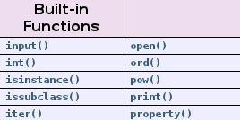

# Dicas de desempenho do Python - Parte 01

Segunda-feira, 09/04/2012 às 09h30, por [Hovhannes Avoyan](http://imasters.com.br/perfil/hovhannesavoyan)

Para ler o [Zen do Python](http://www.python.org/dev/peps/pep-0020/) , digite *import this* em seu interpretador Python. Um leitor afiado novo em Python vai notar a palavra "intérprete", e perceber que Python é outra linguagem de script. "Deve ser lento!"

Nenhuma dúvida sobre isto: o Python não é executado tão rápido ou eficientemente quanto as linguagens compiladas. Até mesmo os defensores do Python lhe dirão que o desempenho é a área na qual o Python não é bom. No entanto, o YouTube tem provado que o [Python é capaz de servir 40 milhões de vídeos](http://www.youtube.com/watch?v=ZW5_eEKEC28&feature=youtu.be)  por hora. Tudo que você tem que fazer é escrever um código eficiente e buscar uma implementação externa (C/C++) se necessário. Aqui estão as dicas para ajudá-lo a se tornar um desenvolvedor Python melhor:

**1. Busque por funções internas:**  
Você pode escrever um código eficiente em Python, mas é muito difícil de superar as funções embutidas (escritas em C). Cheque-os aqui. Elas são muito rápidas.



**2. Use join () para colar um grande número de strings:**  
Você pode usar "+" para combinar várias strings. Uma vez que a string é imutável no Python, cada operação "+" envolve a criação de uma nova string e a cópia do conteúdo antigo. Uma linguagem frequente é usar o módulo do array do Python para modificar caracteres individuais, quando você tiver terminado, use a função join () para recriar a sequência final.

```
>>> #This is good to glue a large number of strings
>>> for chunk in input():
>>>    my_string.join(chunk)
```

**3. Use a atribuição múltipla do Python para trocar variáveis:**  
Isto é elegante e mais rápido no Python:

```
>>> x, y = y, x
```

Isto é mais lento:

```
>>> temp = x
>>> x = y
>>> y = temp
```

**4. Se possível, utilize variável local:**  
O Python é mais rápido recuperando uma variável local do que uma variável global. Ou seja, evite a palavra-chave "global".

**5. Use "in", se possível:**  
Para verificar a persistência em geral, use a palavra-chave "in". Ela é limpa e rápida.

```
>>> for key in sequence:
>>>     print “found”
```

**6. Acelere com a importação lenta:**  
Mova o argumento "*import*" para a função, de modo que você só possa usar o import quando necessário. Em outras palavras, se alguns módulos não são necessários imediatamente, faça o import deles mais tarde. Por exemplo, você pode acelerar seu programa não fazendo o import de uma longa lista de módulos na inicialização. Essa técnica não contribui para o desempenho geral. Ela ajuda você a distribuir o tempo de carregamento para os módulos de maneira mais uniforme.

**7. Use "while 1" para o loop infinito:**  
Às vezes, você deseja um loop infinito em seu programa (por exemplo, um socket de escuta). Apesar de "while True" realizar a mesma coisa, "while 1" é uma operação de loop infinito. Aplique esse truque ao seu código Python de alto desempenho.

```
>>> while 1:
>>>    #do stuff, faster with while 1
>>> while True:
>>>    # do stuff, slower with wile True
```

**8. Use compreensão da lista:**  
Desde o Python 2.0, você pode usar a list comprehension para substituir muitos blocos "for" e "while". Ela é mais rápida porque é otimizada para o interpretador do Python para detectar um padrão previsível durante o looping. Como um bônus, a list comprehension pode ser mais legível (programação funcional) e, na maioria dos casos, poupa uma variável extra para conta. Por exemplo, vamos obter os números pares entre 1 a 10, com uma linha:

```
>>> # the good way to iterate a range
>>> evens = [ i for i in range(10) if i%2 == 0]
>>> [0, 2, 4, 6, 8]
>>> # the following is not so Pythonic
>>> i = 0
>>> evens = []
>>> while i < 10:
>>>    if i %2 == 0: evens.append(i)
>>>    i += 1
>>> [0, 2, 4, 6, 8]
```

**9. Use o xrange () para uma sequência muito longa:**  
Isso pode poupar toneladas de memória do sistema, porque o xrange () só produzirá um elemento inteiro em uma sequência de cada vez. Ao contrário de range (), ele te dá uma lista inteira, que é uma sobrecarga desnecessária para o looping.

**10. Use o Python generator para obter o valor em demanda:**  
Isso poderia também economizar memória e melhorar o desempenho. Se estiver realizando streaming de vídeo, pode enviar um bloco de bytes, mas não todo o fluxo. Por exemplo,

```
>>> chunk = ( 1000 * i for i in xrange(1000))
>>> chunk
<generator object <genexpr> at 0x7f65d90dcaa0>
>>> chunk.next()
0
>>> chunk.next()
1000
>>> chunk.next()
2000
```

**11. Aprenda o módulo itertools:**  
O módulo é muito eficiente para iteração e combinação. Vamos gerar toda permutação para uma lista [1, 2, 3] em três linhas de código Python:

```
>>> import itertools
>>> iter = itertools.permutations([1,2,3])
>>> list(iter)
[(1, 2, 3), (1, 3, 2), (2, 1, 3), (2, 3, 1), (3, 1, 2), (3, 2, 1)]
```

**12. Aprenda o módulo bisect para manter uma lista ordenada de classificação:**  
É uma implementação livre de busca binária e uma ferramenta de inserção rápida para uma sequência ordenada. Ou seja, você pode usar:

```
>>> import bisect
>>> bisect.insort(list, element)
```

Você inseriu um elemento à sua lista, e não tem que chamar sort () novamente para manter o recipiente classificado, o que pode ser muito dispendioso em uma sequência longa.

**13. Entenda que uma lista de Python é na verdade um array:**  
Lista em Python não é implementada como a usual lista encadeada simples de que as pessoas falam em Ciência da Computação. Lista em Python é um array. Ou seja, você pode recuperar um elemento em uma lista usando o índice com constante de tempo O(1), sem procurar desde o começo da lista. Qual é a implicação disso? Um desenvolvedor Python deve pensar por um momento ao usar insert() em um objeto de lista. Por exemplo: >>> list.insert (0 element).

Isso não é eficiente quando se insere um elemento na parte da frente, porque todos os índices subsequentes na lista terão que ser alterados. No entanto, você pode acrescentar um elemento para o fim da lista de forma eficiente, utilizando list.append (). Escolha deque, no entanto, se você quiser uma inserção ou uma remoção rápida em ambas as extremidades. É rápido porque deque em Python é implementado como lista duplamente encadeada.

**14. Use dict e set para testar persistência:**  
O Python é muito rápido para verificar se um elemento existe em um dicionário ou em um conjunto. Isso acontece porque dict e set são implementados usando a tabela hash. A pesquisa pode ser tão rápida quanto O(1). Portanto, se precisar verificar a persistência muitas vezes, use dict ou set como seu recipiente...

```
>>> mylist = ['a', 'b', 'c'] #Slower, check membership with list:
>>> ‘c’ in mylist
>>> True
>>> myset = set(['a', 'b', 'c']) # Faster, check membership with set:
>>> ‘c’ in myset:
>>> True
```

**15. Use sort () com Schwartziana Transform:**  
A função list.sort nativa () é extraordinariamente rápida. O Python classificará a lista em uma ordem natural para você. Às vezes, você precisa classificar as coisas de uma maneira que não é natural. Por exemplo, você quer classificar os endereços IP com base na localização do seu servidor. O Python suporta a comparação personalizada para que você possa fazer list.sort(cmp ()), o que é muito mais lento do que list.sort(), pois você introduz a função chamada overhead. Se a velocidade é uma preocupação, você pode aplicar o Transform Guttman-Rosler, que é baseado no Schwartzian Transform. Embora seja interessante ler o algoritmo real, o breve resumo de como ele funciona é que você pode transformar a lista e chamar list.sort() embutido do Python -> que é mais rápido, sem usar list.sort(cmp () ) -> que é mais lento.

**16. Resultados de cache com Python decorator:**  
O símbolo "@" é a sintaxe do decorator do Python. Use-o não só para rastreamento, bloqueio ou de registro. Você pode decorar uma função Python para que ela lembre os resultados necessários mais tarde. Essa técnica é chamada memoization. Aqui está um exemplo:

```
>>> from functools import wraps
>>> def memo(f):
>>>    cache = { }
>>>    @wraps(f)
>>>    def  wrap(*arg):
>>>        if arg not in cache: cache['arg'] = f(*arg)
>>>        return cache['arg']
>>>    return wrap
```

E podemos usar esse decorator em uma função Fibonacci:

```
>>> @memo
>>> def fib(i):
>>>    if i < 2: return 1
>>>    return fib(i-1) + fib(i-2
```

A ideia chave aqui é simples: aumentar (decorar) sua função para lembrar cada termo Fibonacci que já calculou; se eles estiverem no cache, não há necessidade de calculá-los novamente.

**17. Entenda Python GIL (Global Interpreter Lock):**  
O GIL é necessário porque a administração de memória do CPython não é thread-safe. Você não pode simplesmente criar várias threads e esperar que o Python seja executado mais rapidamente em uma máquina multi-core. Isso se dá porque o GIL irá prevenir múltiplas threads nativas de executarem bytecodes Python ao mesmo tempo. Em outras palavras, o GIL irá serializar todos as suas threads. Você pode, no entanto, acelerar o seu programa usando threads para gerenciar vários processos filhos, que estão sendo executados de forma independente, fora do seu código Python.

**18. Trate o código fonte do Python como sua documentação:**  
O Python possui módulos implementados em C para a velocidade. Quando o desempenho é crítico e a documentação oficial não é suficiente, sinta-se livre para explorar o código fonte você mesmo. Você pode descobrir a estrutura de dados e os algoritmos. O repositório Python é um lugar maravilhoso para se ficar por perto: [http://svn.python.org/view/python/trunk/Modules](http://imasters.com.br/artigo/24050/py/svn.python.org/view/python/trunk/Modules)

#### Conclusão

Não há substituto para o cérebro. É responsabilidade dos desenvolvedores dar uma olhada sob o capô para que eles não joguem juntos depressa um projeto ruim. As dicas de Python neste artigo podem ajudar você a obter um bom desempenho. Se a velocidade ainda não é boa o suficiente, o Python vai precisar de ajuda extra: perfil e rodar código externo. Vamos abordar ambos na parte 2 deste artigo.

⁂  
*Texto original da equipe Monitis, liderada por Hovhannes Avoyan, disponível em <http://blog.monitis.com/index.php/2012/02/13/python-performance-tips-part-1/>*
