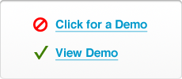
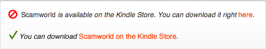
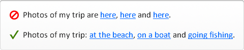
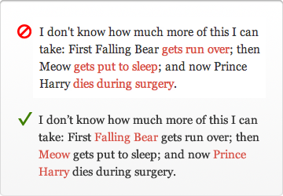
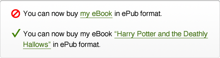
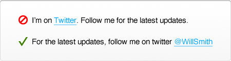
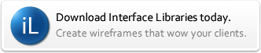
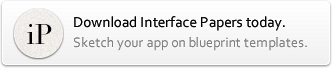
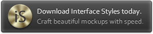

# [Why Your Links Should Never Say “Click Here”](http://uxmovement.com/content/why-your-links-should-never-say-click-here/ "Why Your Links Should Never Say “Click Here”")

by [anthony](http://uxmovement.com/author/anthony/ "Posts by anthony") on 06/20/12 at 10:39 pm

Have you ever wanted your users to click your links, but didn’t know how to get them to act? When some designers run into this problem they’re tempted to use the words “click here” on their links. Before you give in to the temptation, you should know that using these words on a link can affect how users experience your interface.

## “Click” Puts Too Much Focus on Mouse Mechanics

Using the word “click” on your links takes the user’s attention away from your interface and on to their mouse. Users know what a link is and how to use a mouse. It’s unnecessary to call attention to the mechanics when clicking a link. Doing so diminishes their experience of your interface because it momentarily takes their focus away from it. Instead of focusing on the interface and its content, “click here” diverts their attention to the user and their mouse. Not to mention, you can also make them feel dumb by suggesting that they don’t know what a link is or how to use a mouse.

*“view” relates to the users task, while “click” puts the focus on mouse mechanics*

Instead of using the word “click”, look for a different verb you can use that relates to the user’s task. There’s always a better and more relevant verb to use than “click”. “Click” makes users think of their mouse. But a task-related verb makes users think of their task. It keeps users engaged with the content and focused on using the interface, not their mouse.

## “Here” Conceals What Users are Clicking

Some links don’t use the word “click”, but instead they use the word “here”. The problem with using “here” in a link is that it conceals what the user is clicking. You may have text around the link that explains what they’re clicking, but when users read the link itself they won’t have a clue. This means that users have to read the text all around the link to understand the context of the link. This impedes users from taking the quick and short route of clicking the link directly because they have to read the surrounding text first. If there’s a lot of text, this could slow users down a lot.

*when your link doesn’t just say “here”, users can skip the verbose text and go right to the link*

Not only that, but If you have multiple links that say “here”, “here” and “here”. the user is going to have trouble differentiating between each link. The user has to open each of them to see how they’re different. If they want to refer back to a particular source, they have to remember which “here” link it belongs to. This forces them to have to use recall over simple recognition. What you should do instead is label your links with something that describes what the user is clicking so that it makes different links easier to distinguish.

*when each link is labeled, they’re a lot easier for the user to distinguish*

Using the word “here” to make your links noticeable is unnecessary because that’s what the distinct styling of a link should already do. If you feel like you have to use the words “here” to get users to see your link, there’s a problem with how your link looks. Does your link use the same color as your text? If it does, this can make it hard for users to find your links. Can users visually distinguish your links through color and shape? A change in color can help give your link contrast. But a change in shape, such as underlining or bolding the text, can help give your links even more contrast.

## Phrasing Links the Right Way

What your links say, can say a lot about your site. It’s important to use the right words on your links and link to the right words. Below are a few techniques that will help you make the most of your links.

### Link to Nouns

Instead of linking to the words “click here”, you should link to the concrete and proper nouns of a sentence. Concrete nouns are best because they’re things users can experience with their senses. This gives them a better idea of what they’ll get when they click your link as opposed to linking to something abstract. Proper nouns are good because they represent unique entities that stand out in and of itself.

Avoid linking to only verbs because they’re vague and don’t give users a clear picture of what they can expect. Linking to nouns allow users to easily scan your links, and quickly understand what they’re clicking on without needing to read the entire sentence or paragraph of the link.

*linking to nouns gives users a better picture on what they’re clicking*

### Link to Specifics

It’s also best to make whatever you’re linking to as specific as possible. For example, if you’re linking to an article or book, don’t link to the words “article” and “book”. Instead link to their respective titles. This gives users more detailed information on what they’re clicking and what they can expect.

*the more specific the link, the more clear it is to users what they’re clicking*

### End on a Link

Another tip is to try to structure your sentences so that the nouns you want to link to are at the end of the sentence. This makes your links easier to spot because users will instantly see it as they finish reading the sentence. This allows them to act immediately instead of having to go back and look for the link in the middle of the sentence somewhere.

*links at the end of the sentence allow users to take action faster*

## Make Your Links Click with Users Without Saying “Click Here”

Next time you find yourself thinking about using the words “click” or “here” on your links, remember the effects it’ll have on the user experience. The challenge is to make your links say “click here” without actually saying “click here”, and there are many ways to do this. It will take some thought and effort on your part, but in the end, your users will benefit with a better experience of your interface. You can take the easy way out and use “click here” on your links, or you can spend some time to find the right phrasing for your links that’ll click with your users. The choice is yours.

Related Articles:
