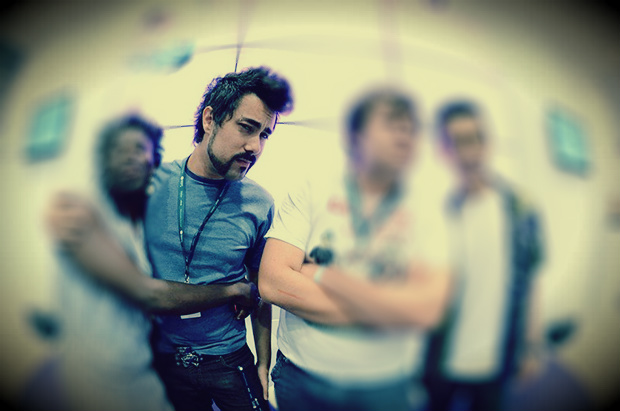
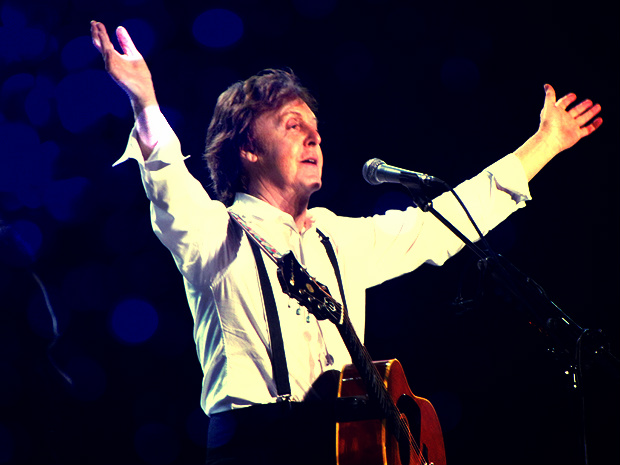
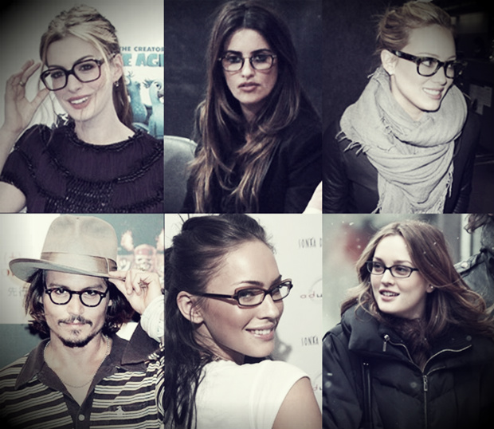
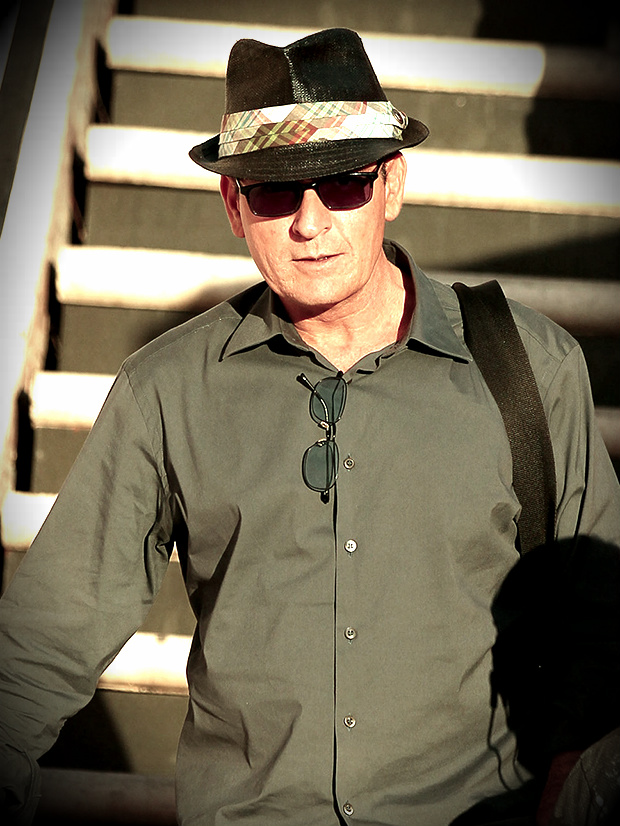
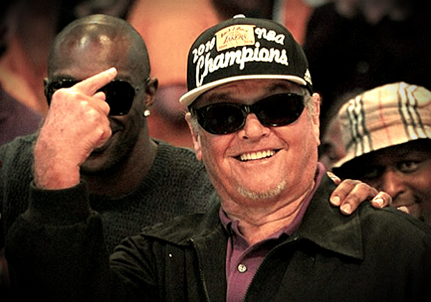
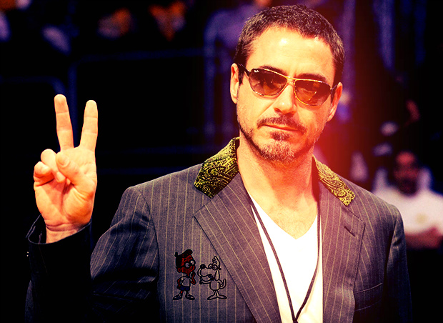
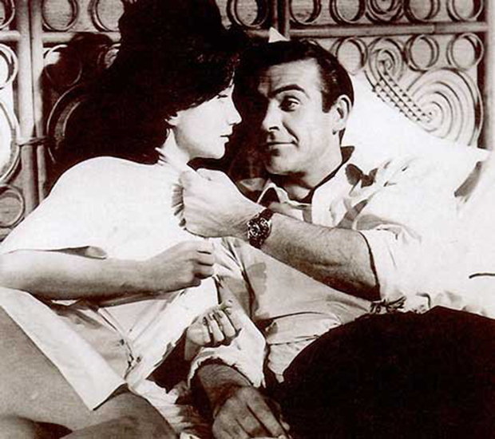
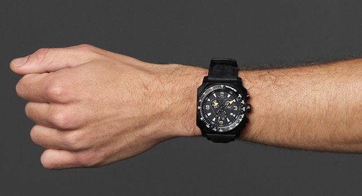
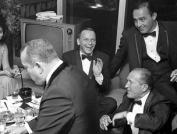

Provavelmente você já viu alguém na rua usando boné ou chapéu num dia nublado e achou isso normal. O motivo é bastante simples: esse acessório tornou-se parte da vestimenta naturalmente. E não é o único.

  

A regra vale também para o cinto. O cinto não serve apenas para segurar as calças, sua função principal. Combinado com outros acessórios, ele tem um valor importante no acabamento do visual. Assim como o relógio. Afinal, quem nunca flagrou uma pessoa tirando o celular do bolso para conferir as horas mesmo estando com o relógio no pulso?

  

O boné, o cinto e o relógio são acessórios que  perderam a  função prioritária e acabaram virando um complemento visual. Basta saber como usa-los sem perder a funcionalidade e, claro, o estilo.

  

### **Cinto**

  

Existem documentos que comprovam a existência de cintos, tanto de uso masculino como feminino, desde a Idade média. Obviamente foi criado com um único fim já citado no post: segurar as calças. Com o desenvolvimento da moda e do comercio, os formatos de cintos, confecções e cores foram variando. Assim, surgiu um novo aliado na combinação. O cinto tem um poder enorme de realças outras peças. Por isso o cuidado na hora de escolher um cinco social ou esporte para determinadas ocasiões.

  

Os cintos servem como um adorno que permite dividir o visual em “parte de cima” e “parte de baixo”. É  bastante indicado para quem gosta de brincar com cores ou até criar um destaque com tons monocromáticos, usando um cinto colorido. No mercado já existem em diferentes tipos de materiais e modelos, dos clássicos de couro até modelos bem modernos.

  

  

Maurício Cid e o cinto mais famoso da internet brasileira

  

### Suspensório

  

Quem se importa que o suspensório não serve mais para segurar as calças?

  

O suspensório tinha a mesma função dos cintos. Na verdade era como uma alternativa para segurar a calça na altura ideal e evitar que ela descesse com os movimentos. Estima-se que o primeiro suspensório foi criado há mais de 200 anos. Ainda assim, tem uma elegância que sobrevive até hoje. Tido como brega nos anos 90, hoje é um exemplo de atitude quando utilizado. [Seja no ambiente acadêmico](http://www.youtube.com/watch?v=wB2zwFTZ4JE) ou nos programas mais informais.

  

O fato é que os suspensórios voltaram à moda como uma opção de acessório que pode ser usado até com um cinto, criando um look moderno. Um bom exemplo de um bom uso do suspensório é no filme *Spread (Jogando com prazer)* com Ashton Kutcher. Ou então os clássicos em *De Volta Para o Futuro* e *Curtindo a Vida Adoidado*. Quem aí lembrava dos protagonistas, símbolos da cool lifestyle, usando suspensórios?

  

  

Sir Paul ainda usa suspensórios. E ainda tá aí na atividade.

  

### Óculos de grau

  

A história diz que o óculos de grau foi criado a partir da evolução de lentes convexas que monges, do século XIII, construíram para colocá-las sobre os manuscritos e ajudá-los na leitura dos textos. Na sociedade os óculos eram interpretados como um sinal de instrução, requinte e maturidade. Hoje as coisas mudaram.

  

Além de seu uso natural entre as pessoas que têm algum tipo de deficiência visual (hipermetropia, miopia ou astigmatismo), existem modelos com lentes de vidro ou plástico só para quem nunca teve um problema de visão poder usar. Pode ser usado quando quiser transmitir mais seriedade, ou mesmo criar um estilo geek.

  

Só não vale usar sem a lente. Aí não.

  

  

Alguns que não erraram ao escolher a armação perfeita

  

### Chapéu

  

O chapéu – ou o que se assemelhava a um – foi criado há milhares de anos e foi evoluindo passando por uma espécie de faixa, tiara, turbante, até se tornar o chapéu que conhecemos atualmente. Usado por nobres, sacerdotes e guerreiros, o chapéu era considerado como símbolo de status social.

  

O chapéu voltou à cena dando um toque retrô aos looks contemporâneos. É um ótimo acessório para criar um look despojado e marcante. Sem contar que trata-se de um símbolo de poder. Homens importantes, reais ou fictícios, para o bem ou para o mal, dificilmente saíam em público sem um desses na cabeça. A lista inclui Ernest Hemigway, Frederico Fellini, John Belushi, Rorschach, Chico Buarque, Orson Welles, Winston Churchill, Al Capone, Dick Tracy e Fred Astaire, entre muitos outros. Ícones do cinema, da música, da dança, da literatura e de diversas disciplinas da arte.

  

  

Salve, Charlie!

  

### Boné

  

Os primeiros bonés surgiram em 1869, quando os jogadores norte-americanos de beisebol do time Brooklyn Excelsiors, utilizaram um modelo antigo que servia para proteger os olhos do sol durante as partidas. O modelo usado hoje em dia teve origem na década de 40.

  

Hoje, a utilidade básica do boné, que antes era para proteger do sol, mudou e agora é um acessório que diferencia um estilo, deixando o visual mais jovem, urbano e moderno. Usar boné, que foi símbolo de rebeldia em determinada época, hoje é uma verdadeira assinatura do usuário. O cara que usa boné muitas vezes conhecido por estar sempre com o acessório. Isso é interessante e mostra a importância de escolher o boné certo. Um boné que diga por você.

  

  

Jack Nicholson é conhecido por assistir jogos com o boné dos Lakers

  

### Óculos de sol

  

Historiadores dizem que a primeira lente escura de que se tem notícia foi uma lâmina verde usada pelo imperador Nero, no século I. Especula-se que como ele era muito loiro, alguns dizem até albino, e gostava de assistir as brigas de gladiadores, mas, por causa dos olhos claros, não via bem as apresentações nas arenas, foi criada essa espécie de lâmina verde escura que ele usava para proteger os olhos e conseguir enxergar ao sol.

  

O óculos de sol hoje ainda é usado como um acessório para “enxergar com mais facilidade durante o dia”, mas é também um adorno para o rosto. Existem vários modelos de armações e lentes, para todos os gostos e estilos. Usar óculos escuros em lugares fechados ou durante a noite é piegas, mas muitos gostam desse ato para demonstrar personalidade e um certo ar de poder. Vai do gosto de cada um. Mas eu não indico.

  

  

Um cara que manja de estilo.

  

### Relógio

  

O relógio é uma das mais antigas invenções humanas e sempre foi utilizado como medidor de tempo. Entre os primeiros artigos que originaram os relógios atuais, estão os relógios de sol, areia (ampulheta) e água. Mais tarde foram criados os primeiros modelos mecânicos, que utilizavam de engrenagens ou pêndulos.

  

Os primeiros relógios utilizados pela sociedade, por volta do século XV, foram os relógios de bolso. Eram muito raros e tidos como verdadeiras jóias, pois poucos tinham um e eram símbolo da alta aristocracia.

  

O uso do relógio é de extrema importância para quem quiser ter um estilo homem e, principalmente, transmitir um ar de responsabilidade e pontualidade. James Bond, por exemplo, é a prova de que um relógio sempre deve estar no pulso de um homem de respeito

  

  

Eu confiaria num Bond de relógio

  
> Então os acessórios perderam os seus valores de antigamente?

  

Pelo contrário. Eu diria que existe um valor até maior nos dias de hoje. Um acessório pode dizer bastante sobre sua personalidade, para o bem ou para o mal. Não espere transmitir seriedade usando boné, mas usar um chapéu com confiança pode causar uma excelente primeira impressão.

  

Por isso, aproveite os diversos tipos de acessórios masculinos e use deles para se destacar dos demais. Não digo para você sair por aí como uma árvore de natal, mas sim identificar quais acessórios têm a sua cara e cabem no seu estilo.

  

### **Mecenas: Netshoes**

  

  

*O pessoal da Netshoes criou uma promoção para incrementar seu estilo, porque um bom relógio pode dizer muito sobre você.*

  

*Eles estão sorteando esse baita relógio acima. Basta entrar aqui e responder: “O que faz de você o senhor do seu tempo?”. O autor da melhor resposta leva o relógio Timberland Stratham.*

  
  

## LEIA TAMBÉM...

  

1.   

   Como ser um bom anfitrião

     

     

   Como planejar um não-jantar perfeito

     

     

   Como fotografar uma mulher nua (e leitores podem participar)

  

---

Curadoria do PdH com as mais deliciosas mulheres da web, selecionadas a dedo: [www.apimentadas.com.br](http://apimentadas.papodehomem.com.br/)

  
[anexo ausente]  
  

Artigos Relacionados

  

[Como escolher uma cuia de chimarrão](http://rss.feedsportal.com/c/32911/f/530922/s/20b1ff6c/l/0Lpapodehomem0N0Bbr0Ccomo0Eescolher0Euma0Ecuia0Ede0Echimarrao0C/story01.htm)

  

[Melhores sanduíches pra se comer nessa vida | Listas descaralhantes #8](http://rss.feedsportal.com/c/32911/f/530922/s/20c6140a/l/0Lpapodehomem0N0Bbr0Cmelhores0Esanduiches0Epra0Ese0Ecomer0Enessa0Evida0Elistas0Edescaralhantes0E60C/story01.htm)

  
  
  
[[anexo ausente]](http://da.feedsportal.com/r/139262099569/u/49/f/530922/c/32911/s/213ded9d/a2.htm) [anexo ausente]  
  

[[anexo ausente]](http://feeds.feedburner.com/~ff/PapodehomemLifestyleMagazine?a=5cGF9qjS0nI:exgnhat-sD0:yIl2AUoC8zA)  [[anexo ausente]](http://feeds.feedburner.com/~ff/PapodehomemLifestyleMagazine?a=5cGF9qjS0nI:exgnhat-sD0:qj6IDK7rITs) [[anexo ausente]](http://feeds.feedburner.com/~ff/PapodehomemLifestyleMagazine?a=5cGF9qjS0nI:exgnhat-sD0:-BTjWOF_DHI)

  
[anexo ausente]  
  
  
  
from Papo de Homem - Lifestyle Magazine <http://papodehomem.com.br/como-incrementar-seu-visual-com-somente-um-acessorio/>
