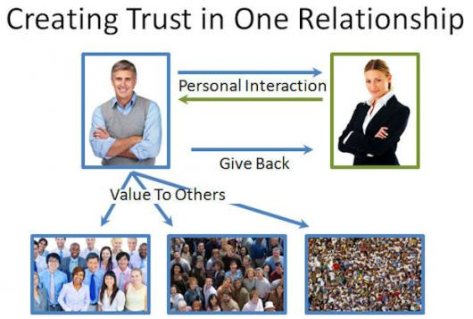
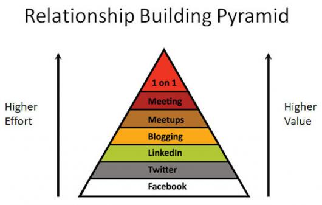
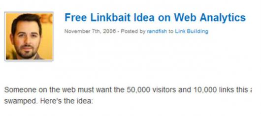
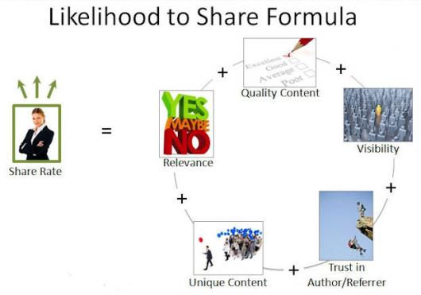
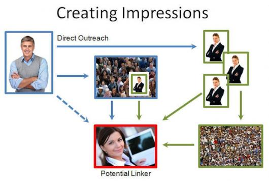

Como já falamos na [primeira parte desse artigo](http://imasters.com.br/artigo/24827/metricas/marketing-de-influencia-o-que-e-e-porque-voce-precisa-faze-lo-parte-01), um bom conteúdo é essencial para promover o seu produto e a sua marca. Mas não adianta ter um conteúdo excelente, se ele não alcança uma grande audiência. É preciso dar visibilidade e fazer com que ele chegue cada vez mais a um número maior de pessoas. E é aí que entra o marketing de influência, no qual você se beneficia da influência de outras pessoas para alavancar o seu conteúdo/ produto/ marca.

  

#### Construindo o relacionamento

  

Isto não é tão diferente de fazer novos amigos quando você muda para um novo bairro. Quando você vai para a primeira festa do bairro, você não sai por aí pedindo para que todos te dêem R$20. Você vai arruinar o seu lugar no bairro agindo dessa maneira. Não funciona no bairro e não vai funcionar na construção de relacionamentos em qualquer outro lugar. O processo é realmente muito simples, como mostrado aqui:

  

  

Os elementos principais são:

  

1. Comece a interagir com eles. Faça como se estivesse fazendo uma nova amizade. Quando se trata de negócios, foque em oferecer valor. Se tiverem alguma dúvida, procure respondê-la. Não gaste todo o tempo dizendo o valor que você traz, basta entregá-lo;

     

   De forma contínua, mostre que você estará ativo em compartilhar suas coisas para o seu público. Mesmo se sua audiência for muito menor, a atitude de dar e receber será notada;

     

   Ajude ativamente os outros. Quando você foca toda sua atenção em uma pessoa, a exclusão de outros passa a ser algo estranho. Dê valor aos outros de forma regular. Publique coisas boas e compartilhe coisas boas de outras pessoas. Dica: se você descobrir um conteúdo bom de um autor pouco conhecido, o influenciador o qual você está tentando construir a sua relação se interessará mais do que nunca!

Assim como na interação, quanto mais pessoal melhor. Eu construí muitos dos meus relacionamentos na indústria de busca indo à conferências e sentando na primeira fila para ouvir as palestras das pessoas que eu queria conhecer. Depois eu era a primeira pessoa a falar com elas quando a palestra terminava. Contato face a face assim é impressionante.

  

O diagrama a seguir tenta ilustrar os tipos de métodos de construção de relacionamento que são os mais pessoais e, portanto, possuem o maior valor:

  

  

Também é importante priorizar. Quais pessoas valem maiores esforços? Como você decide? Você pode ir a uma conferência para encontrar com um crítico pessoalmente. Outros você pode simplesmente interagir com contas em redes sociais.

  

Note que é possível, certamente, construir relacionamentos significativos com pessoas através de apenas meios de comunicação social - mas nada bate o “cara a cara”.

  

Oportunidades também são importantes. Sua primeira oportunidade de fazer uma boa impressão a alguém pode estar no ato de responder a um post de blog, um tweet, ou uma atualização do Facebook. Seu alvo pode pedir ajuda com alguma coisa, como Rand fez neste post de blog em novembro de 2006:

  

  
  
Alguém reforçou e continuou:

  

Ah, certo, fui eu. Os [relatórios analíticos](http://www.stonetemple.com/articles/analytics-report-august-2007.shtml) foram publicados em 27 de agosto de 2007. O ponto é, se jogar em oportunidades como esta faz uma boa impressão; e pode acelerar realmente a construção de um relacionamento.

  

Depois de ter desenvolvido um relacionamento, você ainda precisa fazer as coisas certas para ter alguém que compartilhe ou linke o seu material. Ninguém vai compartilhar tudo que você faz porque algumas delas não são tão boas ou tão relevantes (não se ofenda, ninguém é ótimo o tempo todo).

  

Aqui está uma fórmula que desenvolvi para a probabilidade de alguém compartilhar ou linkar o seu conteúdo:

  

  

Vamos dar uma olhada para os elementos principais:

  

1. Relevância: Se não é relevante para eles, então eles não irão compartilhar - mesmo que seja excelente!

     

   Singularidade: [Seth Godin](http://www.sethgodin.com/purple/) gosta de nos dizer para sermos notáveis. Se o que você criar não for excepcional, ninguém vai se importar e nem compartilhar.

     

   Qualidade de conteúdo: Isso nem é preciso ser dito. Conteúdo porcaria trará resultados porcarias e nenhuma quantidade de construção de relacionamento vai mudar isso.

     

   Confiança no autor – É aí que o relacionamento entra em jogo. Você pode criar conteúdo de qualidade, mas se você ainda não for confiável, a sua taxa de compartilhamento será muito menor.

     

   Confiança nas fontes de referência – A forma como alguém aprende sobre uma parte do conteúdo é um fator na taxa de compartilhamento também. Se uma autoridade te diz a respeito, você está mais propenso a repassar.

     

   Visibilidade – As pessoas não podem compartilhar o que elas não vêem. Por exemplo, se você criar um ótimo post no seu blog e tweetá-lo uma única vez, uma porcentagem de seus seguidores jamais o verão. Tweets são instantâneos e se vão cinco minutos depois. Mesmo o tweetaholic mais viciado perde algumas coisas no seu fluxo de tweet.

     

   Impressões - Impressões é um ponto interessante. Isso é marketing clássico em ação. Os especialistas em marketing costumavam dizer que surgem uma média de sete impressões por venda. Claro, as impressões não são todas criadas iguais:

  

Como você pode ver, o alcance de influenciadores é longo. Eles não só podem te conseguir links, mas também te dar compartilhamentos que resultam em outras pessoas, que por sua vez, compartilham também.

  

#### Resumo

  

Aprender a trabalhar as dinâmicas das pessoas na Internet é uma atividade decisiva de marketing. Isso não é novidade. É sempre valioso para construir relacionamentos com pessoas influentes. A Internet simplesmente nos dá novos mecanismos para fazermos isso.

  

Comunicação e relacionamento estão mais fáceis do que nunca. Você pode começar facilmente a trabalhar com as mídias sociais ou conversas do blog e isso é ótimo. Mas não subestime o poder da moda antiga. Interações mais pessoais ainda têm o maior impacto.

  

Criação de conteúdos fantásticos é uma obrigação, então faça disso uma parte fundamental do seu plano. Em seguida, complemente isso com a construção de relações corretas para que você possa fazer o mundo saber sobre todas as coisas legais que você está fazendo.

  

Uma última dica: agregue valor para o público em cada passo do caminho. Mesmo quando você estiver criando conteúdo para o seu próprio blog, as pessoas estão indo só para compartilhá-lo porque ele ajuda os outros. Dar, dar e dar, e sempre ajudar aos outros. As pessoas irão notar e isso é uma coisa boa.

  

\*\*\*

  

*Este artigo é uma republicação feita com permissão. SEOMoz não tem qualquer afiliação com este site. O original está em*: <http://www.seomoz.org/blog/influencer-marketing-what-it-is-and-why-you-need-to-be-doing-it>

  
[anexo ausente]  
  

  

  
  
  
[[anexo ausente]](http://da.feedsportal.com/r/138509795413/u/49/f/546640/c/33212/s/20ed0e37/a2.htm) [anexo ausente]  
  
[anexo ausente]  
  
  
  
from iMasters - <http://feedproxy.google.com/~r/imasters/~3/TeKCly4jM0g/story01.htm>
