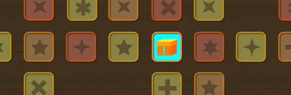

  

Bom, olá pessoal!

  

Antes de tudo gostaria de agradecer ao pessoal que leu o primeiro artigo e espalhou pelas redes sociais por aí… Brigadão! E se você não leu, aqui está o link: [O que faz aplicativo mobile dar certo e outro não?](http://webinsider.uol.com.br/2012/04/12/o-que-faz-aplicativo-mobile-dar-certo-e-outro-nao/)

  

Segundo, desculpa pela enorme demora, sabe como é, poderia dar várias explicações, mas aí vai o post:

  

Vamos então continuar com a conversa sobre o que faz um [aplicativo](http://webinsider.uol.com.br/tag/aplicativos-web-20/) dar certo.

  

Falamos da última vez sobre o planejamento de ideias para tornar o projeto mobile algo legal. Mas porque eu, como designer estou falando tudo isso?

  

A história é a seguinte: a função de um designer, seja qual tipo for, não é simplesmente deixar o produto bonito, na verdade a beleza é consequência do restante das nossas funções.

  

Design é projeto, é pensar para que um produto venda e, consequentemente, em um aplicativo mobile, a função do designer inclui todo o planejamento de arquitetura de navegação, estrutura de elementos, identidade visual e até alguns planejamentos internos como decidir o conteúdo que é carregado da internet ou que está internamente no aplicativo, já que essa informação influencia diretamente na usabilidade do produto.

  

Por mais que muitas pessoas entendam que essas decisões são secundárias, que o que importa é realmente o negócio funcionar e ser bonito, uma navegabilidade fácil é o que torna o usuário mais feliz e confortável com seu aplicativo. Dificultar a vida do usuário o deixa nervoso e faz com que ele se canse facilmente e o delete de seu aparelho.

  

Outro processo então para que seu projeto se faça valer a pena é construir um design bonito, limpo e eficiente.

  

Bom, já que pensamos nas ideias, vamos agora passar para o processo de criação da interface do aplicativo.

  

## Planejamento da criação

  

Costumo dividir esse processo criativo em três grupos, dependendo do seu intuito em fazer o aplicativo.

  

O primeiro é quando você ou o comercial da sua empresa, bate na porta de um cliente em potencial para oferecer seu projeto. Isso é bastante comum de acontecer e eu recomendo!

  

 Nesse tipo de ocasião você tem que entender que talvez o contato não tenha interesse inicialmente ou pior ainda, talvez nunca tenha usado um smartphone, ou seja, você está oferecendo um projeto que só pessoas com smartphones vão poder usar e mais do que isso, vão ter que lhe procurar em uma loja virtual, fazer o download e instala-lo para aí sim poder usar. E você terá que convencê-lo de que vale a pena gastar alguns milhares de reais por isso.

  

Daí que todo seu planejamento entra. Você vai praticamente fazer um “dossiê” sobre o seu provável (será?) cliente. Descobrir tudo sobre o seu produto, clientes, concorrentes, etc. Assim você consegue transformar toda essa informação em ideias, exatamente como vimos no primeiro artigo – e finalmente fazer um mockup!

  

Um mockup? Um mockup nesse caso seria um conjunto de 3 a 6 telinhas do aplicativo já com design caprichado. Mas como assim? Um design caprichado para um cliente que nem é cliente ainda? Sim, sou muito dessa opinião.

  

Criar a interface de cinco telas, por exemplo, já é suficiente para o seu prospect entender a arquitetura do aplicativo: como ele vai navegar, quais funcionalidades vão estar em maior evidência, quão fácil está chegar aos objetivos, além de é claro ver sua identidade visual bem aplicada em conjunto com features que atraiam o usuário e que só o mobile pode oferecer.

  

Por mais que leve um tempo fazendo isso, considero muito mais eficiente do que apresentar apenas um ppt com textos descritivos. Lembre-se que uma imagem vale mais que mil palavras e nosso trabalho é convencer. Estando tudo bem feitinho, a pessoa vai se surpreender e ficar com aquela vontade de ter aquele produto para ela!

  

O segundo grupo é quase a mesma coisa, só que dessa vez quem bate a porta é o cliente, ele lhe pede um aplicativo. A diferença nesse caso é que ele já tem suas ideias, já sabe mais ou menos o que quer. Nesse caso vale da mesma forma fazer um mockup, apresentar o que ele pediu em um design legal. Até porque, nesse caso, é muito provável que ele esteja lhe colocando em uma concorrência, procurou você no Google, indicação, te ama ou o que for… Ele vai querer ver outras propostas, ideias e valores. Ou seja, capriche no design, na estrutura e inove! Mostre que é em você em quem ele deve confiar, que com o seu projeto que vai valer a pena o produto final, que com essas ideias e design, o aplicativo vai se tornar rentável e publicitário.

  

O terceiro e último grupo já é mais diferente dos outros. É quando você tem aquela ideia genial, decide fazer para vender nas lojas de aplicativos e ficar rico! Ou não. Pode dar muito certo, como também você pode fazer um esforço imenso, levar meses produzindo e investindo tempo e dinheiro para no final o número de vendas não compensar… Calma! Não estou querendo desanimar ninguém! Meu intuito é dizer que da mesma forma que nos outros casos você vai ter que pesquisar tudo sobre seus futuros usuários, descobrir do que eles gostam, quais aplicativos usam, o que os concorrentes têm de bom e de ruim, pegar toda essa informação e transformar em uma estrutura e estética melhor que a de todos os outros!

  

Daí que a gente entra na criação da interface em si (eu sei que parece que estou enrolando, mas eu estou tentando não fazer isso, sério). Bom, assim como em qualquer projeto de design, existem algumas etapas essenciais:

  

1. **Lápis e papel.** Você economiza muito, mas muito tempo mesmo planejando a interface no papel. Você já consegue encaixar os elementos necessários na “tela” e prever possíveis falhas na navegação e estética do projeto. E, convenhamos, arrumar no papel é mil vezes mais fácil do que no Photoshop. Além disso, de quebra você ganha um wireframe e um fluxograma pré-produzidos.

     

   **Fluxograma**. O fluxograma tem muitas funções, a principal delas é organizar as telas e traçar um caminho para o usuário percorrer. Prever situações como fluxos alternativos dependendo das escolhas do usuário e quais as telas necessárias para tudo funcionar corretamente. Existem diversos softwares para criação de fluxogramas, eu gosto bastante do [XMind](http://xmind.net/) que é gratuito, tem versão para Mac, Windows e Linux, é bem completo e fácil de usar.

     

   **Wireframe**. Duas funções principais: a primeira vem antes da construção do design, como descrito no item “lápis e papel” e serve para planejar a base de posicionamento dos elementos. A segunda é após a definição da identidade visual e do mockup inicial e serve tanto para testes de usabilidade antes da produção, quanto para aprovação de todas as telas antes de iniciar a construção do design final, para evitar a velha “refação”.

As três etapas são essenciais e contribuem diretamente para um bom resultado final. Sem elas você terá um trabalho muito maior durante a criação da interface e terá que pensar nas funcionalidades, navegação e elementos ao mesmo tempo em que faz a tela, contribuindo para o aparecimento de falhas na usabilidade.

  

Legal, mas que elementos eu coloco na tela? O que eu posso usar, criar e modificar em um aplicativo iOS, Android ou Windows Phone? Posso usar qualquer cor, forma, fonte e interações?

  

Bom, como o post está grande demais de novo, no próximo a gente vai ver tudo isso, como criar uma interface para um aplicativo!

  

É isso aí, obrigado pela atenção e até a próxima!

  

E muito obrigado ao [Samuel](http://somewell.com.br/), que faz a dupla de design comigo aqui no [iai?](http://iai.art.br/) pelas ilustrações! Dahora!

  

Ah e não se esqueçam:

  

O poder é de vocês!

  

**[Webinsider]**

  

…………………………

  

Acompanhe o Webinsider no [Twitter](http://twitter.com/webinsider) e no [Facebook](http://www.facebook.com/webinsiderbrasil).

  

Assine [nossa newsletter](http://webinsider.uol.com.br/newsletter/) e não perca nenhum conteúdo.

  
  
  
from Webinsider [http://webinsider.uol.com.br/2012/07/02/o-que-faz-aplicativo-mobile-dar-certo-e-outro-nao-parte-2/?utm\_source=rss&utm\_medium=rss&utm\_campaign=o-que-faz-aplicativo-mobile-dar-certo-e-outro-nao-parte-2](http://webinsider.uol.com.br/2012/07/02/o-que-faz-aplicativo-mobile-dar-certo-e-outro-nao-parte-2/?utm_source=rss&amp;utm_medium=rss&amp;utm_campaign=o-que-faz-aplicativo-mobile-dar-certo-e-outro-nao-parte-2)
