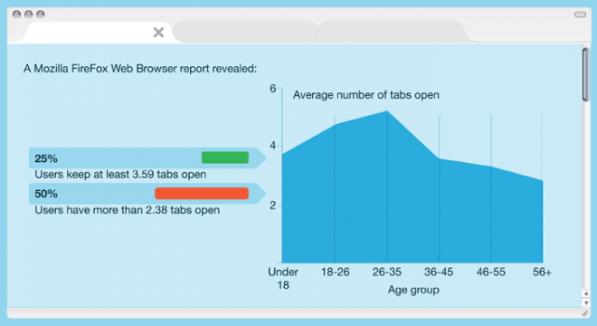
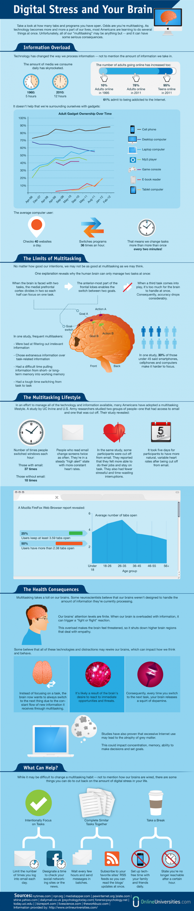

  

O infográfico abaixo, criado pelo [OnlineUniversities](http://onlineuniversities.com/), mostra alguns números sobre crescimento do hábito de executar várias tarefas ao mesmo tempo enquanto as pessoas estão usando o computador.

  

Highlight: o cérebro humano sente-se confortável com no máximo **duas tarefas** acontecendo ao mesmo tempo. Quando uma terceira tarefa entra no jogo, o cérebro começa a dar sinais de cansaço – reduzindo a concentração da pessoa e diminuindo a precisão com que ela realiza o multi-tasking.

  

  
  
  
  
  
  
from Arquitetura de Informação <http://arquiteturadeinformacao.com/2012/09/26/multitasking-estatisticas-e-consequencias-para-o-cerebro/>
