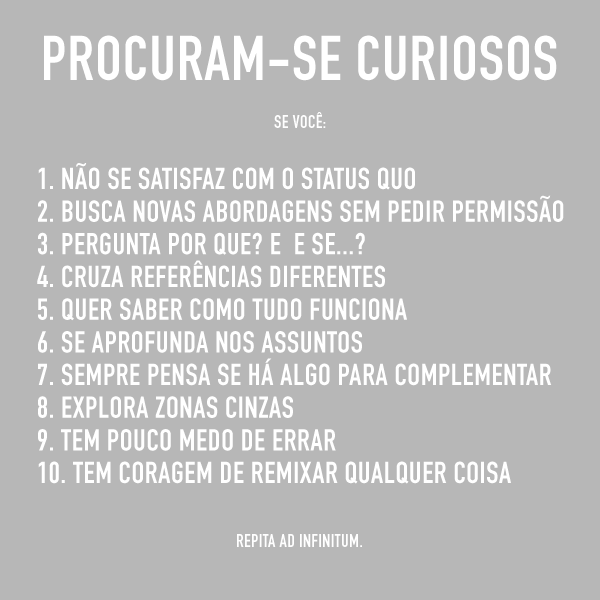
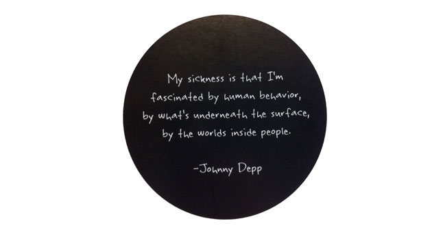
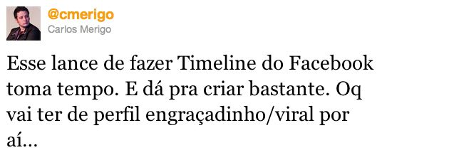

  
  

Uma coisa que tenho notado muito ultimamente é a ausência da curiosidade nas pessoas. Quando falo de curiosidade é muito mais uma questão de estilo de vida do que procurar alguma coisa num FAQ. Sinto falta de ver pessoas questionando as coisas. E nem quero dizer que isso é algo apenas para nós publicitários. É para todo mundo. Se você é curioso, você vai perguntar o porque das coisas serem assim. Vai questionar o status quo. Vai perguntar “E se…?” e vai procurar outras respostas. É saber que mesmo que isso não resolva o seu problema imediato, isso pode ser uma referência que pode ser cruzada no futuro e resolver algum outro problema. Essa falta de curiosidade pode aparecer de várias maneiras independente da idade, cargo, ou função:

  

Quando se trabalha com relatórios qualquer e não se pergunta porque aconteceu um determinado desvio, quando vê algo que funciona ok e não tenta pensar em alguma maneira de muda-la e por aí vai. Quando simplesmente aceita-se que as coisas são assim e pronto.

  

Segundo o dicionário **Houaiss**, curiosidade é  
*2 desejo intenso de ver, ouvir, conhecer, experimentar alguma coisa ger. nova, original, pouco conhecida ou da qual nada se conhece  
2.1 vontade de aprender, saber, pesquisar (assunto, conhecimento, saber); interesse intelectual  
2.2 interesse, procura de coisas originais, insólitas etc.*

  

Ou seja, o curioso é uma pessoa inconformada com o que lhe é apresentado. Ele sempre quer experimentar coisas novas. Teoricamente, curiosidade é o sobrenome do meio de todos os publicitários mas o que notei é que muitas vezes o que está acontecendo é um aprisionamento nos formatos e linguagens existentes. É ficar preso ao “Curta e Compartilha” porque “dá certo” em termos de números por mais que seja algo que muitas vezes nada tem a ver com a marca. É mais fácil repetir o que já existe do que procurar coisas diferentes. Claro, existem situações em que não dá para mudar muita coisa mesmo, tem outras que o cliente não topa. Mas há muitas vezes em que nem se tenta mudar nada. Alguns vão culpar a rotina do trabalho, o cansaço de ver idéias serem vetadas porque o cliente não entendeu ou porque não quis. Mas acho que quem não é curioso para pelo menos pensar se é viável

  

O **Douglas Rushkoff** falava nos seus primeiros livros, cheios de idealismo do início da internet, que as outras gerações iriam mudar o mundo porque elas se comportariam de outra forma e iriam aproveitar muito todas as possibilidades da internet para fazer coisas incríveis. O que aconteceu na verdade, e ele notou mais tarde, foi que a maioria dos jovens vê a internet apenas como mais um canal para falar com amigos e se distrair enquanto a vida passa. Acaba sendo quase como mais um canal de mídia passiva.

  

Essa falta da vontade de saber como as coisas e as pessoas funcionam me incomoda. As pessoas não querem assumir riscos. É uma postura quase de um hacker de tentar procurar maneiras de desafiar o status quo. Não estou falando que todos devem fazer coisas ilegais. Apenas acho que temos que procurar hackear o mundo. Nosso objetivo deve ser otimizar o trabalho e não apenas reduzir o trabalho. Reduzir trabalho hoje acaba sendo repetir formatos sem questioná-los.

  
  

Se você parar para pensar, vai notar que tudo relacionado ao movimento Open Source e Crowdsourcing é focado no que os curiosos podem conseguir para a humanidade. Em Crowdsourcing, tem aquele exemplo clássico de um chefe de logística solucionar um problema de química porque esse é um assunto que ele tem interesse e é curioso.  
No caso do open source é um pouco mais meritocrático mas é interessante também: Você é tão bom quanto o seu código. Se o seu código continua em algum programa open source (que muita gente mexe) é por que você fez ele muito bem.

  

No [Braincast sobre Insights](http://www.brainstorm9.com.br/31522/braincast9/braincast-33-como-surgem-os-insights/) uma coisa que foi pouco abordada na minha opinião é o lance de ter muitas referências e cruza-las quando tem um insight. E esse tipo de associação acontece mais quando se tem mais referências, quando se buscou mais assuntos, quando a pessoa foi mais curiosa.

  

Por isso que o discurso/manifesto “Stay Hungry,stay foolish” do **Steve Jobs** faz tanto sentido assim como o [“Here’s to the crazy ones…”](http://www.brainstorm9.com.br/27066/advertising/the-crazy-ones-na-voz-de-steve-jobs/). O alvo deles são as pessoas insatisfeitas com alguma coisa e que vão correr atrás para muda-las. Pode ser uma coisa boba ou super complexa mas motivação e curiosidade são os principais motores dessa mudança.

  

É o caso do garoto que começa a jogar no computador e ele gosta muito do jogo. Primeiro ele tenta ganhar jogando na boa, depois ele arruma cheats para jogar e ganhar o jogo, depois ele começa a criar mapas e fases para o jogo e no final ele acaba fazendo seus próprios jogos. Claro que movido pela paixão pelo jogo e pela curiosidade de saber como funciona. Não é todo mundo que tem esse perfil de se aprofundar tanto em um assunto mas as vezes é melhor saber um pouco mais das coisas para ter mais informações. Infelizmente o que tenho visto é que nem nas coisas que as pessoas curtem elas tem procurado mais informações.

  

Em um mundo em que tudo está tão sob demanda que acabamos não procurando saber mais de algumas coisas. A impressão que tenho é que hoje em dia não é a curiosidade que matou o gato. O que matou o gato foi o tédio de ficar só olhando a vida passar.

  

Como diria o Timothy Leary numa citação que também aparece numa música do Tool”

  
> Think for yourself, Question authority

  

Só de fazer isso, você já está bem mais perto do perfil do curioso. Por que ao questionar algo, você vai buscar alternativas e ao fazer isso, você vai buscar referências e tentar ver se isso que pensou é viável. E esse já é o comportamento de uma pessoa curiosa. Mesmo que dê tudo errado, aquele conhecimento já está com você e poderá ser usado em algum outro momento. Seja para verificar tudo de novo ou como referência.

  

Mesmo que esse texto tenha extrapolado um pouco a definição básica do curioso, acho que a curiosidade acaba sendo o primeiro passo para a mudança. Se somarmos curiosidade com determinação muita coisa pode mudar. E isso já é bem mais do que temos hoje.

  

### Posts relacionados:

  

[Cuidado: A mediocridade quer te abraçar](http://www.brainstorm9.com.br/26438/opiniao/cuidado-a-mediocridade-quer-te-abracar/)

  

[A Era dos Infográficos](http://www.brainstorm9.com.br/19830/opiniao/a-era-dos-infograficos/)

  

[Lei da compensação negativa](http://www.brainstorm9.com.br/24597/social-media/lei-da-compensacao-negativa/)

  

[O que o novo Facebook muda na sua vida, marketeiro digital?](http://www.brainstorm9.com.br/26997/social-media/o-que-o-novo-facebook-muda-na-sua-vida-marketeiro-digital/)

  

[Opa, me vê um best seller aí…](http://www.brainstorm9.com.br/20693/opiniao/opa-me-ve-um-best-seller-ai/)

  

 Post originalmente publicado no [Brainstorm #9](http://www.brainstorm9.com.br/)  
[Twitter](http://www.twitter.com/brains9) | [Facebook](http://www.facebook.com/brainstorm9) | [Contato](http://www.brainstorm9.com.br/contato/) | [Anuncie](http://www.brainstorm9.com.br/anuncie)

  
  
  
  

[[anexo ausente]](http://feeds.feedburner.com/~ff/brainstorm9?a=-_B1syMdjEQ:ytI-uayFCmw:yIl2AUoC8zA) [[anexo ausente]](http://feeds.feedburner.com/~ff/brainstorm9?a=-_B1syMdjEQ:ytI-uayFCmw:7Q72WNTAKBA)  [[anexo ausente]](http://feeds.feedburner.com/~ff/brainstorm9?a=-_B1syMdjEQ:ytI-uayFCmw:V_sGLiPBpWU) [[anexo ausente]](http://feeds.feedburner.com/~ff/brainstorm9?a=-_B1syMdjEQ:ytI-uayFCmw:I9og5sOYxJI) [[anexo ausente]](http://feeds.feedburner.com/~ff/brainstorm9?a=-_B1syMdjEQ:ytI-uayFCmw:qj6IDK7rITs)

  
[anexo ausente]  
  
  
  
from Brainstorm #9 [http://www.brainstorm9.com.br/31868/opiniao/procura-se-curiosos/?utm\_source=feedburner&utm\_medium=feed&utm\_campaign=Feed%3A+brainstorm9+%28Brainstorm9%29](http://www.brainstorm9.com.br/31868/opiniao/procura-se-curiosos/?utm_source=feedburner&amp;utm_medium=feed&amp;utm_campaign=Feed%3A+brainstorm9+%28Brainstorm9%29)
