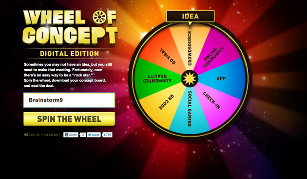

  
  
  
[[anexo ausente]](http://creativecommons.org/licenses/by-nc-nd/2.0/) foto: [Stéfan](http://www.flickr.com/photos/st3f4n/4446092308/)  

As pessoas têm uma noção fantasiosa da verdadeira natureza das ideias. Graças a essa noção, diariamente sonhos morrem e vidas se perdem. Este texto é a minha tentativa desesperada em ajudar aspirantes a escritores, desenhistas e artistas em geral. Poderia ser resumido à próxima frase, mas embora eu ache que só atrapalhe, vou tentar decupar um pouco seu conteúdo nos parágrafos seguintes. Se você não tiver 5 minutos para ler todo o resto, memorize somente isso:

  
> Uma ideia é um problema disfarçado de solução.

  
> Muitos artistas acham que, imediatamente ao ter uma ideia, o mundo lhes deve algo

  

Se você teve uma ideia para um quadro, um livro, uma série de TV ou uma empresa de internet, você está entrando num mundo de problemas. Acredite, eu já tive todos. E assim como a maioria das pessoas, eu também já senti o entusiasmo contagiante que uma nova ideia traz, aquela vontade de sair falando, de mostrar pra mãe, arrastar meio mundo, registrar domínio, fazer um novo cartão de visita e jogar tudo para o alto. E já senti aquela mesma energia se esvair de mim como uma ressaca, esperando a euforia da próxima ideia, muitas vezes com uma certa depressão.

  

Não cabem adjetivos numa ideia, simplesmente por não existir ideia boa ou ruim. Ter uma ideia é como fazer a matrícula numa academia. É algo totalmente isento de valor.

  
> Não há glória, não há vitória, não há NADA enquanto não houver execução, frequência e disciplina empregados diariamente.

  

Quando você se matricula, pode até pedir que alguém te acompanhe durante os treinos. Mas o ato de ir – e continuar frequentando – é algo que só você pode fazer.

  

Seguindo este mesmo raciocínio, a ideia de “copiar” uma ideia se torna paradoxal. Ideias de como de fazer um carro, um blend de café, um romance, estão aí pelo ar. São livres, gratuitas, não é proibido fazer nada disso. Então por que tão pouca gente faz, e menos gente ainda o faz direito? Porque, na minha opinião, as pessoas têm uma certa tendência a se focar nas coisas erradas. Perdem tempo demais tentando copiar algo insípido e de valor quase zero que é uma ideia, e esquecem-se totalmente do grande quebra-cabeças que é a execução.

  

E é nisso que a maioria dos artistas que conheço pecam. Eles acham que, imediatamente ao ter uma ideia, o mundo lhes deve algo. E pior: tentam transferir para outras pessoas o ônus da ideia. Não é assim que funciona. Se você teve a ideia para um livro, ela só será de algum valor quando você tiver terminado de escrever. Não culpe a editora por não *“acreditar em você”*.

  

Nem eu, que escrevi isso tudo só pra te ajudar, acredito até ter o seu manuscrito pronto. Se você teve uma ideia para [uma história em quadrinhos](http://jovemnerd.ig.com.br/nerdcast/nerdcast-327-making-of-independencia-ou-mortos/), olha, boa sorte, viu. Dá um trabalho danado, saiba ou não você desenhar. Uma ideia para um filme? Ai, ai, ai. Em tempo, lendas sobre gente que teve uma ideia mirabolante de uma empresa de internet e ficou milionária da noite para o dia são tão reais quanto a noção que este texto tenta desmistificar.

  

Livre-se dessas fantasias. Arranje um problema. E vá criar algo incrível.

  

### Posts relacionados:

  

[\* Quanto vale uma ideia? \*](http://www.brainstorm9.com.br/18184/publieditorial/quanto-vale-uma-ideia/)

  

[Opa, me vê um best seller aí…](http://www.brainstorm9.com.br/20693/opiniao/opa-me-ve-um-best-seller-ai/)

  

[O que faz com que você curta ou compartilhe algo?](http://www.brainstorm9.com.br/27335/social-media/o-que-faz-com-que-voce-curta-ou-compartilhe-algo/)

  

[Não teve nenhuma ideia para a reunião de hoje? Então gire a “roda do conceito”](http://www.brainstorm9.com.br/24480/advertising/nao-teve-nenhuma-ideia-para-a-reuniao-de-hoje-entao-gire-a-roda-do-conceito/)

  

[Idéia, execução e a diagonal de Vicky Mendoza](http://www.brainstorm9.com.br/25652/opiniao/ideia-execucao-e-a-diagonal-de-vicky-mendoza/)

  

 Post originalmente publicado no [Brainstorm #9](http://www.brainstorm9.com.br/)  
[Twitter](http://www.twitter.com/brains9) | [Facebook](http://www.facebook.com/brainstorm9) | [Contato](http://www.brainstorm9.com.br/contato/) | [Anuncie](http://www.brainstorm9.com.br/anuncie)

  
  
  

[[anexo ausente]](http://feeds.feedburner.com/~ff/brainstorm9?a=2Gxy4QMBStk:JP9tayCamT0:yIl2AUoC8zA) [[anexo ausente]](http://feeds.feedburner.com/~ff/brainstorm9?a=2Gxy4QMBStk:JP9tayCamT0:7Q72WNTAKBA)  [[anexo ausente]](http://feeds.feedburner.com/~ff/brainstorm9?a=2Gxy4QMBStk:JP9tayCamT0:V_sGLiPBpWU) [[anexo ausente]](http://feeds.feedburner.com/~ff/brainstorm9?a=2Gxy4QMBStk:JP9tayCamT0:I9og5sOYxJI) [[anexo ausente]](http://feeds.feedburner.com/~ff/brainstorm9?a=2Gxy4QMBStk:JP9tayCamT0:qj6IDK7rITs)

  
[anexo ausente]  
  
  
  
from Brainstorm #9 [http://www.brainstorm9.com.br/31484/opiniao/teve-uma-ideia-problema-seu/?utm\_source=feedburner&utm\_medium=feed&utm\_campaign=Feed%3A+brainstorm9+%28Brainstorm9%29](http://www.brainstorm9.com.br/31484/opiniao/teve-uma-ideia-problema-seu/?utm_source=feedburner&amp;utm_medium=feed&amp;utm_campaign=Feed%3A+brainstorm9+%28Brainstorm9%29)
