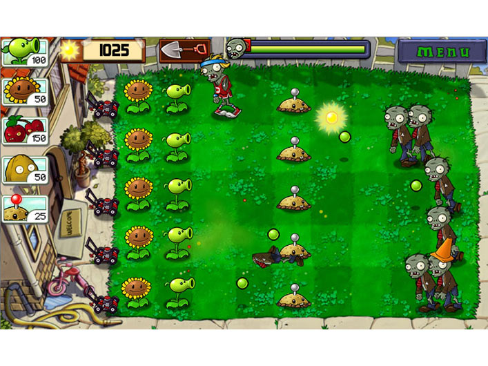
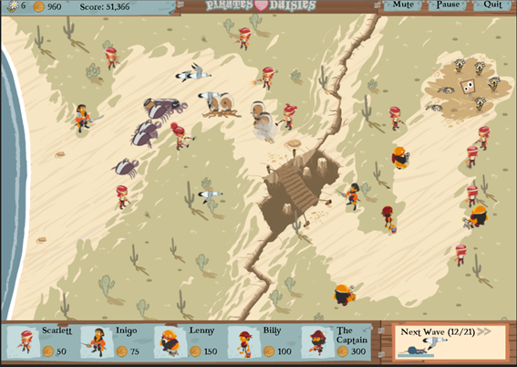

# Jump into Game Development with the Tower Defense Genre

A common dream of most developers is to develop a game. Game development can be very intimidating to jump into straight away. The hardest decision is to determine what kind of game you’re going to create – what’s the backstory, who are the actors, what’s their purpose, what does success look like, and so on. Once you determine what game you’re going to make, you next need to determine how you’re going to go about making that game. There are certainly a wide array of technologies and game engines that are well suited for certain kinds of games. The decision can be limited based on where you’d like to play that game. In other words, which platform will your game target? Certainly over the past few years, the accelerated adoption of smart phones and tablet devices have really given rise to the casual game genre. One of the more popular casual game types and one not to intimidating for new game developers to jump into is the Tower Defense game genre.

#### What is a Tower Defense game?

A tower defense game can be summed up by the following:

- A swarm of creepers (bad guys) are attempting to cross through your seemingly protected area; to get from one side to the other, or to steal something from the other side and bring it back to their base.
- Your mission (if you choose to accept it) is to PROTECT YOUR AREA by placing various defenses along the terrain path.
- During the gameplay, you will earn some sort of resource (money, fuel, sunlight, etc) that you can exchange to bolster your defenses. Whether that’s to enhance your existing embattlements or to purchase more powerful weapons or protection.

A Tower Defense game translates very well to the touch nature of a touch-based smart phone or tablet, as the game play has you selecting your choice of defenses (weapons, etc) and placing them on the battlefield. Once the swarm of creepers start to cross the map, the strategy is how you weigh the collecting and spending of your resources on the appropriate defenses as well as when and where to place them.

One of the more popular Tower Defense games is [Plants vs. Zombies](http://www.popcap.com/games/plants-vs-zombies/windows-phone-7) . I’ve spent many of hours protecting my backyard with [Pea Shooters and Cherry Bombs from those uninvited zombies](http://www.popcap.com/games/plants-vs-zombies/almanac) !

In Plants vs. Zombies, you collect sunshine to grow various types of plants to protect your backyard from an invading pack of Zombies. Some Zombie are harder to eliminate than others (ie. traffic cone protection) and require increased defenses. If the Zombies break through and invade your house, it’s game over.

Another great Tower Defense game that was originally built as [a proof-of-concept for Internet Explorer 9](http://windowsteamblog.com/ie/b/ie/archive/2010/12/17/announcing-pirates-love-daisies-an-html5-tower-defense-game-by-grant-skinner.aspx) and now available in the Windows 8 Store is [Pirates Love Daisies](http://www.pirateslovedaisies.com/) .

This game is written using HTML5 and JavaScript. Another great side benefit of the development of Pirates Love Daisies was the creation of the fantastic [EaselJS](http://www.createjs.com/#!/EaselJS) JavaScript framework. [EaselJS](http://www.createjs.com/#!/EaselJS) greatly simplifies working with rich graphics and the HTML5 Canvas element and is part of the larger [CreateJS Suite](http://www.createjs.com/#!/CreateJS). A must for any HTML5 game development.

#### Building Your Own Tower Defense Game

You can go the route of Pirates Versus Daisies and build your game from scratch using HTML5/JS. Fortunately, their hard work is to our benefit as we now have JavaScript libraries such as [EaselJS](http://www.createjs.com/#!/EaselJS), [TweenJS](http://www.createjs.com/#!/TweenJS), [SoundJS](http://www.createjs.com/#!/SoundJS), and [PreloadJS](http://www.createjs.com/#!/PreloadJS) to help in our efforts. There are additional JavaScript libraries available for the budding game developer such as [CraftyJS](http://craftyjs.com/) and [ImpactJS](http://impactjs.com/) as well.

Our friends over at [Coding4Fun](http://coding4fun.com/) produced an Open Source Tower Defense Engine called [ScriptTD](http://scripttd.codeplex.com/) . With [ScriptTD](http://scripttd.codeplex.com/) , you don’t need to have any development skills to build a great Tower Defense game. You just need to know how edit a text file. Well an XML file to be exact, but you can be up and running with your Tower Defense game in no time. For you seasoned developers, the code for [ScriptTD](http://scripttd.codeplex.com/) is available up on [CodePlex](http://www.codeplex.com/) which gives you the ability to see how the Tower Defense engine hums. Currently [ScriptTD](http://scripttd.codeplex.com/) is available for developing Windows Phone games. However, I’ve been told that work is being done to add the ability to create Windows 8 games as well. Stay tuned!

#### Focus on the Game Play

As Grant Skinner states in [his debrief on developing Pirates Love Daisies](http://gskinner.com/blog/archives/2010/12/pirates-love-daisies-html5-game-launches.html) , don’t underestimate the time it takes to balance out the gameplay. If you want to keep your players coming back as well as becoming viral advocates for your title, you better invest in balancing out the game mechanics. Is the game easy enough to jump in yet challenging me enough over the right amount of time to keep me engaged and excited to play? There are people who specialize in this skill called Level Designers. These are the people who map out game play using spreadsheets, graph paper and lots of play time.

#### Distribution and Making Money

With the advent of app stores such as the Windows Store, its easier than ever for game developers to distribute their games and make money from the blood, sweat and tears that goes into creating a game. With Windows 8 and the Windows Store it doesn’t matter if you’re a C++ developer, a .NET developer, or an HTML/JS developer, you have the platform to create, package and sell your title. Plants vs. Zombies and Pirates Love Daisies offer up great gameplay and inspiration for the Tower Defense genre. Now it’s up to you, the budding game developer, to get out there and build the next great Tower Defense game!
