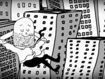

Muito se fala sobre ser um bom anfitrião. E, de fato, é importante [saber ser generoso](http://papodehomem.com.br/como-ser-um-bom-anfitriao/), [oferecer um jantar](http://papodehomem.com.br/naojantarperfeito/), [receber os amigos em casa](http://papodehomem.com.br/bartender-dr-drinks-mostra-a-importancia-de-ser-um-bom-anfitriao/) e criar um bom ambiente para quem vai passar algumas horas ou dias. A vida, porém, não é feita só disso.

  

Há momentos em que saber receber a generosidade dos outros também é uma das faces dela própria. Além de ser um bom anfitrião, é igualmente útil que sejamos bons visitantes. Aqui vão algumas dicas.

  

  

Não seja assim. Nunca

  

### 1. Seja pontual

  

Ponto básico, porém importantíssimo. Não se atrase. Faça uma estimativa realista do seu trajeto, desde sua chegada ao aeroporto ou rodoviária, até a casa do seu anfitrião. Pense que, talvez, ele tenha algum compromisso que pode acabar sacrificando para recebê-lo adequadamente.

  

De qualquer forma, mesmo que ele não tenha nada para fazer, ninguém gosta de ficar esperando um dia inteiro por alguém que simplesmente nunca chega. Então, se prometer que chega de manhã, chegue de manhã. Nada de chegar à noite ou no dia seguinte.

  

Ah, imprevistos devem ser avisados com máxima prioridade.

  

### 2. Traga um presente

  

Abrir as portas de casa para receber uma pesssoa é um grande gesto de generosidade. Seu anfitrião está em casa, poderia muito bem ficar ali e não ser incomodado por nada, mas ao invés disso, preferiu receber uma pessoa, dispor do seu tempo, seu espaço e tudo o mais, apenas para fazê-lo se sentir mais confortável.

  

Trazer um presente é uma forma de demonstrar seu apreço pelo que está sendo oferecido. Não é necessário que seja algo grandioso ou caro. Às vezes, algo simples, do cotidiano de onde estamos vindo já se torna um presente adorável e exótico.

  

### 3. Não seja você mesmo

  

Quando estamos na casa de uma pessoa, automaticamente, nos deparamos com novos modos de fazer as coisas. Ali, a rotina tende a ser diferente nos mínimos detalhes, desde o horário em que se acorda, até a forma como se estende a toalha depois do banho ou onde se guarda o óleo de cozinha. A pior coisa que podemos fazer enquanto hóspedes é deixar nossas manias e maus hábitos se manifestarem durante a estadia.

  

*Link YouTube | Se vestir de mulher, tudo bem. Mas mandar a dona da casa levantar as pernas pra passar o aspirador, isso tá errado*

  

Além disso, esta é uma excelente oportunidade de fazer diferente do que estamos habituados e incorporar traços menos preguiçosos ou autocondescendentes. Se nos questionamos muitas vezes como nos transformarmos quando presos aos modos de operação da nossa rotina, com outras condições, pode ser que façamos surgir uma outra versão de nós mesmos.

  

Então, se você não gosta de yakissoba e for oferecida uma, coma. Se não gosta de acordar cedo e a família levanta às 7:00, faça o mesmo. Aproveite esta oportunidade.

  

### 4. Não deixe rastros

  

Após fazer uso de qualquer dos ambientes domésticos, faça com que sua passagem não seja notada. Isso quer dizer deixar o banheiro limpo, com todos os objetos nos respectivos lugares onde foram encontrados, deixar a cama arrumada, louças limpas etc.

  

Esta é uma prática de não gerar perda de tempo ao seu anfitrião e, ao mesmo tempo, de remover excessos e manter a precisão nos mínimos detalhes de sua presença.

  

### 5. Veja a riqueza do ambiente

  

É incoerente partir em uma trilha, passar por uma pequena cidade no interior de algum lugar remoto, esperar encontrar um Starbucks e ficar insatisfeito ao perceber que isso simplesmente não existe ali. Muito melhor é ver que cada lugar tem seu movimento e ritmo próprio, que as pessoas têm hábitos diferentes, que as peças ali se encaixam de uma forma diferente.

  

Caso não tenha saído para um lugar distante, mesmo dentro da casa do seu anfitrião numa mesma cidade, com certeza há características próprias que devem tornar o ambiente especial de alguma forma. Aprenda a ver e reconhecer isso.

  

### 6. Aceite mimos

  

Às vezes, a impressão que nós temos é de que o melhor a se fazer é incomodar o mínimo possível. E, de fato, é. Mas poucas coisas também são tão feias quanto não permitir que o anfitrião exerça sua hospitalidade.

  

  

Se ela tá querendo é porque eu sou um cara legal

  

Portanto, se for oferecida uma sobremesa qualquer, aceite. Se arrumarem suas coisas por você, aceite. Agradeça. Talvez, você seja convidado para degustar pratos especiais da casa ou para tomar aquele whisky caríssimo do chefe da família. Aceite.

  

Quando aceitou ser um hóspede, deixou de ser você mesmo para se tornar um veículo para a generosidade dos seus anfitriões.

  

### 7. Seja disponível

  

Em casa, é comum nós nos fecharmos, ligarmos o computador e ficarmos ali por horas, esquecendo as outras pessoas que estão presentes, como um adolescente que se tranca no quarto, se isolando do resto do mundo. Isso é tudo o que não deveria acontecer quando visitamos alguém.

  

Este é o momento de ser prestativo, curioso, de se dispor a ajudar, mesmo quando não solicitado.

  

### 8. Deixe que “se aproveitem” de você

  

Ao chegar em um novo ambiente, nosso olhar está fresco e as chances são grandes de enxergarmos coisas que os moradores talvez não vejam ou deixem pra lá em função de algum amortecimento. Você talvez note algumas coisas dignas de reparo, talvez veja detalhes na rotina que podem ser melhorados, talvez você mesmo possa ir lá e consertar, prestar esses pequenos serviços.

  

Certa vez um amigo passou um final de semana na minha casa e resolveu rapidamente uma série de probleminhas que havia nas tomadas. Antes disso, eu ficava procurando a tomada correta, perdendo um tempão e me limitando a determinados locais da casa, ao invés de ir lá e consertar o problema.

  

Sem contar várias outras vezes que recebi amigos em casa e eles me ajudaram com trocentas coisas, desde me arranjando copos decentes até mesmo me conseguindo coisas bem maiores e importantes, como uma geladeira.

  

  

"Xá com a gente, não se preocupa não"

  

Nem preciso dizer o quanto foi útil e o quanto fiquei agradecido depois.

  

### 9. Mostre gratidão

  

Um dos maiores prazeres em ser um anfitrião é fazer feliz quem recebe. Por isso, ele vai estar atento aos diversos sinais de satisfação ou não que você emitir. Cada suspiro, cada olhar de admiração, será recebido como o maior prêmio do mundo, acredite.

  

Por isso, é importante deixar demonstrações de gratidão. Seja uma nota, um presente, um abraço de despedida, sorrisos ou pequenas gentilezas, tudo isso já faz um anfitrião feliz. No final das contas, não importa muito qual forma seu agradecimento vai tomar, desde que seja [feito com o coração](http://papodehomem.com.br/sem-palavras-fala-de-coracao/).

  

### Bônus: hospedagem hardcore

  

Este item é para os fortes, para os bróders do coração. Se a sua relação é pautada no respeito às zonas de conforto, isto nunca vai dar certo. Caso você ache que é possível arriscar ver o seu amigo chorando e implorando pela sua partida, pode tentar incomodar, cutucar feridas e bagunçar a rotina dele deliberadamente.

  

Nas palavras do [Fabio Rodrigues](http://papodehomem.com.br/author/fabiorodrigues/), a coisa funciona assim:

  
> Se o seu anfitrião é bróder, mas bróder de verdade mesmo, considere ser pensadamente invasivo, desafiar por aqueles dias algumas de zoninhas de conforto, espaços vitais e outras frescurinhas, suas e dele, que alimentamos cotidianamente.
>
>   
>
> Coisas que faço: acordar mais cedo e acordar o anfitrião, sentar-se pra [fazer silêncio tarde da noite](http://papodehomem.com.br/como-usar-sua-almofada-de-meditacao/), chamar a atenção pra hábitos ruins do cotidiano, sugerir coisas pra casa, criticar o zelo excessivo se o anfitrião for muito dedicado, criticar a desatenção se for muito indiferente – enfim, [ser chato ou quase-chato de forma geral e calculada](http://papodehomem.com.br/desafie-seus-amigos/).

  

A estadia na casa do [Gustavo Gitti](http://papodehomem.com.br/author/gustavo-gitti/) costuma ter infernos ainda piores, acreditem. Tudo cortesia do Fábio Rodrigues.

  

\* \* \*

  

Chegar com os dois pés no conforto da intimidade do outro pode ser bom para o anfitrião e para o hóspede, especialmente se os dois tentarem se utilizar desta oportunidade como um meio para se desafiarem. Estas mesmíssimas dicas poderiam ser usadas para melhorar a rotina mesmo nas nossas próprias casas, com nossas próprias famílias ou colegas de quarto.

  

Nos diferentes níveis de proximidade das relações, pode ser que uma ou outra dica não se aplique ou seja pouco eficiente. Quais outras sugestões vocês deixariam para aqueles que chegarem em suas casas serem bons hóspedes? O que vocês mesmos fazem quando estão na casa de outras pessoas? Além das dicas para ser educadinhos e convenientes, quais métodos hardcore vocês já utilizaram para dar um sacode na vida dos bróders?

  
  

## LEIA TAMBÉM...

  

1.   

   Como ser um bom anfitrião

     

     

   Para uma vida plena, lembre-se da morte

     

     

   7 aplicativos para você “salvar o mundo” pelo computador

[anexo ausente]  
  

Artigos Relacionados

  

[A felicidade está em descobrir o que você já tem](http://rss.feedsportal.com/c/32911/f/530922/s/233ede3a/l/0Lpapodehomem0N0Bbr0Ca0Efelicidade0Eesta0Eem0Edescobrir0Eo0Eque0Evoce0Eja0Etem0C/story01.htm)

  

[Fazendo miojo com água do chuveiro & outras histórias bem pessoais sobre morar sozinho](http://rss.feedsportal.com/c/32911/f/530922/s/2358c564/l/0Lpapodehomem0N0Bbr0Cfazendo0Emiojo0Ecom0Eagua0Edo0Echuveiro0Eoutras0Ehistorias0Ebem0Epessoais0Esobre0Emorar0Esozinho0C/story01.htm)

  

[O sentido da vida (para ateus)](http://rss.feedsportal.com/c/32911/f/530922/s/235b052f/l/0Lpapodehomem0N0Bbr0Co0Esentido0Eda0Evida0Epara0Eateus0C/story01.htm)

  

[Silêncio, dinheiro, drinks e forró no 5º Encontro Nacional da Cabana PdH](http://rss.feedsportal.com/c/32911/f/530922/s/2363a3e5/l/0Lpapodehomem0N0Bbr0Csilencio0Edinheiro0Edrinks0Ee0Eforro0Eno0E5o0Eencontro0Enacional0Eda0Ecabana0Epdh0C/story01.htm)

  

[Como fazer brigadeiro belga na cozinha maravilhosa de Jader Pires](http://rss.feedsportal.com/c/32911/f/530922/s/23657d1a/l/0Lpapodehomem0N0Bbr0Ccomo0Efazer0Ebrigadeiro0Ebelga0Ena0Ecozinha0Emaravilhosa0Ede0Ejader0Epires0C/story01.htm)

  
  
  
 [anexo ausente]  
  

[[anexo ausente]](http://feeds.feedburner.com/~ff/PapodehomemLifestyleMagazine?a=Gf4CfU4PLvM:D7yhuGdFiKM:yIl2AUoC8zA)  [[anexo ausente]](http://feeds.feedburner.com/~ff/PapodehomemLifestyleMagazine?a=Gf4CfU4PLvM:D7yhuGdFiKM:qj6IDK7rITs) [[anexo ausente]](http://feeds.feedburner.com/~ff/PapodehomemLifestyleMagazine?a=Gf4CfU4PLvM:D7yhuGdFiKM:-BTjWOF_DHI)

  
[anexo ausente]  
  
  
  
from Papo de Homem - Lifestyle Magazine <http://da.feedsportal.com/c/32911/f/530922/s/236e1b73/l/0Lpapodehomem0N0Bbr0Cdo0Ebasico0Eao0Ehardcore0E90Edicas0Epara0Eser0Eum0Ebom0Ehospede0C/ia1.htm>
