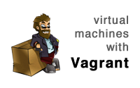

[](http://railscasts.com/episodes/292-virtual-machines-with-vagrant?autoplay=true)

# #292 Virtual Machines with Vagrant

Oct 24, 2011 | 11 minutes | [Tools](http://railscasts.com/?tag_id=12)

Vagrant allows you to run your Rails application and all of its dependencies in a portable, sharable environment. Use for development, set it up as a staging server, or experiment with a production setup.

[Click to Play Video ▶](http://railscasts.com/episodes/292-virtual-machines-with-vagrant?autoplay=true)

- Download:
- [source code](http://media.railscasts.com/assets/episodes/sources/292-virtual-machines-with-vagrant.zip)
- [mp4](http://media.railscasts.com/assets/episodes/videos/292-virtual-machines-with-vagrant.mp4)
- [m4v](http://media.railscasts.com/assets/episodes/videos/292-virtual-machines-with-vagrant.m4v)
- [webm](http://media.railscasts.com/assets/episodes/videos/292-virtual-machines-with-vagrant.webm)
- [ogv](http://media.railscasts.com/assets/episodes/videos/292-virtual-machines-with-vagrant.ogv)

- [Show Notes](http://railscasts.com/episodes/292-virtual-machines-with-vagrant)
- [ASCIIcast](http://railscasts.com/episodes/292-virtual-machines-with-vagrant?view=asciicast)
- [42 Comments](http://railscasts.com/episodes/292-virtual-machines-with-vagrant?view=comments)
- [Similar Episodes](http://railscasts.com/episodes/292-virtual-machines-with-vagrant?view=similar)
- [Next Episode >](http://railscasts.com/episodes/293-nginx-unicorn)
- [< Previous Episode](http://railscasts.com/episodes/104-exception-notifications-revised)


[Browse Source Code](https://github.com/railscasts/292-virtual-machines-with-vagrant)

**Resources**

- [Vagrant](http://vagrantup.com/)
- [VirtualBox](https://www.virtualbox.org/)
- [Vagrant Boxes](http://www.vagrantbox.es/)
- [Chef](http://wiki.opscode.com/display/chef/Home)
- [rbenv](https://github.com/sstephenson/rbenv)
- [ruby-build](https://github.com/sstephenson/ruby-build)

Vagrantfile

```
config.vm.forward_port "rails", 3000, 3000
```

Gemfile

```
gem 'therubyracer'
```

bash

```
# setup vagrant
gem install vagrant
vagrant box add lucid32 http://files.vagrantup.com/lucid32.box
rails new todo
cd todo
vagrant init lucid32
mate Vagrantfile
vagrant up
vagrant ssh

# inside virtual machine
whoami
cd /vagrant
ruby -v
sudo apt-get update
sudo apt-get install build-essential zlib1g-dev curl git-core sqlite3 libsqlite3-dev

# install rbenv and Ruby 1.9.2
git clone git://github.com/sstephenson/rbenv.git ~/.rbenv
echo 'export PATH="$HOME/.rbenv/bin:$PATH"' >> ~/.bash_profile
echo 'eval "$(rbenv init -)"' >> ~/.bash_profile
source .bash_profile
git clone git://github.com/sstephenson/ruby-build.git
cd ruby-build/
sudo ./install.sh 
rbenv install 1.9.2-p290

# get Rails running
cd /vagrant
gem install bundler
rbenv rehash
bundle
bundle exec rails s

# vagrant commands
vagrant reload
vagrant status
vagrant suspend
vagrant resume
vagrant halt
vagrant up
vagrant package
vagrant destroy
```
