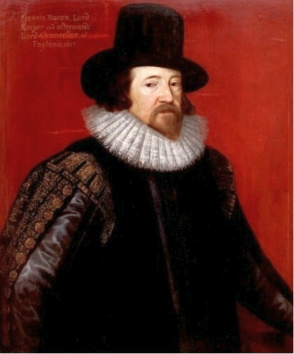

*“That is the best part of beauty, which a picture cannot express.”*

  

 What is beauty? [Richard Feynman](http://www.brainpickings.org/index.php/tag/richard-feynman/) believed its secret [lies in the unknown](http://www.brainpickings.org/index.php/2011/10/07/richard-feynman-on-beauty-honors-and-curiosity/). [Anaïs Nin](http://www.brainpickings.org/index.php/tag/anais-nin/) saw it as [inseparable from quality and ethics](http://www.brainpickings.org/index.php/2012/10/04/anais-nin-meets-frank-lloyd-wright-jr-1947/). It has been defined as [“a supreme instance of order.”](http://www.brainpickings.org/index.php/2012/09/14/a-theory-of-pure-design-beauty/) It has been considered [a byproduct of evolution](http://www.brainpickings.org/index.php/2010/11/17/denis-dutton-darwinian-theory-of-beauty/). It has been [tragically industrialized](http://www.brainpickings.org/index.php/2010/03/25/zed-nelson-love-me/). *“Absolute suffering,”* [wrote Philip K. Dick](http://www.brainpickings.org/index.php/2011/12/16/the-exegesis-of-philip-k-dick/), *“leads to — is the means to — absolute beauty.”*

  

In the essay **“Of Beauty”** from his [**Complete Essays**](https://www.amazon.com/dp/0486454436/ref=as_li_ss_til?tag=braipick-20&amp;camp=0&amp;creative=0&amp;linkCode=as4&amp;creativeASIN=0486454436&amp;adid=03M55DGE9SHD1SGFM5Z4&amp;) ([*public library*](http://www.worldcat.org/title/complete-essays/oclc/181368855%26amp;referer=brief_results); [*public domain*](http://www.gutenberg.org/files/575/575-h/575-h.htm#2H_4_0009)) — the same tome that gave us his timeless insights [on studies](http://www.brainpickings.org/) — philosopher and scientific method pioneer [Francis Bacon](http://en.wikipedia.org/wiki/Francis_Bacon) considers the relationship between beauty and virtue:

  
> VIRTUE is like a rich stone, best plain set; and surely virtue is best, in a body that is comely, though not of delicate features; and that hath rather dignity of presence, than beauty of aspect. Neither is it almost seen, that very beautiful persons are otherwise of great virtue; as if nature were rather busy, not to err, than in labor to produce excellency. And therefore they prove accomplished, but not of great spirit; and study rather behavior, than virtue. But this holds not always: for Augustus Caesar, Titus Vespasianus, Philip le Belle of France, Edward the Fourth of England, Alcibiades of Athens, Ismael the Sophy of Persia, were all high and great spirits; and yet the most beautiful men of their times. In beauty, that of favor, is more than that of color; and that of decent and gracious motion, more than that of favor. That is the best part of beauty, which a picture cannot express; no, nor the first sight of the life. There is no excellent beauty, that hath not some strangeness in the proportion. A man cannot tell whether Apelles, or Albert Durer, were the more trifler; whereof the one, would make a personage by geometrical proportions; the other, by taking the best parts out of divers faces, to make one excellent. Such personages, I think, would please nobody, but the painter that made them. Not but I think a painter may make a better face than ever was; but he must do it by a kind of felicity (as a musician that maketh an excellent air in music), and not by rule. A man shall see faces, that if you examine them part by part, you shall find never a good; and yet altogether do well. If it be true that the principal part of beauty is in decent motion, certainly it is no marvel, though persons in years seem many times more amiable; pulchrorum autumnus pulcher; for no youth can be comely but by pardon, and considering the youth, as to make up the comeliness. Beauty is as summer fruits,) which are easy to corrupt, and cannot last; and for the most part it makes a dissolute youth, and an age a little out of countenance; but yet certainly again, if it light well, it maketh virtue shine, and vices blush.

  

Bacon’s [**Complete Essays**](https://www.amazon.com/dp/0486454436/ref=as_li_ss_til?tag=braipick-20&amp;camp=0&amp;creative=0&amp;linkCode=as4&amp;creativeASIN=0486454436&amp;adid=03M55DGE9SHD1SGFM5Z4&amp;) explore everything from **love** (*“Nuptial love maketh mankind; friendly love perfecteth it; but wanton love corrupteth, and embaseth it.”*) to **envy** (*“A man that hath no virtue in himself, ever envieth virtue in others.”*) to **delays** (*“There is surely no greater wisdom, than well to time the beginnings, and onsets, of things.”*) to **death** (*“Men fear death, as children fear to go in the dark; and as that natural fear in children, is increased with tales, so is the other.”*), and just about everything in between.

  

[[anexo ausente]](http://www.brainpickings.org/index.php/newsletter/) Brain Pickings has a free weekly newsletter and people [say it’s cool](http://www.brainpickings.org/index.php/newsletter/). It comes out on Sundays and offers the week’s best articles. Here’s [what to expect](http://us2.campaign-archive2.com/?u=13eb080d8a315477042e0d5b1&amp;id=ccae42412d). Like? [Sign up.](http://www.brainpickings.org/index.php/newsletter/)

  

*Brain Pickings takes 450+ hours a month to curate and edit across the different platforms, and remains banner-free. If it brings you any joy and inspiration, please consider a modest donation – it lets me know I'm doing something right.*  

  
  
[anexo ausente]  
  
  
  
from Brain Pickings [http://www.brainpickings.org/index.php/2012/10/31/francis-bacon-on-beauty/?utm\_source=feedburner&utm\_medium=feed&utm\_campaign=Feed%3A+brainpickings%2Frss+%28Brain+Pickings%29](http://www.brainpickings.org/index.php/2012/10/31/francis-bacon-on-beauty/?utm_source=feedburner&amp;utm_medium=feed&amp;utm_campaign=Feed%3A+brainpickings%2Frss+%28Brain+Pickings%29)
