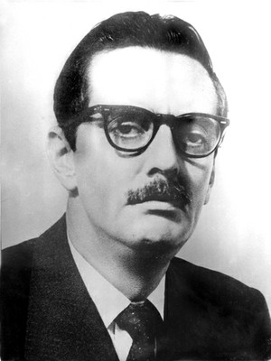

**Autor**: Leonardo Veloso Pin  
**Editor**: Tiago Angelo

  

  **Introdução:**

  

Pretendemos, por meio desse trabalho, analisar concisamente a política externa brasileira durante o breve governo Jânio Quadros. Pensamos que o artigo “Nova Política Externa do Brasil” escrito por Quadros em 1961, pouco antes de sua renúncia, pode ser utilizado para ilustrar-se algumas questões relacionadas à política externa do Brasil no início da década de 60.

  

Jânio, a contragosto dos setores mais conservadores da política brasileira, tentou uma aproximação dos países do bloco socialista e também dos países do chamado terceiro mundo (termo que não significava países pobres e sim aqueles que não estavam inseridos nem no bloco pró EUA nem no bloco pró URSS), principalmente daqueles que estavam em processo de descolonização. Segundo o ex-presidente, em seu governo as portas do Brasil seriam abertas ao comércio com o mundo, “sem distinção de credo político ou ideológico”[1]

  

Todavia, grande parte daqueles que apoiaram a candidatura de Jânio faziam parte dos blocos conservadores da política nacional e sentiram-se profundamente incomodados com a sua política de estabelecimento e fortalecimento de laços diplomático-econômicos com os países do Bloco Soviético e o desenvolvimento de relações cordiais com Cuba com o discurso de direito a autoderterminação do povo cubano.

  

Pensamos que os interesses econômicos guiaram de certa forma a Política Externa Independente do governo Quadros, pois, apesar do discurso de apoximação em relação aos países do Sul e do bloco socialista, o país nunca deixou de mirar uma parceria privilegiada com os Estados Unidos ao mesmo tempo em que se posicionava de maneira ambígua em relação ao anticolonialismo e à revolução cubana.

  

**Desenvolvimento:**

  

O interesse demonstrado na posição do Brasil em assuntos internacionais é em si mesmo   uma prova da presença de uma nova força no cenário mundial. (Jânio Quadros, 1961).

  

Esse trecho redigido por Quadros pode nos fazer pensar que a chamada Polítca Externa Independente,  realmente poderia ser independente dos interesses das grandes potências ocidentais, como se o Brasil estivesse a passos largos para atingir um grande nível de autonomia. Infelizmente, essa não era a realidade do país à época, pois o mesmo nunca transcendeu sua posição de nação capitalista dependente, principalmente em relação aos Estados Unidos da América – mesmo que o artigo de Jânio flerte com o pressuposto de Brasil-potência, o qual norteou de certa forma as ações de barganha da PEI frente aos EUA. Essa relação de dependência fica patente ao lermos outro trecho do artigo de Quadros:

  

Em conseqüência da formação histórica, cultural e cristã, tanto quanto a situação geográfica nossa Nação é predominantemente ocidental, nosso esforço nacional é dirigido para a obtenção de  sistema de vida democrático, tanto política como socialmente. Poderá não ser inútil frisar aqui que nossa dedicação à democracia é maior do que a de outras nações da nossa esfera cultural. (…) Os   ideais comuns de vida e organização acercam-nos  das maiores nações do bloco ocidental, e em   muitos pontos o Brasil pode, em posição de destaque, associar-se a esse bloco. (Quadros, 1961)

  

Jânio não atravesou a fronteira entre a posição neutra e a posição independente, pois, por conta da dependência do Brasil em relação aos Estados Unidos, precisava tornar sua posição progressista em relação à política exterior mais aceitável aos olhos dos estadunidenses. Além disso, não podia dar as costas de maneira decisiva às forças conservadoras do país, as quais defendiam o alinhamento brasileiro aos EUA. “Esse equilíbrio entre independência e neutralidade sugere as ambiguidades da posição brasileira”[2]

  

A PEI insere-se nos movimentos nacionalistas latino-americanos, os quais sonhavam com certa autonomia das nações da América Latina frente ao poder econômico-político norte americano sem abandonar o modelo capitalista de desenvolvimento. Destarte, as afrontas ao poderio estadunidense não poderiam vir sem certa dose de afagos num famoso jogo de “bate e assopra”.

  

A Revolução Cubana acontecera poucos anos antes da subida de Quadros ao poder. Somemos esse fato à conquista pela URSS da posição de segunda maior potência mundial e teremos um quadro no qual a hegemonia dos EUA sofrera um bom desgaste. Jânio Quadros passou a utilizar a apreensão dos Estados Unidos em relação à possível “cubanização” do maior país da América do Sul para fortalecer seu poder de barganha nas mesas de negociação internacionais.

  

Infelizmente o mandato de Jânio deu-se num momento no qual a crise gerada pelo modelo econômico de Kubitschek estava prestes a estourar com os militares e a Igreja intervindo cada vez mais nos rumos políticos de um país no qual cresciam e diversificavam-se os vários movimentos sociais urbanos e rurais. Pode-se interpretar a política externa brasileira como resultado de transformações endógenas que aconteciam naquele momento no Brasil como o “surgimento de novos segmentos sociais em função da acelerada urbanização e industrialização do país”[3]

  

A política externa de Jânio pode ser entendida como progressista quando comparada à sua política interna, calcada no conservadorismo e moralismo cristão burguês. Contudo, a sua ideia de progresso da nação e inserção da mesma entre a elite das nações mundiais era embasada por uma representação que se aproximava da do tipo dominante, a qual supõe uma harmonia das partes e nega o conflito de classes.

  

O ex-presidente entendia o conceito de Nação como uma integridade de soberania e interesses da coletividade nacional nas quais o todo deveria prevalecer sobre as partes  numa dinâmica em que a oposição e os conflitos entre os diferentes setores da sociedade são tratados como anormalidades. Para Quadros, no jogo das nações, a unidade fundamental, a harmonia, era ocultada pelos conflitos aparentes assim como ocorria no plano interno da nação brasileira. Esses conflitos internacionais eram mantidos porque “os Estados se orientam a partir de seus próprios interesses. Quadros mantém as tentativas de equalizar interesses e objetivos muitas vezes opostos, diminuindo a importância das estruturas nos quais se inserem e que os condicionam.”[4]. De acordo com Quadros:

  

Um grupo de nações, especialmente da Ásia, tem também o cuidado de permanecer à     margem de qualquer choque de interesses, que são invariavelmente os das grandes potências e não necessariamente os de nosso país, quanto mais da paz mundial. O primeiro passo para tirar proveito     total das possibilidades da nossa posição no mundo consiste em manter relações normais com todas     as nações. O Brasil, que por má interpretação ou distorção do seu bom senso político, levou vários      anos sem contatos regulares com as nações do bloco comunista, a ponto, mesmo, de ter apenas relações comerciais indiretas e insuficientes com elas.  (Quadros, 1961)

  

Jânio entendia que o mapa internacional não era formado por apenas dois sistemas, capitalista e socialista real, polarizando o mundo. Para ele, haveria um outro conjunto econômico de nações subdesenvolvidas, as quais poderiam transcender as questões ideológicas colocando-se em um nível diferente da luta Leste x Oeste. O conflito central entre capitalismo e socialismo é colocado em segundo plano em nome de uma pretensa unidade entre os países dependentes. Todavia, essa visão de mundo deixa escapar os conflitos do sistema e suas relações básicas de força.

  

O grau de intimidade das relações do Brasil com os países vizinhos do Continente e com as       nações afro-asiáticas, embora baseado em motivos diferentes, tende para o mesmo fim. Entre estes,      na maioria dos casos, estão motivos históricos, geográficos e culturais. O fato comum a todos eles é     o de que nossa situação econômica coincide com o dever de formar uma frente unida na batalha        contra o subdesenvolvimento e todas as formas de opressão. (Jânio Quadros, 1961)

  

Por tentar colocar-se acima do conflito entre socialismo e capitalismo, ao menos no nível do discurso, Jânio tentou estabelecer ou fortalecer os vínculos diplomáticos e econômicos com os países do Leste ao mesmo tempo em que defendia a autodeterminação e soberania das nações, principalmente de Cuba e dos países que lutavam contra o colonialismo, enquanto enviava Roberto Campos à Europa Ocidental e Walter Moreira Salles aos EUA para mostrar aos aliados que ainda mantinha-se dentro do bloco capitalista cristão – o que evidenciava que o discurso independente não condizia com a realidade – e “para negociar as dívidas e levantar novos empréstimos”[5]

  

Como já foi dito, é provável que a barganha política estivesse por detrás dessa aproximação do Governo Quadros em relação aos países socialistas, pois até a Revolução Cubana, o Brasil e a América do Sul haviam sido tratados com descaso pelos Estados Unidos[6], os quais só começaram a se interessar pela América Latina por elocubrarem que o exemplo dos revolucionários cubanos pudesse ser seguido pelos latino americanos.

  

Na base das questões políticas, podemos verificar os problemas econômicos de um país o qual, até a década de 50, havia sido essencialmente agrário, apesar da industrialização verificada no Governo Vargas, e que precisava lidar com a queda dos preços dos produtos agrícolas e das matérias-primas enquanto adaptava-se à nova realidade industrial resultante das políticas econômicas do Governo Kubitschek. Na realidade, o próprio Jânio deixa esse aspecto de sua política externa bem claro:

  

É preciso levar ao conhecimento do mundo o fato de  que o Brasil está aumentando intensivamente sua produção, com vistas não apenas  ao seu mercado doméstico, mas    especificamente procurando atrair outras nações. De um ponto de vista econômico, a divisa do meu        governo é “Produzir tudo, porque tudo que for produzido é comerciável”.  Sairemos à conquista      desses mercados; em casa, na América Latina, na África; na Ásia, na Oceânica, em países sob a   democracia e naqueles que se uniram ao sistema comunista. Os interesses materiais não conhecem doutrina e o Brasil está atravessando um período em que sua própria sobrevivência como nação,    ocupando uma das áreas mais extensas e privilegiadas do globo, depende da solução dos seus      problemas econômicos.

  

A busca da política externa em estabelecer laços comerciais com países do bloco socialista e do chamado terceiro mundo torna-se instrumento essencial ao processo de industrialização e desenvolvimento do capitalismo brasileiro melhorando a situação do país nos limites do sistema capitalista internacional.

  

Como acontecera no século XIX em relação à Inglaterra, a tentativa de um desenvolvimento da indústria latino americana não agradou os EUA. O crescimento industrial brasileiro da década de 50 entrava em choque com os interesses estadunidenses e por essa razão a PEI buscou uma certa autonomia em relação aos norte americanos por meio do recrudescimento das relações com o mundo latino americano, asiático e africano.

  

O que se buscou foi uma diversificação de mercados para os produtos brasileiros, pois os tradicionais já estavam saturados. A abertura para os mundos oriental, latino e africano era uma saída para o problema resultante do desenvolvimento acelerado dos 5 anos JK, o qual teve como consequência uma alta taxa de capacidade ociosa em um país com fraco mercado interno, por conta da extrema pobreza e desigualdade social.

  

**Conclusão:**

  

Podemos dizer que a necessidade de novos mercados oferecia razões objetivas para justificar uma forte ofensiva diplomática e a criação de um discurso de apoio aos movimentos de descolonização e independência que aconteciam em regiões da África, Asia e em Cuba.

  

A aproximação dos países socialistas e de Cuba, além dos mercados os quais o crescimento industrial brasileiro exigia, visavam a transformar o Brasil num aliado privilegiado dos EUA e para isso, lançou-se à barganha nas mesas de negociações ao tentar criar apreensão no governo estadunidense em relação aos rumos que a política brasileira poderia tomar.[7]

  

A abertura aos países socialistas e apoio ao anticolonialismo – mesmo que de forma ambígua – não nos permite dizer que o governo Quadros desenvolvia-se sobre uma visão de esquerda. O ex-presidente desprezava as principais lideranças de esquerda. Quando havia algum tipo de aproximação, esta se dava por conta do mais puro oportunismo político. Dessa forma, podia “conseguir dividendos externos, sem se comprometer com a “subversão” interna”.[8]

  

**Bibliografia:**

  

BENEVIDES, Maria V. de Mesquita. O Governo Jânio Quadros. São Paulo: Brasiliense, 1999.

  

 SALGADO, Carolina de Oliveira. A politica externa independente na questão dadescolonização da África lusófona (1958 – 1964). Rio de Janeiro: UERJ, 2011.

  

 VIZENTINI, Paulo G. F. Do nacional-desenvolvimentismo à Política Externa Independente (1945-1964).  in: FERREIRA, J. DELGADO, Lucília de A N. O Brasil Republicano. Rio de Janeiro: Civilização Brasileira, 2003.

  

**Notas**

  

**[1] BENEVIDES, Maria V. de Mesquita. O Governo Jânio Quadros. São Paulo: Brasiliense, 1999. p. 60  
[2] BENEVIDES, Maria V. de Mesquita. O Governo Jânio Quadros. São Paulo: Brasiliense, 1999. p. 70.  
[3] VIZENTINI, Paulo G. F. Do nacional-desenvolvimentismo à Política Externa Independente (1945-1964).  in: FERREIRA, J. DELGADO, Lucília de A N. O Brasil Republicano. Rio de Janeiro: Civilização Brasileira, 2003. p. 212  
[4] SALGADO, Carolina de Oliveira. A politica externa independente na questão dadescolonização da África lusófona (1958 – 1964). Rio de Janeiro: UERJ, 2011. p. 42  
[5] BENEVIDES, Maria V. de Mesquita. O Governo Jânio Quadros. São Paulo: Brasiliense, 1999. p. 64  
[6] VIZENTINI, Paulo G. F. Do nacional-desenvolvimentismo à Política Externa Independente (1945-1964).  in: FERREIRA, J. DELGADO, Lucília de A N. O Brasil Republicano. Rio de Janeiro: Civilização Brasileira, 2003. p. 210-211  
[7] BENEVIDES, Maria V. de Mesquita. O Governo Jânio Quadros. São Paulo: Brasiliense, 1999. p. 69  
[8] Idem, ibidem. p. 70**

  
[anexo ausente]  
  
  
  
from Bule Voador [http://bulevoador.com.br/2012/10/37728/?utm\_source=feedburner&utm\_medium=feed&utm\_campaign=Feed%3A+BuleVoador+%28Bule+Voador%29](http://bulevoador.com.br/2012/10/37728/?utm_source=feedburner&amp;utm_medium=feed&amp;utm_campaign=Feed%3A+BuleVoador+%28Bule+Voador%29)
