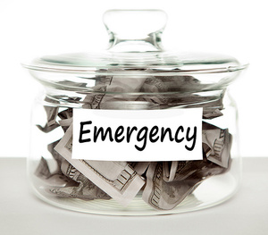
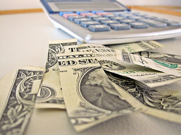
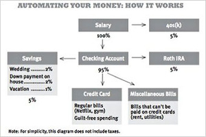
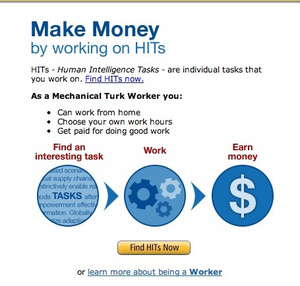

# How to Change Your Spending Habits when Your Salary Goes Up (or Down)

[anexo ausente]**Thorin Klosowski**

- [[anexo ausente]View Profile](http://lifehacker.com/people/kingthor01/)
- [Email](mailto:thorin@lifehacker.com)
- [Facebook](https://www.facebook.com/thorink)
- [Twitter](http://twitter.com/kingthor)
- [Google Plus](https://plus.google.com/112130794860820234172?rel=author)
- [RSS](http://lifehacker.com/author/17fivuhe4r5yb.xml)

Few people go through their whole life on the same salary. Things change—you get a new job, get married, divorced, or laid off—and when that happens you need to recalibrate your spending habits. Here's how to do it without throwing your life into turmoil.

We're all prone to developments in a financial situation, and dealing with them—both the positive and the negative changes—is as much about recognizing the change from a psychological standpoint as it is about adapting your budget. To help get changes to your personal finance under control, I spoke with author and financial expert Ramit Sethi of [I Will Teach You To Be Rich](http://www.iwillteachyoutoberich.com/home/), and debt-repayment expert Rod Ebrahimi, CEO of [ReadyForZero](https://www.readyforzero.com/).

### How to Adjust When Your Income Increases

Adjusting when you have more money is a nice "problem," but that doesn't mean it's easy. In fact, when people get a huge windfall of cash a common reaction is to overdo it and blow all that money. That's not to say you shouldn't spend more, but you should incorporate it into your life in a structured way.

#### **Step 1: Adjust Your Outlook Without Blowing All Your New Cash**

[Full size](http://img.gawkerassets.com/img/18390lrymfcwhjpg/original.jpg)

So you just got a huge raise, or came into a massive amount of cash. That's great, but don't start spending it yet. Ebrahimi recommends you pause for a moment, and make sure you're solidifying your future before you go off and buy a Jaguar:
> Perhaps most importantly: don't adjust your lifestyle expectations upwards just because you now have a higher income. If you do, you'll risk falling victim to the [hedonic treadmill](http://en.wikipedia.org/wiki/Hedonic_treadmill) and you'll miss out on a wonderful opportunity to solidify your financial security for the future.

That said, you can still be practical and spend your new money. In fact, it's almost a necessity. If you hold back, you might splurge in the future when you're not ready. Sethi explains:

> A lot of experts will say, "Take every dollar you're earning now and put it in the bank." That's not practical. The hedonic treadmill is real, if you make more, it's okay to spend more. Make sure you're making your goals, but that's it. If you try to deny yourself as you make more, that's a recipe for blowing up. Take a percentage of what you make, put it into guilt-free spending, and enjoy it.

So, like most things in life, it's about balance. When you get that financial windfall, take the time to think about your financial future, but don't deny yourself the reward for your hard work. *Photo by [JD Hancock](http://www.flickr.com/photos/jdhancock/3583835507/)*.

#### **Step 2: Create an Emergency Fund**

[Full size](http://img.gawkerassets.com/img/18390qriajn1ejpg/original.jpg)

With extra cash in hand, it's easy to start plowing through old bills and debts, but one of the fundamentals of financial security is preparation for the future. Because of that, Ebrahimi recommends you create an emergency fund **before spending money elsewhere:**
> First and foremost, you should create an emergency fund to cover at least three months of expenses, but six months is ideal. This means if you go without income for three to six months you can cover your costs. It should not be used except in case of job loss, health problems, car trouble, etc.

Your natural tendency is likely to start paying off bills right away, but Ebrahimi's point is that you can't ever know what your financial future is. When you prepare for the future first, you'll have the peace of mind to cover more expenses in the present. *Photo by [Tax Credits](http://www.flickr.com/photos/76657755@N04/6881502016/)*.

#### **Step 3: Start Paying Off those Large, High Interest Debts Automatically**

[Full size](http://img.gawkerassets.com/img/18390x0fy2cu3jpg/original.jpg)

Sethi is a huge proponent of [automating your finances](http://lifehacker.com/5702973/automate-your-finances-to-spend-less-time-managing-your-accounts) so that you're automatically saving money, budgeting, and everything else. His system is incredibly simple, and works on a percentage basis. For instance, let's say you're putting 5% of your income towards paying off a credit card. With your old job, that might have been $100 a month, but when you get a raise, that's a bigger chunk. The nice part is that when you land a new job that makes more money, you simply keep this percentage system, and you're automatically dedicating more money to those debts.

But perhaps you've been putting off paying off a bunch of different loans. In this case, it's best to tackle the high interest loans first. Ebrahimi explains:

> Pay off any debt you have, start with the highest interest first. This will ease your monthly finances in the long run (no more interest payments) and give you financial freedom so you won't have to make decisions in the future based on your need to continue paying your creditors.

If you're already automating your finances, you should be dedicating more to those higher interest payments as it is. If you're not, do so, and let the automation do its magic so you'll have more money in the long run. *Photo by [Ruben Schade](http://www.flickr.com/photos/rubenerd/3524120629/)*.

### How to Adjust When Your Income Goes Down

When your income drops—whether you get laid off, you [take a job with less pay](http://lifehacker.com/5708792/would-you-take-a-pay-cut-for-more-job-flexibility), or whatever else—it's easy to feel like you're stuck in a rut and you can't do anything about it. To break free from that feeling, you have to stay positive, slightly alter your financial outlook, and make sure you still dedicate money to decreasing debts.

#### **Step 1: Adjust Your Outlook and Keep Your Chin Up**

[Full size](http://img.gawkerassets.com/img/18391axlvdq58jpg/original.jpg)

When you lose income, it's significantly harder to adjust to the change than it is when you gain income. But that doesn't mean it's not possible. When your income goes down, it's all about not acting rashly, and adjusting your outlook so that it coincides with your new financial situation. This all starts in your head. As Ebrahimi explains:
> This process will be hard, and you'll need to adjust your mentality to a new standard of living (at least, temporarily). Staying positive and proactive will help a lot during this transition.
>
> Change your habits in order to bring your spending in line with your new (lower) income. This may require new behaviors like preparing food at home instead of eating out, shopping at thrift stores or discount racks instead of buying the trendiest clothes, etc.

The preparing meals at home part is easy, and regardless of your kitchen skills a [ton of meals are simple for everyone](http://lifehacker.com/5838661/10%252B-dishes-and-drinks-everyone-should-know-how-to-make-at-home-including-you). As for shopping at thrift stores, it's all about knowing when and where to do it. If you hit up [upscale neighbordhoods you'll find awesome things](http://lifehacker.com/5897376/shop-thrift-stores-in-upscale-neighborhoods-for-big-savings-on-used-goods), and doing so [in spring can net you some savings](http://lifehacker.com/5791857/shop-thrift-stores-in-the-spring-for-the-best-selection-and-deals). If you have hangups about the whole process, [it's well worth ditching them](http://lifehacker.com/5550115/ditch-hangups-over-second+hand-goods-to-reap-huge-savings) so you can save money.

As Sethi points out, the other major problem with losing a source of income is the social factor. Friends and family still want you to go out and have fun, even though you can't afford it. Sethi has a very simple solution though:

> You have to come up with a phrase that's comfortable. People don't like to say, "I can't afford it," because it almost signifies a weakness on your part. One thing I talk about in my book is to come up with a plan, then blame the plan. So, "I'd love to go out, but my spending plan just doesn't allow it this month." That way, they can't blame you—you're shifting the blame to the plan.

Unfortunately, that's really all you can do to adjust your point of view, but you can also do a few things from a financial position to make the process easier. *Photo by [Memphis CVB](http://www.flickr.com/photos/ilovememphis/5657280759/)*.

#### **Step 2: Streamline Your Budget and Cut Recurring Expenses**

[Full size](http://img.gawkerassets.com/img/18391j7jg2xdzjpg/original.jpg)

First things first, it's time to streamline your budget as much as possible. Part of that is tuning your brain to not want those same purchases you used to make, but it's also about getting rid of any recurring expenses you don't need. Ebrahimi has a few suggestions:
> The first thing you should do is streamline your budget. Start by identifying expenses that can be reduced or cut out entirely, particularly ones that are large and recur every month. For example, try to get out from under a car lease or auto loan if you have enough cash to buy a cheap used car or start using public transportation.

But don't act rashly if you can afford not to. Instead, ease into the new lifestyle while acknowledging that it's a temporary change. Sethi explains why:

> People tend to act in a really short term manner, and they'll cut back on everything. This, of course, totally ignores the psychology of how we behave. We are what's called [cognitive misers](http://en.wikipedia.org/wiki/Cognitive_miser). We have limited cognition and willpower. So, if you try to cut back on everything—from the 50 cent coffee all the way up to stopping payments on your mortgage—that's going to be a really big problem.
>
> Look at your two biggest discretionary expenses—for young people it's usually eating out and drinking—and take those and say, "how can I cut these down?" For a lot of my readers this is a target of cutting it by 30% over six months. A lot of people would say "cut it all!" But that's like saying you're 200 pounds overweight, and you're only going to eat 800 calories a day. You know it's not going to last.

Part of this process is also about lowering your monthly bills. The good news? Lowering your bills [usually doesn't take more than a phone call](http://lifehacker.com/5807728/how-to-reduce-the-cost-of-your-monthly-bills-with-few-sacrifices), and you can [lower every single monthly bill](http://lifehacker.com/5823762/a-bill+by+bill-guide-to-saving-money-on-your-monthly-expenses) with a little effort. Another huge recurring expense you [can get rid of is cable television](http://lifehacker.com/5834909/ditch-cable-tv-this-weekend-and-keep-watching-your-shows). Sign up for more shows online, or [invest in a set top box](http://lifehacker.com/5946193/how-to-find-the-best-tv-set-top-box-and-ditch-cable-once-and-for-all) that suits your needs.

Go through every recurring payment you have and cut where you can. Working in a place with free wi-fi now? Consider cutting your data plan on your phone back, or get a cheaper "dumb" phone and [supercharge it with SMS](http://lifehacker.com/5869666/how-to-turn-your-dumbphone-into-a-smartphone-using-nothing-but-sms). Look at every bill you have, and cut it wherever you can. You'll likely be surprised at how much you can save in a month. It's a good thing to do no matter where you find yourself on the income scale. *Photo by [Images Money](http://www.flickr.com/photos/59937401@N07/5857728038/)*.

#### **Step 3: Automate Your Bills and Savings**

[Full size](http://img.gawkerassets.com/img/18391u84nks2tjpg/original.jpg)

Again, [automation of your finances](http://lifehacker.com/5702973/automate-your-finances-to-spend-less-time-managing-your-accounts) is key here. In fact, it's more useful to automate your finances when you're low on cash because it gives you a more accurate view of how much you have left after bills. This is a good thing, because as Sethi points out, none of are going to spend the time redoing our budgets anyway:
> Every personal finance books starts with, "let's figure out where you're spending." Then people close the book, and put it back on the shelf. In truth, you can start automating, and then figure out where you're spending is going. It's a myth that you're going to one day sit and open up your bills and figure out where you money is going.

Of course, that doesn't mean you shouldn't have a grasp on where your money is going. Some personal finance services, like [Mint](https://www.mint.com/) make the process of figuring out where you're spending money [incredibly easy](http://lifehacker.com/5725282/how-to-create-and-stick-to-a-realistic-budget-with-mint).

And just because you're making less doesn't mean you can't still save money. Instead of worrying over the exactness of your budget, Sethi suggests you simply reallocate funds inside your [automated system](http://lifehacker.com/5702973/automate-your-finances-to-spend-less-time-managing-your-accounts):

> If the money goes down, it doesn't mean you take a cleaver and start cutting things out. It means you reallocate things in your system. There's great research in the psychological and personal finance literature that says if you automatically save your money or automatically invest your money, you will not miss it. I'm not saying you should put away $2,000 a month. But if you put away $20 a month you can tune that up to $50 or a $100 over time. The key is to automate the money before you ever see it.

In the end, it's working with what you have, using the exact same system you used when you had a better paying job. The payoff won't be the same, but it can offer the bit you need to stay above water.

#### **Step 4: Reassess Your Bills and Belongings**

[Full size](http://img.gawkerassets.com/img/18391n5lpqwqrjpg/original.jpg)

Sometimes, no amount of mental backflipping and budgeting can cover what you need for the month. Thankfully, resellers exist, and Ebrahimi suggests you use them:
> If necessary, you may want to sell some of your belongings (on eBay or Craigslist) to generate an emergency fund. You might be surprised how much money you can recoup from selling old books, clothes, jewelry, or appliances that you don't use anymore. If you own a home with an extra room you may want to consider using a service like AirBnB to rent out the room on the weekends.

Getting [rid of your unused stuff online is a snap](http://lifehacker.com/5636981/the-definitive-guide-to-selling-your-gadgets-online). If you need to, [selling your stuff on Craigslist](http://lifehacker.com/5915608/how-can-i-avoid-getting-screwed-when-selling-on-craigslist) is easy, and [eBay is all about nailing the ending times](http://lifehacker.com/5871812/end-ebay-auctions-between-630-pm-and-1030-to-get-more-viewers) so you're marketing to the right people. *Photo by [Dan McKay](http://www.flickr.com/photos/mukluk/505060662/)*.

#### **Step 5: Increase Your Side Hustle**

[Full size](http://img.gawkerassets.com/img/18391tqd99yo6jpg/original.jpg)

Finally, it's time to get yourself back on track to making a more money. Both Sethi and Ebrahimi suggest working on your side hustle and finding extra jobs. Why? Because as Sethi suggests, the main thing you need to do is "focus on earning more." It sounds simple, but it's an important mindset when you've lost a large portion of your income.

[We've talked before about a few of the places to find quick work online](http://lifehacker.com/5952900/how-can-i-earn-some-pocket-money-online). These include services like grabbing random odd jobs from [Mechanical Turk](http://www.mturk.com/), or taking surveys over at [Lightspeed Consumer Panel](http://www.lightspeedpanel.com/). You can also make money in [your spare time doing all types of random things](http://lifehacker.com/5770451/make-money-in-your-spare-time-doing-simple-online-tasks). If you need a little extra cash and you have some extra time, it's completely possible to earn cash quickly with little effort.

If you have a skill that aligns with freelancing, you can also [get started freelancing without quitting your job](http://lifehacker.com/5436821/how-to-start-freelancing-without-quitting-your-job). Just make sure you have a good idea of [what you should charge for your services](http://lifehacker.com/5831776/how-much-should-i-charge-for-my-freelance-services).

---

Regardless of what type of financial change you're going through, it's necessary to recognize it as a change—potentially a big one—and act accordingly. No financial situation is permanent, but learning to take control of your finances regardless of whether you're making more or less ensures you'll be better off in the long run.
