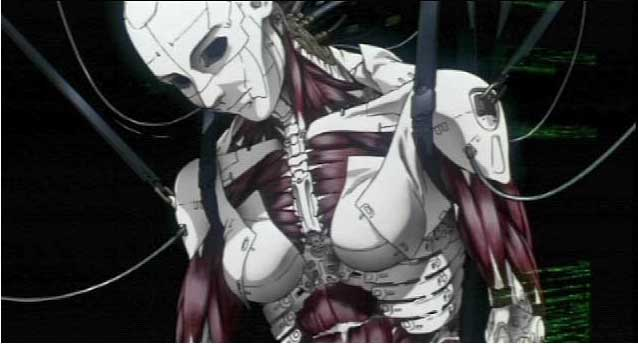

**Ghost in the Shell** (**Fantasma do Futuro** em sua tradução) é a primeira adaptação para os cinemas do mangá homônimo criado por **Masamune Shirow**. Dirigida por **Mamoru Oshii**, a adaptação acabou se tornando um dos maiores ícones da ficção científica no cinema, sendo influência direta nas obras de diversos cineastas posteriormente, além de ser uma das principais obras responsáveis pela popularização das animações japonesas no Ocidente.

  

Em 2029 temos um mundo em que a tecnologia atingiu níveis neurais. A capacidade de processamento de dados a nível cerebral se tornou algo banal e a tecnologia já se tornou algo inerente na vida de todas as pessoas. A Seção 9 é um departamento especial de polícia, liderado pela Major Kusanagi Motoko, cuja especialidade é combater cyber-terrorismo e crimes relacionados. A trama se desenvolve quando Kusanagi e sua equipe investigam um criminoso conhecido como “Puppet Master”, que começa a roubar informações secretas do governo hackeando o “ghost” de suas vítimas.

  

A narrativa do filme se desenvolve através da busca existencialista em que a protagonista se aprofunda. Em uma sociedade em que a tecnologia faz parte inerente da vida das pessoas, a única coisa que diferenciaria um humano de um robô seria a presença de um “ghost” (uma alma). Temos um distanciamento e intangibilidade da alma humana. O corpo é apenas uma casca para essa subjetiva alma e esse único fator seria definidor da humanidade e individualidade de alguém.

  

  

Logo no início somos apresentados à Major Kusanagi, uma mulher com corpo inteiramente mecânico, porém com cérebro orgânico. Em sua primeira cena, Kusanagi entra em combate totalmente despida de suas roupas, apenas trajando uma capa de invisibilidade militar. Já aí podemos observar que o corpo cibernético transcenderia o que é humano e a sexualidade. O Paradoxo de Teseus, que foi discutido por filósofos como Heráclito, Sócrates, Platão, Thomas Hobbes e John Locke, diz: “Será que um objeto que teve todos os seus componentes trocados permaneceria sendo o mesmo objeto?”. Essa é a pergunta que a Major se faz ao longo do filme.

  

A discussão continua com a presença do Puppet Master, que era apenas uma inteligência artificial criada pelo governo para fazer “trabalhos sujos”, mas que atingiu o auto esclarecimento. Não aceitando o fato de que seria desligado, ele se rebela e foge.  Seria o androide com tal racionalidade isento de humanidade? Quando se encontra com Kusanagi, diz: “A vida se perpetua através da diversidade e isso inclui a habilidade de se sacrificar quando necessário”.  A junção das duas personalidades – robótica do Puppet Master e humana de Kusanagi – poderia formar um ser completamente novo, mais grandioso e evoluído. Algo maior de fato é criado, mas Oshii nos deixa em dúvida do que seria essa entidade.

  

A arte de Ghost in the Shell é  muitíssimo bem trabalhada, passando ao espectador a atmosfera opressora e sombria de um futuro dominado pela tecnologia através dos tons azulados e cinzentos acentuados. A animação é suave e natural, mas ao mesmo tempo detalhada, e se mescla sutilmente com a trilha sonora.

  

Ghost in the Shell é uma obra grandiosa e complexa, que levanta questões e deixa o ar de dúvida como uma verdadeira obra de ficção científica o faz.

  
  

### Posts Relacionados

  

[Lego Star Wars? Quem se importa, se temos Lego Senhor dos Anéis](http://www.vortexcultural.com.br/cinema/lego-star-wars-quem-se-importa-se-temos-lego-senhor-dos-aneis/)

  

[[Crítica] Planeta dos Macacos - A Origem](http://www.vortexcultural.com.br/cinema/critica-planeta-dos-macacos-a-origem/)

  

[20 Filmes Essenciais de 2011 (Parte Um)](http://www.vortexcultural.com.br/cinema/20-filmes-essenciais-de-2011-parte-um/)

  

[Nicolas Cage pode fazer um terceiro filme do Motoqueiro Fantasma](http://www.vortexcultural.com.br/cinema/nicolas-cage-pode-fazer-um-terceiro-filme-do-motoqueiro-fantasma/)

  

[[Crítica] Donnie Darko (2)](http://www.vortexcultural.com.br/cinema/critica-donnie-darko-2/)

  
  
  
from Vortex Cultural - HQ's, Literatura, Games, Resenhas, Podcast, Cinema, Música e Séries <http://www.vortexcultural.com.br/cinema/critica-ghost-in-the-shell/>
