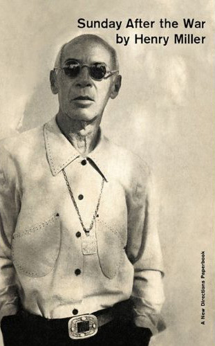
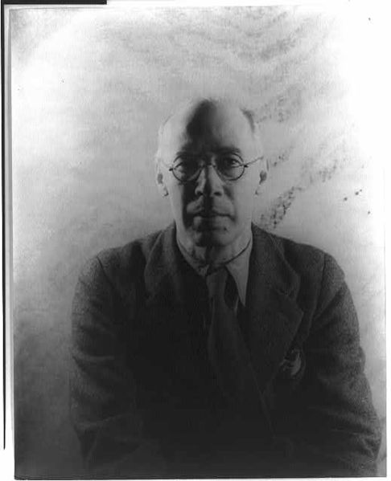

*“It is almost banal to say so yet it needs to be stressed continually: all is creation, all is change, all is flux, all is metamorphosis.”*

  

 In the heat of World War II, [Henry Miller](http://www.brainpickings.org/index.php/tag/henry-miller/) (1891-1980) — [voracious reader](http://www.brainpickings.org/index.php/2012/07/30/henry-miller-the-books-in-my-life/), [masterful letter-writer](http://www.brainpickings.org/index.php/2012/08/06/henry-miller-on-altruism/), [champion of combinatorial creativity](http://www.brainpickings.org/index.php/2012/05/11/henry-miller-on-originality/), [one disciplined writer](http://www.brainpickings.org/index.php/2012/02/22/henry-miller-on-writing/) — was living in Beverly Glen, California, and wrestling with the soul-stirring questions that war inevitably brings to the surface. It was then he penned **“Of Art and the Future,”** a wide-ranging essay on war, art, technology, the role of women in society, and mankind’s future, eventually published in [**Sunday After the War**](http://www.amazon.com/Sunday-After-War-Henry-Miller/dp/0811219046/ref=sr_1_1?tag=braipick-20) ([*public library*](http://www.worldcat.org/title/sunday-after-the-war/oclc/819187%26amp;referer=brief_results)) in 1944. In 1959, the it was included in [*The Henry Miller Reader*](http://www.amazon.com/Henry-Miller-Reader-Directions-Paperbook/dp/0811201112/ref=sr_1_1?tag=braipick-20) — also featuring Miller’s wonderful [“The Wisdom of the Heart”](http://www.brainpickings.org/index.php/2012/10/09/the-wisdom-of-the-heart-henry-miller/) — where he contextualizes it with a caveat: *“The war was still on, my royalties from Europe were cut off, and I was in the doldrums.”* Still, the essay offers a timeless and immeasurably timely lens on the triumphs and tyrannies of the human spirit.

  

Miller begins by considering the [continuum of time](http://www.brainpickings.org/index.php/2012/02/07/cartographies-of-time/):

  
> To most men the past is never yesterday, or five minutes ago, but distant, misty epochs some of which are glorious and others abominable, Each one reconstructs the past according to his temperament and experience. We read history to corroborate our own views, not to learn what scholars think to be true. About the future there is as little agreement as bout the past, I’ve noticed. We stand in relation to the past very much like the cow in the meadow — endlessly chewing the cud. It is not something finished and done with, as we sometimes fondly imagine, but something alive, constantly changing, and perpetually with us. But the future too is with us perpetually, and alive and constantly changing. The difference between the two, a thoroughly fictive one, incidentally, is that the future we create whereas the past can only be recreated. As for that constantly vanishing point called the present, that fulcrum which melts simultaneously into past and future, only those who deal with the eternal know and live in it, acknowledging it to be all.

  

He articulates [the era’s familiar fear of technology](http://www.brainpickings.org/index.php/2012/09/24/anais-nin-global-village/):

  
> The cultural era of Europe, and that includes America, is finished. The next era belongs to the technician; the day of the mind machine is dawning. God pity us!

  

In a prescient contemplation, all the more true and urgent today, Miller considers the state of war and peace:

  
> In the future we shall have only ‘world wars’ — that much is already clear.
>
>   
>
> With total wars a new element creeps into the picture. From now on, every one is involved, without exception. What Napoleon began with the sword, and Balzac boasted he would finish with the pen, is actually going to be carried through by the collaboration of the whole wide world, including the primitive races whom we study and exploit shamelessly and ruthlessly. As war spread wider and wider so will peace sink deeper and deeper into the hearts of men. If we must fight more whole-heartedly we shall also be obliged to live more whole-heartedly.

  

He then goes on to echo his then-lover [Anaïs Nin](http://www.brainpickings.org/index.php/tag/anais-nin/)‘s poignant meditation on [individuals and mass movements](http://www.brainpickings.org/index.php/2012/08/21/anais-nin-diary-mass-movements/):

  
> This war will bring about the realization that the nations of the earth are made up of individuals, not masses. The common man will be the new factor in the world0wide collective mania which will sweep the earth.

  

  

Miller considers the role and responsibility of inventors and “geniuses” in moving society forward — something [astrophysicists Neil deGrasse Tyson recently discussed on Colbert](http://www.brainpickings.org/index.php/2012/09/24/neil-degrasse-tyson-colbert/) — with equal parts optimism for human nature and caution of power-warped human intentions:

  
> The problem of power, what to do with it, how to use it, who shall wield it or not wield it, will assume proportions heretofore unthinkable. We are moving into the realm of incalculables and imponderables in our everyday life just as for the last few generations we have been accustoming ourselves to this realm through the play of thought. Everything is coming to fruition, and the harvest will be brilliant and terrifying. To those who look upon such predictions as fantastic I have merely to point out, ask them to imagine, what would happen should we ever unlock the secret patents now hidden in the vaults of our unscrupulous exploiters. Once the present crazy system of exploitation crumbles, and it is crumbling hourly, the powers of the imagination, heretofore stifled and fettered, will run riot. The face of the earth can be changed utterly overnight one we have the courage to concretize the dreams of our inventive geniuses. Never was there such a plentitude of inventors as in this age of destruction. And there is one thing to bear in mind about the man of genius — even the inventor — usually he is on the side of humanity, not the devil. It has been the crowning shame of this age to have exploited the man of genius for sinister ends. But such a procedure always acts as a boomerang: ultimately the man of genius always has his revenge.

  

One could easily see him as a champion of today’s 99%:

  
> What is now at the bottom will come to the top, and vice versa. The world has literally been standing on its head for thousands of years.

  

Two years before [*Races of Mankind*](http://www.brainpickings.org/index.php/2012/04/12/brotherhood-of-man-1946/), Miller makes an eloquent case for abolishing racist sensibilities:

  
> We have talked breathlessly about equality and democracy without ever facing the reality of it. We shall have to take these despised and neglected ones to our bosom, melt into them, absorb their anguish and misery. We cannot have a real brotherhood so long as we cherish the illusion of racial superiority, so long as we fear the touch of yellow, brown, black or red skins.

  

He then presents a vision for the future of the city, strikingly aligned with today’s notion of global citizenship:

  
> The city, which was the birth-place of civilization, such as we know it tot be, will exist no more. There will be nuclei of course, but they will be mobile and fluid. The peoples of the earth will no longer be shut off from one another within states but will flow freely over the surface of the earth and intermingle. There will be no fixed constellations of human aggregates.

  

Miller’s addition to history’s [famous definitions of art](http://www.brainpickings.org/index.php/2012/06/22/what-is-art/) mirrors [Joan Didion’s conception of writing as power](http://www.brainpickings.org/index.php/2012/10/16/why-i-write-joan-didion/). He writes:

  
> At the root of the art instinct is this desire for power — vicarious power. The artist is situated hierarchically between the hero and the saint.
>
>   
>
> […]
>
>   
>
> To put it quite simply, art is only a stepping stone to reality; it is the vestibule in which we undergo the rites of initiation. Man’s task is to make of himself a work of art. The creations which man makes manifest have no validity in themselves; they serve to awaken, that is all.

  

Despite his own [profound passion for books](http://www.brainpickings.org/index.php/2012/07/30/henry-miller-the-books-in-my-life/), Miller envisions a future where the bound page no longer is:

  
> In a few hundred years or less books will be a thing of the past. There was a time when poets communicated with the world without the medium of print; the time will come when they will communicate silently, not as poets merely, but as seers. What we have overlooked, in our frenzy to invent more dazzling ways and means of communication, is to communicate.

  

Nearly two decades before Marshall McLuhan’s [seminal treatise](http://www.brainpickings.org/index.php/2011/06/20/the-medium-is-the-massage-shepard-fairey-marshall-mcluhan/) on how new communication media shape our desires and cultural norms, Miller makes a similar observation:

  
> No, the advance will not come through the use of subtler mechanical devices, nor will it come through the spread of education. The advance will come in the form of a breakthrough. New forms of communication will be established. New forms presuppose new desires. The great desire of the world today is to break the bounds which lock us in. It is not yet a conscious desire. Men do not yet realize what they are fighting for. This is the beginning of a long fight, a fight from within outwards.

  

In contemplating the era’s political landscape — an observation at ones timeless and timelier than ever, with the urgency of this season’s election — he laments:

  
> Often, when I listen to the radio, to a speech by one of our politicians, to a sermon by one of our religious maniacs, to a discourse by one of our eminent scholars, to an appeal by one of our men of good will, to the propaganda dined into us night and day by the advertising fiends, I wonder what the men of the coming century would think were they to listen in for just one evening.

  

Ultimately, however, Miller’s characteristic [faith in the human spirit](http://www.brainpickings.org/index.php/2012/08/06/henry-miller-on-altruism/) remains unabated:

  
> Myself I cannot see the persistence of the artist type. I see no need for the individual man of genius in such an order. I see no need for martyrs. I see no need for vicarious atonement. I see no need for the fierce preservation of beauty on the part of a few. Beauty and Truth do not need defenders, nor even expounders. No one will ever have a lien on Beauty and Truth; they are creations in which all participate. They need only to be apprehended; they exist externally. Certainly, when we think of the conflicts and schisms which occur in the realm of art, we know that they do not proceed out of love of Beauty or Truth. Ego worship is the one and only cause of dissension, in art as in other realms. The artist is never defending art, but simply his own petty conception of art. Art is as deep and high and wide as the universe. There is nothing but art, if you loo at it properly. It is almost banal to say so yet it needs to be stressed continually: all is creation, all is change, all is flux, all is metamorphosis.

  

[**Sunday After the War**](http://www.amazon.com/Sunday-After-War-Henry-Miller/dp/0811219046/ref=sr_1_1?tag=braipick-20) is a treasure in its entirety, made all the more precious by the fact that most of the essays in it are not available online.

  

[[anexo ausente]](http://www.brainpickings.org/index.php/newsletter/) Brain Pickings has a free weekly newsletter and people [say it’s cool](http://www.brainpickings.org/index.php/newsletter/). It comes out on Sundays and offers the week’s best articles. Here’s [what to expect](http://us2.campaign-archive2.com/?u=13eb080d8a315477042e0d5b1&amp;id=ccae42412d). Like? [Sign up.](http://www.brainpickings.org/index.php/newsletter/)

  

*Brain Pickings takes 450+ hours a month to curate and edit across the different platforms, and remains banner-free. If it brings you any joy and inspiration, please consider a modest donation – it lets me know I'm doing something right.*  

  
  
[anexo ausente]  
  
  
  
from Brain Pickings [http://www.brainpickings.org/index.php/2012/11/07/henry-miller-of-art-and-the-future/?utm\_source=feedburner&utm\_medium=feed&utm\_campaign=Feed%3A+brainpickings%2Frss+%28Brain+Pickings%29](http://www.brainpickings.org/index.php/2012/11/07/henry-miller-of-art-and-the-future/?utm_source=feedburner&amp;utm_medium=feed&amp;utm_campaign=Feed%3A+brainpickings%2Frss+%28Brain+Pickings%29)
