## [PerformanceWriting Fast, Memory-Efficient JavaScript](http://coding.smashingmagazine.com/2012/11/05/writing-fast-memory-efficient-javascript/ "Read 'Writing Fast, Memory-Efficient JavaScript'")

- By [Addy Osmani](http://coding.smashingmagazine.com/author/addy-osmani/?rel=author "Posts by Addy Osmani")
- November 5th, 2012
- [JavaScript](http://coding.smashingmagazine.com/tag/javascript/), [Optimization](http://coding.smashingmagazine.com/tag/optimization/), [Performance](http://coding.smashingmagazine.com/tag/performance/)
- [42 Comments](http://coding.smashingmagazine.com/2012/11/05/writing-fast-memory-efficient-javascript/#comments "Comment on Writing Fast, Memory-Efficient JavaScript")

Advertisement

### [Smashing Job Board[anexo ausente]](http://auslieferung.commindo-media-ressourcen.de/www/delivery/ck.php?oaparams=2__bannerid=3823__zoneid=22__OXLCA=1__cb=15b562c46b__oadest=http%3A%2F%2Fjobs.smashingmagazine.com%2F%3Futm_source%3Dsm%26utm_medium%3Dcad%26utm_campaign%3Dwidget)

- #### [Lead UI/UX Designer - Bluebox - (San Francisco, CA) - FullTime](http://auslieferung.commindo-media-ressourcen.de/www/delivery/ck.php?oaparams=2__bannerid=3823__zoneid=22__log=no__oadest=http%3A%2F%2Fjobs.smashingmagazine.com%2Fj%2FLead-UI-UX-Designer%2F2187450%3Futm_source%3Dsm%26utm_medium%3Dcad%26utm_campaign%3Dwidget "View this feed at Smashing Jobs")

  Bluebox Security, an Andreessen Horowitz backed company, is looking for an experienced UI / UX Designer to lead usability and ...
- #### [Lead Designer - Bluebox - (San Francisco, CA) - FullTime](http://auslieferung.commindo-media-ressourcen.de/www/delivery/ck.php?oaparams=2__bannerid=3823__zoneid=22__log=no__oadest=http%3A%2F%2Fjobs.smashingmagazine.com%2Fj%2FLead-Designer%2F2187441%3Futm_source%3Dsm%26utm_medium%3Dcad%26utm_campaign%3Dwidget "View this feed at Smashing Jobs")

  Bluebox Security, an Andreessen Horowitz backed company, is looking for an experienced Lead Designer to join our SF team in our ...

[anexo ausente]

JavaScript engines such as Google’s [V8](http://code.google.com/p/v8/) (Chrome, Node) are specifically designed for the [fast execution](http://www.html5rocks.com/en/tutorials/speed/v8/) of large JavaScript applications. As you develop, if you care about memory usage and performance, you should be aware of some of what’s going on in your user’s browser’s JavaScript engine behind the scenes.

Whether it’s V8, [SpiderMonkey](https://developer.mozilla.org/en-US/docs/SpiderMonkey) (Firefox), [Carakan](http://my.opera.com/ODIN/blog/carakan-faq) (Opera), [Chakra](http://en.wikipedia.org/wiki/Chakra_(JScript_engine)) (IE) or something else, doing so can help you **better optimize your applications**. That’s not to say one should optimize for a single browser or engine. Never do that.

You should, however, ask yourself questions such as:

- Is there anything I could be doing more efficiently in my code?
- What (common) optimizations do popular JavaScript engines make?
- What is the engine unable to optimize for, and is the garbage collector able to clean up what I’m expecting it to?

  
*Fast-loading Web sites — like fast cars — require the use specialized tools. Image source: [dHybridcars](http://dhybridcars.com/toyota-hybrid/2013-scion-fr-s-sexy-sport-car/media/2013-scion-fr-s-speed-gauge-img-8/).*

There are many common pitfalls when it comes to writing memory-efficient and fast code, and in this article we’re going to explore some test-proven approaches for writing code that performs better.

(**Smashing's side note**: Have you already pre-ordered the brand new [Smashing Mobile Book](http://auslieferung.commindo-media-ressourcen.de/www/delivery/ck.php?oaparams=2__bannerid=3452__zoneid=68__OXLCA=1__cb=eb51e83c44__oadest=http%3A%2F%2Fwww.smashingmagazine.com%2F2012%2F10%2F16%2Fthe-mobile-book-preorder%2F)? The book features everything you need to know as a designer or developer to create beautiful and rich mobile experiences. [Get your book today!](http://auslieferung.commindo-media-ressourcen.de/www/delivery/ck.php?oaparams=2__bannerid=3452__zoneid=68__OXLCA=1__cb=eb51e83c44__oadest=http%3A%2F%2Fwww.smashingmagazine.com%2F2012%2F10%2F16%2Fthe-mobile-book-preorder%2Fhttp%3A%2F%2Fwww.the-mobile-book.com))

[anexo ausente]

### So, How Does JavaScript Work In V8?

While it’s possible to develop large-scale applications without a thorough understanding of JavaScript engines, any car owner will tell you they’ve looked under the hood at least once. As Chrome is my browser of choice, I’m going to talk a little about its JavaScript engine. V8 is made up of a few core pieces.

- A **base compiler**, which parses your JavaScript and generates native machine code before it is executed, rather than executing bytecode or simply interpreting it. This code is initially not highly optimized.
- V8 represents your objects in an **object model**. Objects are represented as associative arrays in JavaScript, but in V8 they are represented with [hidden classes](https://developers.google.com/v8/design), which are an internal type system for optimized lookups.
- The **runtime profiler** monitors the system being run and identifies “hot” functions (i.e. code that ends up spending a long time running).
- An **optimizing compiler** recompiles and optimizes the “hot” code identified by the runtime profiler, and performs optimizations such as inlining (i.e. replacing a function call site with the body of the callee).
- V8 supports **deoptimization**, meaning the optimizing compiler can bail out of code generated if it discovers that some of the assumptions it made about the optimized code were too optimistic.
- It has a **garbage collector**. Understanding how it works can be just as important as the optimized JavaScript.

### Garbage Collection

Garbage collection is **a form of memory management**. It’s where we have the notion of a collector which attempts to reclaim memory occupied by objects that are no longer being used. In a garbage-collected language such as JavaScript, objects that are still referenced by your application are not cleaned up.

Manually de-referencing objects is not necessary in most cases. By simply putting the variables where they need to be (ideally, as local as possible, i.e. inside the function where they are used versus an outer scope), things should just work.

  
*Garbage collection attempts to reclaim memory. Image source: [Valtteri Mäki](http://www.flickr.com/photos/26817893@N05/2864644153/).*

It’s not possible to force garbage collection in JavaScript. You wouldn’t want to do this, because the garbage collection process is controlled by the runtime, and it generally knows best when things should be cleaned up.

#### De-Referencing Misconceptions

In quite a few discussions online about reclaiming memory in JavaScript, the `delete` keyword is brought up, as although it was supposed to be used for just removing keys from a map, some developers think you can force de-referencing using it. Avoid using `delete` if you can. In the below example, `delete o.x` does a lot more harm than good behind the scenes, as it changes `o`‘s hidden class and makes it a generic slow object.

|  |  |
| --- | --- |
| `1` | `var` `o = { x: 1 };` |

|  |  |
| --- | --- |
| `2` | `delete` `o.x;` `// true` |

|  |  |
| --- | --- |
| `3` | `o.x;` `// undefined` |

That said, you are almost certain to find references to `delete` in many popular JavaScript libraries – it does have a purpose in the language. The main takeaway here is to avoid modifying the structure of hot objects at runtime. JavaScript engines can detect such “hot” objects and attempt to optimize them. This is easier if the object’s structure doesn’t heavily change over its lifetime and `delete` can trigger such changes.

There are also misconceptions about how `null` works. Setting an object reference to `null` doesn’t “null” the object. It sets the object reference to `null`. Using `o.x = null` is better than using `delete`, but it’s probably not even necessary.

|  |  |
| --- | --- |
| `1` | `var` `o = { x: 1 };` |

|  |  |
| --- | --- |
| `2` | `o =` `null``;` |

|  |  |
| --- | --- |
| `3` | `o;` `// null` |

|  |  |
| --- | --- |
| `4` | `o.x` `// TypeError` |

If this reference was the last reference to the object, the object is then eligible for garbage collection. If the reference was not the last reference to the object, the object is reachable and will not be garbage collected.

Another important note to be aware of is that global variables are not cleaned up by the garbage collector during the life of your page. Regardless of how long the page is open, variables scoped to the JavaScript runtime global object will stick around.

|  |  |
| --- | --- |
| `1` | `var` `myGlobalNamespace = {};` |

Globals are cleaned up when you refresh the page, navigate to a different page, close tabs or exit your browser. Function-scoped variables get cleaned up when a variable falls out of scope. When functions have exited and there aren’t any more references to it, the variable gets cleaned up.

#### Rules of Thumb

To give the garbage collector a chance to collect as many objects as possible as early as possible, **don’t hold on to objects you no longer need**. This mostly happens automatically; here are a few things to keep in mind.

- As mentioned earlier, a better alternative to manual de-referencing is to use variables with an appropriate scope. I.e. instead of a global variable that’s nulled out, just use a function-local variable that goes out of scope when it’s no longer needed. This means cleaner code with less to worry about.
- Ensure that you’re unbinding event listeners where they are no longer required, especially when the DOM objects they’re bound to are about to be removed
- If you’re using a data cache locally, make sure to clean that cache or use an aging mechanism to avoid large chunks of data being stored that you’re unlikely to reuse

#### Functions

Next, let’s look at functions. As we’ve already said, garbage collection works by reclaiming blocks of memory (objects) which are no longer reachable. To better illustrate this, here are some examples.

|  |  |
| --- | --- |
| `1` | `function` `foo() {` |

|  |  |
| --- | --- |
| `2` | `var` `bar =` `new` `LargeObject();` |

|  |  |
| --- | --- |
| `3` | `bar.someCall();` |

|  |  |
| --- | --- |
| `4` | `}` |

When `foo` returns, the object which `bar` points to is automatically available for garbage collection, because there is nothing left that has a reference to it.

Compare this to:

|  |  |
| --- | --- |
| `1` | `function` `foo() {` |

|  |  |
| --- | --- |
| `2` | `var` `bar =` `new` `LargeObject();` |

|  |  |
| --- | --- |
| `3` | `bar.someCall();` |

|  |  |
| --- | --- |
| `4` | `return` `bar;` |

|  |  |
| --- | --- |
| `5` | `}` |

|  |  |
| --- | --- |
| `6` |  |

|  |  |
| --- | --- |
| `7` | `// somewhere else` |

|  |  |
| --- | --- |
| `8` | `var` `b = foo();` |

We now have a reference to the object which survives the call and persists until the caller assigns something else to `b` (or `b` goes out of scope).

#### Closures

When you see a function that returns an inner function, that inner function will have access to the outer scope even after the outer function is executed. This is basically a [closure](http://robertnyman.com/2008/10/09/explaining-javascript-scope-and-closures/) — an expression which can work with variables set within a specific context. For example:

|  |  |
| --- | --- |
| `01` | `function` `sum (x) {` |

|  |  |
| --- | --- |
| `02` | `function` `sumIt(y) {` |

|  |  |
| --- | --- |
| `03` | `return` `x + y;` |

|  |  |
| --- | --- |
| `04` | `};` |

|  |  |
| --- | --- |
| `05` | `return` `sumIt;` |

|  |  |
| --- | --- |
| `06` | `}` |

|  |  |
| --- | --- |
| `07` |  |

|  |  |
| --- | --- |
| `08` | `// Usage` |

|  |  |
| --- | --- |
| `09` | `var` `sumA = sum(4);` |

|  |  |
| --- | --- |
| `10` | `var` `sumB = sumA(3);` |

|  |  |
| --- | --- |
| `11` | `console.log(sumB);` `// Returns 7` |

The function object created within the execution context of the call to `sum` can’t be garbage collected, as it’s referenced by a global variable and is still very much accessible. It can still be executed via `sumA(n)`.

Let’s look at another example. Here, can we access `largeStr`?

|  |  |
| --- | --- |
| `1` | `var` `a =` `function` `() {` |

|  |  |
| --- | --- |
| `2` | `var` `largeStr =` `new` `Array(1000000).join(``'x'``);` |

|  |  |
| --- | --- |
| `3` | `return` `function` `() {` |

|  |  |
| --- | --- |
| `4` | `return` `largeStr;` |

|  |  |
| --- | --- |
| `5` | `};` |

|  |  |
| --- | --- |
| `6` | `}();` |

Yes, we can, via `a()`, so it’s not collected. How about this one?

|  |  |
| --- | --- |
| `1` | `var` `a =` `function` `() {` |

|  |  |
| --- | --- |
| `2` | `var` `smallStr =` `'x'``;` |

|  |  |
| --- | --- |
| `3` | `var` `largeStr =` `new` `Array(1000000).join(``'x'``);` |

|  |  |
| --- | --- |
| `4` | `return` `function` `(n) {` |

|  |  |
| --- | --- |
| `5` | `return` `smallStr;` |

|  |  |
| --- | --- |
| `6` | `};` |

|  |  |
| --- | --- |
| `7` | `}();` |

We can’t access it anymore and it’s a candidate for garbage collection.

#### Timers

One of the worst places to leak is in a loop, or in `setTimeout()`/`setInterval()`, but this is quite common.

Consider the following example.

|  |  |
| --- | --- |
| `1` | `var` `myObj = {` |

|  |  |
| --- | --- |
| `2` | `callMeMaybe:` `function` `() {` |

|  |  |
| --- | --- |
| `3` | `var` `myRef =` `this``;` |

|  |  |
| --- | --- |
| `4` | `var` `val = setTimeout(``function` `() {` |

|  |  |
| --- | --- |
| `5` | `console.log(``'Time is running out!'``);` |

|  |  |
| --- | --- |
| `6` | `myRef.callMyMaybe();` |

|  |  |
| --- | --- |
| `7` | `}, 1000);` |

|  |  |
| --- | --- |
| `8` | `}` |

|  |  |
| --- | --- |
| `9` | `};` |

If we then run:

|  |  |
| --- | --- |
| `1` | `myObj.callMeMaybe();` |

to begin the timer, we can see every second “Time is running out!” If we then run:

|  |  |
| --- | --- |
| `1` | `myObj =` `null``;` |

The timer will still fire. `myObj` won’t be garbage collected as the closure passed to `setTimeout` has to be kept alive in order to be executed. In turn, it holds references to `myObj` as it captures `myRef`. This would be the same if we’d passed the closure to any other function, keeping references to it.

It is also worth keeping in mind that references inside a `setTimeout`/`setInterval` call, such as functions, will need to execute and complete before they can be garbage collected.

### Be Aware Of Performance Traps

It’s important never to optimize code until you actually need to. This can’t be stressed enough. It’s easy to see a number of micro-benchmarks showing that N is more optimal than M in V8, but test it in a real module of code or in an actual application, and **the true impact of those optimizations may be much more minimal** than you were expecting.

  
*Doing too much can be as harmful as not doing anything. Image source: [Tim Sheerman-Chase](http://www.flickr.com/photos/tim_uk/7717078488/sizes/c/in/photostream/).*

Let’s say we want to create a module which:

- Takes a local source of data containing items with a numeric ID,
- Draws a table containing this data,
- Adds event handlers for toggling a class when a user clicks on any cell.

There are a few different factors to this problem, even though it’s quite straightforward to solve. How do we store the data? How do we efficiently draw the table and append it to the DOM? How do we handle events on this table optimally?

A first (naive) take on this problem might be to store each piece of available data in an object which we group into an array. One might use jQuery to iterate through the data and draw the table, then append it to the DOM. Finally, one might use event binding for adding the click behavior we desire.

**Note: This is NOT what you should be doing**

|  |  |
| --- | --- |
| `01` | `var` `moduleA =` `function` `() {` |

|  |  |
| --- | --- |
| `02` |  |

|  |  |
| --- | --- |
| `03` | `return` `{` |

|  |  |
| --- | --- |
| `04` |  |

|  |  |
| --- | --- |
| `05` | `data: dataArrayObject,` |

|  |  |
| --- | --- |
| `06` |  |

|  |  |
| --- | --- |
| `07` | `init:` `function` `() {` |

|  |  |
| --- | --- |
| `08` | `this``.addTable();` |

|  |  |
| --- | --- |
| `09` | `this``.addEvents();` |

|  |  |
| --- | --- |
| `10` | `},` |

|  |  |
| --- | --- |
| `11` |  |

|  |  |
| --- | --- |
| `12` | `addTable:` `function` `() {` |

|  |  |
| --- | --- |
| `13` |  |

|  |  |
| --- | --- |
| `14` | `for` `(``var` `i = 0; i < rows; i++) {` |

|  |  |
| --- | --- |
| `15` | `$tr = $(``'<tr></tr>'``);` |

|  |  |
| --- | --- |
| `16` | `for` `(``var` `j = 0; j <` `this``.data.length; j++) {` |

|  |  |
| --- | --- |
| `17` | `$tr.append(``'<td>'` `+` `this``.data[j][``'id'``] +` `'</td>'``);` |

|  |  |
| --- | --- |
| `18` | `}` |

|  |  |
| --- | --- |
| `19` | `$tr.appendTo($tbody);` |

|  |  |
| --- | --- |
| `20` | `}` |

|  |  |
| --- | --- |
| `21` |  |

|  |  |
| --- | --- |
| `22` | `},` |

|  |  |
| --- | --- |
| `23` | `addEvents:` `function` `() {` |

|  |  |
| --- | --- |
| `24` | `$(``'table td'``).on(``'click'``,` `function` `() {` |

|  |  |
| --- | --- |
| `25` | `$(``this``).toggleClass(``'active'``);` |

|  |  |
| --- | --- |
| `26` | `});` |

|  |  |
| --- | --- |
| `27` | `}` |

|  |  |
| --- | --- |
| `28` |  |

|  |  |
| --- | --- |
| `29` | `};` |

|  |  |
| --- | --- |
| `30` | `}();` |

Simple, but it gets the job done.

In this case however, the only data we’re iterating are IDs, a numeric property which could be more simply represented in a standard array. Interestingly, directly using `DocumentFragment` and native DOM methods are more optimal than using jQuery (in this manner) for our table generation, and of course, event delegation is typically more performant than binding each `td` individually.

Note that jQuery does use `DocumentFragment` internally behind the scenes, but in our example, the code is calling `append()` within a loop and each of these calls has little knowledge of the other so it may not be able to optimize for this example. This should hopefully not be a pain point, but be sure to benchmark your own code to be sure.

In our case, adding in these changes results in some good (expected) performance gains. Event delegation provides decent improvement over simply binding, and [opting for `documentFragment`](http://jsperf.com/first-pass) was a real booster.

|  |  |
| --- | --- |
| `01` | `var` `moduleD =` `function` `() {` |

|  |  |
| --- | --- |
| `02` |  |

|  |  |
| --- | --- |
| `03` | `return` `{` |

|  |  |
| --- | --- |
| `04` |  |

|  |  |
| --- | --- |
| `05` | `data: dataArray,` |

|  |  |
| --- | --- |
| `06` |  |

|  |  |
| --- | --- |
| `07` | `init:` `function` `() {` |

|  |  |
| --- | --- |
| `08` | `this``.addTable();` |

|  |  |
| --- | --- |
| `09` | `this``.addEvents();` |

|  |  |
| --- | --- |
| `10` | `},` |

|  |  |
| --- | --- |
| `11` | `addTable:` `function` `() {` |

|  |  |
| --- | --- |
| `12` | `var` `td,tr,frag,frag2;` |

|  |  |
| --- | --- |
| `13` | `for` `(``var` `i = 0; i < rows; i++) {` |

|  |  |
| --- | --- |
| `14` | `tr = document.createElement(``'tr'``);` |

|  |  |
| --- | --- |
| `15` | `for` `(``var` `j = 0; j <` `this``.data.length; j++) {` |

|  |  |
| --- | --- |
| `16` | `td = document.createElement(``'td'``);` |

|  |  |
| --- | --- |
| `17` | `td.appendChild(document.createTextNode(``this``.data[j]));` |

|  |  |
| --- | --- |
| `18` |  |

|  |  |
| --- | --- |
| `19` | `frag2.appendChild(td);` |

|  |  |
| --- | --- |
| `20` | `}` |

|  |  |
| --- | --- |
| `21` | `tr.appendChild(frag2);` |

|  |  |
| --- | --- |
| `22` | `frag.appendChild(tr);` |

|  |  |
| --- | --- |
| `23` | `}` |

|  |  |
| --- | --- |
| `24` | `tbody.appendChild(frag);` |

|  |  |
| --- | --- |
| `25` | `},` |

|  |  |
| --- | --- |
| `26` | `addEvents:` `function` `() {` |

|  |  |
| --- | --- |
| `27` | `$(``'table'``).on(``'click'``,` `'td'``,` `function` `() {` |

|  |  |
| --- | --- |
| `28` | `$(``this``).toggleClass(``'active'``);` |

|  |  |
| --- | --- |
| `29` | `});` |

|  |  |
| --- | --- |
| `30` | `}` |

|  |  |
| --- | --- |
| `31` |  |

|  |  |
| --- | --- |
| `32` | `};` |

|  |  |
| --- | --- |
| `33` |  |

|  |  |
| --- | --- |
| `34` | `}();` |

We might then look to other ways of improving performance. You may have read somewhere that using the prototypal pattern is more optimal than the module pattern (we confirmed it wasn’t earlier), or heard that using JavaScript templating frameworks are highly optimized. Sometimes they are, but use them because they make for readable code. Also, precompile!. Let’s test and find out how true this hold in practice.

|  |  |
| --- | --- |
| `01` | `moduleG =` `function` `() {};` |

|  |  |
| --- | --- |
| `02` |  |

|  |  |
| --- | --- |
| `03` | `moduleG.prototype.data = dataArray;` |

|  |  |
| --- | --- |
| `04` | `moduleG.prototype.init =` `function` `() {` |

|  |  |
| --- | --- |
| `05` | `this``.addTable();` |

|  |  |
| --- | --- |
| `06` | `this``.addEvents();` |

|  |  |
| --- | --- |
| `07` | `};` |

|  |  |
| --- | --- |
| `08` | `moduleG.prototype.addTable =` `function` `() {` |

|  |  |
| --- | --- |
| `09` | `var` `template = _.template($(``'#template'``).text());` |

|  |  |
| --- | --- |
| `10` | `var` `html = template({``'data'` `:` `this``.data});` |

|  |  |
| --- | --- |
| `11` | `$tbody.append(html);` |

|  |  |
| --- | --- |
| `12` | `};` |

|  |  |
| --- | --- |
| `13` | `moduleG.prototype.addEvents =` `function` `() {` |

|  |  |
| --- | --- |
| `14` | `$(``'table'``).on(``'click'``,` `'td'``,` `function` `() {` |

|  |  |
| --- | --- |
| `15` | `$(``this``).toggleClass(``'active'``);` |

|  |  |
| --- | --- |
| `16` | `});` |

|  |  |
| --- | --- |
| `17` | `};` |

|  |  |
| --- | --- |
| `18` |  |

|  |  |
| --- | --- |
| `19` | `var` `modG =` `new` `moduleG();` |

As it turns out, in this case the performance benefits are negligible. [Opting for templating and prototypes](http://jsperf.com/second-pass) didn’t really offer anything more than what we had before. That said, performance isn’t really the reason modern developers use either of these things — it’s the readability, inheritance model and maintainability they bring to your codebase.

More complex problems include [efficiently drawing images using canvas](http://jsperf.com/canvas-drawimage-vs-webgl-drawarrays/6) and [manipulating pixel data](http://jsperf.com/canvas-pixel-manipulation/30) with or without [typed arrays](http://jsperf.com/typed-arrays-for-pixel-manipulation)

Always give micro-benchmarks a close lookover before exploring their use in your application. Some of you may recall the [JavaScript templating shoot-off](http://jsperf.com/dom-vs-innerhtml-based-templating/473) and the [extended shoot-off that followed](http://jsperf.com/javascript-templating-shootoff-extended/26). You want to make sure that tests aren’t being impacted by constraints you’re unlikely to see in real world applications — test optimizations together in actual code.

### V8 Optimization Tips

Whilst detailing every V8 optimization is outside the scope of this article, there are certainly many tips worth noting. Keep these in mind and you’ll reduce your chances of writing unperformant code.

- Certain patterns will cause V8 to bail out of optimizations. A try-catch, for example, will cause such a bailout. For more information on what functions can and can’t be optimized, you can use the `--trace-bailout file.js` with the d8 shell utility that comes with V8.
- If you care about speed, try very hard to keep your functions monomorphic, i.e. make sure that variables (including properties, arrays and function parameters) only ever contain objects with the same hidden class. For example, don’t do this:

|  |  |
| --- | --- |
| `1` | `function` `add(x, y) {` |

|  |  |
| --- | --- |
| `2` | `return` `x+y;` |

|  |  |
| --- | --- |
| `3` | `}` |

|  |  |
| --- | --- |
| `4` |  |

|  |  |
| --- | --- |
| `5` | `add(1, 2);` |

|  |  |
| --- | --- |
| `6` | `add(``'a'``,``''``b');` |

|  |  |
| --- | --- |
| `7` | `add(my_custom_object, undefined);` |

- Don’t load from uninitialized or deleted elements. This won’t make a difference in output, but it will make things slower.
- Don’t write enormous functions, as they are more difficult to optimize

For more tips, watch Daniel Clifford’s Google I/O talk [Breaking the JavaScript Speed Limit with V8](http://www.youtube.com/watch?v=UJPdhx5zTaw) as it covers these topics well. [Optimizing For V8 — A Series](http://floitsch.blogspot.co.uk/2012/03/optimizing-for-v8-introduction.html) is also worth a read.

#### Objects Vs. Arrays: Which Should I Use?

- If you want to store a bunch of numbers, or a list of objects of the same type, use an array.
- If what you semantically need is an object with a bunch of properties (of varying types), use an object with properties. That’s pretty efficient in terms of memory, and it’s also pretty fast.
- Integer-indexed elements, regardless of whether they’re stored in an array or an object, are [much faster to iterate over than object properties](http://jsperf.com/performance-of-array-vs-object/3).
- Properties on objects are quite complex: they can be created with setters, and with differing enumerability and writability. Items in arrays aren’t able to be customized as heavily — they either exist or they don’t. At an engine level, this allows for more optimization in terms of organizing the memory representing the structure. This is particularly beneficial when the array contains numbers. For example, when you need vectors, don’t define a class with properties x, y, z; use an array instead..

There’s really only one major difference between objects and arrays in JavaScript, and that’s the arrays’ magic `length` property. If you’re keeping track of this property yourself, objects in V8 should be just as fast as arrays.

#### Tips When Using Objects

- Create objects using a constructor function. This ensures that all objects created with it have the same hidden class and helps avoid changing these classes. As an added benefit, it’s also [slightly faster than `Object.create()`](http://jsperf.com/object-create-vs-constructor-vs-object-literal/7)
- There are no restrictions on the number of different object types you can use in your application or on their complexity (within reason: long prototype chains tend to hurt, and objects with only a handful of properties get a special representation that’s a bit faster than bigger objects). For “hot” objects, try to keep the prototype chains short and the field count low.

**Object Cloning**  
Object cloning is a common problem for app developers. While it’s possible to benchmark how well various implementations work with this type of problem in V8, be very careful when copying anything. Copying big things is generally slow — don’t do it. `for..in` loops in JavaScript are particularly bad for this, as they have a devilish specification and will likely never be fast in any engine for arbitrary objects.

When you absolutely do need to copy objects in a performance-critical code path (and you can’t get out of this situation), use an array or a custom “copy constructor” function which copies each property explicitly. This is probably the fastest way to do it:

|  |  |
| --- | --- |
| `1` | `function` `clone(original) {` |

|  |  |
| --- | --- |
| `2` | `this``.foo = original.foo;` |

|  |  |
| --- | --- |
| `3` | `this``.bar = original.bar;` |

|  |  |
| --- | --- |
| `4` | `}` |

|  |  |
| --- | --- |
| `5` | `var` `copy =` `new` `clone(original);` |

**Cached Functions in the Module Pattern**  
Caching your functions when using the module pattern can lead to performance improvements. See below for an example where the variation you’re probably used to seeing is slower as it forces new copies of the member functions to be created all the time.

Also note that using this approach can be significantly more optimal than just relying on the prototypal pattern (as confirmed by the jsPerf test).

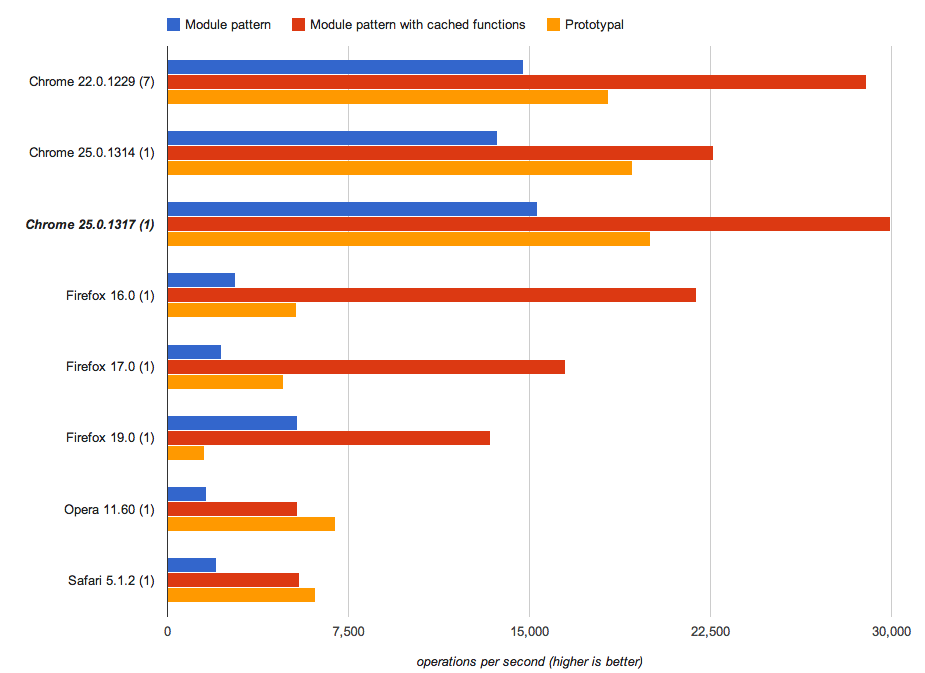  
*Performance improvements when using the module or prototypal patterns.*

Here is a [test of prototype versus module pattern performance](http://jsperf.com/prototypal-performance/12)

|  |  |
| --- | --- |
| `01` | `// Prototypal pattern` |

|  |  |
| --- | --- |
| `02` | `Klass1 =` `function` `() {}` |

|  |  |
| --- | --- |
| `03` | `Klass1.prototype.foo =` `function` `() {` |

|  |  |
| --- | --- |
| `04` | `log(``'foo'``);` |

|  |  |
| --- | --- |
| `05` | `}` |

|  |  |
| --- | --- |
| `06` | `Klass1.prototype.bar =` `function` `() {` |

|  |  |
| --- | --- |
| `07` | `log(``'bar'``);` |

|  |  |
| --- | --- |
| `08` | `}` |

|  |  |
| --- | --- |
| `09` |  |

|  |  |
| --- | --- |
| `10` | `// Module pattern` |

|  |  |
| --- | --- |
| `11` | `Klass2 =` `function` `() {` |

|  |  |
| --- | --- |
| `12` | `var` `foo =` `function` `() {` |

|  |  |
| --- | --- |
| `13` | `log(``'foo'``);` |

|  |  |
| --- | --- |
| `14` | `},` |

|  |  |
| --- | --- |
| `15` | `bar =` `function` `() {` |

|  |  |
| --- | --- |
| `16` | `log(``'bar'``);` |

|  |  |
| --- | --- |
| `17` | `};` |

|  |  |
| --- | --- |
| `18` |  |

|  |  |
| --- | --- |
| `19` | `return` `{` |

|  |  |
| --- | --- |
| `20` | `foo: foo,` |

|  |  |
| --- | --- |
| `21` | `bar: bar` |

|  |  |
| --- | --- |
| `22` | `}` |

|  |  |
| --- | --- |
| `23` | `}` |

|  |  |
| --- | --- |
| `24` |  |

|  |  |
| --- | --- |
| `25` |  |

|  |  |
| --- | --- |
| `26` | `// Module pattern with cached functions` |

|  |  |
| --- | --- |
| `27` | `var` `FooFunction =` `function` `() {` |

|  |  |
| --- | --- |
| `28` | `log(``'foo'``);` |

|  |  |
| --- | --- |
| `29` | `};` |

|  |  |
| --- | --- |
| `30` | `var` `BarFunction =` `function` `() {` |

|  |  |
| --- | --- |
| `31` | `log(``'bar'``);` |

|  |  |
| --- | --- |
| `32` | `};` |

|  |  |
| --- | --- |
| `33` |  |

|  |  |
| --- | --- |
| `34` | `Klass3 =` `function` `() {` |

|  |  |
| --- | --- |
| `35` | `return` `{` |

|  |  |
| --- | --- |
| `36` | `foo: FooFunction,` |

|  |  |
| --- | --- |
| `37` | `bar: BarFunction` |

|  |  |
| --- | --- |
| `38` | `}` |

|  |  |
| --- | --- |
| `39` | `}` |

|  |  |
| --- | --- |
| `40` |  |

|  |  |
| --- | --- |
| `41` |  |

|  |  |
| --- | --- |
| `42` | `// Iteration tests` |

|  |  |
| --- | --- |
| `43` |  |

|  |  |
| --- | --- |
| `44` | `// Prototypal` |

|  |  |
| --- | --- |
| `45` | `var` `i = 1000,` |

|  |  |
| --- | --- |
| `46` | `objs = [];` |

|  |  |
| --- | --- |
| `47` | `while` `(i--) {` |

|  |  |
| --- | --- |
| `48` | `var` `o =` `new` `Klass1()` |

|  |  |
| --- | --- |
| `49` | `objs.push(``new` `Klass1());` |

|  |  |
| --- | --- |
| `50` | `o.bar;` |

|  |  |
| --- | --- |
| `51` | `o.foo;` |

|  |  |
| --- | --- |
| `52` | `}` |

|  |  |
| --- | --- |
| `53` |  |

|  |  |
| --- | --- |
| `54` | `// Module pattern` |

|  |  |
| --- | --- |
| `55` | `var` `i = 1000,` |

|  |  |
| --- | --- |
| `56` | `objs = [];` |

|  |  |
| --- | --- |
| `57` | `while` `(i--) {` |

|  |  |
| --- | --- |
| `58` | `var` `o = Klass2()` |

|  |  |
| --- | --- |
| `59` | `objs.push(Klass2());` |

|  |  |
| --- | --- |
| `60` | `o.bar;` |

|  |  |
| --- | --- |
| `61` | `o.foo;` |

|  |  |
| --- | --- |
| `62` | `}` |

|  |  |
| --- | --- |
| `63` |  |

|  |  |
| --- | --- |
| `64` | `// Module pattern with cached functions` |

|  |  |
| --- | --- |
| `65` | `var` `i = 1000,` |

|  |  |
| --- | --- |
| `66` | `objs = [];` |

|  |  |
| --- | --- |
| `67` | `while` `(i--) {` |

|  |  |
| --- | --- |
| `68` | `var` `o = Klass3()` |

|  |  |
| --- | --- |
| `69` | `objs.push(Klass3());` |

|  |  |
| --- | --- |
| `70` | `o.bar;` |

|  |  |
| --- | --- |
| `71` | `o.foo;` |

|  |  |
| --- | --- |
| `72` | `}` |

|  |  |
| --- | --- |
| `73` | `// See the test for full details` |

#### Tips When Using Arrays

Next let’s look at a few tips for arrays. In general, **don’t delete array elements**. It would make the array transition to a slower internal representation. When the key set becomes sparse, V8 will eventually switch elements to dictionary mode, which is even slower.

**Array Literals**  
Array literals are useful because they give a hint to the VM about the size and type of the array. They’re typically good for small to medium sized arrays.

|  |  |
| --- | --- |
| `1` | `// Here V8 can see that you want a 4-element array containing numbers:` |

|  |  |
| --- | --- |
| `2` | `var` `a = [1, 2, 3, 4];` |

|  |  |
| --- | --- |
| `3` |  |

|  |  |
| --- | --- |
| `4` | `// Don't do this:` |

|  |  |
| --- | --- |
| `5` | `a = [];` `// Here V8 knows nothing about the array` |

|  |  |
| --- | --- |
| `6` | `for``(``var` `i = 1; i <= 4; i++) {` |

|  |  |
| --- | --- |
| `7` | `a.push(i);` |

|  |  |
| --- | --- |
| `8` | `}` |

**Storage of Single Types Vs. Mixed Types**  
It’s never a good idea to mix values of different types (e.g. numbers, strings, undefined or true/false) in the same array (i.e. `var arr = [1, “1”, undefined, true, “true”]`)

[Test of type inference performance](http://jsperf.com/type-inference-performance/2)

As we can see from the results, the array of `ints` is the fastest.

**Sparse Arrays vs. Full Arrays**  
When you use sparse arrays, be aware that accessing elements in them is much slower than in full arrays. That’s because V8 doesn’t allocate a flat backing store for the elements if only a few of them are used. Instead, it manages them in a dictionary, which saves space, but costs time on access.

[Test of sparse arrays versus full arrays](http://jsperf.com/sparse-arrays-vs-full-arrays).

The full array `sum` and `sum` of all elements on an array without zeros were actually the fastest. Whether the full array contains zeroes or not should not make a difference.

**Packed Vs. Holey Arrays**  
Avoid “holes” in an array (created by deleting elements or `a[x] = foo` with `x > a.length`). Even if only a single element is deleted from an otherwise “full” array, things will be much slower.

[Test of packed versus holey arrays](http://jsperf.com/packed-vs-holey-arrays).

**Pre-allocating Arrays Vs. Growing As You Go**  
Don’t pre-allocate large arrays (i.e. greater than 64K elements) to their maximum size, instead grow as you go. Before we get to the performance tests for this tip, keep in mind that this is specific to only some JavaScript engines.

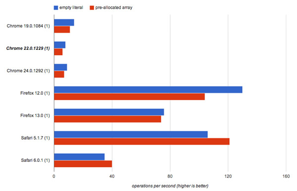  
*Test of empty literal versus pre-allocated array in various browsers.*

Nitro (Safari) actually treats pre-allocated arrays more favorably. However, in other engines (V8, SpiderMonkey), not pre-allocating is more efficient.

[Test of pre-allocated arrays](http://jsperf.com/pre-allocated-arrays).

|  |  |
| --- | --- |
| `01` | `// Empty array` |

|  |  |
| --- | --- |
| `02` | `var` `arr = [];` |

|  |  |
| --- | --- |
| `03` | `for` `(``var` `i = 0; i < 1000000; i++) {` |

|  |  |
| --- | --- |
| `04` | `arr[i] = i;` |

|  |  |
| --- | --- |
| `05` | `}` |

|  |  |
| --- | --- |
| `06` |  |

|  |  |
| --- | --- |
| `07` | `// Pre-allocated array` |

|  |  |
| --- | --- |
| `08` | `var` `arr =` `new` `Array(1000000);` |

|  |  |
| --- | --- |
| `09` | `for` `(``var` `i = 0; i < 1000000; i++) {` |

|  |  |
| --- | --- |
| `10` | `arr[i] = i;` |

|  |  |
| --- | --- |
| `11` | `}` |

### Optimizing Your Application

In the world of Web applications, **speed is everything**. No user wants a spreadsheet application to take seconds to sum up an entire column or a summary of their messages to take a minute before it’s ready. This is why squeezing every drop of extra performance you can out of code can sometimes be critical.

  
*Image source: [Per Olof Forsberg](http://www.flickr.com/photos/perolofforsberg/6691744587/in/photostream/).*

While understanding and improving your application performance is useful, it can also be difficult. We recommend the following steps to fix performance pain points:

- Measure it: Find the slow spots in your application (~45%)
- Understand it: Find out what the actual problem is (~45%)
- Fix it! (~10%)

Some of the tools and techniques recommended below can assist with this process.

#### Benchmarking

There are many ways to run benchmarks on JavaScript snippets to test their performance — the general assumption being that benchmarking is simply comparing two timestamps. One such pattern was pointed out by the [jsPerf](http://jsperf.com) team, and happens to be used in [SunSpider](http://www.webkit.org/perf/sunspider/sunspider.html)‘s and [Kraken](http://krakenbenchmark.mozilla.org/)‘s benchmark suites:

|  |  |
| --- | --- |
| `1` | `var` `totalTime,` |

|  |  |
| --- | --- |
| `2` | `start =` `new` `Date,` |

|  |  |
| --- | --- |
| `3` | `iterations = 1000;` |

|  |  |
| --- | --- |
| `4` | `while` `(iterations--) {` |

|  |  |
| --- | --- |
| `5` | `// Code snippet goes here` |

|  |  |
| --- | --- |
| `6` | `}` |

|  |  |
| --- | --- |
| `7` | `// totalTime → the number of milliseconds taken` |

|  |  |
| --- | --- |
| `8` | `// to execute the code snippet 1000 times` |

|  |  |
| --- | --- |
| `9` | `totalTime =` `new` `Date - start;` |

Here, the code to be tested is placed within a loop and run a set number of times (e.g. six). After this, the start date is subtracted from the end date to find the time taken to perform the operations in the loop.

However, this oversimplifies how benchmarking should be done, especially if you want to run the benchmarks in multiple browsers and environments. Garbage collection itself can have an impact on your results. Even if you’re using a solution like `window.performance`, you still have to account for these pitfalls.

Regardless of whether you are simply running benchmarks against parts of your code, writing a test suite or coding a benchmarking library, there’s a lot more to JavaScript benchmarking than you might think. For a more detailed guide to benchmarking, I highly recommend reading [JavaScript Benchmarking](http://mathiasbynens.be/notes/javascript-benchmarking) by Mathias Bynens and John-David Dalton.

#### Profiling

The Chrome Developer Tools have good support for [JavaScript profiling](https://developers.google.com/chrome-developer-tools/docs/profiles). You can use this feature to detect what functions are eating up the most of your time so that you can then go optimize them. This is important, as even small changes to your codebase can have serious impacts on your overall performance.

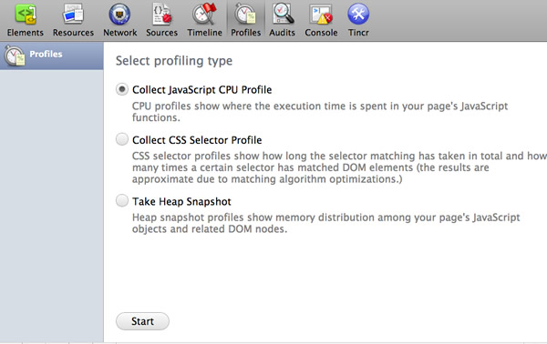  
*Profiles Panel in Chrome Developer Tools.*

Profiling starts with obtaining a baseline for your code’s current performance, which can be discovered using the Timeline. This will tell us how long our code took to run. The Profiles tab then gives us a better view into what’s happening in our application. The JavaScript CPU profile shows us how much CPU time is being used by our code, the CSS selector profile shows us how much time is spent processing selectors and Heap snapshots show how much memory is being used by our objects.

Using these tools, we can isolate, tweak and reprofile to gauge whether changes we’re making to specific functions or operations are improving performance.

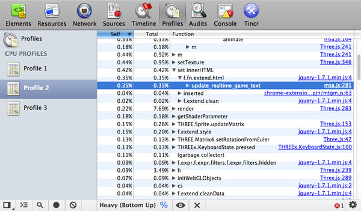  
*The Profile tab gives you information about your code’s performance.*

For a good introduction to profiling, read [JavaScript Profiling With The Chrome Developer Tools](http://coding.smashingmagazine.com/2012/06/12/javascript-profiling-chrome-developer-tools/), by Zack Grossbart.

Tip: Ideally, you want to ensure that your profiling isn’t being affected by extensions or applications you’ve installed, so run Chrome using the `--user-data-dir <empty_directory>` flag. Most of the time, this approach to optimization testing should be enough, but there are times when you need more. This is where V8 flags can be of help.

#### Avoiding Memory Leaks — Three Snapshot Techniques for Discovery

Internally at Google, the Chrome Developer Tools are heavily used by teams such as Gmail to help us discover and squash memory leaks.

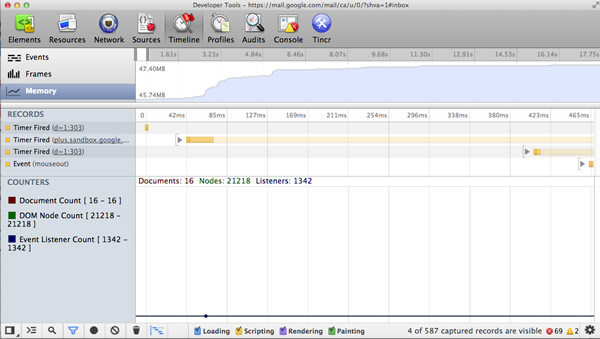  
*Memory statistics in Chrome Developer Tools.*

Some of the memory statistics that our teams care about include private memory usage, JavaScript heap size, DOM node counts, storage clearing, event listener counts and what’s going on with garbage collection. For those familiar with event-driven architectures, you might be interested to know that one of the most common issues we used to have were `listen()`’s without `unlisten()`’s (Closure) and missing `dispose()`’s for objects that create event listeners.

Luckily the DevTools can help locate some of these issues, and Loreena Lee has a fantastic presentation available documenting the [“3 snapshot” technique](https://docs.google.com/presentation/d/1wUVmf78gG-ra5aOxvTfYdiLkdGaR9OhXRnOlIcEmu2s/pub?start=false&loop=false&delayms=3000#slide=id.g1d65bdf6_0_0) for finding leaks within the DevTools that I can’t recommend reading through enough.

The gist of the technique is that you record a number of actions in your application, force a garbage collection, check if the number of DOM nodes doesn’t return to your expected baseline and then analyze three heap snapshots to determine if you have a leak.

#### Memory Management in Single-Page Applications

Memory management is quite important when writing modern single-page applications (e.g. AngularJS, Backbone, Ember) as they almost never get refreshed. This means that memory leaks can become apparent quite quickly. This is a huge trap on mobile single-page applications, because of limited memory, and on long-running applications like email clients or social networking applications. **With great power comes great responsibility.**

There are various ways to prevent this. In Backbone, ensure you always dispose old views and references using `dispose()` (currently available in [Backbone (edge)](https://github.com/documentcloud/backbone/blob/master/backbone.js#L1234)). This function was recently added, and removes any handlers added in the view’s ‘events’ object, as well as any collection or model listeners where the view is passed as the third argument (callback context). `dispose()` is also called by the view’s `remove()`, taking care of the majority of basic memory cleanup needs when the element is [cleared from the screen](https://github.com/documentcloud/backbone/blob/master/backbone.js#L1235). Other libraries like Ember [clean up observers](https://github.com/emberjs/ember.js/blob/d8f76a7fdde741ae3d1e07b12df9cb6718170e48/packages/ember-handlebars/lib/helpers/binding.js#L296) when they detect that elements have been removed from view to avoid memory leaks.

Some sage advice from Derick Bailey:

> none

> “Other than being aware of how events work in terms of references, just follow the standard rules for manage memory in JavaScript and you’ll be fine. If you are loading data in to a Backbone collection full of User objects you want that collection to be cleaned up so it’s not using anymore memory, you must remove all references to the collection and the individual objects in it. Once you remove all references, things will be cleaned up. This is just the standard JavaScript garbage collection rule.”

In his article, Derick covers many of the common [memory pitfalls](http://lostechies.com/derickbailey/2012/03/19/backbone-js-and-javascript-garbage-collection/) when working with Backbone.js and how to fix them.

There is also an helpful tutorial available for [debugging memory leaks in Node](https://github.com/felixge/node-memory-leak-tutorial) by Felix Geisendörfer worth reading, especially if it forms a part of your broader SPA stack.

#### Minimizing Reflows

When a browser has to recalculate the positions and geometrics of elements in a document for the purpose of re-rendering it, we call this [reflow](https://www.youtube.com/watch?feature=player_embedded&v=ZHxbs5WEQzE). Reflow is a user-blocking operation in the browser, so it’s helpful to understand how to improve reflow time.

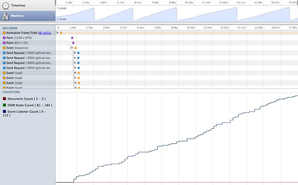  
*Chart of reflow time.*

You should batch methods that [trigger reflow](http://stackoverflow.com/questions/510213/when-does-reflow-happen-in-a-dom-environment) or that repaints, and use them sparingly. It’s important to process off DOM where possible. This is possible using [DocumentFragment](http://www.w3.org/TR/DOM-Level-2-Core/core.html#ID-B63ED1A3), a lightweight document object. Think of it as a way to extract a portion of a document’s tree, or create a new “fragment” of a document. Rather than constantly adding to the DOM using nodes, we can use document fragments to build up all we need and only perform a single insert into the DOM to avoid excessive reflow.

For example, let’s write a function that adds 20 `div`s to an element. Simply appending each new `div` directly to the element could trigger 20 reflows.

|  |  |
| --- | --- |
| `1` | `function` `addDivs(element) {` |

|  |  |
| --- | --- |
| `2` | `var` `div;` |

|  |  |
| --- | --- |
| `3` | `for` `(``var` `i = 0; i < 20; i ++) {` |

|  |  |
| --- | --- |
| `4` | `div = document.createElement(``'div'``);` |

|  |  |
| --- | --- |
| `5` | `div.innerHTML =` `'Heya!'``;` |

|  |  |
| --- | --- |
| `6` | `element.appendChild(div);` |

|  |  |
| --- | --- |
| `7` | `}` |

|  |  |
| --- | --- |
| `8` | `}` |

To work around this issue, we can use `DocumentFragment`, and instead, append each of our new `div`s to this. When appending to the `DocumentFragment` with a method like `appendChild`, all of the fragment’s children are appended to the element triggering only one reflow.

|  |  |
| --- | --- |
| `01` | `function` `addDivs(element) {` |

|  |  |
| --- | --- |
| `02` | `var` `div;` |

|  |  |
| --- | --- |
| `03` | `// Creates a new empty DocumentFragment.` |

|  |  |
| --- | --- |
| `04` | `var` `fragment = document.createDocumentFragment();` |

|  |  |
| --- | --- |
| `05` | `for` `(``var` `i = 0; i < 20; i ++) {` |

|  |  |
| --- | --- |
| `06` | `div = document.createElement(``'a'``);` |

|  |  |
| --- | --- |
| `07` | `div.innerHTML =` `'Heya!'``;` |

|  |  |
| --- | --- |
| `08` | `fragment.appendChild(div);` |

|  |  |
| --- | --- |
| `09` | `}` |

|  |  |
| --- | --- |
| `10` | `element.appendChild(fragment);` |

|  |  |
| --- | --- |
| `11` | `}` |

You can read more about this topic at [Make the Web Faster](https://developers.google.com/speed/articles/javascript-dom),  
[JavaScript Memory Optimization](http://blog.tojicode.com/2012/03/javascript-memory-optimization-and.html) and [Finding Memory Leaks](http://gent.ilcore.com/2011/08/finding-memory-leaks.html).

#### JavaScript Memory Leak Detector

To help discover JavaScript memory leaks, two of my fellow Googlers (Marja Hölttä and Jochen Eisinger) developed a tool that works with the Chrome Developer Tools (specifically, the remote inspection protocol), and retrieves heap snapshots and detects what objects are causing leaks.

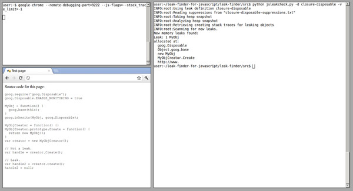  
*A tool for detecting JavaScript memory leaks.*

There’s a whole post on [how to use the tool](http://google-opensource.blogspot.de/2012/08/leak-finder-new-tool-for-javascript.html), and I encourage you to check it out or view the [Leak Finder project page](http://code.google.com/p/leak-finder-for-javascript/).

Some more information: In case you’re wondering why a tool like this isn’t already integrated with our Developer Tools, the reason is twofold. It was originally developed to help us catch some specific memory scenarios in the Closure Library, and it makes more sense as an external tool (or maybe even an extension if we get a heap profiling extension API in place).

#### V8 Flags for Debugging Optimizations & Garbage Collection

Chrome supports passing a number of flags directly to V8 via the `js-flags` flag to get more detailed output about what the engine is optimizing. For example, this traces V8 optimizations:

|  |  |
| --- | --- |
| `1` | `"/Applications/Google Chrome/Google Chrome"` `--js-flags=``"--trace-opt --trace-deopt --trace-bailout"` |

Windows users will want to run `` `chrome.exe --js-flags="--trace-opt --trace-deopt --trace-bailout" ``

When developing your application, the following V8 flags can be used.

- `trace-opt` – log names of optimized functions.
- `trace-deopt` – log a list of code it had to deoptimize while running.
- `trace-bailout` – find out where the optimizer is skipping code because it can’t figure something out.
- `trace-gc` – logs a tracing line on each garbage collection.

V8’s tick-processing scripts mark optimized functions with an `*` (asterisk) and non-optimized functions with `~` (tilde).

If you’re interested in learning more about V8′s flags and how V8′s internals work in general, I strongly recommend looking through Vyacheslav Egorov’s [excellent post on V8 internals](http://blog.mrale.ph/post/14403172501/simple-optimization-checklist), which summarizes the best resources available on this at the moment.

#### High-Resolution Time and Navigation Timing API

[High Resolution Time](http://www.w3.org/TR/hr-time/) (HRT) is a JavaScript interface providing the current time in sub-millisecond resolution that isn’t subject to system clock skews or user adjustments. Think of it as a way to measure more precisely than we’ve previously had with `new Date` and `Date.now()`. This is helpful when we’re writing performance benchmarks.

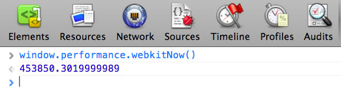  
*High Resolution Time (HRT) provides the current time in sub-millisecond resolution.*

HRT is currently available in Chrome (stable) as `window.performance.webkitNow()`, but the prefix is dropped in Chrome Canary, making it available via `window.performance.now()`. Paul Irish has written [more about HRT](http://updates.html5rocks.com/2012/08/When-milliseconds-are-not-enough-performance-now) in a post on HTML5Rocks.

So, we now know the current time, but what if we wanted an API for accurately measuring performance on the web?

Well, one is now also available in the [Navigation Timing API](http://dvcs.w3.org/hg/webperf/raw-file/tip/specs/NavigationTiming/Overview.html). This API provides a simple way to get accurate and detailed time measurements that are recorded while a webpage is loaded and presented to the user. Timing information is exposed via `window.performance.timing`, which you can simply use in the console:

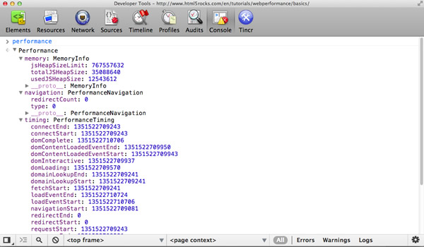  
*Timing information is shown in the console.*

Looking at the data above, we can extract some very useful information. For example, network latency is `responseEnd-fetchStart`, the time taken for a page load once it’s been received from the server is `loadEventEnd-responseEnd` and the time taken to process between navigation and page load is `loadEventEnd-navigationStart`.

As you can see above, a `perfomance.memory` property is also available that gives access to JavaScript memory usage data such as the total heap size.

For more details on the Navigation Timing API, read Sam Dutton’s great article [Measuring Page Load Speed With Navigation Timing](http://www.html5rocks.com/en/tutorials/webperformance/basics/).

#### about:memory and about:tracing

`about:tracing` in Chrome offers an intimate view of the browser’s performance, recording all of Chrome’s activities across every thread, tab and process.

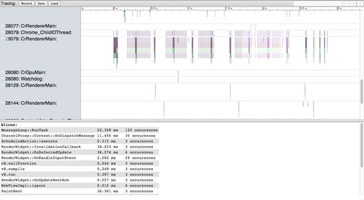  
*`About:Tracing` offers an intimate view of the browser’s performance.*

What’s really useful about this tool is that it allows you to capture profiling data about what Chrome is doing under the hood, so you can properly adjust your JavaScript execution, or optimize your asset loading.

Lilli Thompson has an excellent [write-up for games developers](http://www.html5rocks.com/en/tutorials/games/abouttracing/) on using `about:tracing` to profile WebGL games. The write-up is also useful for general JavaScripters.

Navigating to `about:memory` in Chrome is also useful as it shows the exact amount of memory being used by each tab, which is helpful for tracking down potential leaks.

### Conclusion

As we’ve seen, **there are many hidden performance gotchas in the world of JavaScript engines**, and no silver bullet available to improve performance. It’s only when you combine a number of optimizations in a (real-world) testing environment that you can realize the largest performance gains. But even then, understanding how engines interpret and optimize your code can give you insights to help tweak your applications.

**Measure It. Understand it. Fix it.** Rinse and repeat.

[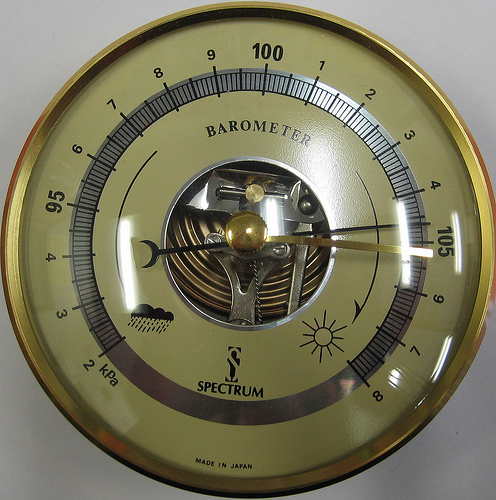](http://www.flickr.com/photos/38891164@N02/4266609887/)  
*Image source: [Sally Hunter](http://www.flickr.com/photos/38891164@N02/4266609887/).*

Remember to care about optimization, but stop short of opting for micro-optimization at the cost of convenience. For example, some developers opt for `.forEach` and `Object.keys` over `for` and `for in` loops, even though they’re slower, for the convenience of being able to scope. Do make sanity calls on what optimizations your application absolutely needs and which ones it could live without.

Also, be aware that although JavaScript engines continue to get faster, the next real bottleneck is the DOM. Reflows and repaints are just as important to minimize, so remember to only touch the DOM if it’s absolutely required. And do care about networking. HTTP requests are precious, especially on mobile, and you should be using HTTP caching to reduce the size of assets.

Keeping all of these in mind will ensure that you get the most out of the information from this post. I hope you found it helpful!

#### Credits

This article was reviewed by Jakob Kummerow, Michael Starzinger, Sindre Sorhus, Mathias Bynens, John-David Dalton and Paul Irish.

*[Image source](http://www.flickr.com/photos/26817893@N05/2864644153/) of picture on front page.*

*(cp) (jc)*

**Tags:**[JavaScript](http://coding.smashingmagazine.com/tag/javascript/ "View all articles tagged 'JavaScript' (49)")[Optimization](http://coding.smashingmagazine.com/tag/optimization/ "View all articles tagged 'Optimization' (2)")[Performance](http://coding.smashingmagazine.com/tag/performance/ "View all articles tagged 'Performance' (5)")

[↑ Back to top](http://coding.smashingmagazine.com/2012/11/05/writing-fast-memory-efficient-javascript/#top "Jump to the top of the page")[Share on Twitter](https://twitter.com/intent/tweet?original_referer=http%3A%2F%2Fcoding.smashingmagazine.com%2F2012%2F11%2F05%2Fwriting-fast-memory-efficient-javascript%2F&source=tweetbutton&text=Writing%20Fast%2C%20Memory-Efficient%20JavaScript&url=http%3A%2F%2Fcoding.smashingmagazine.com%2F2012%2F11%2F05%2Fwriting-fast-memory-efficient-javascript%2F&via=smashingmag "Share on Twitter!")
