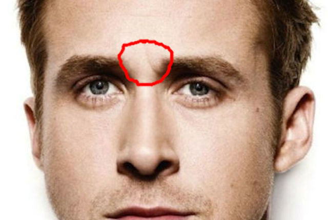
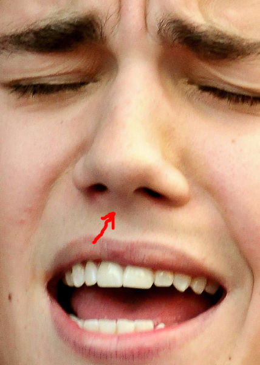
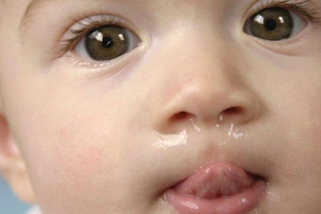
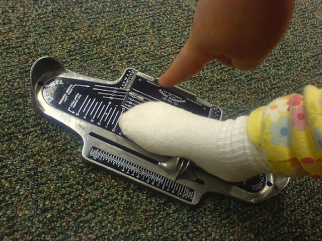
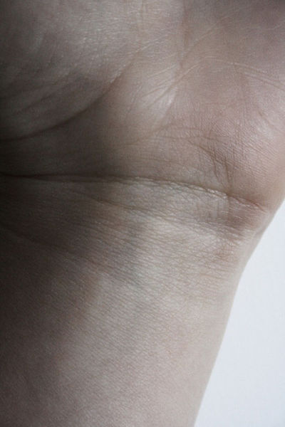

Algumas partes do nosso corpo, e objetos que usamos no cotidiano, possuem nomes que muitas vezes não conhecemos. Conheça 10 delas.

  

  

# **Glabela** - O Espaço entre as sobrancelhas.

  

.  
.  
.  
.  

  

# **Vagitus** - Do latim “choro, berro de criança”

  

.  
.  
.  
.  

  

# **Copo Souffle** – Copo para colocar catchup

  

.  
.  
.  
.  

  

# **Natiforme** - Coisas em formato de nádegas

  

.  
.  
.  
.  

  

# **Tintinabulação** - Toque de sinos

  

.  
.  
.  
.  

  

# **Cogumela nasal** - Espaço entre as narinas

  

.  
.  
.  
.  

  

# **Rinorréia** – Corrimento nasal

  

.  
.  
.  
.  

  

# **Misofonia** - Ficar bravo com alguém por comer ou respirar muito alto (entre outras coisas).

  

.  
.  
.  
.  

  

# **Dispositivo de Brannock** – Objeto usado para medir os pés numa loja de sapatos.

  

.  
.  
.  
.  

  

# **Rasceta** - As linhas no seu pulso.

  

Créditos: [www.buzzfeed.com](http://www.buzzfeed.com/)

  

Notas relacionadas:

  

1. [15 coisas sobre o corpo humano que pouca gente sabe…](http://colunistas.ig.com.br/obutecodanet/2010/01/07/15-coisas-sobre-o-corpo-humano-que-pouca-gente-sabe/)

     

   [10 coisas que pouca gente sabe que tinham nomes](http://colunistas.ig.com.br/obutecodanet/2011/07/15/10-coisas-que-pouca-gente-sabe-que-tinham-nomes/)

     

   [15 anos depois: 33 curiosidades sobre “Titanic” que pouca gente sabe](http://colunistas.ig.com.br/obutecodanet/2012/04/03/33-curiosidades-sobre-titanic-que-pouca-gente-sabe/)

  
  
from O Buteco da Net <http://colunistas.ig.com.br/obutecodanet/2012/11/22/10-coisas-que-pouca-gente-sabe-o-nome/>
