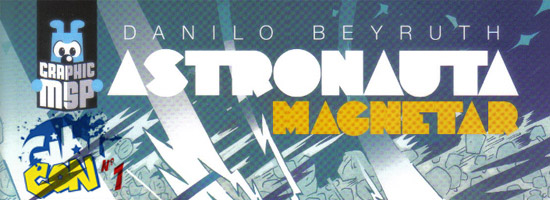
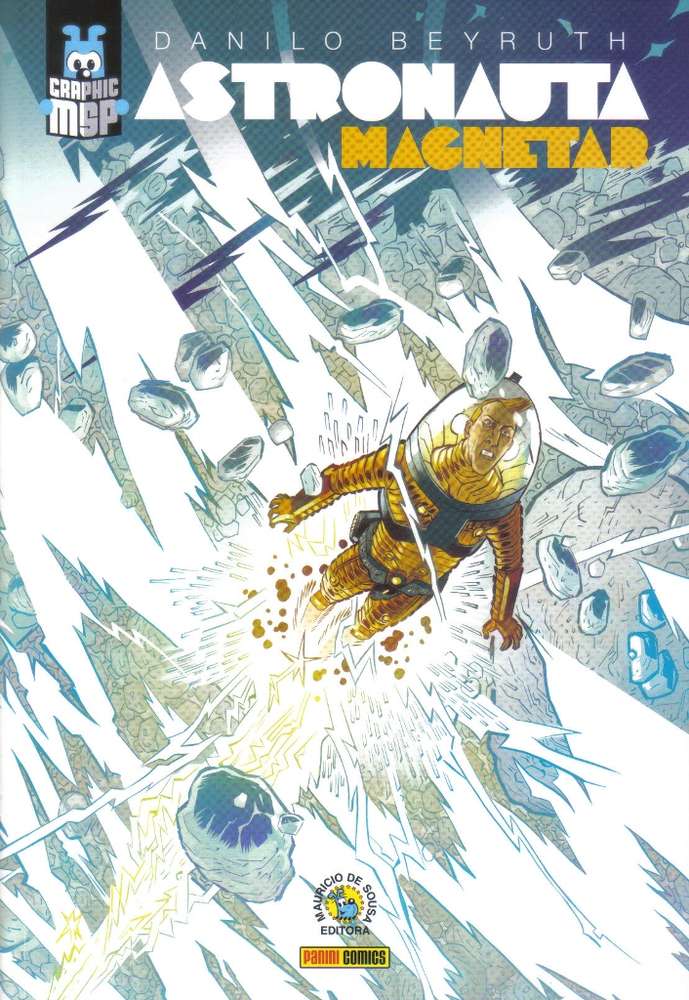
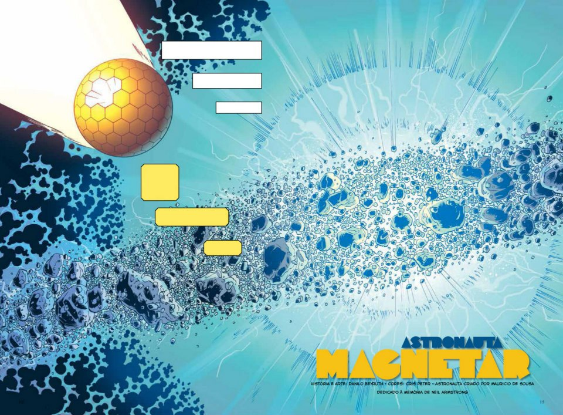
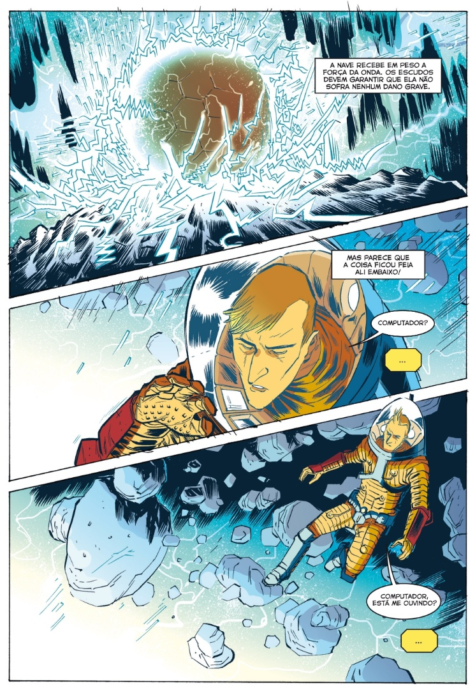
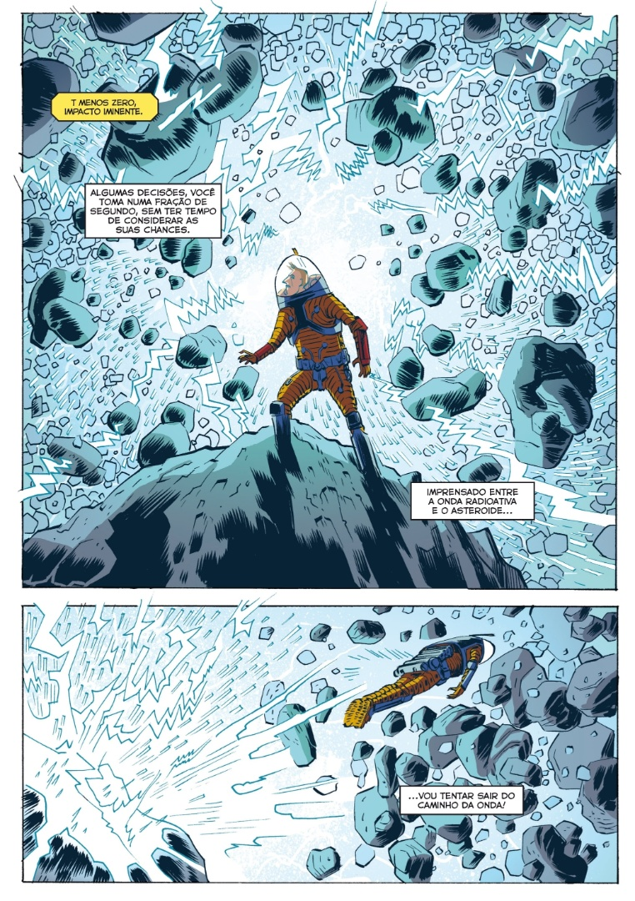

  
  
  
Última resenha das minhas compras da Gibicon e, como não poderia deixar de ser, o dia de hoje é destinado a um dos mais esperados lançamento do ano: A primeira Graphic Novel MSP.

  

Eu confesso que sou um dos poucos leitores de quadrinhos no Brasil que não começou com os quadrinhos do **Maurício de Sousa** e que nunca teve uma relação tão próxima com os personagens da Turma. Eu lia, é claro, mas comecei a ler quadrinhos com os Super Heróis e fui fiel a eles por muito tempo. Eu gostava da Turma da Mônica, mas nunca me foi uma leitura prioritária.

  

  

Acho que, como toda criança que se sente deslocada e sozinha no mundo, minha atenção, nas histórias do Maurício de Sousa, sempre se focavam nos personagens secundários, ou seja, me interessava mais a **Turma do Penadinho** do que a Turma da Mônica, por exemplo. Destes, um dos que eu sempre gostei foi o **Astronauta**, por motivos óbvios (sempre fui um grande entusiasta da ciência e especialmente da astronomia). Mas, mesmo assim, as revistas do Maurício de Sousa acabaram ficando como boas memórias da minha infância, dos quais deixei de ler quando entrei para a pré-adolescência (tanto que só há poucos anos descobri que existem uma penca de novos personagens criados durante os anos 90, quando eu já não lia mais).

  

Pois então foi com uma grande surpresa quando **Sidney Gusman** anunciou, depois do sucesso dos 3 MSP 50, que iria desenvolver Graphic Novels com histórias mais extensas e sérias com diversos personagens, sendo que o primeiro deles seria o Astronauta. Isso por si só já despertou minha atenção, mas o que me convenceu, antes mesmo do material ser publicado, que eu ia comprá-lo foi a equipe responsável pelo álbum: **Danilo Beyruth**, um dos meus autores favoritos, no argumento e na arte, além de **Cris Peter** nas cores.

  

**Astronauta: Magnetar** conta a história de como o Astronauta, a zilhões de anos-luz da Terra, se torna um náufrago ao tentar registrar um magnetar (um tipo de estrela de nêutrons com campo magnético muito alto – sim, isso é ciência de verdade, meus amigos, outra das coisas que me interessaram no álbum). A partir daí, nosso protagonista precisa aprender a conviver consigo mesmo, com a paciência e, principalmente, com a solidão.

  

  

O roteiro de Astronauta: Magnetar tem algumas qualidades características das histórias do Danilo Beyruth: conteúdo emocional sem ser piegas, informativo sem ser didático, instigante sem ser apelativo. Então se você já leu algum outro material do autor e curtiu, pode adquirir esta Graphic Novel sem medo. Sobre a arte, não há muito o que falar: Danilo tem um estilo bem característico, sem contar que desenha bem pra caramba e sempre é criativo na narrativa sequencial, ou seja, outro aspecto comum do autor que não decepciona. Além disso, a história tem uma pegada que lembra bastante o quadrinho europeu, o que mostra a versatilidade do autor (em **Necronauta** a inspiração vem dos comics; em **Bando de Dois**, havia a tentativa de fazer algo especificamente brasileiro e, neste álbum do Astronauta, a inspiração é claramente o quadrinho europeu).

  

Bem, eu vou confessar que tenho uma certa marra com **colorização de quadrinhos**. Sei que é algo que aconteça com muito mais freqüência em histórias de super-heróis, mas canso de ver colorizações que **“matam” a arte do desenhista**. Aqui podemos destacar o mérito da Cris Peter, que foi sábia em não exagerar nos efeitos e definir uma estrutura de colorização que não compromete a história nem subjuga a arte do Danilo. O resultado é o que a colorização deveria ser sempre: um aspecto que agrega e dá mais dimensão à obra, mas não se sobrepõe a ela.

  

  

Não é exagero dizer que Astronauta: Magnetar é um dos melhores álbuns lançados no Brasil este ano (notem que não especifiquei “álbum nacional”; acho que a história compete **tranquilamente com o que há de melhor no material estrangeiro** que sai por aqui). Também é um material original (no sentido de que, mesmo com suas influências, consegue caminhar com as próprias pernas sem usar clichês ou referências a outras obras como muleta) e o mais interessante de tudo: consegue reinventar o astronauta, **mantendo uma extrema fidelidade ao material fonte**.

  

Sidão foi muito feliz ao escolher a equipe desta primeira Graphic MSP. E o resultado não tem demorado a aparecer: Além de estar vendendo muito, foi divulgado até nos EUA (e provavelmente será publicado no mercado internacional logo, logo).

  

  

Recomendo, e muito, a leitura de Astronauta: Magnetar. E que venham os próximos álbuns!

  

**Astronauta: Magnetar**  
Danilo Beyruth – Cris Peter  
**Nota: 9,2**

  

[[anexo ausente]](http://feedads.g.doubleclick.net/~a/cAAxyIwFFi9bhNCs928NFb_rPBI/0/da)  
[[anexo ausente]](http://feedads.g.doubleclick.net/~a/cAAxyIwFFi9bhNCs928NFb_rPBI/1/da)

  
  
  
from Melhores do Mundo <http://interney.net/blogs2/melhoresdomundo/2012/11/09/compras-da-gibicon-astronauta-magnetar/>
