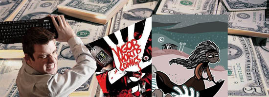
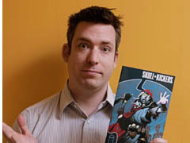
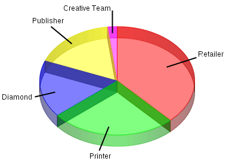
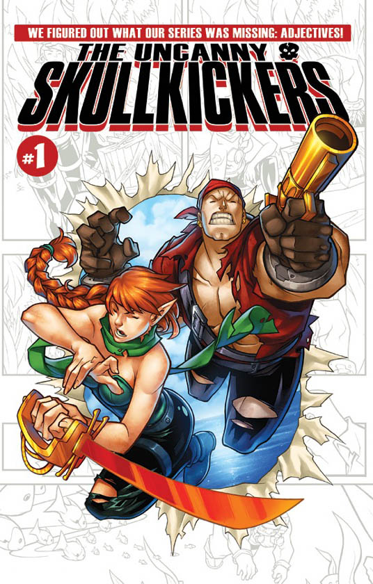

# [Dá pra ficar rico com quadrinho autoral**?**](http://interney.net/blogs/melhoresdomundo/2012/11/29/da-pra-ficar-rico-com-quadrinho-autoral/)

**Jim Zub** responde**!**

Provavelmente você nunca ouviu falar desse canadense, o Jim**.** Roteirista e ilustrador, o cara editou trabalhos no **estúdio UDON** (que tinha uns lances com uns personagens da **CAPCOM**) e vem publicando uns quadrinhos, entre eles uma série chamada *Skullkickers*, pela Image (desde 2010)**.** Aparentemente, a série (que é autoral) trata de um universo de **fantasia medieval RPGzístico****.**

Pois eis que o Jim em seu blog, o **Zub Tales**, deu recentemente uma detalhada nos **custos para a produção** de um quadrinho autoral, um pouco para explicar para a **mulher dele, para a sogra e para os credores** como que, em dois anos publicando por uma grande editora, ele ainda não tem uma casa com piscina, helicóptero e **salaminho fatiado com limão****.** Seu post vem gerando algum burburinho nas **interwebs** e como, apesar de estarem em dólares os valores, a realidade da coisa não muda muito aqui pro Brasil (e como o **refalecido Ultra** não pára de me aporrinhar no QG do MdM), resolvi trazer o texto pra cá**.** É grande, mas **não chega a ser um post narrando cronologicamente um filme que você já viu**, então respira fundo e vai**!**

Vamos a ele:

> Estou absolutamente encantado por estar trabalhando com quadrinhos**.** Ainda mais feliz porque um de meus grandes projetos agora é uma **série em quadrinhos de minha propriedade** – escrever minha criação *Skullkickers* e sendo publicado pela Image Comics é uma emoção e uma honra**.**  
> Uma discussão recente que eu tinha sobre **fazer dinheiro** em quadrinhos tomou um rumo estranho e percebi que muitas pessoas fazem suposições sobre como o dinheiro vem em rios no negócio dos quadrinhos**.** Ser publicado não é uma chave de para fama e fortuna imediatas**.**
>
> Considere uma HQ de preço de capa a **U$$ 2,99** (Vamos de **U$$ 3**, para simplificar):
>
> **Menos 1,40 mangos:** 40 a 50% do preço de capa fica para os varejistas, o tiozinho da banca que vende os quadrinhos para os leitores**.** Esta quantidade varia um pouco baseado na editora e no número de exemplares encomendados pelo varejista, mas é uma aproximação de base**.** Varejistas merecem a sua parte para na venda de histórias em quadrinhos para a base de clientes locais**.** Eles compram um produto **não-retornável** e correm riscos com isso**.**
>
> **Menos 0,80 mangos:** A impressão é indispensável (e isso varia muito com base na quantidade impressa, disponibilidade e tipo de papel e outros fatores, que acabam fazendo com que este não seja um número exato)**.** Oitenta centavos é uma referência muito boa para tiragens pequenas**.** Em tiragens muito baixas (**menores do que 3000 exemplares**), a impressão pode custar mais do que **U$$ 1,00 por cópia**, o que realmente pesa no orçamento**.**
>
> **Menos 0,50 mangos:** 1/6 do preço de capa vai para *Diamond*, a distribuidora que pega os pedidos dos varejistas e os faz chegar até eles**.** Esse custo varia de acordo com o transporte, os preços do combustível, quantidade encomendada, entre outros mas é uma boa aproximação**.** A **Diamond** merece a sua parcela para receber os pedidos, armazenar e transportar os gibis para as lojas de varejo**.** Eles são um distribuidor internacional com muitas despesas para manter o sistema funcionando**.**
>
> Como disse, mesmo com a impressão variando muito, vamos trabalhar com 80 centavos de dólar como um índice válido**.** Com os restantes **30 centavos por unidade**, precisamos pagar as seguintes partes:
>
> • Publicidade/promoção;  
> • Trabalho editorial/despesas de escritório;  
> • **A equipe criativa**, para quem nada está pago e;  
> • Lucro**?**
>
> 
>
> Em uma tiragem de 5000 revistas (e muitos, muitos títulos autorais vendem menos do que isso no mercado atual), isso significa que restam **U$$ 1**.**500,00 para as quatro categorias** importantes acima**.** **Adivinhar quem chupa o dedo?**
>
> Se o custo de publicidade foi ZERO e despesas com editor forem zero, em seguida, o escritor e o artista de uma história em quadrinhos de 20 páginas receberão, cada um, **U$$ 37,50 por página****.** Ops, não há dinheiro para a arte da capa, me desculpe**.** Adicionar mais pessoas (arte-finalista, colorista, letrista, etc) divide o ***larjan*** ainda mais, mas este é um número hipotético**.** A editora tem despesas e pessoal para pagar.
>
> A realidade é que uma vez que a editora tem sua parte do que resta (e eles absolutamente merecem), não sobra nada, nadica de nada, para a publicidade e para a equipe criativa**.**
>
> **….**  
> Acredite ou não, eu não sou amargo sobre tudo isso**.** É o preço de fazer negócios na indústria *mainstream* de quadrinhos através de lojas de varejo e distribuição internacional**.** É assim que funciona. Eu só quero deixar bem claro para que as pessoas entendam o que quero dizer quando digo que **não vou ficar rico** fazendo a minha própria revista**.** ***Skullkickers* é o hobby mais caro que eu já tive**.****
>
> É por isso que você deve:
>
> • Apoiar títulos autorais;  
> • Apoiar a propriedade de autor nos quadrinhos;  
> • Pré-encomendar álbuns que você está interessado em seu revendedor local;  
> • Divulgar entre seus amigos suas HQ’s favoritas e ajudar a construir o uma rede de consumo**.**  
> • Apoiar campanhas crowndfunding para grandes projetos independentes de quadrinhos;  
> • Comprar direto dos criadores em convenções e eventos, para que 100% do preço de capa vá para o bolso deles**.**

**Negada, e aí**?**** Cara, salvas as devidas proporções, do que eu já apurei de conversas por aí com gente como o **Sidney Gusman** e alguns autores independentes como **Vitor Cafaggi**, a coisa por aqui segue mais ou menos o mesmo esquema**.** Claro que temos de levar em conta as **peculiaridades dos mercados** (como o sistema de pré-venda, que nós não temos, ou o fato de que no Brasil o encalhe fica com a editora e não com o varejista), mas é evidente que esses pontos que **Jim Zub** levanta afetam também nosso mercado – não é a toa que temos tantos (bons) quadrinhistas **fazendo tudo por conta própria****.** Dá um trabalho do cão, com certeza, mas o cara sabe que o retorno, no fim das contas, vem pro bolso dele**.** Claro que nesses casos os caras acabam trabalhando com **tiragens bem pequenas**, entre 1000 e 2000 exemplares, mas é melhor a tiragem pequena do que ter que enfrentar a máfia da distribuição ou os problemas com livrarias e etc**.**

Ou **sejE**: quer ter **dinheiro, sucesso, iates, mulheres****?** Não trata de estudar prum **concurso da Mega Sena** não, neguinho, pra tu ver onde vai parar…**!**
