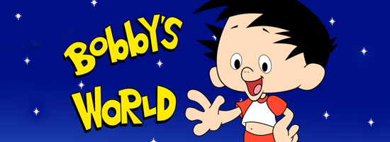
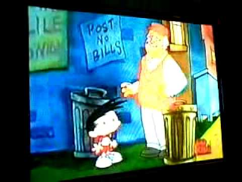

  

Ouça a música…

  

Um dos desenhos animados mais populares entre a garotada nos anos 90 (e que o Change jura que **é plágio descarado e maledetto do Calvin**) era **O Fantástico Mundo de Bobby,** onde o comediante **Howie Mendel** virava desenho pra acompanhar as aventuras de seu filho **Bob**, um menino cheio de **imaginação**.

  

Todos os episódios de **Bobby’s World** (nome original da série animada nos EUA) sempre tratando de alguma brincadeira do Bobby com os amigos ou alguma desventura familiar ao lado dos pais **Howard e Matha Generic** (**e não Genéric**), do **Tio Ted** e dos irmãos aborrecentes **Kelly** e **Derek**.

  

As histórias eram muito **lúdicas**, sempre girando em torno de como a imaginação do Bobby lidava com coisas simples do cotidiano de uma criança como **se perder dos irmãos no shopping** comprando um presente, **aprender a nadar** na piscina (*“Tio Ted, como é que você faz bolhas sem colocar a cara na água?*” ^^), descobrir que **a mãe está grávida**, assistir **super-heróis na TV**, criar **um clube** com os amigos, ou quando Bobby e o Tio Ted tem que ir a **Las Vegas** pra levar a empregada **Nafulgia** pro casamento dela e a **Tia Ruth** acha que o Bobby foi **raptado por ETs** (é, esse foi **muito** lúdico).

  

  

Mas existe **um capítulo completamente diferente dos outros**. Ele começa **aparentemente** como todos os demais, com Bobby imaginativo demais e por isso acabando por se dar mal na sua **prova de geometria**. Por viver tão intensamente seu universo particular, ele não consegue se concentrar no que está ao seu redor. Porém, o **Guarda de Trânsito Abe**, amigo de Bobby, decide ajudá-lo ensinando ao menino um **jeito lírico de aprendizado sentindo a música do mundo** e Bobby passa a ver, ou melhor, **ouvir** as coisas de um modo totalmente diferente.

  

Só essa cena já valeria o episódio inteiro, lembro de um amigo que me disse que a **filosofia** do desenho influenciou ele anos depois a **estudar música**. Mas a história ainda reserva uma reviravolta completamente inesperada que eu **nunca pensei que veria numa animação como O Fantástico Mundo de Bobby**, quando de supetão o garoto tem que lidar com uma situação séria e dramática, onde nem sua imaginação consegue confortá-lo.

  

O final é **inspiradíssimo** e mostra de uma forma raramente vista numa produção infantil **a poesia que pode existir na vida quando ela transcende a morte…**

  
  

[[anexo ausente]](http://feedads.g.doubleclick.net/~a/CQvxC0x-q0cGg2hIw5mmQ79RnBU/0/da)  
[[anexo ausente]](http://feedads.g.doubleclick.net/~a/CQvxC0x-q0cGg2hIw5mmQ79RnBU/1/da)

  
  
  
from Melhores do Mundo <http://interney.net/blogs2/melhoresdomundo/2012/11/05/nerdtube-o-fantastico-mundo-de-bobby-a-musica/>
