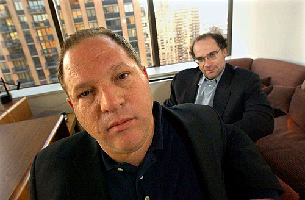
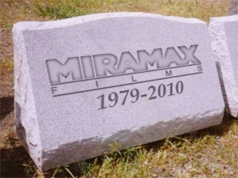
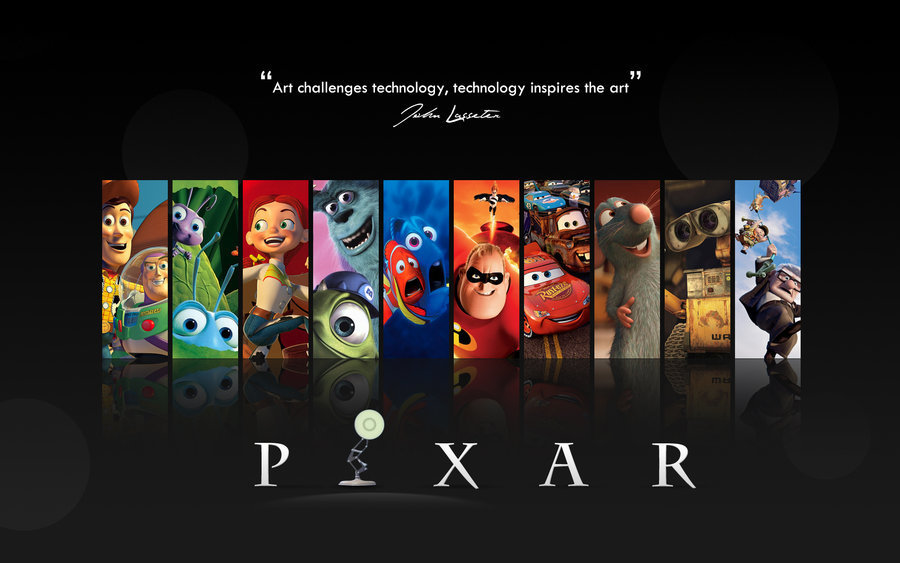
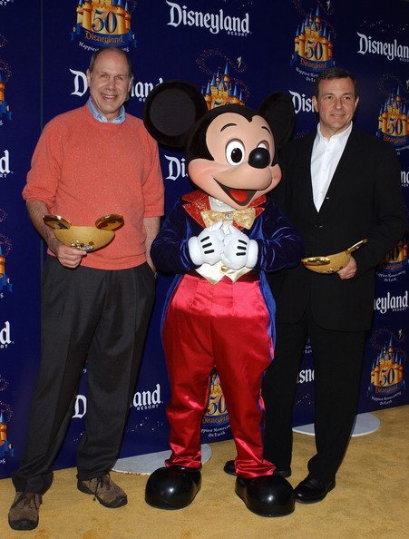
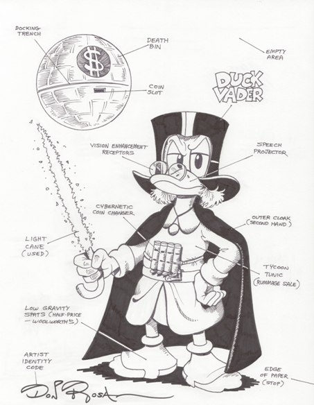
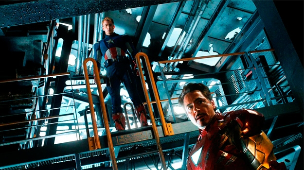
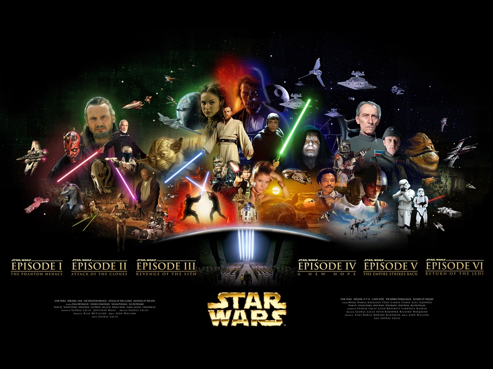

  

**Mark Hammil** comentou recentemente sobre **a compra da Lucasfilm pela Disney** poder dar certo, baseado nas compras da **Marvel, dos Muppetts e da Pixar** pela empresa do Mickey, Donald e Tio Patinhas. Porém, o mesmo não se pode dizer sobre a **Miramax**.

  

  

A Miramax tinha sido criada no fim dos anos 70 por **Harvey e Bob Weinstein** para ser basicamente **uma produtora de filmes independentes, que não seriam comercialmente viáveis em grandes produtoras**. Mas em 1993 a história do Estúdio começou a traçar um novo destino.

  

O CEO da Disney **Michael Eisner** comprou a Miramax dos Irmãos Weinstein e, embora eles continuassem responsáveis pelas produções, aconteceram interferências criativas, pois ambos tinham filosofias de trabalho diferentes. Por mais que os irmãos tenham continuado a frente de grandes projetos como **Pulp Fiction**, se esforçando pra ser o *“braço artístico”* da Disney e seguir independente dela, rolou muita treta durante anos (como toda **a polêmica que envolveu o filme Dogma do Kevin Smith** que a Igreja Católica tentou boicotar), e as divergências entre a Disney e os Weinstein cresceram até que tornaram a relação insustentável.

  

Um dos casos mais lembrados é que **a Miramax iria produzir O Senhor dos Anéis**, mas Michael Eisner, queria fazer só dois filmes e não três e, por mais independente que a Miramax fosse, **a Disney dava a palavra final.** Isso fez com que **Peter Jackson acabasse levando o projeto pra New Line**, estúdio que faz parte da **Warner, rival da Disney**, e o resto é história.

  

  

Por essa e por várias outras, os Weinstein acabaram deixando a Miramax com a empresa do camundongo em 2005 e indo embora, o que nenhum deles curtiu nem um pouco porque, além de terem criado a Miramax, **o nome era uma homenagem aos pais deles, Max e Miriam.** Daí a dupla fundou a **Weinstein Company**, que hoje, graças ao *“monstro”* em que Harvey Wenstein se transformou, virou **uma das maiores papadoras de Oscar de todos os tempos**… mas isso é uma outra história…

  

O que importa nesse caso é que a Disney terminou vendendo a Miramax em 2010 pela bagatela de **600 milhões de euros**… 17 anos depois de comprá-la por **80 milhões de dólares**.

  

  

Claro que foi **um caso diferente com a Pixar**. Até porque a Disney já distribuia os filmes do estúdio de animação desde o início e não interferia criativamente – talvez porque tivessem bom senso de saber que **os desenhos da Pixar eram melhores que os da própria Disney**. A compra ocorreu após o fim da parceria de uma forma que pareceu natural. Mas na verdade **Steve Jobs já não aguentava mais Michael Eisner** e a Pixar, capitaneada pelo **talento de John Lasseter**, tinha tudo pra crescer sozinha e se tornar uma nova grande rival da Disney.

  

Foi só quando Eisner foi substituído por **Bob Iger, novo CEO da Disney**, que esse teve a sacada de **comprar a Pixar**, agregando-a ao Grupo Disney em 2006 que todos saíram ganhando.

  

  

Os problemas de qualidade das produções animadas Disney foram resolvidos com **John Lasseter passando a ser diretor criativo das duas empresas** e Steve Jobs abocanhou **mais de 7 bilhões de dólares**, além de ter se tornado um dos maiores acionistas da Disney… claro que hoje em dia isso tudo **já não significa mais nada pra ele**… mas isso também é uma outra história…

  

Iger não parou por aí. Em 2009 comprou a Marvel e desde 2011 vem negociando com George Lucas a compra da Lucasfilm. Segundo especialistas tudo isso é um sintoma do mundo atual, onde grandes empresas com capital abrangem pequenas empresas com potencial, mas que não conseguem arcar com grandes projetos só com investimento próprio.

  

Mas no que isso interfere **pros fãs**?

  

  

Vamos ver muito mais **parques temáticos, bonequinhos, brinquedos e produtos em geral** com certeza… assim como acontece com relação a Marvel também. Mas não custa lembrar que **Star Wars é essencialmente uma série de longa metragens pro cinema** – tanto que não por acaso **a Disney se apressou em anunciar uma nova trilogia** – e o melhor filme de Star Wars pra 9 em cada 10 fãs é o **Episódio V – O Império Contra-Ataca** (sem trocadilhos com o Império Disney)… que também é **onde a direção optou pelo clima mais sombrio da cinessérie**, muito mais do que no **Episódio III – a Vingança dos Sith**, do qual se esperava muito mais do que ver o **George Lucas numa tara em superar o tempo do duelo de espadas do Scaramouche** – cuja luta final ainda é **muito melhor** que a do Obi Wan com o Anakin…

  

… aliás, da última trilogia inteira se esperava muito mais. **NINGUÉM** mais quer ver o **Jar Jar Binks**.

  

Agora a questão é: Independente de quem é o CEO, **a Disney faz filmes que interessam a Disney.** Que tipo de filme nós queremos ver em Star Wars? O tipo de filme **lúdico e familiar** que a Marvel, os Muppets e algumas produções Pixar fazem ou o tipo de **filmes de autor** que a Miramax e a Weinstein Company fazem? **Existe um meio termo?** Se existe **quem** seria capaz de fazer isso no Cinema atual?

  

  

Quanto a Marvel e a Pixar… a Marvel aparentemente ainda não sofreu interferências, mas a coisa mais pesada que eu vi num filme do Marvel Studius até hoje foi **o Loki arrancando o olho daquele cara e matando o Coulson pelas costas** em Os Vingadores. Grandes cenas, violentas e bem feitas, mas ainda longe se comparar ao impacto que **Vader mandando congelar Han Solo, arrancando a mão do Luke e revelando ser pai dele** tiveram em 1980, por exemplo.

  

**Vingadores é o chamado filme solar.** Os personagens são bem humorados e, na base da união, superam suas dificuldades para triunfar sobre o mal, enquanto as maiores derrotas – **as vítimas da batalha final em Nova York** – são convenientemente tiradas de foco na conclusão da trama pra **jogar luz sobre o heroísmo do grupo**.

  

Funciona com Os Vingadores, mas não funcionaria com Star Wars. Exceto pelo **Episódio I – A Ameaça Fantasma**, as duas trilogias sempre se esforçaram pra ambientarem um universo mais sombrio onde a paz tem um preço alto. Não custa lembrar como **a Marvel amarelou em não mostrar o nazismo em Capitão América – O Primeiro Vingador**. Claro que estou falando tudo isso **sem assistir Homem de Ferro 3**, com o trailer dando a entender que o **Mandarim** vai testar os limites de até aonde os heróis Marvel podem ir nos cinemas e até onde a Disney vai dar corda pra isso.

  

Quanto a Pixar, o que o Lasseter, **fã confesso do Estúdio Ghibli de Hayao Miyazaki**, fazia e ainda faz são **filmes autorais pro grande público**. Dai de vez em quando daí de lá um **Wall-E**, que apresenta **uma visão bem mais sombria que qualquer filme da Marvel Studios**, seguindo assim uma tendência de pôr **em primeiro lugar as idéias do roteiro e a visão do diretor**, ao invés de colocar em primeiro plano **a comercialização de produtos derivados dos filmes.** E existe um número muito restrito de cineastas que fazem isso hoje em dia.

  

  

**Martin Scorcese, Steven Spielberg, Tim Burton, Christopher Nolan, Peter Jackson, J. J. Abrams, os Irmãos Wachowski** e, com alguma boa vontade, o **James Cameron** se encaixam aí. Mas acho que **nenhum deles serviria pra Star Wars**, o ideal seria **um talento novo** que não tivesse sido ligado a nenhuma outra franquia, mas alguém pra quem o Iger desse a liberdade necessária pra **levar a saga da Família Skywalker adiante.**

  

Pouca gente se lembra, mas **Frank Darabont** era uma espécie de consultor criativo não creditado dos filmes de George Lucas e as discordâncias entre eles chegaram num ponto que após Lucas **excluir o roteiro de Darabont de Indiana Jones 4 e tirá-lo dos créditos**, o diretor de **Um Sonho de Liberdade** falou que não trabalharia na série sobre Star Wars que Lucas planejava antes da venda da **Lucafilm** porque *“nossas sensibilidades para contar histórias divergiram a tal ponto que isso seria um exercício de inutilidade.”*

  

Um cara criativo e inteligente como o **Nacho Vigalondo**, diretor de **Crimes Temporais (Los Cronocrímenes)** seria foda no universo de Star Wars. **Alex Proyas**, diretor de **Cidade das Sombras (Dark City)** também podia ser interessante, mas quando eu lembro que o filme mais fraquinho dele foi uma adaptação, **Eu, Robô (I, Robot)**, prefiro que ele – e o Tim Burton também – **continuem contando suas próprias histórias e não as dos outros.** No fim o que eu quero é que o novo Star Wars **NÃO** seja um filme do Bob Iger ou de algum produtor, porque **um filme de produtor já foram os últimos três** (já que como Diretor o George Lucas já tinha perdido a mão a muito tempo).

  

Minha esperança final é que Bob Iger, embora pareça o **Tio Patinhas**, não é o Michael Eisner e não acho que ele teria posto a perder a Miramax como seu antecessor fez. Pelo menos a princípio ele parece ter muito **zelo** pelas empresas, os estúdios e as obras que agora lhe pertencem. Tanto que na época da aquisição dos personagens de **Stan Lee e Jack Kirby** dizem que Iger comprou a **Enciclopédia Marvel** e ficou lendo ela sem parar por meses. **O próximo passo do Império (Disney) deve ser a compra da Hasbro.** Aguardemos.

  

E antes que vocês digam que já estão de **saco cheio da tendência do Cinema em fazer filmes sombrios** eu gostaria de lembrar que enquanto o resto do mundo tentava fazer filmes sombrios, **Darth Vader estava rolando num gramado cheio de florzinhas com sua namorada…**

  

  

**Curiosidade**: Fiquei me perguntando se **Michael Eisner** teria algum parentesco com **Will Eisner** e pelo visto não. Porém, inesperadamente descobri que **Bob Iger é sobrinho do Jerry Iger, célebre parceiro do velho Will nos quadrinhos nos anos 30 e 40.**

  

[[anexo ausente]](http://feedads.g.doubleclick.net/~a/tpwGfXzh3qhULWCFdukWY1wAx_Q/0/da)  
[[anexo ausente]](http://feedads.g.doubleclick.net/~a/tpwGfXzh3qhULWCFdukWY1wAx_Q/1/da)

  
  
  
from Melhores do Mundo <http://interney.net/blogs2/melhoresdomundo/2012/11/08/quando-o-tio-patinhas-vai-as-compras/>
