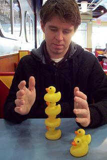
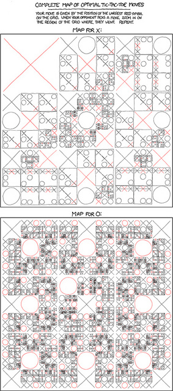
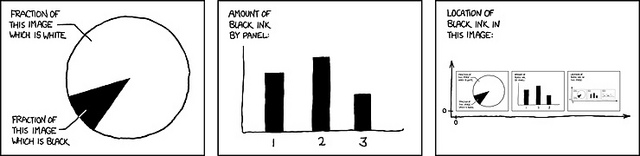
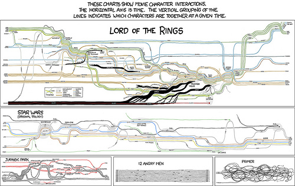
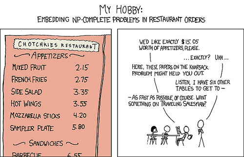
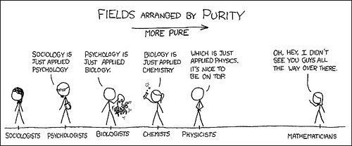

# The Mathematics Behind xkcd: A Conversation with Randall Munroe

|  |  |
| --- | --- |
| *Laura Taalman* |  |

*Randall Munroe*

*This is a sample article from the September 2012 issue of*  [*Math Horizons*](http://www.maa.org/Mathhorizons/).

The creator of the popular web comic [xkcd](http://xkcd.com/) muses about the merits of pen and paper versus computer coding, tic-tac-toe, and where he sits on the scale of intellectual purity.

[Read the article (pdf).](http://www.maa.org/mathhorizons/MH-Sep2012_XKCD.pdf)

[Subscribe to *Math Horizons.*](http://www.maa.org/membership/regular.html)

This past April, *Math
Horizons* sat down with Randall Munroe, the author of the popular webcomic xkcd, to talk about some of his most mathematical comics. We met at Christopher Newport University, Randall’s alma mater, where he was about to give an invited talk to a packed auditorium of fans. (Watch his [Christopher Newport address](http://www.maa.org/mathhorizons/www.youtube.com/watch?v=3XctkVYvY0c)).

  

### Tic-Tac-Toe

Math Horizons: Let’s start with one of your most complex comics, the map of tic-tac-toe moves.

*The only winning move is to play, perfectly, waiting for your opponent to make a mistake. "[Tic-Tac-Toe](http://xkcd.com/832/),” Randall Munroe. (Click image for larger size)*

Randall Munroe: I remember that—I have a callus in my hand from making it. I think I drew maybe a fifth or a sixth of the actual chart by hand, and then put that in the computer and mirrored and flipped it, and pieced together the rest of it. It took me something like 12 hours to draw out the fifth of it that I did. There was no way I was doing the rest of it by hand!

MH: How come you didn’t start with X in the middle?

RM: Because it doesn’t matter. With every opening move for X it’s going to be a draw if you move optimally from that point onward. Part of what started this off is that I had tried doing these maps when I was in English class in 11th grade, sitting there and working out a tree for most of tic-tac-toe, and I had sort of taken it as an article of faith that the best move for X is in the center. The reason I went for the upper-left opening move in this comic was that with this one, there are some winning moves that aren’t the ones that everyone knows.

MH: So you wanted to go with a less common opening move?

RM: Yes. I was looking for moves where you can force a win, and you can do it in a way that isn’t obvious. The thing that was interesting for me here was the moves that take into account psychology and the places that people are least likely to see that a win is forced.

MH: What gave you the idea to present the information in this way? People have made these trees before, and some of them are quite complicated, but you managed to fit it all in one page.

RM: The full tree of possible moves would be a lot bigger than this. I did the calculations, and when I realized that for the full tree I would need a piece of paper that was bigger than the dining room table, I thought, *I’m not drawing that!*

I was trying to figure out if there was a way to present the information so that at every stage you are making a choice on a grid of nine possibilities. It seemed like there should be some way to present the data where making the choice is just zooming in on the grid or something, and I wound up doing what you see in the comic. It’s a way to organize that makes it so you can quickly shade in, for example, all the wins for X, and you’ll be able to see whether there are a lot of them or only a few. At the very least, it looks pretty.

MH: It’s so effcient, likeEdward Tufte’s *Visual* *Explanations* book.

RM: Yes, Tufte’s real focus is always to convey the information with as little ink as possible. I like that the tic-tac-toe comic didn’t have a lot of extraneous stuff. I did put in some boxes, and that helped with visually organizing the boards a little, but the presence of a box, even, tells you something: It tells you if that’s an end-board state. The consequence of using boxes only for the end states is that, not counting the big boxes around each panel, you never have a box inside another box. This means that you don’t have the problem of nested boxes for each state that would quickly eat up all of your space with margins.

### Self-Description

*The contents of any one panel are dependent on the contents of every panel
including itself. The graph of panel dependencies is complete and bidirectional,
and each node has a loop. “[Self-Description](http://xkcd.com/688/),” Randall Munroe.*

MH: Another one of your comics
that fascinates math people is the
self-referential one where each panel
describes the amount or location of
black ink in itself and other panels.
Various people have analyzed this
comic by writing code to iterate and
get your comic as the fixed point.
(Readers can see one example using
Mathematica by Jon McLoone [here](http://blog.wolfram.com/2010/09/07/self-description/).) Is that how you found
it, or did you find it another way?

RM: I found it another way. I didn’t
actually write any code for this. I
started off thinking about the pie
chart in the first panel. I was trying
to figure out what other charts there
might be that don’t disintegrate to
nothing.

That was the problem; there are
certain charts or plots whose fixed
points are zero. Like a situation
where one chart was referring to another, and the other to the first, and
you end up with an equilibrium state
where both graphs are empty.

And you don’t need a computer
program to figure that out. You just
sort of think, *OK, well, if this graph
is right for the one I’ve drawn now,
and I make it a little smaller, how
does the other one change?*

And so just thinking about it, I
realized that the three ideas in the
panels would work; they’d all have
a reasonable amount of black ink
in each one, which would make the
middle chart work, and so on.

MH: How did you determine how
much black ink to put in each of the
charts?

RM: I figured out how to measure
each of the quantities shown in the charts. I drew up the outlines
in Photoshop, added the captions,
drew in eyeballed estimates, and
then used some utilities to count
the number of pixels.

Photoshop will tell you how many
pixels are in this area, if you select
in a certain way, and I’ve been pixel
painting in Photoshop forever. I
just wrote down the numbers, used
a calculator, and calculated for the
first two panels: What should the
height of the bar graphs and the
angle of the pie chart be?

The third panel I generated by
just taking the image and cloning
and shrinking it. I had a big sheet
of paper to keep track of the math,
and I was just doing it all by hand.

MH: Wow, you iterated it by hand?
How many times did you have to
iterate?

RM: Yeah. I think there were about
10 or 12 iterations, which really
isn’t so bad if you compare it to the
amount of time it would have taken
me to write the code, which I would
have had to learn things to do parts
of it.

For example, I don’t know of a
library for pulling in an image and
doing things like that, so I’d be just
reading in a bitmap and then using it
as an array and—I never remember
how to do half that stuff, you know,
whereas I did know how to measure
size in Photoshop, and I knew I had
some paper there. I always go for the lazy solution that doesn’t require a
lot of new stuff.

I draw the comics at something
like 10 or 15 times the resolution that
they are online, and after just 10 or
12 iterations, it was getting to where
the image wasn’t changing enough
that it would make a real difference.
It would just be like a slight difference in the gray at the top of one of
the lines on the bar graph. It got to
the point where it was like staying within a pixel—and it got there
pretty quickly.

MH: Did this one take you more time
than the tic-tac-toe comic?

RM: This one took less time, I think.
I started in the afternoon, and it was
maybe five hours or something. I think this one went up on time. Five
hours isn’t a lot of time in terms of
how much time a job normally takes.
They take longer than they look,
because I write out all the dialogue
by hand, and I do it in pencil once
just to make sure it is all in the right
places, and then I’ll do it again, and
then I scan it in, and then I process
it.

Usually for a really simple comic
that I know the script and I know
what the joke is, I tend to set aside
two or three hours. If I have to work
out the wording, or other things,
then four hours. So this one took
longer than usual, but not ridiculously. Not as long as some of the
other ones.

MH: Do you think the solution is
unique? For example, is it possible
that there is a larger pie you could
draw here that would be part of a
different fixed point, if you iterated
it?

RM: No, I think this is a unique solution. Look at the limit case for all of
these—say, if you color the pie chart
in all the way. For the second panel,
the overall scale is sort of arbitrary,
but even if you had a scale and the
first two bars were all the way up,
the third bar is constrained; once
you’ve set two of them, you’ve constrained the third. Even in this limit
case, your very first iteration will
take you to something that looks a
lot like the final comic, because even
when you’ve shaded in all of the pie
chart, this is still basically a white
image.

MH: Do you think it’s possible to
find this fixed point without iterating? Maybe algebraically?

RM: Yeah, I think it’s totally possible. One thing that I really liked
about this is that every panel
depends on the state of every other
panel and on itself. Which is why,
when I hit on these three panels,
that I stuck with those choices. I
liked that there was nothing that you could set and say OK, now I’ve
solved this part, I’ll figure out the
rest of it from there. Everything
depends on everything. Solving it
algebraically, I feel like it could be a
hard problem.

When people look at these comics, they always assume, oh, the guy
that drew this must have done all
that. But for me, I just found a cool
way to get to the result that skips all
that, even if it’s not as general or satisfying. People tend to assume that
I’ve done whatever the most expert
way of getting to it is, and so they
assume that I know a lot more about
the subject than I do.

MH: Although iterating it by hand is
. . . pretty badass.

RM: There’s a lot of stuff for a lot of
the things that I do that look cooler
than they are, because no one would
have thought to do something that
boring.

### Movies

*In the* Lord of the Rings *map, up and down correspond LOOSELY to northwest and southeast, respectively. "[Movie Narrative Charts](http://xkcd.com/657/),” Randall Munroe. (Click image for larger size)*

RM: For example, I did a big chart
of movie narratives. That was one
of my favorites, that was one that
was fun to do. And I didn’t use a
computer at all in that.

MH: Did you have to watch the movies over and over again to get that
right?

RM: That’s kind of the embarrassing
part . . . once or twice I fact-checked
myself on the Wikipedia article for *Lord of the Rings*, but I’ve seen those
movies a lot. I pretty much just sat
down and drew that by hand. It
took me a couple of days, but when
I show that to someone, people will
sort of respond by saying, “OK, I
guess you could do a program; you
could download a copy of the script,
and then do a language parser, figure
out who’s talking to who, that’ll
tell you who’s near who, and then
you get the rules for how to make
the lines go back and forth to each other”—they’ll come up with this
idea, but no one would implement
that because that is a lot of work!

But it turns out that just doing it
by hand is totally doable if you have
a weekend free. And if your job is
making pictures like this. So it’s not
even that I figured out something
clever. It’s just I have the patience to
do the thing that no one would think
of, or that anyone would ever bother
to do. And sometimes that’s key. It’s
just like I have that much free time.

MH: That sounds like a good life.

RM: Well, it’s fun. And it’s fun when I
hit on something like this. I really enjoy
solving these kinds of things, and it’s a
bonus if I realize that I can put boxes
around it and make it a comic.

### NP-Complete

*“[NP-Complete](http://xkcd.com/287/),” Randall Munroe.*  *(Click image for larger size)*

RM: On the other hand, there are
other comics that it might surprise
you how much code I wrote for them.
For example, there was one that involved combining different restaurant
menu items to get a certain total.
But because I didn’t know something
about how Perl’s libraries handle
floating-point comparison, the puzzle
in the comic actually has a really
simple solution in addition to the one
I meant, that the code missed because of this bug. Most people didn’t
notice, but it’s always bugged me.

### Purity

*“[Purity](http://xkcd.com/435/),” Randall Munroe.* *(Click image for larger size)*

MH: One of the favorite xkcd comics
among mathematicians is of course
the one where you drew mathematicians on the far side on a list of
sciences arranged by “purity.”

RM: Yeah, I like this one. The question I always get about this one is:
Where does computer science fit
here? Because it’s sort of math, but
it’s sort of superapplied, like physics.
I feel like maybe there should be another axis branching off, and maybe
that axis is, like, how much sunlight
you get.

And there’s another distinction:
There’s coding, and then there is
computer science. The best explanation I’ve ever heard of that is
that coding is writing programs,
and computer science is the study
of computers only in the sense that
astronomy is the study of telescopes. I think that’s a really concise summation, because computer
science isn’t the study of computers, it’s the study of what you can
do with a computer and what stuff you can explore with a computer.

MH: Maybe math is kind of like that
too.

RM: Yeah, physics really *is* just applied math. When I started off, I
did a math minor, and I almost did
math. It’s funny because in physics, I get annoyed when it gets too
close to engineering, like when it’s
too real, the materials are breaking
on you, and you have to figure out
that messy real-world stuff. I like the
theory. But if you go too far in the
math, then I lose the connection to
anything I can picture in my head, so
I get lost in algebra.
That’s why I wound up sort of oscillating and then ending up around
here [between the physicists and the
mathematicians on the scale]. But
at the same time, computer science
is also somewhere in this end of the chart. I feel like you’re OK over here
in the middle part. Well, you’re OK
over here on the left, too.

MH: Somebody has to be over there.

RM: Well, I’m going to talk about
this a little in the talk tonight, but
my wife went through cancer treatment not too long ago, for the last
year and a half. And everyone who
went through med school did a lot of
biology. That’s what med school is.
After depending on those people so
much, for all this life-and-death stuff,
I don’t want to say anything too
mean about them, because they’re
doing incredible stuff.

MH: Maybe there could be another
axis for how important your job
actually is in the universe.

RM: Then I feel like you might even
get a curve like this [drawing a high
bump over the biologists]. Although
for the sociologists—if you burn
down society, there’d be nobody to
pay you to do math!

MH: Good point! Thank you so
much for talking with *Math Horizons* this afternoon.

RM: Thank you. I like it when people
go into detail, and try to figure all
that stuff out. I like that there’s the
audience out there for that. That’s why I do this.

Like this article? [Subscribe to *Math Horizons.*](http://www.maa.org/membership/regular.html)

[Read more MAA Sample Articles and Features](http://www.maa.org/pubs/Features.html)
