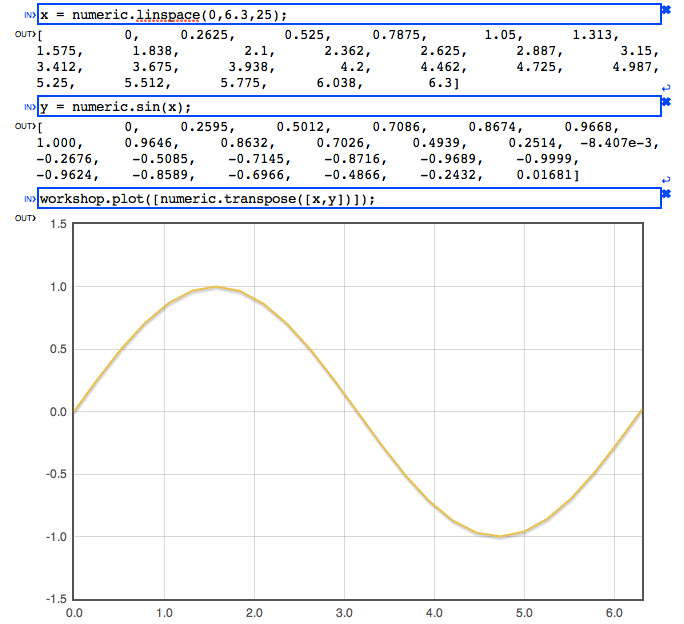

# Numerical analysis in Javascript

The [Numeric Javascript](http://www.numericjs.com/) library allows you to perform
sophisticated numerical computations in pure javascript in the browser and elsewhere.  
  
**From the [blog](http://numericjs.com/wordpress/)...**

- [Numeric.js 1.2.3: faster linear programming](http://numericjs.com/wordpress/?p=52 "Permanent Link to Numeric.js 1.2.3: faster linear programming") (September 23, 2012)
- [Sparse Matrices in Column Compressed Storage format](http://numericjs.com/wordpress/?p=26 "Permanent Link to Sparse Matrices in Column Compressed Storage format") (September 19, 2012)
- [Numeric Javascript v1.2: Linear Programming](http://numericjs.com/wordpress/?p=8 "Permanent Link to Numeric Javascript v1.2: Linear Programming") (September 6, 2012)

[  
Numeric Workshop](http://numericjs.com/numeric/workshop.php)

# Examples

Each of these examples runs in the [Workshop](http://numericjs.com/numeric/workshop.php).

- [Linear algebra](http://numericjs.com/numeric/workshop.php?link=bf9eb195e289cf58fe226b11ff9e70d3360865f1aa1565d23990ad12673fd7de)
- [Complex numbers](http://numericjs.com/numeric/workshop.php?link=ca14363bad73fd337ba4e8ba6ff48b282894946396d845450e4d885cb04701c9)
- [Splines](http://numericjs.com/numeric/workshop.php?link=f33555dc9b8f8232b567ebd6cb367f8b72e870392cc579563b6c8bd2b16015d8)
- [ODE solver](http://numericjs.com/numeric/workshop.php?link=fdd38094da018f6071cb2d51d47c7fb3de869cb5dd0b4f3b677b480ce7ffbd31)
- [Unconstrained optimization](http://numericjs.com/numeric/workshop.php?link=4d89edb9e548da48eaf09578f5b3a3aa215b18e3933141ff643b9b0e4865d27f)
- [PDE and sparse linear algebra](http://numericjs.com/numeric/workshop.php?link=10db8ddaa8499c109058efe8aabd7b418e62b2ec5e0cfa368b9832f83b5b4166)

# Workshop

The [Workshop](http://numericjs.com/numeric/workshop.php) is a Javascript console that can be used to experiment with
Numeric Javascript by writing a "Worksheet" of Javascript commands. This Worksheet can be saved and
shared simply by sharing a permanent link to the Worksheet.  
  
The Workshop also includes plotting facilities using the
[Flot](http://code.google.com/p/flot/) plotting library.

# Performance

Although Javascript does not reach the same performance as native programs, the Numeric Javascript
library is carefully tuned to obtain the best possible performance for a Javascript program. You
can compare the performance of Numeric, [Sylvester](http://sylvester.jcoglan.com/) and
[Google Closure](http://code.google.com/closure/)'s
[Matrix](http://code.google.com/p/closure-library/source/browse/trunk/closure/goog/math/matrix.js)
object using our [Benchmark](http://numericjs.com/numeric/benchmark.html).

# Correctness

Numeric Javascript contains a set of unit tests that are automatically run in several browsers. You can
view the [report](http://numericjs.com/numeric/report.html) that is automatically generated.

# Community

Join the discussion on our [Google Group](http://groups.google.com/group/numericjs).
We have a public [github](https://github.com/sloisel/numeric/) repository.

# About the Author

I am [Sébastien Loisel](http://www.ma.hw.ac.uk/~loisel/).
You can use the following bibtex entry:

```
@misc{
numericjs,
Author = {S{\'e}bastien Loisel},
Title = {Numeric Javascript},
howpublished = {\url{http://www.numericjs.com/}} }
```
