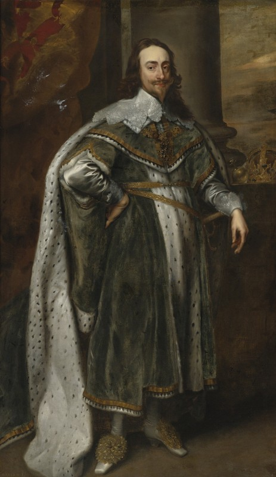
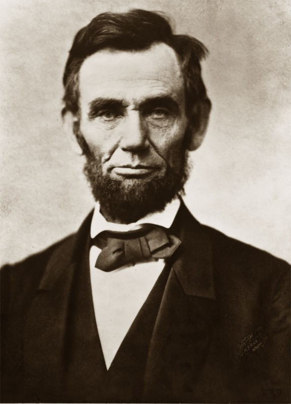
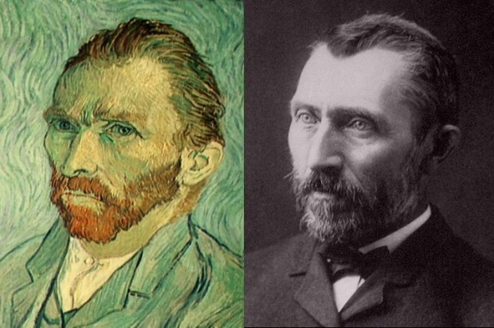
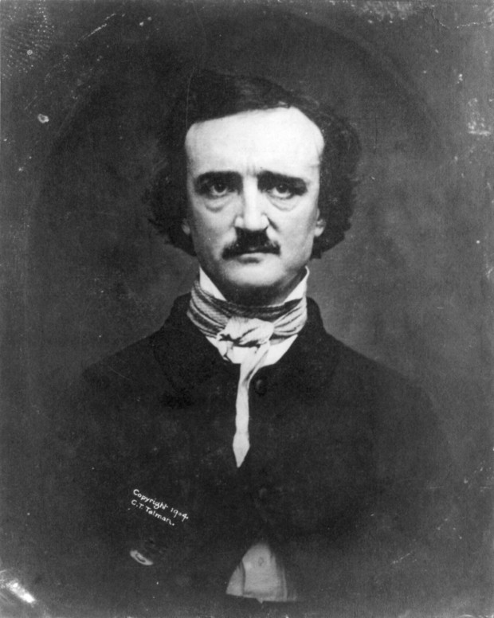
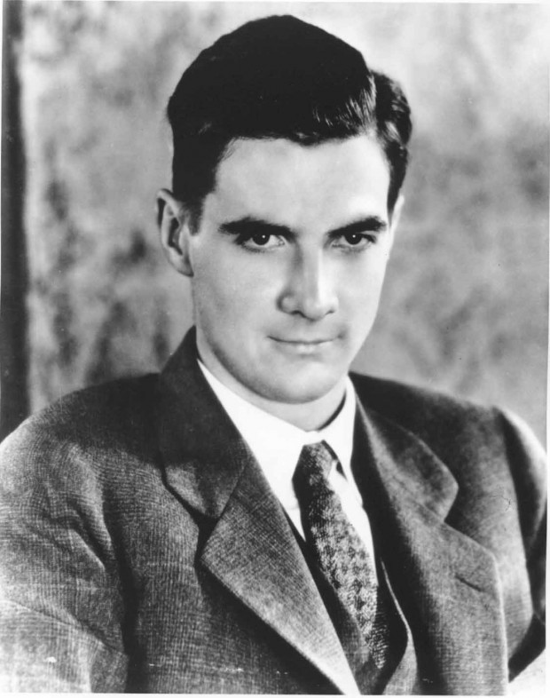
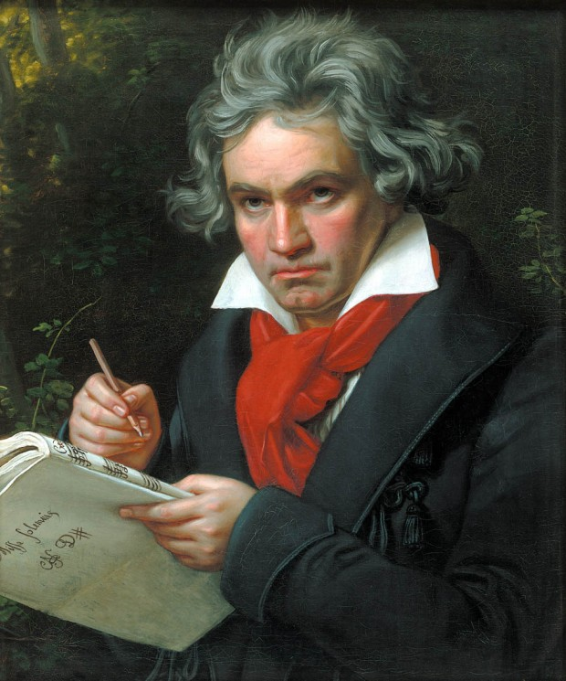
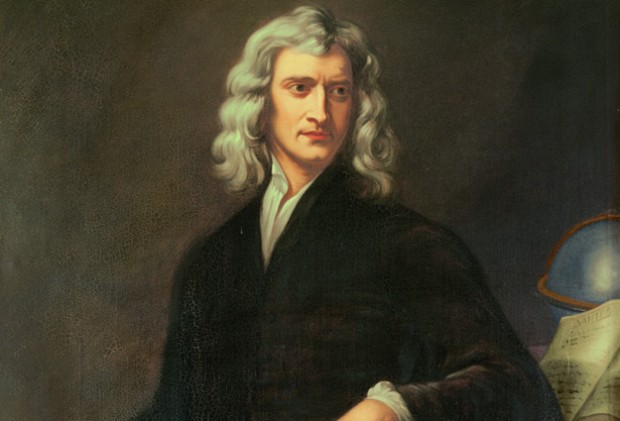

> “Homens já me chamaram de louco; mas a questão ainda não foi resolvida, se a loucura é ou não é a mais alta inteligência – se muito do que é glorioso – se tudo que é profundo – não provém da doença do pensamento – de ânimos da mente exaltados às custas do intelecto geral.” –Edgar Allan Poe

  

Desde que o mundo é mundo, tem gente maluca andando por aí. Mas, por algum motivo, a gente acha que ser maluco é algo fora do normal, que pessoas com distúrbios mentais não conseguem encontrar um lugar na sociedade. Na realidade, a gente se assustaria se olhasse com mais atenção pra quantidade de pessoas excêntricas, esquisitas ou realmente loucas de pedra que contribuíram significativamente para a história da humanidade.

  

Aqui vai uma pequena lista com algumas figuras históricas famosas por terem o pino solto.

  

### Rei Carlos VI da França

  

  

O Rei Carlos VI era conhecido como Carlos, o Louco. Depois de uns doze anos de reinado, os primeiros sinais de sua insanidade começaram a aparecer.

  

Houve episódios onde ele não lembrava o próprio nome, nem da esposa, dos filhos ou sequer de que era rei da França. Durante cinco meses, se recusou a tomar banho ou trocar de roupa. Além disso, teve um tempo em que acreditava ser feito de vidro, então proibia que qualquer pessoa tocasse sua figura real e fazia uso de roupas reforçadas, para evitar que se quebrasse por acidente.

  

Ele reinou de 1380 a 1422. Imagino que deve ter sido um período tumultuado para os franceses.

  

### Abraham Lincoln

  

  

Conhecido por ser um dos dezesseis primeiros presidentes americanos mais fodões de todos os tempos.

  

Apesar de suas grandes conquistas, como colocar um fim na Guerra da Secessão, introduzir medidas que colocaram um fim à escravidão nos EUA, e inclusive, [ter matado alguns vampiros](http://youtu.be/yTnPhrakkVg), tinha o que ele próprio chamava de “tendência à melancolia”.

  

É normal ficar triste de vez em quando, acontece com todo mundo. No entanto, o que Lincoln vivia eram períodos de profunda e debilitante depressão. Alguns biógrafos especulam que não era raro ele contemplar a possibilidade de suicídio.

  

De acordo com um [perfil feito pela Ability Magazine](http://abilitymagazine.com/abe_story.html), ele chorava desesperadamente e utilizava-se de um senso de humor exagerado, além de uma espécie de fanatismo religioso e dedicação extrema ao trabalho para balancear sua melancolia.

  

### Vincent Van Gogh

  

  

Certo, Van Gogh é aquele pintor que cortou a própria orelha e mais tarde cometeu suicídio. Você provavelmente já ouviu falar dele.

  

Ele costumava ter ataques epiléticos causados por uma lesão cerebral oriunda do consumo excessivo de absinto. Sim, ele era alcoólatra. Seu famoso entusiasmo por arte e religião, combinado por seu ritmo acelerado de pintura, seguidos por períodos de profunda depressão reforçam a teoria de que ele talvez sofresse de distúrbio bipolar.

  

Ele também era um excelente escritor e deixou centenas de cartas. Alguns acreditam que ele sofria de hipergrafia, uma espécie de mania associada à epilepsia que é, basicamente, uma vontade incontrolável de escrever.

  

Bem parecido com o que sofrem os editores do PapodeHomem.

  

### Edgar Allan Poe

  

  

Conhecido por seus contos de horror, foi um dos primeiros a tentar construir uma carreira apenas com seu ofício de escritor. Edgar Allan Poe era extremamente interessado em psicologia e usava o que aprendia sobre o assunto como substrato para suas obras.

  

Acontece que ele tinha um inimigo chamado [Rufus Griswold](http://pt.wikipedia.org/wiki/Rufus_Wilmot_Griswold), de quem o Poe gostava de falar mal, seja por escrito ou verbalmente. Então, após a morte de Poe, Griswold decidiu escrever um obituário venenoso sobre seu rival, contando a respeito de como as pessoas simplesmente deixavam passar batida a sua proeminente loucura.

  

Depois disso, as pessoas passaram a conjecturar que Edgar Allan Poe tinha distúrbio bipolar. O próprio Poe já havia escrito uma carta contando que já experimentava pensamentos suicidas. Um fato curioso é que toda uma saga sobre uma [suposta viagem de balão](http://en.wikipedia.org/wiki/The_Balloon-Hoax) já havia sido publicada como notícia e, no final, descobriu-se que era uma farsa.

  

### Howard Hughes

  

  

Howard Hughes foi aviador, engenheiro aeroespacial, produtor de filmes, diretor de cinema e bilionário nas horas vagas.

  

Metódico, organizado, disciplinado, tinha aversão a germes. Ou melhor: ele tinha uma fobia diagnosticada a germes. Um [artigo publicado pela American Psychological Association](http://www.apa.org/monitor/julaug05/hughes.aspx) sugere que sua fobia era tão severa que contribuiu para o vício em [Codeína](http://pt.wikipedia.org/wiki/Code%C3%ADna) e [Valium](http://pt.wikipedia.org/wiki/Valium), além de levá-lo a ter uma vida de reclusão.

  

Sua vida foi marcada por períodos de estresse e isolamento. Quando adolescente, chegou a ficar paralizado por meses, por nenhuma razão aparente.

  

Mais tarde, começou a apresentar comportamentos obsessivo-compulsivos, em função da sua fobia. Todos os que se aproximavam dele tinham de usar luvas, sua comida era, obrigatoriamente servida protegida por lenços de papel, só conseguia dormir pelado, com os pés protegidos por caixas de tecido, em zonas livres de germes devidamente inspecionadas por ele próprio.

  

### Ludwig Van Beethoven

  

  

Gênio da música.

  

Acredita-se que tenha sofrido de transtorno bipolar. Dizem que apanhava de seu pai de maneira tão violenta que, talvez, isto tenha contribuído para sua perda auditiva.

  

Era um cara intenso, cheio de vitalidade, carregado de ideias brilhantes, mas que subitamente entrava em ciclos de reclusão, depressão profunda, humor negro e crueldade.

  

Também foi viciado em álcool e e ópio, numa espécie de tentativa de controlar seus próprios ânimos.

  

### Sir Isaac Newton

  

  

Físico, matemático, astrônomo, alquimista, filósofo e teólogo. Ele criou uma boa parte do conteúdo de física do ensino médio, então você provavelmente já o conhece e odeia.

  

Nos seus estudos teológicos, Isaac Newton criou várias teorias para como o mundo poderia acabar, tentando extrair conhecimentos científicos da Bíblia. Segundo ele, estamos seguros até 2060.

  

Há relatos de que as pessoas da época também o odiavam bastante. Ele era conhecidamente psicótico, difícil de se conviver e dado a mudanças dramáticas e radicais de humor, sem motivos lá muito aparentes. Alguns autores dizem que ele talvez fosse bipolar. Talvez fosse esquizofrênico. Ou [talvez, fosse só virgem mesmo](http://en.wikipedia.org/wiki/Isaac_Newton#Personal_life).

  
[anexo ausente]  
  

Artigos Relacionados

  

[Quatro excelentes jogos de tabuleiro para jogar no feriado](http://rss.feedsportal.com/c/32911/f/530922/s/25a2a597/l/0Lpapodehomem0N0Bbr0Cjogos0Ede0Etabuleiro0Ebaratos0Eno0Ebrasil0C/story01.htm)

  

[O carro sem piloto e as novas tecnologias automotivas](http://rss.feedsportal.com/c/32911/f/530922/s/25bde0e5/l/0Lpapodehomem0N0Bbr0Co0Ecarro0Esem0Epiloto0Ee0Eas0Enovas0Etecnologias0Eautomotivas0C/story01.htm)

  

[Marcelo Yuka: “O que eu preciso pra viver em paz?”](http://rss.feedsportal.com/c/32911/f/530922/s/25c72805/l/0Lpapodehomem0N0Bbr0Cmarcelo0Eyuka0Eo0Eque0Eeu0Epreciso0Epra0Eviver0Eem0Epaz0C/story01.htm)

  

[Céu](http://rss.feedsportal.com/c/32911/f/530922/s/25d33743/l/0Lpapodehomem0N0Bbr0Cceu0C/story01.htm)

  

[Os 8 lugares mais assustadores da face da Terra](http://rss.feedsportal.com/c/32911/f/530922/s/25e47fce/l/0Lpapodehomem0N0Bbr0Cos0E80Elugares0Emais0Eassustadores0Eda0Eface0Eda0Eterra0C/story01.htm)

  
  
  
[[anexo ausente]](http://da.feedsportal.com/r/151231087675/u/49/f/530922/c/32911/s/25e56f69/a2.htm) [anexo ausente]  
  

[[anexo ausente]](http://feeds.feedburner.com/~ff/PapodehomemLifestyleMagazine?a=dkWIp95yb4s:aU1lcMhK090:yIl2AUoC8zA)  [[anexo ausente]](http://feeds.feedburner.com/~ff/PapodehomemLifestyleMagazine?a=dkWIp95yb4s:aU1lcMhK090:qj6IDK7rITs) [[anexo ausente]](http://feeds.feedburner.com/~ff/PapodehomemLifestyleMagazine?a=dkWIp95yb4s:aU1lcMhK090:-BTjWOF_DHI)

  
[anexo ausente]  
  
  
  
from Papo de Homem - Lifestyle Magazine <http://da.feedsportal.com/c/32911/f/530922/s/25e56f69/l/0Lpapodehomem0N0Bbr0Cfiguras0Ehistoricas0Ee0Esuas0Edoencas0Ementais0C/ia1.htm>
