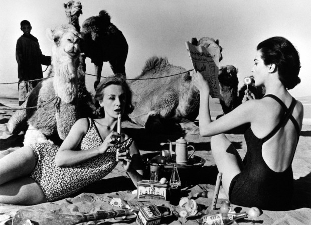
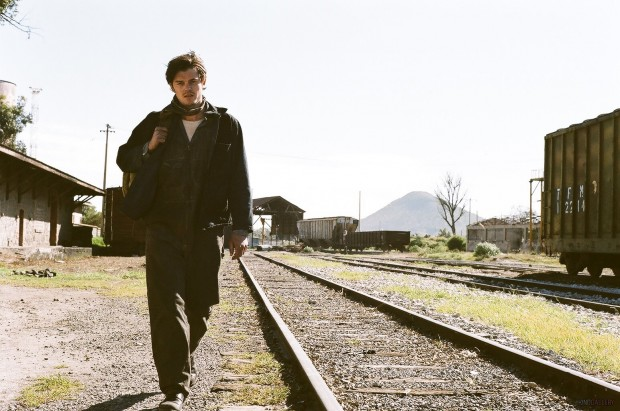
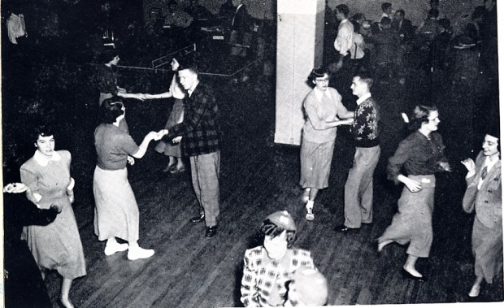

Pensamos tecnologia, falamos tecnologia, criamos, discutimos, até mesmo respiramos tecnologia. Mas será que devemos “viver” tecnologia? Praticamente tudo que pensamos é voltado ao mundo digital, mas esquecemos que vivemos em um mundo essencialmente “analógico”.

  

Analógico sim, porque apesar de respirarmos tecnologia, ainda assim temos relações. Não relações virtuais somente, mas temos amigos, familiares, companheira(o)s, presentes em nossa vida fisicamente.

  

Pode não ser fácil se desligar do mundo tecnológico. Mas lembre-se, você não foi instalado a partir de um arquivo baixado na internet. Você nasceu, cresceu ouvindo seus avós, seus pais, falando para você descer de algum lugar alto, parar de correr dentro de casa, não bater no seu irmão.

  

  
  

As vovós entendiam das coisas

  

Você não nasceu digitalmente. Tornou-se digital. Mas não você e sim seus afazeres, trabalhos, vivência, cotidiano. Isso não quer dizer que você deva pensar zeros e uns.

  

Não estou querendo dizer que você precisa regredir, reinventar a roda, programar em Pascal ou escrever cartas. Mas você pode aproveitar o mundo digital, sendo, também, analógico.

  

Preparei uma pequena lista de sugestões com atividades gostosas de se fazer fora do mundo digital, com pessoas de verdade, olho no olho.

  

Aqui vão minhas sugestões para dar um break no digital.

  

### Fazer um mochilão, com os amigos ou sozinho

  

Fiz um mochilão em 2008 sozinho do Rio até Salvador. Só tinha Nextel e ele não pegava em praticamente nenhum lugar. Nada mais sensacional que isso. Acessei a internet algumas poucas vezes pra avisar que estava vivo e só. Ano passado fui pra Buenos Aires e o celular não pegava, só a internet. Foi bom da mesma forma, só que um pouco mais digital, mas zoando horrores e pouco me fudendo com as redes sociais.

  

### Viajar com a família

  

Fiz isso ano retrasado e farei esse ano. Sugiro que, se decidir fazer, vá pra lugares nunca visitados, como fiz pra Recife e farei pra Natal. Tente ir pra Fernando de Noronha, onde raramente o celular pega e você consegue se desligar do trabalho e da vida, aproveitando o lugar absurdamente

  

### Ir pro boteco com os amigos e esquecer os “checkins”

  

Deixe o celular de lado. Beba com os amigos, foda-se o Fousquare. Se o lugar está bom, a companhia está boa, você raramente vai lembrar do celular e das redes sociais. A não ser que você esteja esperando aquela mina.

  

### Tirar férias e esquecer o telefone e o computador

  

Tirar férias é uma coisa fodástica. Difícil para alguns, pois as empresas dificultam isso. Mas tente isso, desestressa bastante. Vá sozinho ou leve sua parceira(o), saia da cidade, esqueça um pouco o mundo. Sei que é difícil deixar de lado o celular, mas tente esquecê-lo um pouco.

  

  

### Almoçar com a família

  

É bom fazer isso com mais regularidade. Nem que seja com a mãe, irmã, pai durante a semana, no intervalo do trabalho, mas principalmente nos finais de semana com aqueles familiares que você não vê frequentemente. Seja seus tios, primos, avós, dentre outros. Geralmente é mais fácil em datas comemorativas, mas surpreenda, faça isso numa data foda-se, aleatória.

  

### Beber um chopp com seu pai

  

Normalmente fazemos isso no aniversário dele e no dia dos pais. Quer dizer, quando fazemos. Eu mesmo admito que não faço isso com frequência, sou um bosta, mas estou tentando fazer isso mais vezes. Mas acima disso, faça isso em dias aleatórios. Teu coroa vai gostar, tenha certeza disso.

  

### Dar um abraço nas pessoas que você ama

  

Acho que o abraço é mais forte que um beijo, sério. Aquele abraço de urso, bem forte, bem dado, transmite mais sentimento que um beijo em si. Mas claro, não é sempre. Mas um abraço protege, guarda pra si, aproxima. Um abraço forte seguido de um beijo na bochecha faz muito bem. Seja nos seus familiares, nos seus amigos, na(s) sua(s) mulher(es). Faça com mais frequência.

  

### Andar por aí, sozinho, seja na praia, no campo, na montanha, escalando

  

Faço isso constantemente. Vira e mexe vou na Pista Claudio Coutinho, que é a base do Pão de Açúcar, sozinho, caminho por ela e subo a pedra do Pão de Açúcar até o limite que dá pra fazer sem aparelhos e com segurança. Uma puta vista, boa pra pensar na vida, refletir, ver as merdas que você está fazendo, as coisas boas, se renovar.

  

### Faça um esporte, uma luta, dance

  

  

Nada melhor pra desestressar do que um esporte, principalmente uma luta. Fiz boxe por um dia, imaginei aquele saco de porrada como o IE6 na época (já faz uns bons anos).

  

Caralho, enchi aquela porra de saco de porrada, suei que nem um filho da puta e saí renovado. Voltarei a escalar, isso é é muito bom, recomendo.

  

E uma dica valiosa, principalmente pros cuecas: façam dança de salão. Lá você esquece do stress, do mundo externo e se concentra na sua parceira, só nela e quando os professores passam os exercícios e passos. Te deixa mais leve, mas ágil e te faz ter um algo mais para as mulheres, garanto.

  

### Este texto deveria ser desnecessário

  

É triste que ainda tenhamos que escrever um texto como este. Seria bom que as pessoas já soubessem disso, que fosse algo tão óbvio quanto o procedimento para amarrar os cadarços. Infelizmente, ainda há muitas pessoas que precisam ler algo assim.

  

Enquanto esta não for a forma como normalmente agimos, espero que quando terminar de ler, alguém se sinta motivado a dar um abraço em quem quer que seja.

  

Mas por favor, sem nicknames malucos, sem o intermédio de uma tela, é abraço mesmo, bem forte e em quem você ama. Nada de IM’s ok?

  
[anexo ausente]  
  

Artigos Relacionados

  

[Você não tem tempo](http://rss.feedsportal.com/c/32911/f/530922/s/250a9bfa/l/0Lpapodehomem0N0Bbr0Cvoce0Enao0Etem0Etempo0C/story01.htm)

  

[Minhas 5 esquetes favoritas do Monty Python são melhores que as suas](http://rss.feedsportal.com/c/32911/f/530922/s/250f0bce/l/0Lpapodehomem0N0Bbr0Cmonty0Epython0C/story01.htm)

  

[É tudo uma questão de ponto de vista](http://rss.feedsportal.com/c/32911/f/530922/s/2522a13d/l/0Lpapodehomem0N0Bbr0Ccontrafato0Ee0Etudo0Euma0Equestao0Ede0Eponto0Ede0Evista0C/story01.htm)

  

[Meditamos, testamos QI, melhoramos a performance e a Disney não comprou o PdH: Outubro foi foda](http://rss.feedsportal.com/c/32911/f/530922/s/25283a5f/l/0Lpapodehomem0N0Bbr0Cmeditamos0Etestamos0Eqi0Emelhoramos0Ea0Eperformance0Ee0Ea0Edisney0Enao0Ecomprou0Eo0Epdh0Eoutubro0Efoi0Efoda0C/story01.htm)

  

[5 artistas que influenciaram Bob Dylan descritos por ele próprio](http://rss.feedsportal.com/c/32911/f/530922/s/252dc2f4/l/0Lpapodehomem0N0Bbr0C50Eartistas0Eque0Einfluenciaram0Ebob0Edylan0Edescritos0Epor0Eele0Eproprio0C/story01.htm)

  
  
  
[[anexo ausente]](http://da.feedsportal.com/r/148658562708/u/49/f/530922/c/32911/s/253a49c0/kg/342/a2.htm) [anexo ausente]  
  

[[anexo ausente]](http://feeds.feedburner.com/~ff/PapodehomemLifestyleMagazine?a=GQxx4NNOgTs:S5FfJZU_bRk:yIl2AUoC8zA)  [[anexo ausente]](http://feeds.feedburner.com/~ff/PapodehomemLifestyleMagazine?a=GQxx4NNOgTs:S5FfJZU_bRk:qj6IDK7rITs) [[anexo ausente]](http://feeds.feedburner.com/~ff/PapodehomemLifestyleMagazine?a=GQxx4NNOgTs:S5FfJZU_bRk:-BTjWOF_DHI)

  
[anexo ausente]  
  
  
  
from Papo de Homem - Lifestyle Magazine <http://papodehomem.com.br/10-coisas-que-fiz-para-sair-do-automatismo-digital/>
