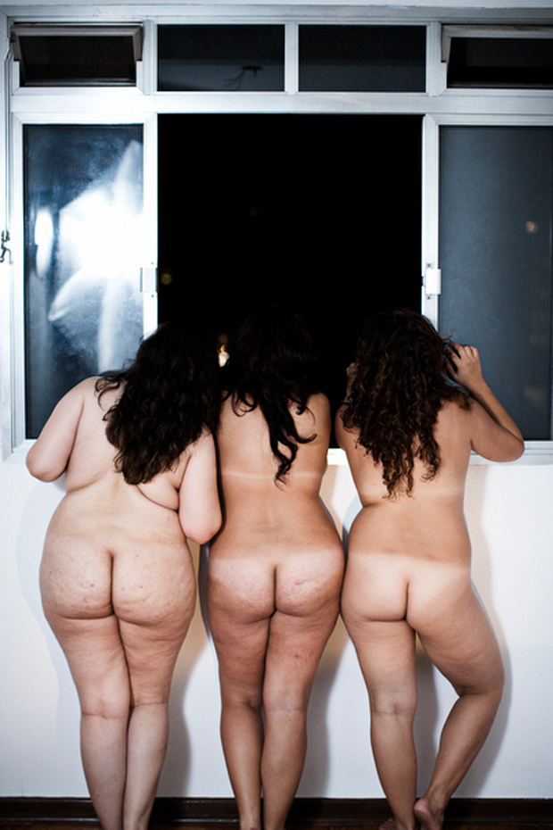
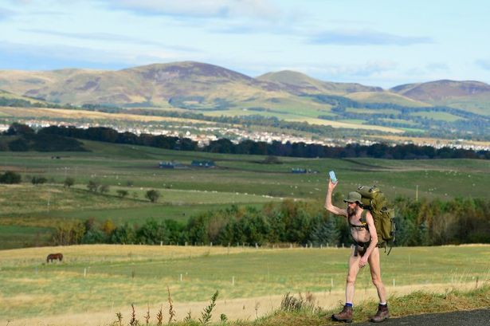
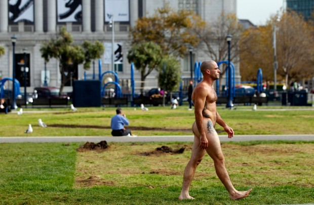
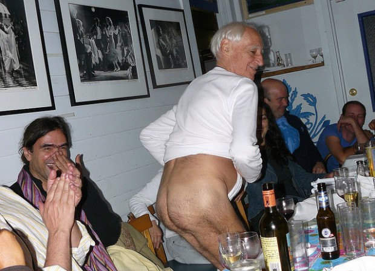

Pelas duas primeiras semanas de novembro, o [Projeto Nu](http://thenuproject.com/) estará no Brasil, fotografando a nudez de nossas mulheres.

  

Você se candidataria à modelo? Não?

  

Por que não?

  

  

### O direito à nudez

  

O inglês Stephen Gough, conhecido como “[o andarilho nu](http://www.dailymail.co.uk/femail/article-2200337/Why-DID-Naked-Rambler-choose-nudity-children-Wife-eccentric-freedom-fighter-plea-clothes-on.html)“, passou grande parte dos últimos seis anos preso. Seu crime: [andar nu pelo Reino Unido](http://g1.globo.com/mundo/noticia/2012/10/nudista-radical-luta-por-direito-de-andar-sem-roupas.html).

  

As autoridades dizem não querer prendê-lo, mas Stephen tira as roupas [assim que é solto](http://www.standard.co.uk/news/uk/naked-rambler-stephen-gough-heads-south-after-prison-release-8202338.html), e acaba sendo preso de novo. Mesmo dentro da cadeia, ele se recusa a usar roupas e tem que ficar isolado dos outros prisioneiros.

  

  
  

É assim que Stephen Gough anda pela estrada. Isso te ofenderia?

  

Para Stephen, a questão é simples: ele considera que andar nu em público é uma liberdade fundamental. Que é um aspecto da sua individualidade. Que não é racional agir como se o corpo humano fosse ofensivo.

  

Outros argumentam que os direitos de Stephen terminam onde começam os direitos dos outros de não serem “perturbados” ou “alarmados” por sua nudez.

  

Mas será que a nudez de um homem andando na dele deveria mesmo ser alarmante e perturbadora?

  

### A obscenidade da nudez pública

  

Em São Francisco, na Califórnia, a lei proíbe apenas “comportamento obsceno” e não a nudez pública. Ou seja, balançar o pau e gritar “olha minha trolha!!” não pode. Simplesmente andar pelado pela cidade, pode. Hoje, a nudez pública só é proibida em três lugares: nos restaurantes, nos parques e no porto.

  

Ano passado, um supervisor municipal conseguiu passar uma lei restringindo a prática: agora, para usar cadeiras ou bancos públicos, os nudistas precisam sentar em uma toalhinha ou jornal.

  

*(Essa nova regra não faz sentido pra mim. Do ponto de vista do nudista, posso até me imaginar andando nu pela rua… mas sentando nu em um banco de praça? Caralho! E, do ponto de vista da cidade, você confiaria na higiene de uma toalhinha trazida por um cara tão pouco preocupado com sua higiene pessoal que sentaria nu em um banco de praça? A toalha deve estar muito mais nojenta que a bunda dele.)*

  

  
  

Cidadão de São Francisco, exercendo seu direito de andar nu em público.

  

Enfim, agora o mesmo supervisor está tentando [acabar com a nudez pública](http://www.bizjournals.com/sanfrancisco/blog/2012/10/san-francisco-supervisors-public-nudity.html?page=all) ou restringi-la somente a lugares pré-estabelecidos.

  

Entretanto, mesmo que exista uma maioria de insatisfeitos com um comportamento não-agressivo que não faz mal a ninguém, isso justificaria proibi-lo?

  

E pergunto: você se incomodaria de estar andando pela praça e cruzar por um homem nu placidamente lendo o jornal?

  

Ou melhor: você se incomodaria de passear nu com seu cachorro? Ou de dar uma corridinha para a banca mais próxima, só pra comprar o jornal, sem precisar vestir roupas?

  

Muitos responderiam que não fariam isso, mesmo se fosse legal e socialmente aceito, por terem vergonha de seus corpos.

  

Por quê?

  

*(Por seis meses, depois do furacão Katrina, enquanto esperava as águas baixarem, morei em São Franciso. Baita orgulho dessa cidade.)*

  

### A vergonha da nudez

  

Por que temos vergonha de nossos corpos?

  

A melhor explicação talvez esteja no romance *Imortalidade*, de [Milan Kundera](http://www.companhiadasletras.com.br/autor.php?codigo=00914).

  

Em um dado momento, uma personagem de dezesseis anos menstrua subitamente na casa de uma amiga e suja os lençóis. Morta de vergonha, ela tenta racionalizar sua vergonha.

  
> Afinal, por que estava com tanta vergonha? Todas as mulheres não menstruam? Ela por acaso tinha inventado os órgãos genitais? Era responsável por eles? Claro que não.
>
>   
>
> Mas responsabilidade não tinha nada a ver com vergonha. Pelo contrário. Se tivesse derrubado tinta e sujado a tolha de mesa de seus anfitriões, teria sido desagradável e doloroso, mas não teria sentido vergonha.
>
>   
>
> A base da vergonha não seria algum erro pessoal que cometemos, mas a humilhação de termos que ser quem somos sem nenhuma escolha no assunto e que essa humilhação seja vista por todos.

  

Ou seja, a vergonha não está no acidente fortuito de derrubar a tinta (que só aconteceu com você) mas sim na menstruação, pela vergonhosa banalidade de ela acontecer com todas.

  

A vergonha que sentimos de nossos corpos não é por serem feios ou diferentes, mas sim por serem tão dolorosamente iguais aos outros sete bilhões de corpos que respiram pela terra.

  

*(Milan Kundera é muito foda. Leiam A Insustentável Leveza do Ser, A Brincadeira, Risíveis Amores, Imortalidade. Recomendo.)*

  

*Link YouTube | “O banquete”, de Platão, em montagem do Teatro Oficina*

  

### A naturalidade da nudez

  

O Teatro Oficina, de José Celso Martinez Corrêa, é das companhias teatrais mais tradicionais, consagradas e premiadas do Brasil — e só quem conhece seu repertório entende a ironia de usar “Teatro Oficina” e “tradicional” na mesma frase.

  

*(Quando celebraram seus 50 anos de atividade, visitaram Nova Orleans e fui das pessoas que passeou pela cidade com o Zé Celso, um encontro que me marcou demais.)*

  

As peças do Teatro Oficina são famosas por serem longas (uma curta demora quatro horas; a mais longa, vinte e sete) e por grande parte do elenco estar nu em cena.

  

*(Nunca esqueço da famosa campanha: “Nesse inverno, agasalhe uma atriz do Teatro Oficina”.)*

  

Por isso, muita gente apressada classifica o teatro do Zé Celso de pornográfico ([uma atriz chegou a perder a guarda dos filhos!](http://www.advivo.com.br/blog/luisnassif/a-atriz-que-perdeu-a-guarda-dos-filhos)) mas nada poderia estar mais distante da verdade.

  

De fato, é o oposto.

  

  
  

Nova Orleans, 2008. Em um dos melhores restaurantes da cidade, cercado pela elite do teatro local… a bunda do Zé Celso. Foto minha.

  

Assistir nove horas de Teatro Oficina é como o pai que tranca o filho no quarto com uma caixa de charuto: ele sai de lá sem querer fumar nunca mais.

  

No começo da peça, você pode até achar sexy, interessante, engraçado aqueles paus e peitos balançando de cá pra lá. Mas é impossível manter esse nível de interesse ou estimulação por muito tempo. Em breve, a nudez se torna natural. Logo depois, se torna invisível. Quando menos você percebe, pasmem!, está prestando atenção… na peça! Em meio a dezenas de seios pululando!

  

É quase como se Zé Celso estivesse dialogando com Kundera: a mesma banalidade que nos faz ter vergonha da nudez também torna a nudez natural e invisível.

  

*(Dia 8 de novembro, estreia em São Paulo o novo espetáculo do Teatro Oficina, Acordes. Aproveite e leia esse artigo sobre a nudez em Zé Celso: A nudez em cena: Teatro Oficina, o espelho mágico e o nu artístico.)*

  

### A nudez não precisa ser sexual para ser linda

  

Não vou falar muito aqui sobre o [Projeto Nu](http://thenuproject.com/). O PapodeHomem já publicou um texto muito interessante sobre isso: [Nenhuma nudez será castigada](http://papodehomem.com.br/nenhuma-nudez-sera-castigada/).

  

A ideia do fotógrafo [Matt Blum](http://mattblum.com/) é simples: clicar a nudez de mulheres de verdade, em suas casas, sem maquiagem, sem produção, sem photoshop, sem iluminação especial.

  

Matt e sua equipe estão no Brasil agora, onde devem ficar até a segunda semana de novembro, passando por São Paulo, Rio, Recife e Salvador. Infelizmente, as inscrições já se encerraram.

  

Como explicou Matt [em entrevista ao portal iG](http://delas.ig.com.br/comportamento/2012-04-19/projeto-chega-ao-brasil-para-tirar-a-roupa-de-mulheres-normais.html):

  
> “nós nem pedimos que mandem fotos. Só precisam ter mais de 21 anos, disporem de um lugar para fotografar e estarem disponíveis para a foto”.

  

O site do projeto é lindo, emocionante, terno, político e… por que não?, tesudo. [Recomendo a visita.](http://thenuproject.com/)

  

  

Na verdade, o que Matt Blum está mostrando é que a nudez, apesar de ser linda, não precisa ser sexual. Nossos corpos são ferramentas: eles podem ser usados para o sexo, mas também podem ser usados para construir uma ponte ou matar um exército inimigo.

  

Às vezes, um corpo nu lendo o jornal em um banco de praça é só um corpo nu lendo o jornal em um banco de praça.

  
[anexo ausente]  
  

Artigos Relacionados

  

[A revolução educacional já começou](http://rss.feedsportal.com/c/32911/f/530922/s/251f3467/l/0Lpapodehomem0N0Bbr0Ca0Erevolucao0Eeducacional0Eja0Ecomecou0C/story01.htm)

  

[John Fahey: músico, excêntrico e gênio](http://rss.feedsportal.com/c/32911/f/530922/s/252200a6/l/0Lpapodehomem0N0Bbr0Cjohn0Efahey0Emusico0Eexcentrico0Ee0Egenio0C/story01.htm)

  

[Uma cigarrilha apagada](http://rss.feedsportal.com/c/32911/f/530922/s/252981b4/l/0Lpapodehomem0N0Bbr0Cuma0Ecigarrilha0Eapagada0C/story01.htm)

  

[5 artistas que influenciaram Bob Dylan descritos por ele próprio](http://rss.feedsportal.com/c/32911/f/530922/s/252dc2f4/l/0Lpapodehomem0N0Bbr0C50Eartistas0Eque0Einfluenciaram0Ebob0Edylan0Edescritos0Epor0Eele0Eproprio0C/story01.htm)

  

[Uma escola de bambu na Libéria, com a ajuda do Brasil](http://rss.feedsportal.com/c/32911/f/530922/s/25438fda/l/0Lpapodehomem0N0Bbr0Cliberia0Eescola0Ede0Ebambu0C/story01.htm)

  
  
  
[[anexo ausente]](http://da.feedsportal.com/r/148658616608/u/49/f/530922/c/32911/s/254a18f2/a2.htm) [anexo ausente]  
  

[[anexo ausente]](http://feeds.feedburner.com/~ff/PapodehomemLifestyleMagazine?a=LQItfaZGVXM:sePUHgAM_pM:yIl2AUoC8zA)  [[anexo ausente]](http://feeds.feedburner.com/~ff/PapodehomemLifestyleMagazine?a=LQItfaZGVXM:sePUHgAM_pM:qj6IDK7rITs) [[anexo ausente]](http://feeds.feedburner.com/~ff/PapodehomemLifestyleMagazine?a=LQItfaZGVXM:sePUHgAM_pM:-BTjWOF_DHI)

  
[anexo ausente]  
  
  
  
from Papo de Homem - Lifestyle Magazine <http://papodehomem.com.br/a-nudez-nao-precisa-ser-sexual/>
