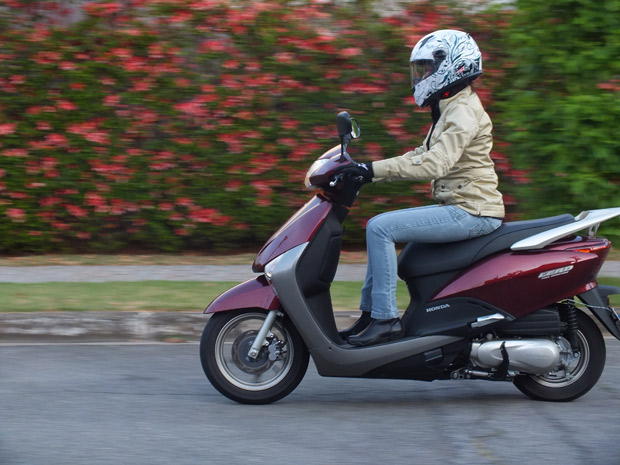
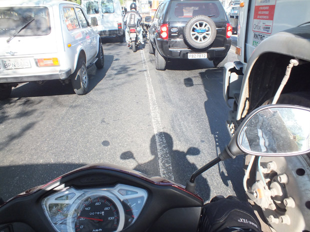

Cansado do trânsito, de ter que acordar tão cedo e ter poucas horas de descanso, de me estressar tanto para ir a uma reunião quanto para sair com a namorada, decidi procurar uma alternativa. Comprei uma Scooter.

  

  
  

Foto: Alessandra Carolina

  

Pode parecer loucura se deslocar no trânsito caótico e desorganizado de São Paulo em uma dessas, mas, realmente, digo que vale a pena. Num trajeto de 25 quilômetros, onde enfrentaria 1h30 de puro congestionamento, demoro hoje 30 minutos para chegar ao trabalho. E o melhor: com 12 reais para encher o tanque.

  

As motos do tipo scooter (também chamadas de [vespas, lambretas ou motonetas](http://pt.wikipedia.org/wiki/Motoneta)) são utilizadas para deslocamentos pequenos e que não exijam alta velocidade. Geralmente elas são limitadas a 90 km/h, mas isso pode variar.

  

No caso da Honda Lead, que eu dirijo, noventinha é de bom tamanho para o dia a dia.

  

Só tive mesmo que aprender uma coisa:

  

### Buzina é questão de sobrevivência

  

Ela é a minha mais necessária ferramenta para sobreviver nesse trânsito selvagem. A falta de respeito entre os condutores é impressionante.

  

Não só os que estão em seus carros, mas também os colegas de duas rodas.

  

Já presenciei casos em que os condutores de motocicletas disputavam o mesmo espaço como se estivessem numa pista de corrida. O final não foi um trófeu e uma linda mulher entregando um champagne ao vencedor, mas sim um acidente grave envolvendo os dois motociclistas e mais um automóvel. É triste ver a falta de respeito.

  

Pela minha observação e experiência de quem conhece o trânsito tanto pelos olhos do carro quanto da moto, o grande culpado na maior parte das vezes é a irresponsabilidade do condutor da moto.

  

Mas os motoristas de veículos também têm a sua parcela de culpa. Depois que passei para o outro lado, percebi que é necessário ter atenção redobrada com o espaço entre os carros. Existem sim os conscientes, que sinalizam a mudança de faixa ou até esperam os motociclistas passarem. Só que existem também os que não sinalizam e mudam de faixa como se trocassem de cueca e aí, meu amigo, é buzina pra todo lado. Ou pior: acidente.

  

Você pode achar irritante o barulho da buzina, afinal, já esta estressado dentro do veículo, parado ali no trânsito há tempos. Mas é a única maneira de avisar que existe um motociclista no corredor. Chega a ser angustiante e claustrofóbico andar naquele espaço entre os automóveis.

  

  
  

Foto: Alessandra Carolina

  

Acredito que no futuro (espero que não muito distante) todo motorista seja obrigado a tirar CNH de moto e automóvel.

  

Nada melhor do que ter essa vivência para entender como funciona a segurança de ambos. O motorista desesperado e estressado para chegar ao seu destino, que na pressa se enfia em qualquer espaço à frente do veículo numa outra faixa, muitas vezes sem lembrar de sinalizar, dificilmente agiria assim se sofresse com esse tipo de atitude sentado em uma moto em outros momentos.

  

A motocicleta não oferece a mesma segurança de um veículo, portanto, sempre fico atento ao corredor para mudar de faixa no trânsito. E quando estou na scooter me preocupo com essas mudanças bruscas de faixa e não ando como se estivesse no autódromo de interlagos.

  

Mesmo assim, como eu disse antes, vale a pena.

  

Consigo dormir até mais tarde e chegar no horário. Economizo absurdamente com gasolina e estacionamento. Ando num veículo com baixo índice de furto e roubo. O problema é só quando chove – aí, realmente, recorro ao carro.

  
[anexo ausente]  
  

Artigos Relacionados

  

[5 artistas que influenciaram Bob Dylan descritos por ele próprio](http://rss.feedsportal.com/c/32911/f/530922/s/252dc2f4/l/0Lpapodehomem0N0Bbr0C50Eartistas0Eque0Einfluenciaram0Ebob0Edylan0Edescritos0Epor0Eele0Eproprio0C/story01.htm)

  

[Nasce um homem](http://rss.feedsportal.com/c/32911/f/530922/s/25357fe0/l/0Lpapodehomem0N0Bbr0Cnasce0Eum0Ehomem0C/story01.htm)

  

[Bom dia, Jessica Weekley](http://rss.feedsportal.com/c/32911/f/530922/s/253c73af/l/0Lpapodehomem0N0Bbr0Cbom0Edia0Ejessica0Eweekley0C/story01.htm)

  

[Uma escola de bambu na Libéria, com a ajuda do Brasil](http://rss.feedsportal.com/c/32911/f/530922/s/25438fda/l/0Lpapodehomem0N0Bbr0Cliberia0Eescola0Ede0Ebambu0C/story01.htm)

  

[O Brasil das muitas e escuras minorias](http://rss.feedsportal.com/c/32911/f/530922/s/254c3d5d/l/0Lpapodehomem0N0Bbr0Co0Ebrasil0Edas0Emuitas0Ee0Eescuras0Eminorias0C/story01.htm)

  
  
  
 [anexo ausente]  
  

[[anexo ausente]](http://feeds.feedburner.com/~ff/PapodehomemLifestyleMagazine?a=dcy0msEFioM:j5iYxtemcB4:yIl2AUoC8zA) [[anexo ausente]](http://feeds.feedburner.com/~ff/PapodehomemLifestyleMagazine?a=dcy0msEFioM:j5iYxtemcB4:D7DqB2pKExk) [[anexo ausente]](http://feeds.feedburner.com/~ff/PapodehomemLifestyleMagazine?a=dcy0msEFioM:j5iYxtemcB4:qj6IDK7rITs) 

  
  
  
  
  
from Papo de Homem - Lifestyle Magazine <http://da.feedsportal.com/c/32911/f/530922/s/254d04fe/l/0Lpapodehomem0N0Bbr0Ccomprei0Euma0Escooter0Emelhorei0Eminha0Evida0C/ia1.htm>
