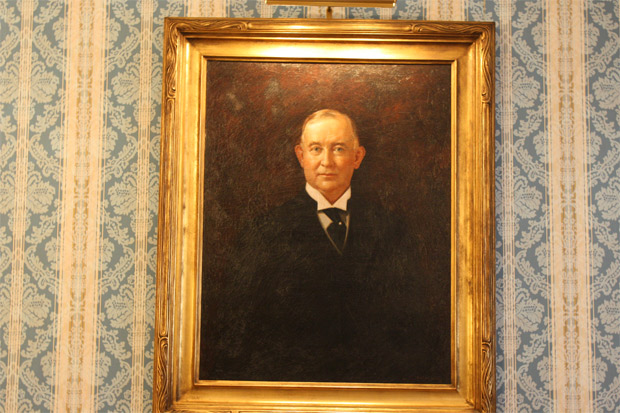
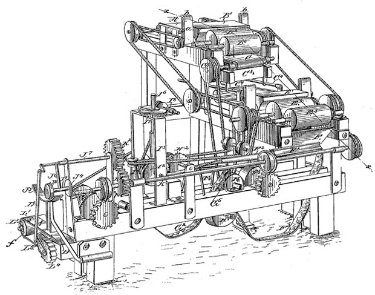

Temos em nosso modelo mental que uma pessoa capaz de causar mais de um milhão de mortes não deve ser um sujeito bom. Mao, Stalin e Hitler se encaixam nesse perfil do vilão absoluto, assim como outros carinhas complicados com muito poder nas mãos.

  

Mas, apesar de ter matado bem mais, o reconhecido filantropo James Buchanan Duke não tem nada a ver com esse perfil.

  

Nada a ver mesmo, exceto que a busca por dólares fez nascer uma indústria que mata 5 milhões de pessoas todos os anos, segundo a Organização Mundial da Saúde. Se não fosse ele, outra pessoa certamente teria iniciado aquilo que poderia ser reconhecido como o mal do século XX. E teria ficado podre de rico em seu lugar.

  

  

Tudo começou em 1885, quando Duke mandou construir a primeira máquina de processamento de cigarros. Antes disso, em sua “fábrica”, um operário produzia artesanalmente 200 cigarros por dia enrolando-os à mão. Esta máquina, a primeira de seu tipo, produzia 120 mil cigarros no mesmo período.

  

Considerando apenas o que se consome de cigarros em um nervoso jogo da Libertadores, até que não parece tanto, mas na ocasião isso era o equivalente a um quinto do consumo norte-americano. Até então, as únicas opções para usar tabaco eram usar um cachimbo ou charuto ou enrolar o próprio fumo. Tudo muito caro e pouco prático se comparado com os cigarros fabricados em escala industrial.

  

Era tanto cigarro que o problema de Duke agora não era mais produzi-los, mas vender toda essa produção. Pelo preço que fosse.

  

  
  

Projeto da primeira máquina de fazer cigarros. A grande sacada era fazer um cigarro muito comprido e depois cortá-lo em pedaços

  

Até de graça ele distribuía cigarros para promover o produto. Mas não em qualquer lugar: ele sempre os distribuía em desfiles de moda, estreias de peças teatrais e outros locais de alto status. A ideia era que as estrelas fossem fotografadas fumando, aumentando assim o status do cigarro.

  

Ou seja, além de matar milhões de pessoas todos os anos, Duke também inventou a disciplina favorita dos políticos brasileiros, o marketing, muito antes da Coca-Cola e da GM.

  

### Milhões de mortos

  

Todo mundo sabe o mal que o cigarro faz. Hoje em dia. Mas Duke morreu numa época em que médicos até mesmo recomendavam o consumo do tabaco. Para ele, estava fazendo do mundo um lugar melhor. Era tão bem intencionado que fez um doação gigantesca para o Trinity College, nos Estados Unidos, que, honrado, mudou o nome para Duke University.

  

Ou seja, Duke também foi o precursor da moda do [Naming Rights](http://pt.wikipedia.org/wiki/Direitos_de_nome), algo que só pegaria fôlego em 1990.

  

Assim como Henry Ford, cujos automóveis baratos deram mobilidade (e propensão a morrer em acidentes) a bilhões de pessoas, Duke permitiu que o consumo do tabaco fosse massificado. Depois dele, restaurantes, cinemas e outros lugares públicos passaram a aceitar fumantes. E mais: apenas fumantes do cigarro produzido em massa, porque faziam menos fumaça que os cachimbos ou palheiros. A facilidade de fumar cigarros, aliada ao hábito de tragar, fez explodir os casos de câncer de pulmão.

  

  

Estes dados do Ministério da Saúde mostram como deu certo o esforço de Duke:

  
> “(…) o fumo é uma das principais causas de morte evitável, hoje, no planeta.
>
>   
>
> Um terço da população mundial adulta – cerca de 1,3 bilhão de pessoas – fuma: aproximadamente 47% da população masculina e 12% da população feminina fazem uso de produtos derivados do tabaco. Nos países em desenvolvimento, os fumantes somam 48% dos homens e 7% das mulheres, enquanto nos desenvolvidos, a participação do sexo feminino mais do que triplica, num total de 42% de homens e 24% de mulheres fumantes.
>
>   
>
> No Brasil, pesquisa realizada recentemente pelo Ministério da Saúde, por meio do Instituto Nacional de Câncer (Inca), indica que 18,8% da população brasileira é fumante (22,7% dos homens e 16% das mulheres).”
>
>   
>
> **Fonte: Portal da Saúde**

  

Ele inventou o produto, desenvolveu formas muito eficazes de vendê-lo e, mais ainda, ficou extremamente rico nesse processo. Para concluir, um único americano motivado pelo interesse pessoal de enriquecimento matou mais gente do que Hitler, Stalin e Mao juntos.

  

Culpado ou inocente?

  
[anexo ausente]  
  

Artigos Relacionados

  

[A nova geração de pais que mimam](http://rss.feedsportal.com/c/32911/f/530922/s/25e348a3/l/0Lpapodehomem0N0Bbr0Ca0Enova0Egeracao0Ede0Epais0Eque0Emimam0C/story01.htm)

  

[Os 8 lugares mais assustadores da face da Terra](http://rss.feedsportal.com/c/32911/f/530922/s/25e47fce/l/0Lpapodehomem0N0Bbr0Cos0E80Elugares0Emais0Eassustadores0Eda0Eface0Eda0Eterra0C/story01.htm)

  

[Black Friday no Brasil faz preço subir. Aí sim dá pra abaixar](http://rss.feedsportal.com/c/32911/f/530922/s/25e47fcf/l/0Lpapodehomem0N0Bbr0Cblack0Efriday0Eno0Ebrasil0Efaz0Epreco0Esubir0Eai0Esim0Eda0Epra0Eabaixar0C/story01.htm)

  

[O que podemos aprender com a NFL e a Premier League](http://rss.feedsportal.com/c/32911/f/530922/s/25f00473/l/0Lpapodehomem0N0Bbr0Co0Eque0Epodemos0Eaprender0Ecom0Ea0Enfl0Ee0Ea0Epremier0Eleague0C/story01.htm)

  

[Futebol no radinho](http://rss.feedsportal.com/c/32911/f/530922/s/25f08b55/l/0Lpapodehomem0N0Bbr0Cfutebol0Eno0Eradinho0C/story01.htm)

  
  
  
[[anexo ausente]](http://da.feedsportal.com/r/151230832896/u/49/f/530922/c/32911/s/25ebc386/a2.htm) [anexo ausente]  
  

[[anexo ausente]](http://feeds.feedburner.com/~ff/PapodehomemLifestyleMagazine?a=dl5ZFHGrI0A:kdehxZu2cl8:yIl2AUoC8zA)  [[anexo ausente]](http://feeds.feedburner.com/~ff/PapodehomemLifestyleMagazine?a=dl5ZFHGrI0A:kdehxZu2cl8:qj6IDK7rITs) [[anexo ausente]](http://feeds.feedburner.com/~ff/PapodehomemLifestyleMagazine?a=dl5ZFHGrI0A:kdehxZu2cl8:-BTjWOF_DHI)

  
[anexo ausente]  
  
  
  
from Papo de Homem - Lifestyle Magazine <http://da.feedsportal.com/c/32911/f/530922/s/25ebc386/l/0Lpapodehomem0N0Bbr0Co0Ehomem0Eque0Ematou0Emais0Edo0Eque0Estalin0Emao0Ee0Ehitler0C/ia1.htm>
