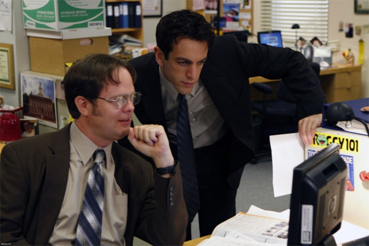
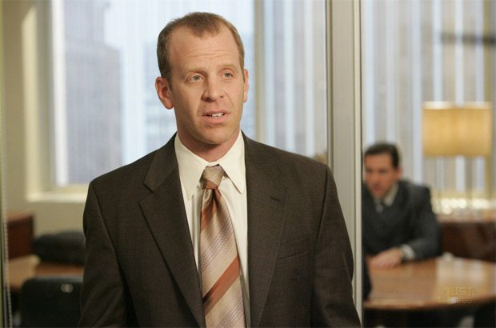

Bato o ponto mais uma vez. Atrasado 10 minutos. Merda. Vai ser descontado no próximo pagamento.

  

Percebi esses dias: eles chegam ao trabalho como o gado indo para o abate, devagar, a passos calmos; tristes, porém conformados com destino. Vão ser cortados e embalados em pedaços de carne por oito horas – quer dizer, sete, pois uma hora é tirada para o almoço. Mas todos os dias às 6, ou um pouco antes até, saem do serviço com um sorriso largo na expressão. Só faltam dar famoso soco no ar do Pelé, de tanta alegria.

  

  

Mal chego e o **Pedro** já me conta, de um modo engraçado, sobre a incompetência do serviço executado por Paulo no dia anterior. Ele espera que eu me alegre e compartilhe da alegria pela miséria alheia. Faço-o feliz e lhe dou um sorriso amigo, concordando, mesmo pensando: “Deus, não consigo me livrar desse cara”. Mas até que é um bom sujeito o coitado, sempre me conta as novas.

  

**Cristóvão**, meu chefe, dá ordens. Esse é o trabalho dele: “dar ordens”. Ele já alcançou um grau tão elevado e iluminado na montanha empresarial que não precisa mais trabalhar, apenas delegar tarefas. Fica sentado em sua poltrona (a melhor da firma) vendo e-mails pornográficos que seus amigos e bajuladores mandam. Todo o mundo sabe o motivo daqueles risos no computador, mas ninguém ousa comentar. De minha arte, faço o serviço mandado por ele e entrego. Faço e entrego. Faço e entrego. Não recebo elogios. No máximo um olhar de “muito bem” e outra ordem, que precisa ser executada com o máximo de rapidez e eficiência, como um cão adestrado. Se eu fosse um cachorro, pelo menos receberia o biscoito da recompensa.

  

**João** não trabalha, e seu serviço sobra sobre mim. Ele tem muitos anos de empresa e faz o básico no meio de campo, um verdadeiro Zinho na seleção do escritório. Estranhamente, não é cobrado por ninguém.

  

**Judas** leva as fofocas e os erros dos outros ao chefe. Imagina que com isso passa a imagem de cara preocupado com a Empresa, abnegado, um ser que pensa no coletivo. Um grande boçal, no entanto, é o que ele é. Esse safado necessita mostrar que está preocupado, mesmo com as pequenas coisas, mesmo com as coisas de que ninguém dá importância, mesmo com a necessidade de fazer um orçamento com quatro empresas diferentes sobre a compra de clips coloridos que facilitam a demarcação de assuntos nas pastas. Não por acaso, ele que vai substituir meu chefe nas suas férias.

  

**Mateus** rouba a empresa. Leva as resmas de papel do escritório para a filha, que está na faculdade de Direito e precisa imprimir trabalhos e livros volumosos. Ela dá pro rapazinho do xerox, e com isso economiza anualmente 850 reais.

  

  

**Madalena**, a secretária, é a única mulher da empresa. Não bastasse, é gostosa. Dá mole pra todo mundo, já até saiu com o Cristóvão, mas nunca retribui meus cumprimentos de bom dia. Esses tempos fiquei olhando aquelas coxas enquanto estava sentada. Branquinhas, grossas e fortes, permeada de pelinhos eriçados pelo frio do ar condicionado. A saia, teimosa, insistia em subir mediante seus movimentos na cadeira. Do meu computador, com uma cara de besta, fiquei olhando uns bons minutos pra aquele monte de carne, como um cachorro sentado observando o frango a rodar na máquina da padaria. Ela percebeu a minha babação, abaixou a saia e fez uma cara de repulsa para mim. Se eu fosse um cachorro, teria me feito carinho.

  

**Felipe** não fala com ninguém. Nas poucas vezes que balbuciou algo, sua fala soou tímida e auto piedosa. Este protótipo de ser humano não demonstra emoções, seu rosto é uma interrogação; nunca sei ao certo quando está triste, alegre ou com vontade de cagar. Vejo o cara chegar, colocar os fones de ouvido, digitar no computador, tomar café às quatro e ir embora. Não sei seu sobrenome. Ele me lembra aqueles rapazes calmos e serenos que volta e meia invadem um cinema com uma submetralhadora e descarregam sua raiva contra os filmes da Sofia Coppola.

  

**Lucas** usava o telefone da firma para ligar para suas amantes. Ligações interurbanas, e também para celular. Há dois meses o chefe descobriu e acabou com a farra. Todas as ligações particulares foram proibidas. Mesmo se ocorrer um assalto, vier um tsunami ou se a sua mulher estiver precisando de ajuda porque está em trabalho de parto. Não pode. Ando agora com cartões telefônicos, o orelhão é perto da esquina. A conta de telefone de Lucas veio em 637 reais. Foi descontado do seu pagamento. Tranquilo: meu chefe parcelou a sua dívida em 5 vezes, debitado em folha.

  

  

Não acessamos a internet no nosso trabalho. Roupas, apenas sociais. Não podemos deixar a barba crescer. Políticas comportamentais da empresa. Parece o Velho Testamento: “Não deixarás a extremidade de vossas faces peludas, sob pena de castigo e advertência divina.”

  

Não há pessoal da limpeza, pois a terceirização custa muito. Então, é feita uma escala semanal para os próprios funcionários limparem os banheiros. Segundo alguns especialistas de recursos humanos e uma pesquisa recente dessas universidades americanas, limpar a privada onde seu colega acabou de cagar traz mais proximidade e melhora o senso de equipe.

  

Tento, nas reuniões, aparentar estar feliz por alcançar resultados que não me trazem benefício algum. Rio das piadas de Tiago, meu supervisor, apenas para me enturmar.

  

De vez em quando o pessoal entre em greve e pede aumento. Sinto vergonha em ver André, meu amigo de baia e chefe do sindicato, mendigando aumento salarial. Parece que pedimos um favor a eles. Porém, gosto quando dá certo, e o reajuste esse ano foi de 2,5%. Sucesso.

  

Bem, hoje foi dia do amigo secreto da empresa, com direito a salgadinhos frios e refrigerantes baratos. Judas tirou chefe e deu-lhe de presente um par de tacos de golfe. O acertado entre todos era de que o valor máximo dos presentes fosse de 50 Reais. Esse safado sabe como agradar, deve ter gasto o quadruplo disso. Eu dei um DVD do Roupa Nova para Mateus. Estava na promoção, foda-se.

  

Desde 1988 trabalho aqui. Segui o conselho do meu pai, que me sempre me falava das maravilhas do funcionalismo público. Não tenho plano de carreira.

  

  

Bato o ponto e vou embora. Fico uma hora e 7 minutos no trânsito até chegar ao meu apartamento. Vazio.

  

Minha filha acabou de ligar. Disse que não vai poder ficar comigo esse final de semana, pois vai viajar com a Gi, a Rafa, a Gabi e a Tati pra Maresias. Além disso, me pede dinheiro. Como se já não bastasse a pensão. Digo que irei depositar na conta da mãe dela.

  

Tomo um banho e ligo a TV.

  

Nos noticiários, a mesma ladainha de sempre. Morreram mais alguns árabes em um atentado a bomba no sei-lá-quistão, meu time empatou e estourou outro escândalo de corrupção com um nome engraçado. Acabo dormindo no sofá, com a televisão ligada, volume baixinho. Quer dizer, tento dormir – meu corpo dói por inteiro, então vou pra cama. Trabalho o dia todo sentado, mas sinto as mesmas dores que um pedreiro ao final de um dia de labuta sob o sol erguendo muros.

  

Minha libido anda baixa. Não tenho vontade de me masturbar, tampouco sair com uma mulher. Não é o caso de não desejá-las. Talvez seja por não me desejar.

  

[7:00]

  

Novo dia. Acordo suado. O sol absurdamente forte invade minha casa pela janela. Ponho-me de pé e vou ao banheiro, mijo, tomo um banho, requento um café velho, não necessariamente nesta ordem.

  

Saio, entro no carro e ligo o rádio. Notícias. Enfrento o trânsito como o resto do gado.

  

Chego ao escritório e mais uma vez me atraso de propósito. Ninguém notou. Merda. 25 minutos atrasado. Vai ser descontado do próximo pagamento.

  

  
[anexo ausente]  
  

Artigos Relacionados

  

[O cientista que tinha cerveja infinita em casa](http://rss.feedsportal.com/c/32911/f/530922/s/258d2321/l/0Lpapodehomem0N0Bbr0Co0Ecientista0Eque0Etinha0Ecerveja0Einfinita0Eem0Ecasa0C/story01.htm)

  

[Como organizei um TEDx em Fortaleza](http://rss.feedsportal.com/c/32911/f/530922/s/2593ad5d/l/0Lpapodehomem0N0Bbr0Ccomo0Eorganizei0Eum0Etedx0Eem0Efortaleza0C/story01.htm)

  

[Quem é seu fiscal?](http://rss.feedsportal.com/c/32911/f/530922/s/25a2a595/l/0Lpapodehomem0N0Bbr0Cquem0Ee0Eseu0Efiscal0C/story01.htm)

  

[Quatro excelentes jogos de tabuleiro para jogar no feriado](http://rss.feedsportal.com/c/32911/f/530922/s/25a2a597/l/0Lpapodehomem0N0Bbr0Cjogos0Ede0Etabuleiro0Ebaratos0Eno0Ebrasil0C/story01.htm)

  

[Assange questiona integrantes do movimento Occupy | O mundo amanhã #7](http://rss.feedsportal.com/c/32911/f/530922/s/25a2a598/l/0Lpapodehomem0N0Bbr0Cassange0Econversa0Ecom0Eintegrantes0Edo0Emovimento0Eoccupy0Eo0Emundo0Eamanha0E70C/story01.htm)

  
  
  
   
  

[[anexo ausente]](http://feeds.feedburner.com/~ff/PapodehomemLifestyleMagazine?a=cc77AV79Pho:i1c-01sZzAc:yIl2AUoC8zA)  [[anexo ausente]](http://feeds.feedburner.com/~ff/PapodehomemLifestyleMagazine?a=cc77AV79Pho:i1c-01sZzAc:qj6IDK7rITs) [[anexo ausente]](http://feeds.feedburner.com/~ff/PapodehomemLifestyleMagazine?a=cc77AV79Pho:i1c-01sZzAc:-BTjWOF_DHI)

  
[anexo ausente]  
  
  
  
from Papo de Homem - Lifestyle Magazine <http://da.feedsportal.com/c/32911/f/530922/s/25a70fa0/l/0Lpapodehomem0N0Bbr0Co0Etrabalho0Edanifica0Eo0Ehomem0C/ia1.htm>
