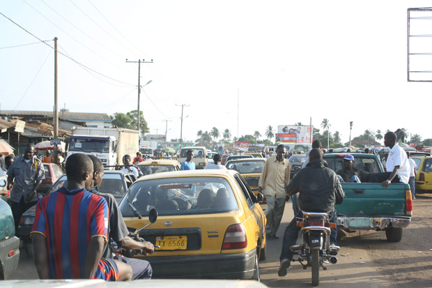
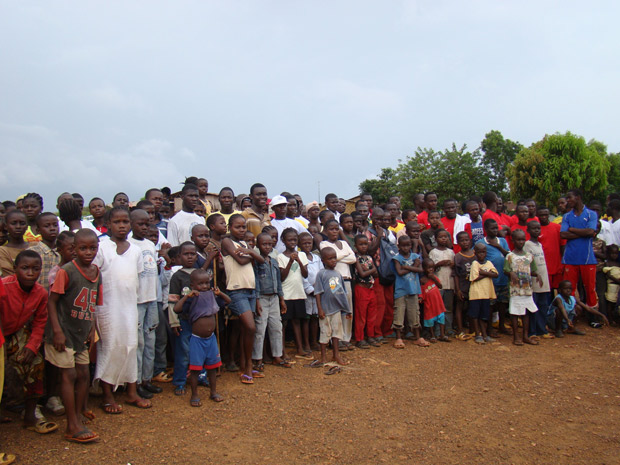
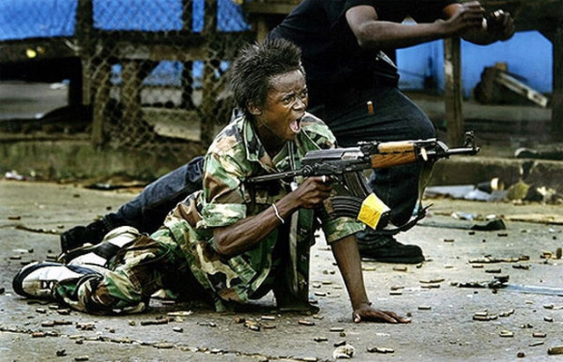
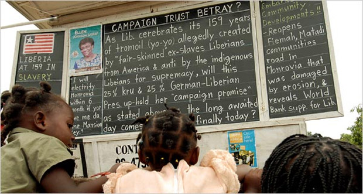
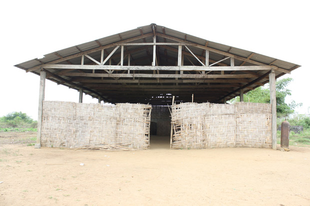

A [Libéria](http://pt.wikipedia.org/wiki/Lib%C3%A9ria) é um pequeno país do oeste africano, situado logo abaixo de Serra Leoa. Uma nação pobre, esquecida, explorada e que detém as últimas posições de qualquer ranqueamento que meça o desenvolvimento humano, econômico e estrutural.

  

Apesar de sempre estar entre os últimos de qualquer lista, a Libéria costuma ganhar espaço nas primeiras páginas dos jornais.

  

### Assim é a Libéria

  

  

Tive a oportunidade de conhecer a Libéria no ano de 2010. É um país muito quente, úmido, com um céu parecido com o de São Paulo, cinzento na maior parte do tempo. Cercado pelo mar e banhado por inúmeros rios, o território tem apenas duas estações no ano: época de sol e época de chuva, muita chuva.

  

Mais do que dizer como é o clima lá, acho importante citar como são as coisas.

  

**Na capital, Monróvia, apenas a avenida principal era asfaltada em 2010** (mas não contava com nenhum semáforo disciplinando seu caótico trânsito). Os carros são da década de 80, praticamente todos danificados nos costumeiros acidentes em que se envolvem. Não existe ônibus urbano; carros e motos particulares fazem o transporte da população local.

  

Para os condutores, não há a necessidade de uma carteira de habilitação, basta um veículo para dirigir. Cinto de segurança e capacete até existem, mas ninguém os utiliza. E, pelas leis da física vigentes na Libéria, a moto é um veículo capaz de transportar de três a quatro pessoas.

  

No ano passado, a premiação do Nobel da Paz reconheceu os esforços de duas pessoas daquele território: a presidenta Ellen Johnson Sirleaf e a militante Leymah Gbowee. Apesar do prêmio ter sido concedido em 2011, ambas tiveram forte influência para acabar com a guerra civil em 2003, [orquestrando uma greve de sexo](http://g1.globo.com/mundo/noticia/2011/10/ganhadora-do-nobel-da-paz-liderou-greve-de-sexo-na-liberia-em-2002.html) que englobou todos os lados do conflito.

  

Na década de 90, pelo futebol, surgiu uma outra personalidade que se tornou bem famosa: [George Weah](http://pt.wikipedia.org/wiki/George_Weah), eleito o melhor jogador do mundo em 1995. Nas eleições do ano passado, o atleta tentou se tornar presidente, mas acabou derrotado por Ellen Johnson, que conquistou o segundo mandato.

  

Podemos dizer que ambas as notícias estão entre as melhores já publicadas sobre este país. As outras capas de jornais e revistas, que mencionaram a Libéria, não foram por superação pessoal ou destaques positivos. Eram relatos dos conflitos que sempre existiram no país.

  

Diferentemente dos demais países africanos, a Libéria, assim como a Etiópia, não foi colonizada por europeus. No caso liberiano, a fundação ocorreu em 1821, por obra de uma então denominada Sociedade Americana de Colonização. Com o fim do período escravocrata nos Estados Unidos, e considerando impossível socializá-los nos moldes da sociedade americana, foi avaliado, então, que a melhor alternativa seria devolvê-los ao continente de origem.

  

  

Surge então a **Libéria, terra da liberdade**, lugar onde os ex-escravos norte-americanos foram libertos, mas que reproduziram em suas relações de poder o único sistema que conheciam: o escravocrata. Este território, que já era habitado, foi então redividido. Cada uma das 16 tribos tinha o seu próprio espaço; e os chamados américo-liberianos eram os únicos considerados cidadãos do país, representando menos de 1% da população local. Esta situação perdurou até 1980, quando **um golpe de estado mudou a complexa dinâmica que vigorou por mais de 150 anos naquele território.**

  

Em 1989, menos de uma década depois do golpe, teve início uma sangrenta guerra civil, que se arrastou por 14 anos. Três grupos políticos disputaram o poder, com um saldo considerado: estima-se que cerca de 300.000 pessoas morreram em batalhas travadas até por crianças soldados, que eram capturadas do círculo familiar e obrigadas a lutar. Tudo que havia sido levantado fora destruído, até mesmo uma usina hidrelétrica que gerava uma quantidade ínfima de energia distribuída para os liberianos.

  

O conflito acabou em 2003, com a campanha da abstinência promovida pelas ganhadoras do Nobel da Paz, além da interferência de órgãos internacionais. De lá pra cá, o país tenta se reerguer.

  

  

Na tentativa de manter o estado de paz, a ONU tem forte presença no país. Existem dois tipos de polícia: a da ONU e a do Estado.

  

Os policiais da ONU são os únicos autorizados a portar armas de fogo, já os do Estado não possuem grandes recursos para trabalhar. Até mesmo o transporte de suspeitos de pequenos delitos é feito de forma improvisada: o policial chama um moto-táxi para a tarefa. **Sem algemas e armas, a prisão é feita pelo convencimento.**

  

O salário mínimo na Libéria é de 70 dólares mensais, o que não significa que grande parte da população receba esta quantia. Os índices de desemprego são altíssimos e de difícil mensuração. O último estudo realizado neste sentido data de 2003, mesmo ano que a guerra civil terminou, e está publicado no site da CIA. Na ocasião, 85% da população estava desempregada.

  

Na área da saúde, a situação é lastimável. Diferentemente do Brasil, não existe qualquer alternativa para tratamentos gratuitos; até mesmo o hospital público é pago. E poucas pessoas têm dinheiro para tanto. Cerca de 40% da população é subnutrida, menos de 20% tem acesso à rede sanitária no país em que a expectativa de vida ao nascer não supera os 57 anos. A malária está por toda a Libéria. É difícil encontrar alguém que nunca tenha contraído a doença, sem contar a febre tifoide e o HIV.

  

Em dois meses adoeci duas vezes. Em menos de 15 dias fui picado pelo mosquito da malária, que, por sorte, estava contaminado com o mais baixo grau de periculosidade. Para o tratamento, repouso por alguns dias, muita água, 5 doses de uma injeção dolorida e alguns comprimidos. Não tive a mesma sorte com a febre tifoide, que me obrigou a ficar internado por três dias.

  

Optei por um dos melhores hospitais e paguei apenas 60 dólares por isso.

  

O médico errou no diagnóstico, quis tratar de uma diabete inexistente. Receitou remédios para baixar meus níveis de glicose, que despencaram para a casa dos 35%. Em meu braço, a enfermeira deixou por um longo período o dispositivo do soro aberto sem qualquer líquido no recipiente. Resultado: minha mão inchou a ponto de ficar o dobro do próprio tamanho.

  

Este era um dos melhores hospitais da capital Monrovia, com médicos muito atenciosos, prestativos, humanos, companheiros… Mas além da falta de estrutura, faltava o conhecimento. Nas muitas conversas que mantive com o povo liberiano, uma de um jovem de 20 e poucos anos foi esclarecedora para que eu compreendesse até onde pode chegar o desconhecimento de um liberiano:

  
> “Quantas horas de energia há no Brasil por dia?”

  

Na Libéria, poucas pessoas têm acesso à energia; quando têm, é provida por um gerador a gasolina, que não dura o dia inteiro.

  

Poucos têm dinheiro para se informar, seja assistindo televisão, ouvindo rádio ou comprando jornal. Não à toa, o veículo de comunicação mais popular na Libéria é o Daily News, um quadro negro bem grande afixado sobre uma bancada disposta na avenida principal da Monróvia. Os notícias, escritas com giz, são atualizadas diariamente.

  

  

Na Libéria, o sistema educacional é bem diferente do modelo brasileiro: assim como acontece com os hospitais, até mesmo as escolas públicas são pagas. Os valores por um semestre de ensino podem variar de U$ 50,00 a U$ 200,00. Adicionando transporte e materiais didáticos, chega-se a um custo que pode tornar inviável a educação dos filhos. Outro fator que difere do Brasil é a idade na qual a criança começa a escrever: 3 anos de idade.

  

Muitas das crianças liberianas nunca viram sequer um aparelho de televisão e pertencem à enorme fatia desprovida de acesso à rede mundial de computadores. **A Libéria é o país com o menor índice de acessos à internet**: apenas 0,07 de cada 100 cidadãos estão conectados, o que equivale a 2.800 pessoas.

  

### Fazendo a diferença em meio a esse caos

  

Neste país destruído por uma guerra, riquíssimo em recursos naturais, mas com uma população muito pobre, conheci um rapaz de 34 anos chamado Sabato Neufville. Apesar da pouca idade, adotou nove crianças e jovens que ficaram órfãos na guerra civil.

  

Sabato é um sujeito que aprendeu a sobreviver graças ao seu instinto. Durante os 14 anos do conflito conseguiu se refugiar por duas vezes, em Guiné e Costa do Marfim. Começou a trabalhar desde muito criança e aprendeu a se virar sozinho. Quando a guerra acabou, retornou para a Libéria e passou a desenvolver ações sociais, junto a jovens e adolescentes, para combater a violência infantil herdada no conflito.

  

Sabato é, por assim dizer, um freelancer da ONU.

  

Recebe uma média U$ 800,00 quando precisam de seus serviços. Com este dinheiro, além de sustentar e educar os filhos adotivos, fundou o [**United Youth Movement Against Violence**](http://uymav.wordpress.com/), instituição que promove atividades lúdicas e educacionais em três comunidades diferentes: Soul Clinic, Congo Town e Fendell.

  

Em Fendell, após construir um Centro da Juventude, Sabato descobriu que a evasão escolar era enorme, já que ali não havia escola e os pais não tinham recursos para financiar o estudo dos filhos, nem fornecer dinheiro para o transporte. **Decidiu então construir, com bambus enfileirados, uma escola que, diferentemente da maioria das existentes na Libéria, seria gratuita.** Esta escola também é muito diferente da maioria das existentes no Brasil, já que não possui energia elétrica, banheiros, fossa e água encanada.

  

  

As condições de segurança e salubridade são bastante precárias no prédio construído por Sabato. O bambu, na maneira que tem sido utilizado, danifica-se facilmente pela ação da chuva e sol intensos na região. A ausência de banheiros torna o ambiente insalubre a ponto dos alunos se sentirem mal durante as aulas. A qualidade da água na comunidade, retirada por poços artesianos, também acaba ficando comprometida.

  

Diante desta realidade, e sensibilizado pela personalidade do ativista Sabato, não pude deixar que esta história se resumisse a apenas um encontro em terras africanas. **Gravei entrevistas com crianças e adultos, reuni imagens e trouxe o material para o Brasil.**

  

Aqui, chamei amigos, mantive diversos encontros e montamos o projeto [Escola de Bambu](http://escoladebambu.com/).

  

*Link YouTube | Vídeo do projeto, saído quentinho do forno hoje mesmo*

  

Este é um projeto que visa a construção de uma escola totalmente sustentável na comunidade de Fendell. Muito além de levantar um prédio sustentável, nosso interesse é repassar toda tecnologia a ser empregada na obra e treinar pessoas para que os próprios liberianos estejam aptos a reproduzir o modelo proposto.

  

O novo prédio, desenhado pelos arquitetos [André Dal’bó](http://www.youtube.com/watch?v=0-0WmKZ7mbg) e Gabriela Ortega, continuará utilizando o bambu como elemento de construção, pois este é um recurso já conhecido no país. Propomos também a utilização de uma fossa biodigestora, para que a comunidade consiga produzir adubo para as plantações. A solução energética é o gerador P2RCA, inventado pelo [bioconstrutor Fabio “Peetssa” Ivamoto](http://revistatrip.uol.com.br/revista/201/reportagens/perna-eletrica.html), e fabricado com ímãs de HD de computadores quebrados e aros de bicicleta.

  

Nosso projeto está orçado em cerca de R$ 410.000,00. Somos um grupo com mais de 40 pessoas atuando como voluntários na capital paulista, articulando com pessoas físicas, empresas, institutos e instituições, buscando alternativas para viabilizar esta proposta.

  

Carregamos conosco o sentimento de que aquela comunidade merece alcançar os níveis de desenvolvimento que tanto anseia, motivados que somos pelo desejo de reparar minimamente a tragédia da escravidão imposta ao continente africano.

  

Hoje, o Brasil é o segundo país com a maior população negra no mundo, perdendo apenas para a Nigéria. Muito de nossa história e de nosso bem-estar foram alcançados graças ao trabalho de africanos que aqui chegaram como escravos, e que ainda hoje permanecem excluídos da dinâmica financeira e política de nosso país.

  

Para nós, a questão não se resume apenas à solidariedade entre povos, que já seria suficiente para nos motivar nesta empreitada. O que se coloca à nossa frente atende pelo nome de Justiça.

  
[anexo ausente]  
  

Artigos Relacionados

  

[Uma cigarrilha apagada](http://rss.feedsportal.com/c/32911/f/530922/s/252981b4/l/0Lpapodehomem0N0Bbr0Cuma0Ecigarrilha0Eapagada0C/story01.htm)

  

[5 artistas que influenciaram Bob Dylan descritos por ele próprio](http://rss.feedsportal.com/c/32911/f/530922/s/252dc2f4/l/0Lpapodehomem0N0Bbr0C50Eartistas0Eque0Einfluenciaram0Ebob0Edylan0Edescritos0Epor0Eele0Eproprio0C/story01.htm)

  

[Quanta energia elétrica o Yoda conseguiria gerar com a Força?](http://rss.feedsportal.com/c/32911/f/530922/s/2530acef/l/0Lpapodehomem0N0Bbr0Cquanta0Eenergia0Eeletrica0Eo0Eyoda0Econseguiria0Egerar0Ecom0Ea0Eforca0C/story01.htm)

  

[Nasce um homem](http://rss.feedsportal.com/c/32911/f/530922/s/25357fe0/l/0Lpapodehomem0N0Bbr0Cnasce0Eum0Ehomem0C/story01.htm)

  

[Bom dia, Jessica Weekley](http://rss.feedsportal.com/c/32911/f/530922/s/253c73af/l/0Lpapodehomem0N0Bbr0Cbom0Edia0Ejessica0Eweekley0C/story01.htm)

  
  
  
[[anexo ausente]](http://da.feedsportal.com/r/148658619788/u/49/f/530922/c/32911/s/25438fda/a2.htm) [anexo ausente]  
  

[[anexo ausente]](http://feeds.feedburner.com/~ff/PapodehomemLifestyleMagazine?a=T08xLXZcm0M:qRQDBua3v0A:yIl2AUoC8zA)  [[anexo ausente]](http://feeds.feedburner.com/~ff/PapodehomemLifestyleMagazine?a=T08xLXZcm0M:qRQDBua3v0A:qj6IDK7rITs) [[anexo ausente]](http://feeds.feedburner.com/~ff/PapodehomemLifestyleMagazine?a=T08xLXZcm0M:qRQDBua3v0A:-BTjWOF_DHI)

  
[anexo ausente]  
  
  
  
from Papo de Homem - Lifestyle Magazine <http://papodehomem.com.br/liberia-escola-de-bambu/>
