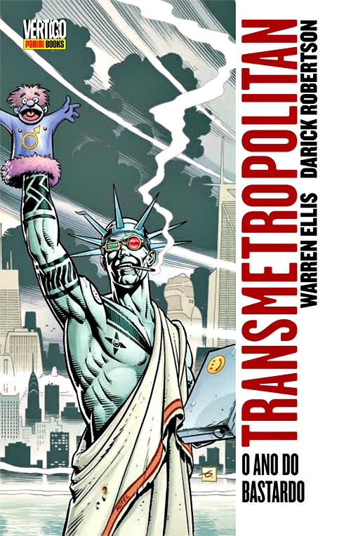
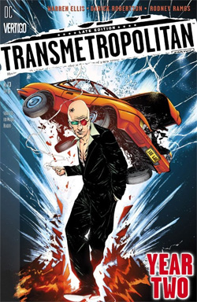
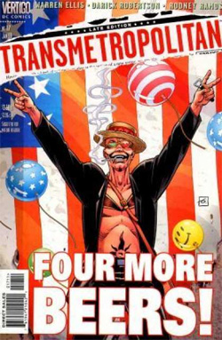
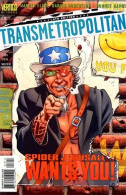
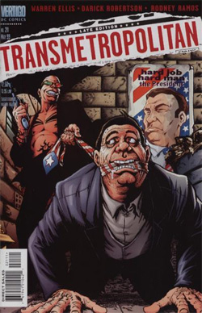

Após um hiato de **quase um ano**, a Panini finalmente lançou o terceiro volume de **Transmetropolitan**, no mesmo formato de encadernado de capa dura pra livrarias, mas dessa vez contendo 12 edições, o **segundo ano completo** da série. É ano eleitoral, e **Spider Jerusalém** fará tudo a seu alcance pra infernizar a vida dos candidatos… Mas vamos primeiro à sinopse oficial:

  

*Assassinos. Estupradores. Molestadores de cães. Ladrões de DNA. O renegado jornalista Spider Jerusalém já cobriu de tudo ao longo de sua carreira, geralmente sob o efeito de pesadas drogas. Mas todos esses assuntos parecem brincadeira de criança se comparados com o que ele vai se envolver agora: a política! Dois candidatos disputam a corrida eleitoral e apenas Spider tem estômago para chafurdar nas mentiras deles e trazer para o público o que realmente está por trás de tudo. Mas será que a verdade revelada é capaz de fazer realmente diferença? O aclamado roteirista Warren Ellis (Planetary, Frequência Global) e o artista Darick Robertson (The Boys, Wolverine) jogam pra galera e se metem com a campanha eleitoral em O Ano do Bastardo e A Nova Escória.*  
*308 páginas*  
*Panini Comics*  
*Capa dura*

  

  

**Roteiro:** Warren Ellis  
**Desenhos:** Darick Robertson  
**Arte-final:** Rodney Ramos  
**Cores:** Nathan Eyring  
**Capas:** Jae Lee e Dave Gibbons  
**Publicação original:** Transmetropolitan 13 a 24, Vertigo: Winter’s Edge 2 e 3

  

  
  
Esse encadernado possui dois arcos de 6 histórias cada. O primeiro é “**O ano do bastardo**“, que corresponde às edições 13 a 18, e o segundo é “**A nova escória**“, que vai do 19 ao 24. Em uma decisão bastante acertada, a Panini resolveu juntar os dois em um único encadernado. Assim, o leitor não precisa esperar um ano pra ler apenas 6 edições, já que parece que o objetivo deles é lançar apenas um encadernado por ano.

  

Em “**O ano do bastardo**“, **Spider Jerusalém** é obrigado por seu editor a cobrir as eleições, apesar de ter prometido nunca mais se envolver com política depois da confusão que o fez se isolar numa montanha. Apesar de seu ódio por todos os políticos, Spider acaba apoiando o candidato “**sorridente**“, pois ele é a única chance de derrotar o atual presidente, apelidado carinhosamente por Spider de “**A Besta**“.

  

  
  
A história é extremamente divertida, com o senso de humor ácido de Spider Jerusalém tomando conta e levando às situações mais improváveis. O “apoio” de Spider ao candidato sorridente não é bem o tipo de apoio que ele esperava, afinal Spider odeia os dois candidatos, ele apenas acha este um mal menor que o outro. Mas isso também muda quando o sorridente faz uma **aliança espúria** com um quase nazista pra conseguir os votos de um estado-chave e tem que acolher um **vice-candidato fabricado** (literalmente). Qualquer semelhança com as eleições reais não é mera coincidência. Apesar de caricata, essa história é uma crítica muito real à política americana, e também guarda muitas semelhanças com a brasileira.

  

  
  
No segundo arco, “A nova escória”, após uma grande decepção com o candidato que estava apoiando, Spider precisa conviver com a fama adquirida com sua cobertura da campanha presidencial, com a morte de uma grande amiga e com toda a confusão causada por suas duas desequilibradas assistentes. Tudo isso ainda em meio à campanha. Ao contrário do anterior, este arco é mais reflexivo, apresenta mais os problemas daquele mundo e mostra claramente que ele não tem salvação. Sem chance.

  

Os pontos altos deste arco são as entrevistas realizadas com cada um dos candidatos a presidente. O sorridente embarca no jogo de Spider, conseguindo surpreendê-lo e deixando claro que se for eleito ele não terá mais paz, o que incrivelmente deixa Spider sem reação. Mas na entrevista com o atual presidente Spider finalmente consegue dizer tudo o que ele queria há muito tempo, o que é uma catarse não só pro personagem, mas também pra nós, pois certamente gostaríamos de dizer algo semelhante pra muitos políticos por aí. O seguinte trecho é a resposta de Spider à pergunta “**por que começou a me chamar de A Besta?**”:

  
> *“É a imagem que sempre tive de você. Um grande bicho preto agachado no coração da América, cagando montes de fumegante merda esverdeada no país. Lambendo as próprias bolas, punhetando em cima da constituição, ejaculando golfadas ferventes de esperma venenoso na cara dos babacas que votaram em você. Você é… a coisa dentro de nós que vota só pra foder com a vesícula do próximo, é o cérebro reptiliano que não diz nada a não ser coma-mate-trepe-cague… é A Besta. (…) Vá se foder. Vá se foder! Você barganhou em cima de medo e ódio, e abiscoitou um cargo no qual poderia realizar seus sonhos molhados, ao fazer dos Estados Unidos uma merda de país de terceiro mundo que sangra dinheiro e não exporta porra nenhuma a não ser programas fuleiros de tevê e órgãos pra transplante. Uma vez tendo matado a saúde pública e gerado uma cultura de crime, além de seu governo ter feito do país o recordista mundial de assassinatos. Tudo porque você, seu bosta, achou que era divertido, e esse foi só o começo de seu rastro de merda.”*

  

  
  
No final, Spider lamenta à sua própria maneira o vencedor do pleito. É certo que ele lamentaria independentemente do resultado, mas se você quiser saber quem ganhou, leia a história porque vale muito a pena!

  

Ao final da edição, a Panini ainda publicou duas histórias curtas lançadas originalmente nos números 2 e 3 da revista **Vertigo Winter’s Edge**, que traz coletâneas de histórias do universo Vertigo. Não são grandes coisas, mas são histórias divertidas e não comprometem a qualidade dos dois grandes arcos anteriores.

  

**Nota: 9,0**

  

**Pra comprar:**

  

[Transmetropolitan – Volume 3 – O Ano do Bastardo](http://www.comix.com.br/product_info.php?products_id=17711)

**Links:**

  

[[HQview] Transmetropolitan – Volume 1 – De Volta às Ruas](http://www.terrazero.com.br/v2/2010/05/hqview-transmetropolitan-volume-1/)

  

[ComicPod #104 – Transmetropolitan – Ano 1](http://www.terrazero.com.br/v2/2012/10/comicpod-104-transmetropolitan-ano-1/)

  
  
from Terra Zero <http://www.terrazero.com.br/v2/2012/11/hqview-transmetropolitan-volume-3-o-ano-do-bastardo/>
