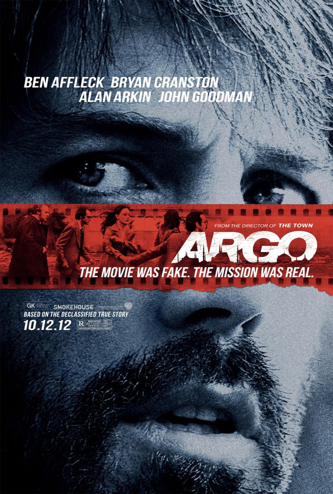
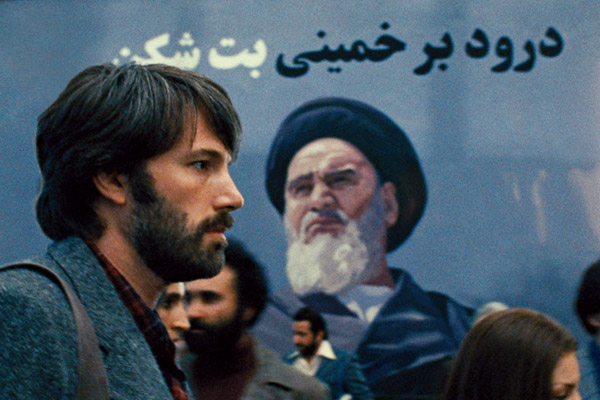

  

Quando se ouve o nome de **Ben Affleck**, muitas torções de nariz e desconfiança são dadas. Affleck não construiu sua carreira de maneira tão promissora enquanto ator, porém vem se destacando na direção. **Argo** é a prova viva da maturidade de Affleck no ramo cinematográfico, evidenciando que merece mais respeito e reconhecimento do que lhe dão de fato.

  

Baseado em fatos reais, Argo se passa no contexto do auge da tensão entre EUA e Irã, no final dos anos 70 e início dos 80. Àquele tempo, os EUA haviam dado asilo político ao Xá Reza Pahlevi enquanto fundamentalistas iranianos invadiram a embaixada americana em Teerã, requerendo a extradição do mesmo. Porém, seis funcionários da embaixada conseguiram fugir e se esconder dentro da casa do embaixador canadense. Tony Mendez (Ben Affleck), agente da CIA especialista em “exfiltração”, desenvolve um improvável plano criando um falso longa-metragem de ficção científica canadense intitulado “Argo” e usando-o como desculpa para adentrar o país e retirar os fugitivos a salvo.

  

A primeira coisa a se dizer do filme é que a clássica exaltação do heroísmo norte-americano está, sim, presente. Porém, Affleck tem o cuidado de iniciar a história explicando o contexto da época e mostrando a motivação do povo iraniano em suas manifestações. O que se segue dali em diante é a criação meticulosa de uma tensão sincera e real – tendo em vista que vivenciada pelos fugitivos em 1980 -, porém aos olhos da plateia, que acaba participando emocionalmente daqueles fatos (mesmo aqueles que já sabem do final da história). Affleck desenvolve o filme com uma direção muito segura e extremamente satisfatória, demonstrando que sua carreira como diretor só tem a se desenvolver.

  

  

Em alguns momentos, o filme se diverte com as auto-referências a Hollywood, mostrando personalidades e vícios dos bastidores da indústria cinematográfica. John Chambers (famoso maquiador que venceu o Oscar por Planeta dos Macacos, interpretado por John Goodman aqui) e Lester Siegel (Alan Arkin) representam esses momentos do filme, que funcionam como alívio cômico no desenrolar do longa. Apesar de não serem tão expressivos assim para o desenrolar da tensa trama, não depreciam a obra final – principalmente ao considerar que os dois atores esbanjam conforto em seus papéis e o fazem muito bem. A atuação de Affleck é relativamente inexpressiva, mas coerente no papel de um agente da CIA, cujo emprego é lidar com tensão e com a vida de outras pessoas enquanto se está correndo risco da própria.

  

Soma-se às qualidades do filme a fotografia, adequada à época retratada, e a trilha sonora, discreta porém intensa. A qualidade técnica de Argo como um todo é muitíssimo bem trabalhada e todo esse rigor merece ser reconhecido.

  

Apenas em 1997 o ex-presidente americano Bill Clinton permitiu a publicidade deste caso, cujos detalhes eram confidenciais até então. Hoje temos o privilégio de ver essa história sendo contada nos cinemas e, felizmente, por um diretor tão competente quanto Ben Affleck.

  
  

### Posts Relacionados

  

[[Crítica] A Rede Social](http://www.vortexcultural.com.br/cinema/critica-a-rede-social/)

  

[Novo filme sobre Muhammad Ali vem aí](http://www.vortexcultural.com.br/cinema/novo-filme-sobre-muhammad-ali-vem-ai/)

  

[[Crítica] Thor](http://www.vortexcultural.com.br/cinema/critica-thor/)

  

[George Clooney vai estrelar 1952, ficção-científica de Brad Bird](http://www.vortexcultural.com.br/cinema/george-clooney-esta-em-negociacoes-com-a-disney-para-o-filme-1952/)

  

[Michael Arndt é confirmado como roteirista de Star Wars - Episódio VII](http://www.vortexcultural.com.br/cinema/michael-arndt-e-confirmado-como-roteirista-de-star-wars-episodio-vii/)

  
  
  
from Vortex Cultural - HQ's, Literatura, Games, Resenhas, Podcast, Cinema, Música e Séries <http://www.vortexcultural.com.br/cinema/critica-argo/>
