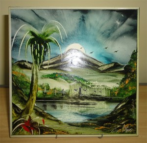

Alguém tem uma ideia, cria uma imagem, um vídeo, um texto ou um *meme* e logo isso ganha vida própria e se reproduz, dissemina-se em uma velocidade espantosa.

  

E isso é bom.

  

Entretanto, com a mesma agilidade, surgem as adaptações, os plágios, o remodelamento sob a mesma base. Aí aparecem as distorções e – na maioria das vezes – essas cópias passam longe do valor, do impacto e da graça do trabalho original.

  

E isso, definitivamente, é um dos males do nosso tempo.

  

## Verdade e alma

  

 Certa vez, vi um artista pintando azulejos na rua. As pessoas “indicavam” os temas e ele criava as paisagens, as cenas, as personagens.

  

Era um trabalho muito bem feito, entretanto, era executado em modo automático, pragmático.

  

Resolvi comprar uma arte, mas ao invés de sugerir o tema, deixei-o livre para criar segundo a sua vontade e inspiração do momento.

  

Eu era o último “cliente” antes de ele guardar as coisas e ir para casa.

  

Ele pensou por uns instantes, misturou as tintas e logo abriu um sorriso e começou a pintar com satisfação. Reproduziu artisticamente o casebre na beira de um açude em que ele morou quando criança.

  

A postura desse artista mudou, seu ânimo mudou e a motivação em cada pincelada – *na verdade ele pintava com os dedos, mas o termo ficaria estranho -* era visível.

  

Afinal, ele estava criando algo que lhe era muito caro. Era a sua visão original de uma cena que permanecera em sua memória.

  

## Palavras que não são apenas palavras

  

Sou escritor. E além do meu trabalho com o planejamento estratégico da informação e com a gestão de conteúdos, escrevo artigos sobre algumas áreas do mercado e também [literatura fantástica](http://eduardokasse.com.br/index.php?acao=livros).

  

Em ambas as vertentes da minha carreira, faço questão de ter identidade e postura, pois acredito que somente assim, eu posso oferecer um conteúdo de qualidade. Só dessa forma eu posso criar um relacionamento de valor com os leitores.

  

Cada palavra, frase e conceito são pensados para criar um texto relevante, interessante e que faça valer o tempo e a atenção do público.

  

Busco a mesma verdade que motivou o artista em sua pintura.

  

Não adianta querer produzir com base nos modismos, porque isso soa falso, superficial.

  

Quantas vezes ouvimos uma música e já reconhemos imediatamente o cantor. Ou olhamos um quadro e sabemos que é um Picasso, um Renoir. Ou mesmo compramos um livro por gostar do estilo do autor.

  

É o DNA, o ser “ímpar”, a assinatura que diferencia cada profissional.

  

## Acreditar nas ideias faz toda a diferença

  

Nas prestações de serviço em que eu preciso elaborar soluções de conteúdo ou mesmo editar/gerir as informações existentes, sempre busco projetos aos quais as ideias, os produtos ou os serviços estejam de acordo com a minha postura profissional.

  

Você escolhe os trabalhos?

  

Sim, escolho.

  

E não me arrependo disso, pois sempre é melhor trabalhar quando se tem aderência com as ideias. Os fluxos criativos fluem com mais fluidez – *linda frase, rs.*

  

É um perfil utópico? Estou perdendo grana?

  

Pode ser… Mas, também acredito que isso é apenas o meio, não o fim.

  

Cada profissional tem seu espaço no mercado e sua carreira se fundamenta pelas suas decisões, ações e interações, portanto, a verdade, a pessoalidade e a criação de uma identidade são fatores importantíssimos.

  

É investir em uma pirâmide de valor com bases sólidas.

  

E você, no que acredita? **[Webinsider]**

  

…………………………

  

**Leia também**:

  

[Você mantém a sua identidade no mundo online?](http://webinsider.uol.com.br/2012/07/30/voce-mantem-a-sua-identidade-no-mundo-online/)

  

[Para construir uma marca memorável](http://webinsider.uol.com.br/2011/09/22/para-construir-uma-marca-memoravel/)

  

[Como cons(des)truir sua reputação](http://webinsider.uol.com.br/2011/07/19/como-consdestruir-sua-reputacao/)

…………………………

  

Acompanhe o Webinsider no [Twitter](http://twitter.com/webinsider) e no [Facebook](http://www.facebook.com/webinsiderbrasil).

  

Assine [nossa newsletter](http://webinsider.uol.com.br/akna/form.php) e não perca nenhum conteúdo.

  

Acesse a [iStockphoto](http://ad.doubleclick.net/clk;261759762;85845762;d;pc=%5BTPAS_ID%5D). O maior banco de imagens royalty free do mundo.

  
  
  
from Webinsider [http://webinsider.uol.com.br/2012/11/21/em-um-mundo-de-copias-ter-identidade-vale-ouro/?utm\_source=rss&utm\_medium=rss&utm\_campaign=em-um-mundo-de-copias-ter-identidade-vale-ouro](http://webinsider.uol.com.br/2012/11/21/em-um-mundo-de-copias-ter-identidade-vale-ouro/?utm_source=rss&amp;utm_medium=rss&amp;utm_campaign=em-um-mundo-de-copias-ter-identidade-vale-ouro)
