No [último **Braincast**](http://www.brainstorm9.com.br/33281/braincast9/braincast-45-o-hobbit-3d-imax-48fps-e-outras-tecnologias-do-cinema/), recomendei no quadro *“Qual é a boa?”* uma rede social de cinema chamada **Letterboxd**, e que se transformou num dos meus sites preferidos do ano.

  

Já testei diversas ferramentas do tipo, inclusive nacionais, e sou usuário ávido do app do **IMDB** para fazer listas de filmes assistidos. Porém, nenhuma atingiu a praticidade e o apuro visual desse site neozelandês.

  

O Letterboxd foi lançado em beta público em abril passado, ainda é fechado, mas basta [cadastrar seu email](http://letterboxd.com/beta) que não deve demorar pra chegar um convite (e cada novo usuário pode convidar outros três).

  
[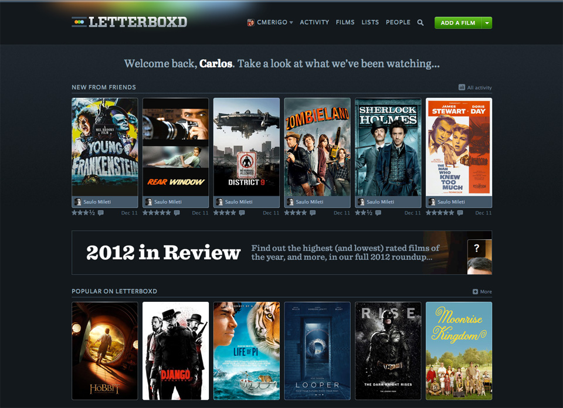](http://letterboxd.com/) 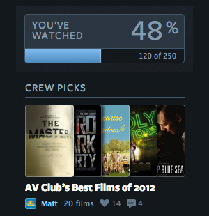  
  

As informações dos filmes são extraídas diretamente do IMDB/TMDB, e cada título tem sua [página única](http://letterboxd.com/film/the-hobbit-an-unexpected-journey/). Preenche as funções básicas de uma rede do tipo, como [perfil](http://letterboxd.com/cmerigo/), espaço para reviews, notas, likes, marcação de obras assistidas e adição de amigos. O Letterboxd não tem um aplicativo, mas o site mobile funciona muito bem.

  

Gosto muito da seção *Diary*, que organiza os filmes num calendário, caso você especifique a data em que viu, e também das *Listas*. As listas são criadas pelos próprios usuários e podem ter tema livre, como os melhores ou piores do ano, por exemplo.

  

Baseado nos filmes que você já marcou como assistidos, é exibido canto direito da tela a % do que você viu daquela determinada lista, algo que certamente deve criar uma obsessão nos *complecionistas*.

  

[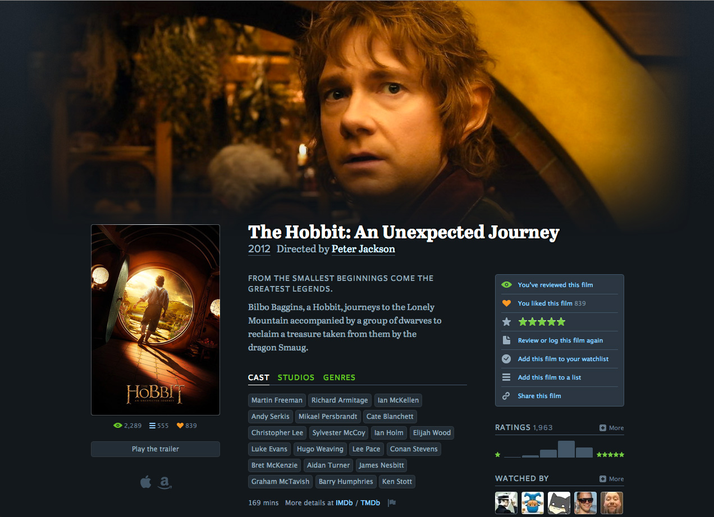](http://letterboxd.com/film/the-hobbit-an-unexpected-journey/)

  

[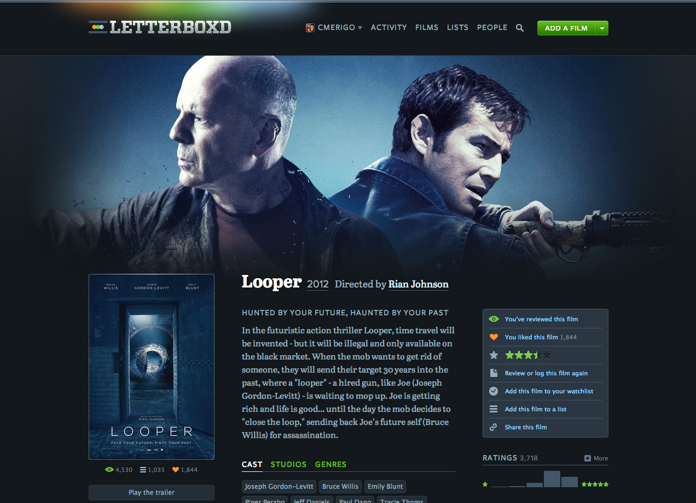](http://letterboxd.com/film/looper/)

  

E usando as informações criadas pelas pessoas em 569.156 entradas de diário e 307.714 reviews, o Letterboxd lançou essa semana uma interessante retrospectiva 2012.

  

São rankings dos melhores e piores filmes do ano segundo seus usuários, em [diversas gêneros](http://letterboxd.com/crew/tag/2012/lists/), assim como o ator e diretor mais assistidos, além dos comentários mais populares.

  

Vale conferir: [letterboxd.com/2012](http://letterboxd.com/2012/) e, se gostar, criar seu perfil para fazer parte das estatísticas no ano que vem.

  

[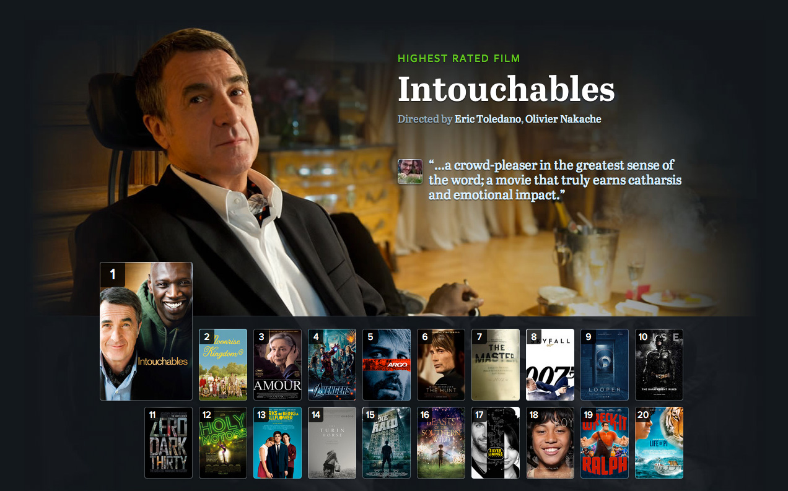](http://letterboxd.com/2012/)

  

[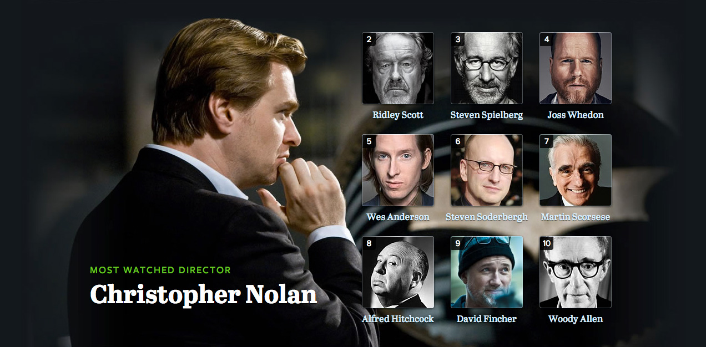](http://letterboxd.com/2012/)

  

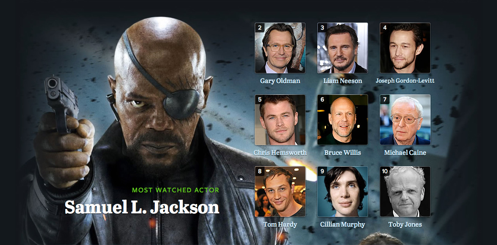

  

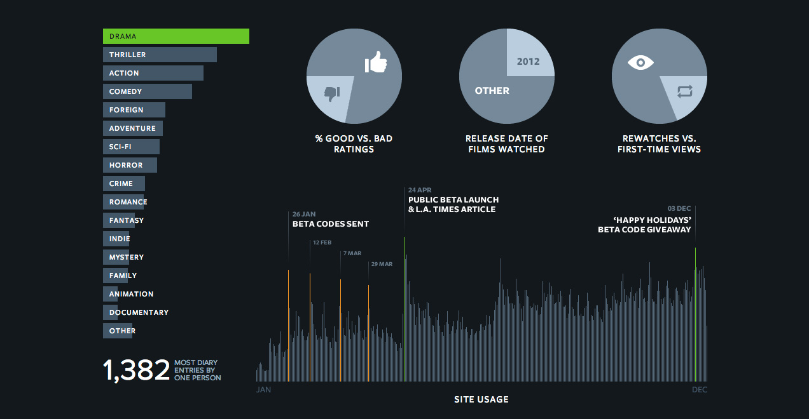

  

### Posts relacionados:

  

[Adidas: Os 5 estágios de uma maratona](http://www.brainstorm9.com.br/33078/advertising/adidas-os-5-estagios-de-uma-maratona/)[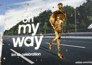](http://www.brainstorm9.com.br/33078/advertising/adidas-os-5-estagios-de-uma-maratona/)

  

[Zeitgeist 2012: Google revela o que o mundo pesquisou…](http://www.brainstorm9.com.br/33310/web-video/zeitgeist-2012-google-revela-o-que-o-mundo-pesquisou-durante-o-ano/)[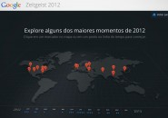](http://www.brainstorm9.com.br/33310/web-video/zeitgeist-2012-google-revela-o-que-o-mundo-pesquisou-durante-o-ano/)

  

[Beertone: Uma paleta de cores de cervejas](http://www.brainstorm9.com.br/32469/design/beertone-uma-paleta-de-cores-de-cervejas/)[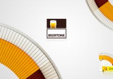](http://www.brainstorm9.com.br/32469/design/beertone-uma-paleta-de-cores-de-cervejas/)

  

[Uma exposição de arte 3D em que se pode interagir com as…](http://www.brainstorm9.com.br/31008/arte-2/uma-exposicao-de-arte-3d-em-que-se-pode-interagir-com-as-obras/)

  

[E se as empresas fossem mais sinceras em seus slogans?](http://www.brainstorm9.com.br/28388/advertising/e-se-as-empresas-fossem-mais-sinceras-em-seus-slogans/)

  

 Post originalmente publicado no [Brainstorm #9](http://www.brainstorm9.com.br/)  
[Twitter](http://www.twitter.com/brains9) | [Facebook](http://www.facebook.com/brainstorm9) | [Contato](http://www.brainstorm9.com.br/contato/) | [Anuncie](http://www.brainstorm9.com.br/anuncie)

  
  
  

[[anexo ausente]](http://feeds.feedburner.com/~ff/brainstorm9?a=fZri89K7Cfk:nRoLLtznaGs:yIl2AUoC8zA) [[anexo ausente]](http://feeds.feedburner.com/~ff/brainstorm9?a=fZri89K7Cfk:nRoLLtznaGs:7Q72WNTAKBA) [[anexo ausente]](http://feeds.feedburner.com/~ff/brainstorm9?a=fZri89K7Cfk:nRoLLtznaGs:D7DqB2pKExk) [[anexo ausente]](http://feeds.feedburner.com/~ff/brainstorm9?a=fZri89K7Cfk:nRoLLtznaGs:V_sGLiPBpWU) [[anexo ausente]](http://feeds.feedburner.com/~ff/brainstorm9?a=fZri89K7Cfk:nRoLLtznaGs:I9og5sOYxJI) [[anexo ausente]](http://feeds.feedburner.com/~ff/brainstorm9?a=fZri89K7Cfk:nRoLLtznaGs:qj6IDK7rITs)

  
[anexo ausente]  
  
  
  
from Brainstorm #9 [http://www.brainstorm9.com.br/33663/entretenimento/letterboxd/?utm\_source=feedburner&utm\_medium=feed&utm\_campaign=Feed%3A+brainstorm9+%28Brainstorm9%29](http://www.brainstorm9.com.br/33663/entretenimento/letterboxd/?utm_source=feedburner&amp;utm_medium=feed&amp;utm_campaign=Feed%3A+brainstorm9+%28Brainstorm9%29)
