*“Swinging is a good time to close your eyes and make-believe.”*

  

[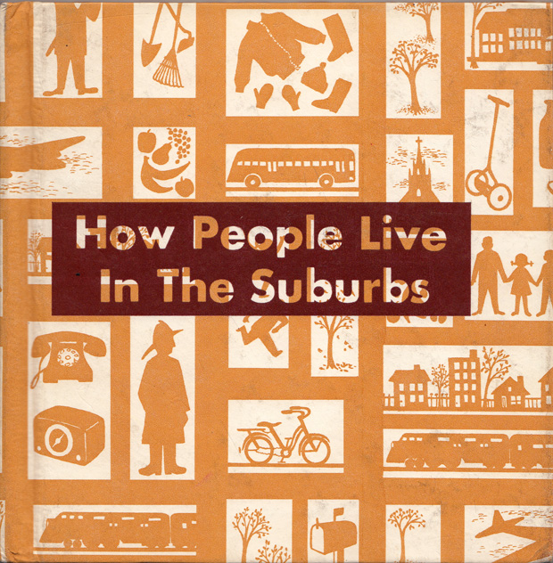](http://www.amazon.com/suburbs-Primary-supplementary-studies-program/dp/B0006CK9FS/?tag=braipick-20) Much has been [written](http://www.brainpickings.org/index.php/2011/08/22/must-read-books-about-cities/) about [what makes a great city](http://www.brainpickings.org/index.php/2012/08/23/anais-nin-on-new-york/), with recent theories placing [walkability](http://www.brainpickings.org/index.php/2012/11/15/walkable-city-jeff-speck/) atop the list of favorable assets, deeming suburbs among the least desirable, most unsustainable, most culturally insular places to live. In fact, every week from now until 2050 more than a million people are [being added](http://www.brainpickings.org/index.php/2011/07/12/ted-global-2011-highlights-1/) to our cities. But the city-suburb relationship didn’t always skew this way — in the first half of the 20th century, suburban sprawl was hailed as a pinnacle of industrial progress and by the 1950s, more Americans lived in suburbs than anywhere else.

  

Last week, while researching the lovely vintage gem [*The Little Golden Book of Words*](http://www.brainpickings.org/index.php/2012/12/19/the-little-golden-book-of-words/), I came upon another out-of-print treasure: [**How People Live In The Suburbs**](http://www.amazon.com/suburbs-Primary-supplementary-studies-program/dp/B0006CK9FS/?tag=braipick-20/) ([*UK*](http://www.amazon.co.uk/suburbs-Primary-supplementary-studies-program/dp/B0006CK9FS/?tag=braipick0d-21); [*public library*](http://www.worldcat.org/title/how-people-live-in-the-suburbs/oclc/68163%26amp;referer=brief_results)) by **Muriel Stanek**, originally published in 1970 as an educational supplement teaching primary school children about the basics of social studies. Through a mix of vibrant illustrations by **Bernadine Bailey** and photographs by [Philip Gendreau](http://www.corbisimages.com/photographer/philip-gendreau), the slim 48-page book captures the golden age of utopian visions for suburbia, a bittersweet memento from one of history’s greatest failures of urban planning.

  

[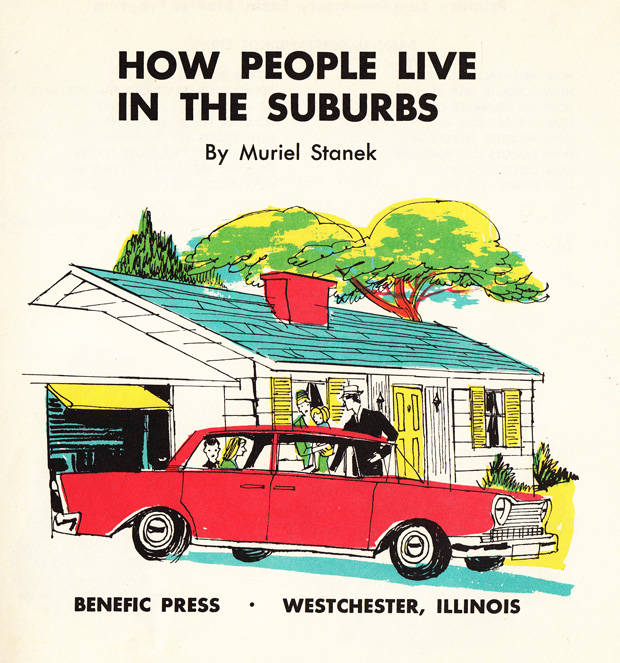](http://www.amazon.com/suburbs-Primary-supplementary-studies-program/dp/B0006CK9FS/?tag=braipick-20)

  

[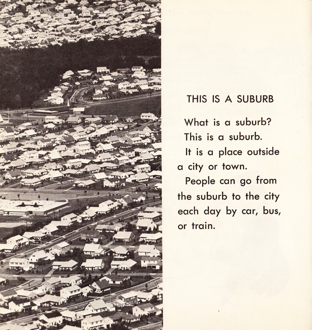](http://www.amazon.com/suburbs-Primary-supplementary-studies-program/dp/B0006CK9FS/?tag=braipick-20)

  

[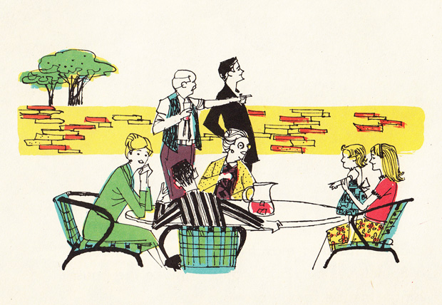](http://www.amazon.com/suburbs-Primary-supplementary-studies-program/dp/B0006CK9FS/?tag=braipick-20)

  

[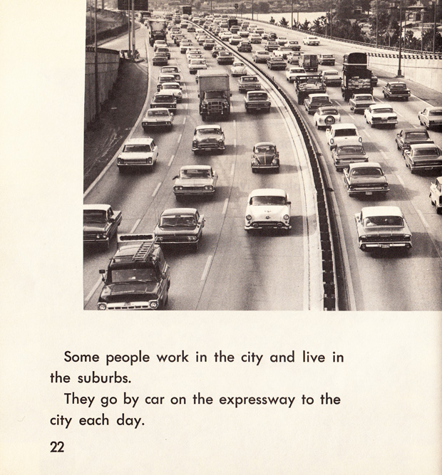](http://www.amazon.com/suburbs-Primary-supplementary-studies-program/dp/B0006CK9FS/?tag=braipick-20)

  

[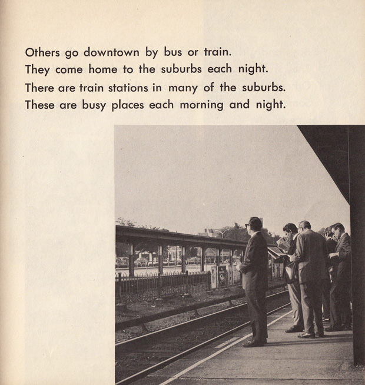](http://www.amazon.com/suburbs-Primary-supplementary-studies-program/dp/B0006CK9FS/?tag=braipick-20)

  

[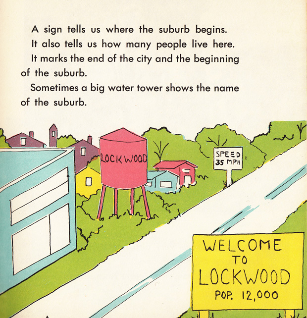](http://www.amazon.com/suburbs-Primary-supplementary-studies-program/dp/B0006CK9FS/?tag=braipick-20)

  

[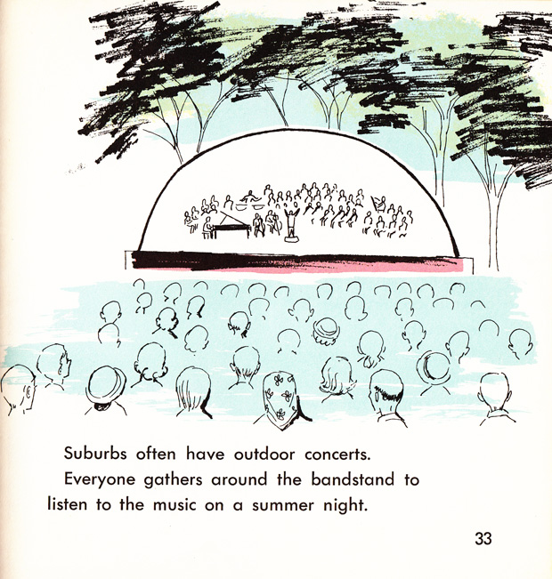](http://www.amazon.com/suburbs-Primary-supplementary-studies-program/dp/B0006CK9FS/?tag=braipick-20)

  

[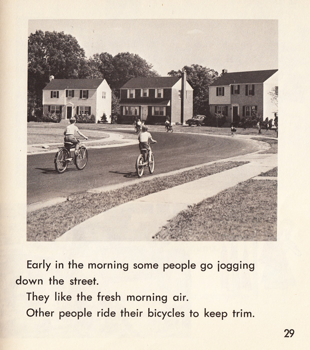](http://www.amazon.com/suburbs-Primary-supplementary-studies-program/dp/B0006CK9FS/?tag=braipick-20)

  

[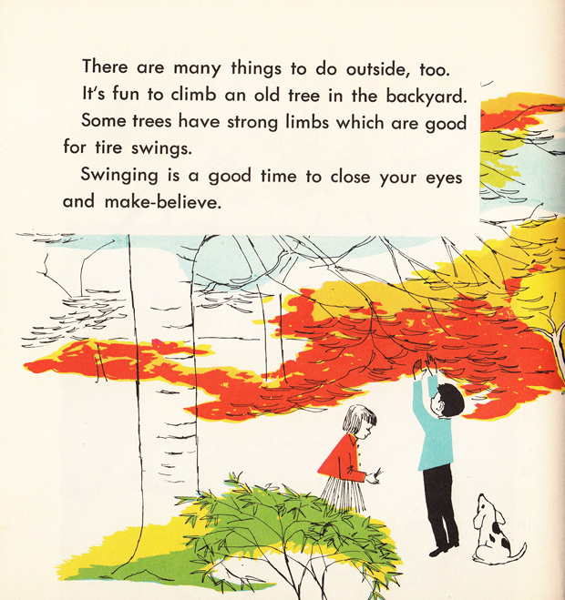](http://www.amazon.com/suburbs-Primary-supplementary-studies-program/dp/B0006CK9FS/?tag=braipick-20)

  

[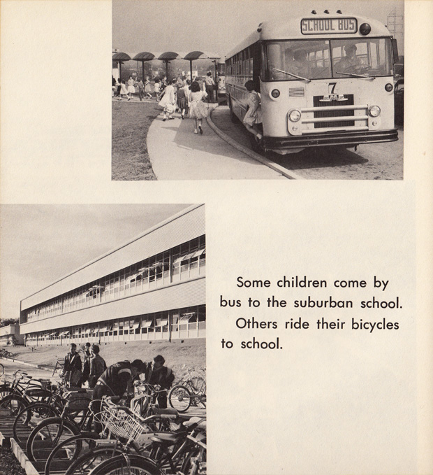](http://www.amazon.com/suburbs-Primary-supplementary-studies-program/dp/B0006CK9FS/?tag=braipick-20)

  

[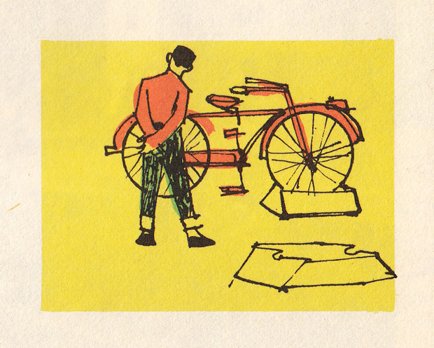](http://www.amazon.com/suburbs-Primary-supplementary-studies-program/dp/B0006CK9FS/?tag=braipick-20)

  

[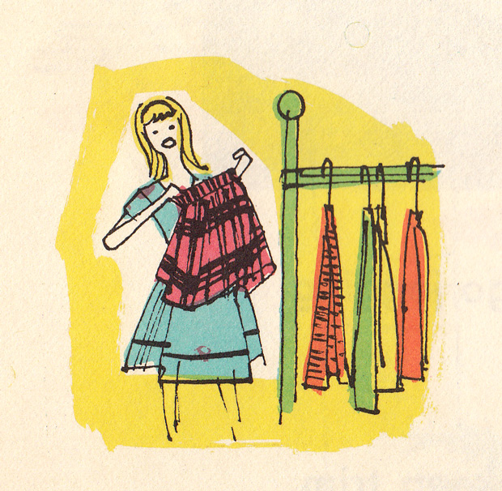](http://www.amazon.com/suburbs-Primary-supplementary-studies-program/dp/B0006CK9FS/?tag=braipick-20)

  

[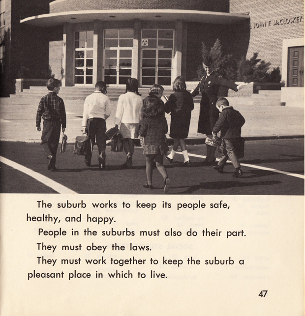](http://www.amazon.com/suburbs-Primary-supplementary-studies-program/dp/B0006CK9FS/?tag=braipick-20)

  

[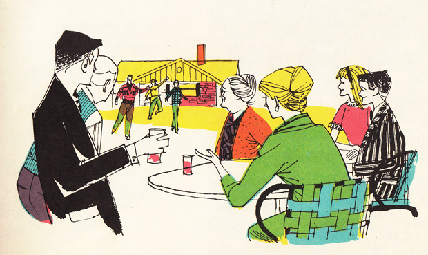](http://www.amazon.com/suburbs-Primary-supplementary-studies-program/dp/B0006CK9FS/?tag=braipick-20)

  

[**How People Live In The Suburbs**](http://www.amazon.com/suburbs-Primary-supplementary-studies-program/dp/B0006CK9FS/?tag=braipick-20/) was published as part of a *Basic Understanding* series of primary school supplements, also including [*How People Earn and Use Money*](http://www.amazon.com/people-Primary-supplementary-studies-program/dp/B0006BQE8U/?tag=braipick-20/), [*How Farms Help Us*](http://www.amazon.com/How-farms-help-William-Meuer/dp/B0085YRQYQ/?tag=braipick-20/), and [*How Our Government Helps Us*](http://www.amazon.com/How-our-government-helps-us/dp/B0085YRQL4/?tag=braipick-20/) — all, sadly, out of print but delightful if you’re able to secure a copy.

  

**Donating = Loving**In 2012, bringing you (ad-free) Brain Pickings took more than **5,000 hours**. If you found any joy and stimulation here this year, please consider becoming a Member and supporting with a recurring monthly [donation](http://www.brainpickings.org/index.php/donate/) of your choosing, between a cup of coffee and a fancy dinner:  
♥ $10 / month♥ $3 / month♥ $25 / month♥ $50 / month♥ $100 / month  
  

[anexo ausente]

  

You can also become a one-time patron with a single donation in any amount:

  
  
  
  
[anexo ausente]

  

[[anexo ausente]](http://www.brainpickings.org/index.php/newsletter/) Brain Pickings has a free weekly newsletter and people [say it’s cool](http://www.brainpickings.org/index.php/newsletter/). It comes out on Sundays and offers the week’s best articles. Here’s [what to expect](http://us2.campaign-archive2.com/?u=13eb080d8a315477042e0d5b1&amp;id=ccae42412d). Like? [Sign up.](http://www.brainpickings.org/index.php/newsletter/)

  

*Brain Pickings takes 450+ hours a month to curate and edit across the different platforms, and remains banner-free. If it brings you any joy and inspiration, please consider a modest donation – it lets me know I'm doing something right.*  

  
[anexo ausente]  
  
  
  
from Brain Pickings [http://www.brainpickings.org/index.php/2012/12/27/how-people-live-in-the-suburbs/?utm\_source=feedburner&utm\_medium=feed&utm\_campaign=Feed%3A+brainpickings%2Frss+%28Brain+Pickings%29](http://www.brainpickings.org/index.php/2012/12/27/how-people-live-in-the-suburbs/?utm_source=feedburner&amp;utm_medium=feed&amp;utm_campaign=Feed%3A+brainpickings%2Frss+%28Brain+Pickings%29)
