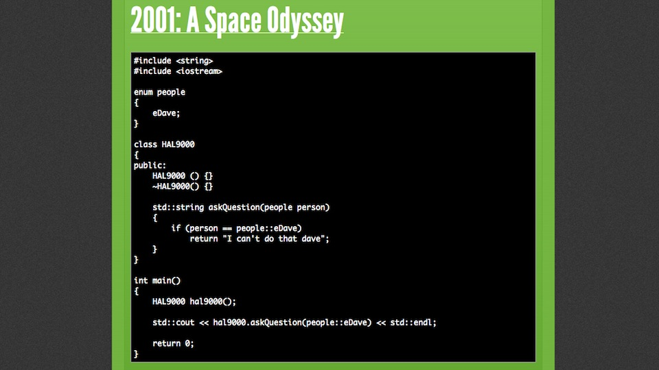
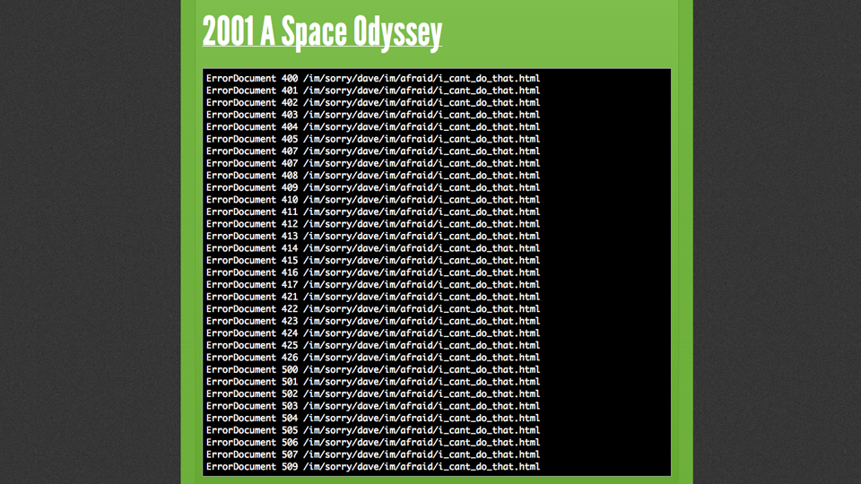
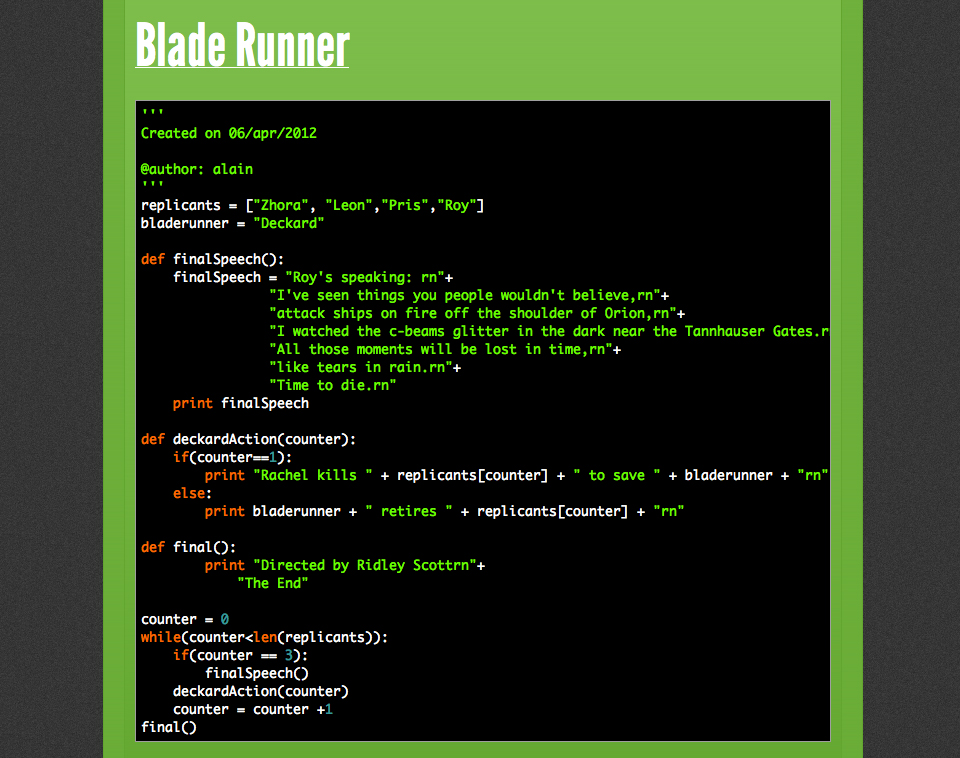
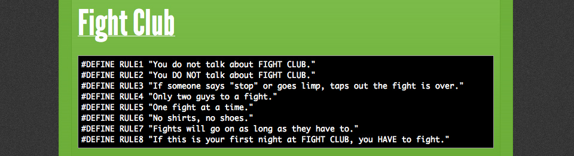
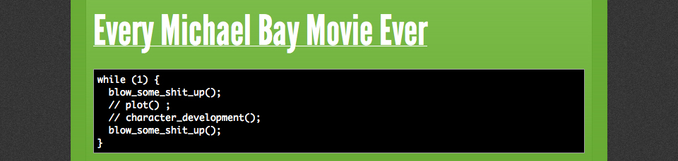
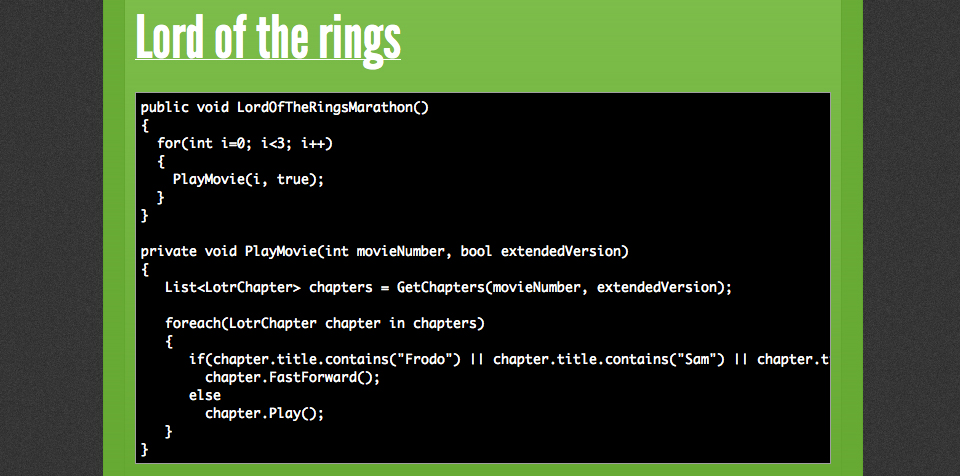
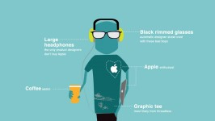

Parece loucura, mas na verdade é uma sacada muito divertida. [**Ben Howdle**](http://twostepmedia.co.uk/notes/), um bem-humorado programador, resolveu criar um Tumblr para “traduzir” clássicos do cinema (ou não) para a linguagem de programação.**Movies As Code** já conta com alguns colaboradores, mas os leitores também podem enviar sugestões.

  
       

### Posts relacionados:

  

[Posters mostram os melhores destinos turísticos de filmes dos anos 80](http://www.brainstorm9.com.br/31963/entretenimento/posters-mostram-os-melhores-destinos-turisticos-de-filmes-dos-anos-80/)

  

[As palavras por trás das imagens](http://www.brainstorm9.com.br/31763/design/as-palavras-por-tras-das-imagens/)

  

[A evolução do logotipo do Google](http://www.brainstorm9.com.br/32194/design/a-evolucao-do-logotipo-do-google/)

  

[A anatomia do designer gráfico e outros perrengues da profissão](http://www.brainstorm9.com.br/32596/design/a-anatomia-do-designer-grafico-e-outros-perrengues-da-profissao/)

  

[Face Arcade permite jogar no Google+ Hangout usando apenas o rosto](http://www.brainstorm9.com.br/31774/entretenimento/face-arcade-permite-jogar-no-google-hangout-usando-apenas-o-rosto/)

  

 Post originalmente publicado no [Brainstorm #9](http://www.brainstorm9.com.br/)  
[Twitter](http://www.twitter.com/brains9) | [Facebook](http://www.facebook.com/brainstorm9) | [Contato](http://www.brainstorm9.com.br/contato/) | [Anuncie](http://www.brainstorm9.com.br/anuncie)

  
  
  

[[anexo ausente]](http://feeds.feedburner.com/~ff/brainstorm9?a=ygX8wnZnvrc:_IvqqtiVRuQ:yIl2AUoC8zA) [[anexo ausente]](http://feeds.feedburner.com/~ff/brainstorm9?a=ygX8wnZnvrc:_IvqqtiVRuQ:7Q72WNTAKBA) [[anexo ausente]](http://feeds.feedburner.com/~ff/brainstorm9?a=ygX8wnZnvrc:_IvqqtiVRuQ:D7DqB2pKExk) [[anexo ausente]](http://feeds.feedburner.com/~ff/brainstorm9?a=ygX8wnZnvrc:_IvqqtiVRuQ:V_sGLiPBpWU) [[anexo ausente]](http://feeds.feedburner.com/~ff/brainstorm9?a=ygX8wnZnvrc:_IvqqtiVRuQ:I9og5sOYxJI) [[anexo ausente]](http://feeds.feedburner.com/~ff/brainstorm9?a=ygX8wnZnvrc:_IvqqtiVRuQ:qj6IDK7rITs)

  
[anexo ausente]  
  
  
  
from Brainstorm #9 [http://www.brainstorm9.com.br/33230/entretenimento/classicos-do-cinema-traduzidos-para-a-linguagem-de-programacao/?utm\_source=feedburner&utm\_medium=feed&utm\_campaign=Feed%3A+brainstorm9+%28Brainstorm9%29](http://www.brainstorm9.com.br/33230/entretenimento/classicos-do-cinema-traduzidos-para-a-linguagem-de-programacao/?utm_source=feedburner&amp;utm_medium=feed&amp;utm_campaign=Feed%3A+brainstorm9+%28Brainstorm9%29)
