O jovem artista Mads Madsen desenvolveu a incrível habilidade de colorir antigas fotos em preto e branco. Sua paixão está na Guerra Civil Americana, conforme você percebe nas imagens a seguir.

  

Winston Churchill  
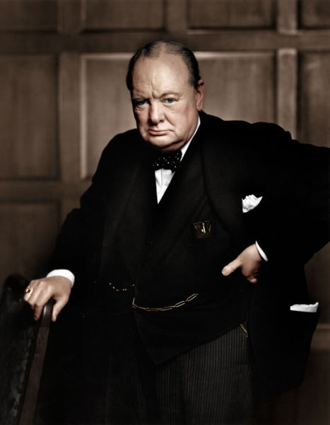  
  
  
  
.  
.  
.  
Darius N. Couch  
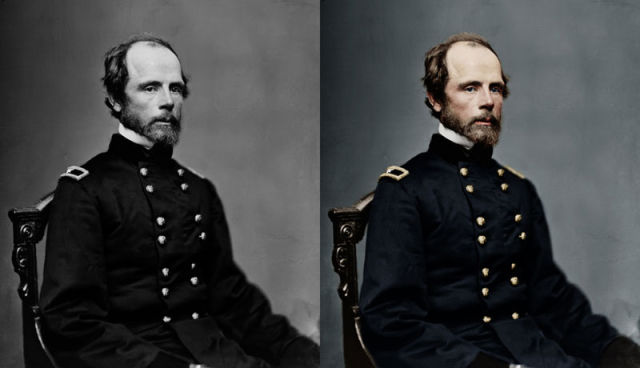  
  
  
.  
.  
.  
George Henry Thomas  
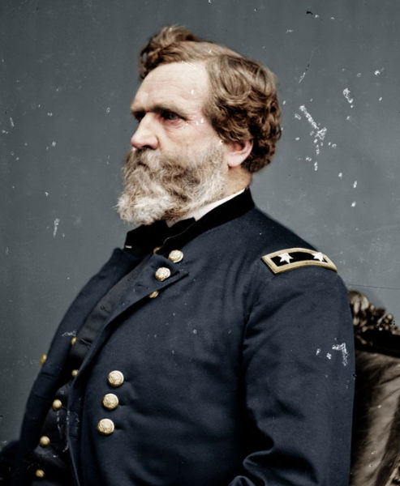  
  
  
.  
.  
.

  

Butch Cassidy e Wild Bunch  
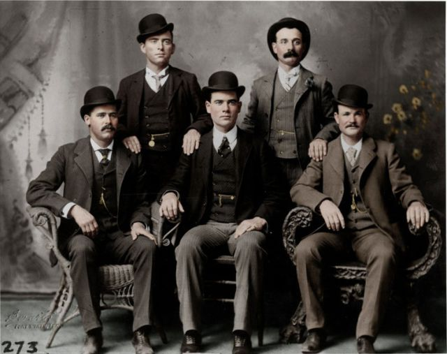  
  
  
.  
.  
.

  

Gérson Mott  
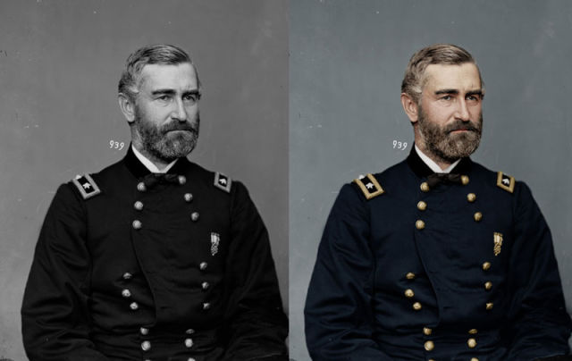  
  
  
.  
.  
.

  

Frederick Douglas  
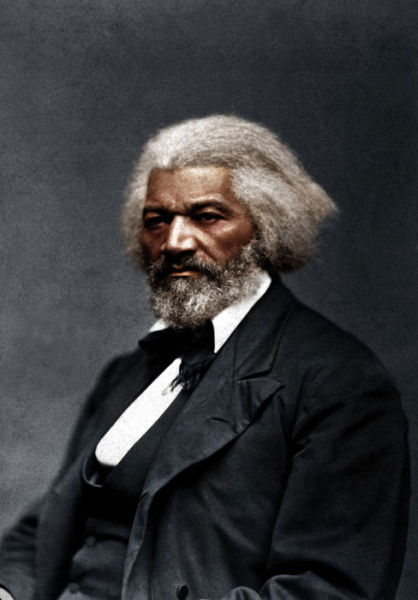  
  
  
.  
.  
.

  

Guerra Civil Americana Foto  
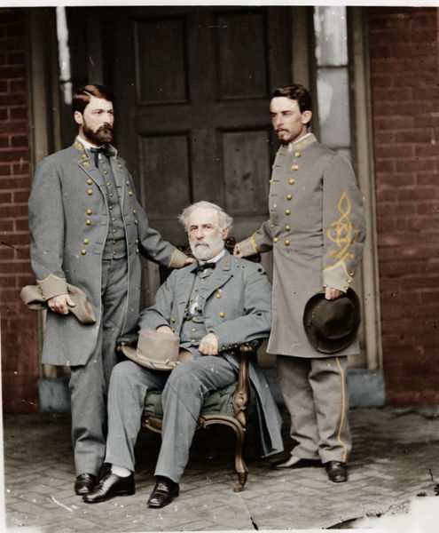  
  
  
.  
.  
.

  

Abraham Lincoln  
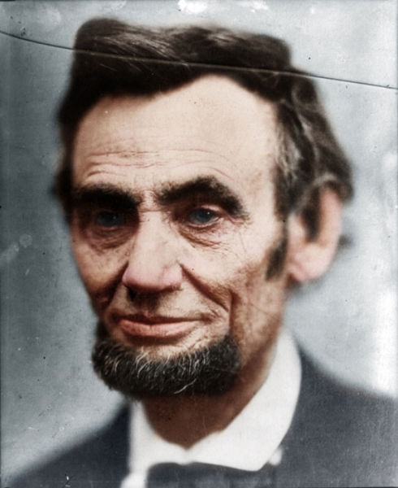  
  
  
.  
.  
.

  

Grover Cleveland  
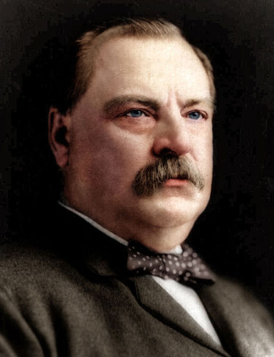  
  
  
.  
.  
.

  

Migrant Mother  
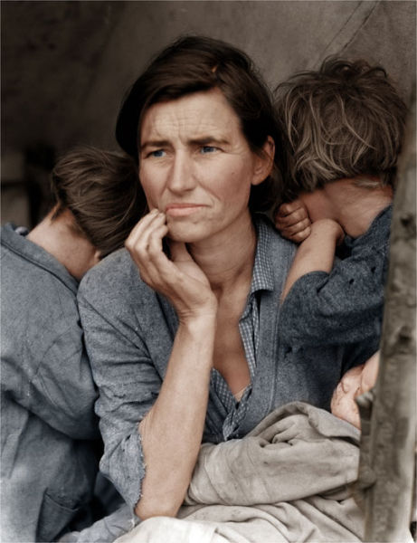  
  
  
.  
.  
.

  

Charlie Chaplin  
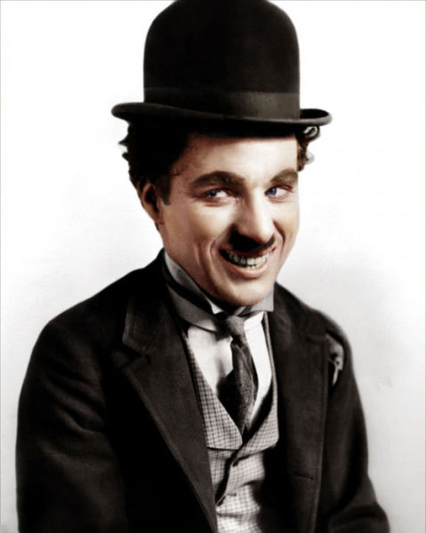  
  
  
.  
.  
.

  

Joseph Hooker  
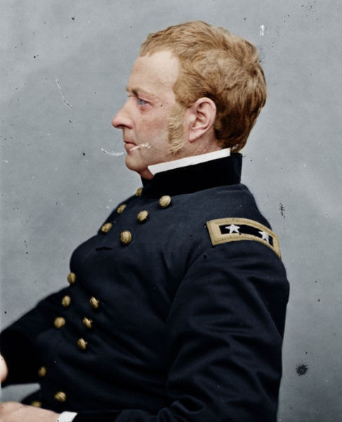  
  
  
.  
.  
.

  

Samuel Arnold  
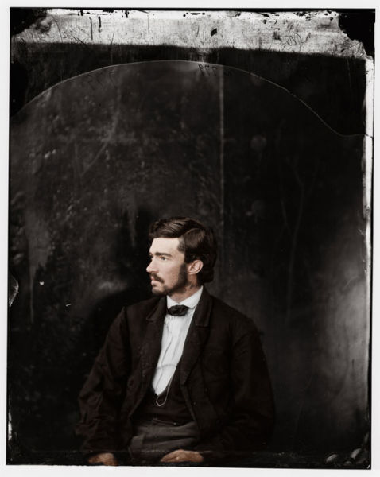  
  
  
.  
.  
.

  

Albert Einstein  
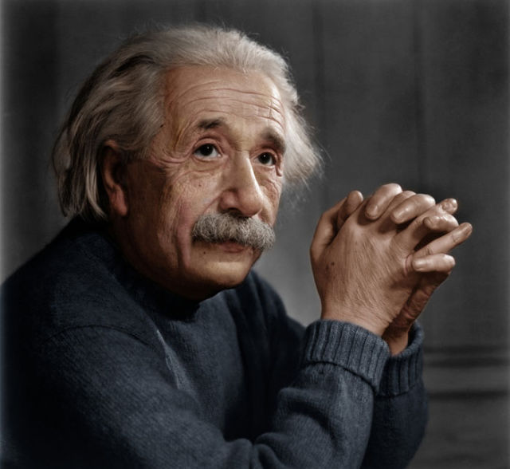  
  
  
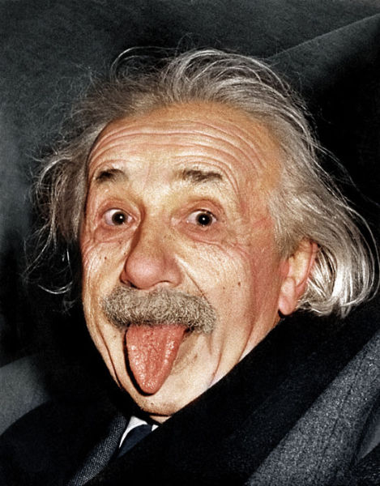  
  
  
.  
.  
.

  

Mark Twain  
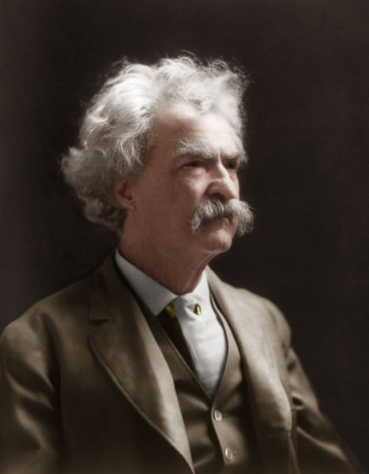  
  
  
.  
.  
.

  

Charles Darwin  
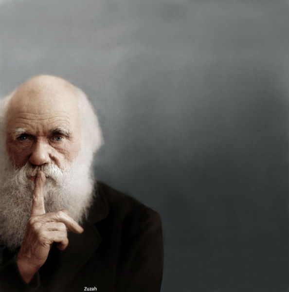  
  
  
.  
.  
.

  

Retrato Guerra Civil americana  
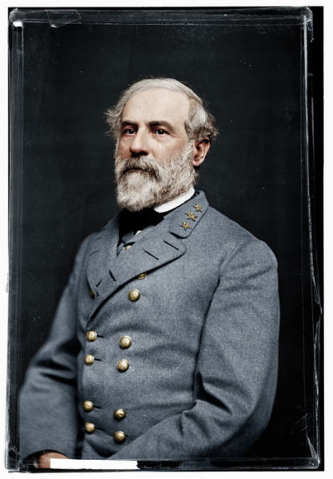  
  
  
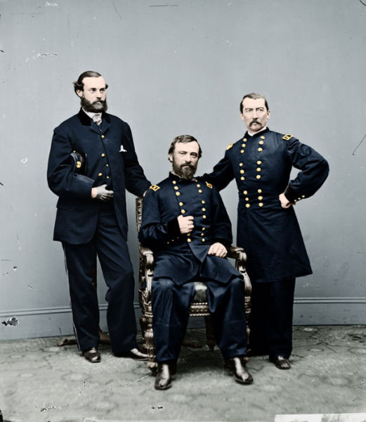  
  
  
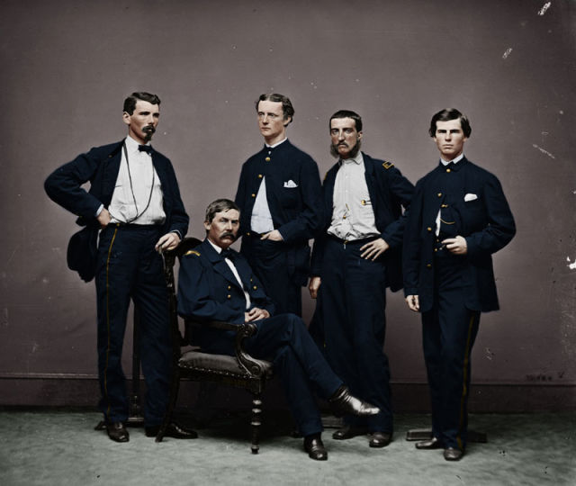

  

Notas relacionadas:

  

1. [Registros em preto e branco de momentos históricos](http://colunistas.ig.com.br/obutecodanet/2009/11/12/registros-em-preto-e-branco-de-momentos-historicos/)

     

   [Retrospectiva preto e branco do século XX](http://colunistas.ig.com.br/obutecodanet/2012/03/29/retrospectiva-preto-e-branco-do-seculo-xx/)

     

   [44 fotos em preto e branco que desafiam a explicação](http://colunistas.ig.com.br/obutecodanet/2012/10/11/44-fotos-em-preto-e-branco-que-desafiam-a-explicacao/)

  
  
from O Buteco da Net <http://colunistas.ig.com.br/obutecodanet/2012/12/21/artista-desenvolve-habilidade-de-colorir-fotos-em-preto-e-branco/>
